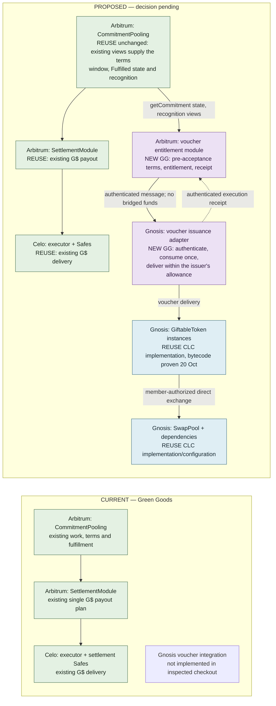

# Cosmo-Local architecture alignment — first pass

**As of:** 20 October 2026 UTC / 19 October Pacific. **Status:** research-backed proposal;
Claude's second-pass [review](handoffs/claude-architecture-review-results.md) recommended the no-core-upgrade boundary recorded below, and
Afo accepted it on 20 October as the PRD-1315 candidate. Afo's voucher-direction decisions of
21 October are recorded in the [spec](spec.md#voucher-direction-decided-2026-10-21). No implementation or deployment
authorized.

**Current scope:** the [spec](spec.md) and [acceptance checks](eval.md) record the later
implementation decisions, member-owned issuer model and PRD-1317 recovery scope. The alternatives
below remain historical. Earned delivery uses finite reserve allowance; the adapter has no
mint/writer fallback.

**Accepted user intent:** one Green Goods commitment can receive both vouchers and G$, with both
terms agreed at commitment acceptance.
The earlier several-G$-installments interpretation is withdrawn. The original four goals remain:
Gnosis integration, the Tech and Sun story, PWA/admin cohesion, and a public Q4 strategy.

## The recommendation in plain language

Keep one commitment and one account of the work completed. Attach the agreed voucher entitlement
to that commitment, alongside any existing G$ consideration. After eligible fulfillment, the
G$ path pays on Celo and a separate authorization causes vouchers to be issued on Gnosis.
Track each result independently. The work stays fulfilled even if one reward is delayed.

For example, a commitment could promise **100 G$ plus 10 Tech and Sun service-voucher units**.
These are illustrative quantities, not agreed issuer prices or a conversion rate. When work is
confirmed, the two deliveries can complete in either order. Receiving those vouchers is distinct
from later attending and confirming the service they represent.

This preserves the initial issuer-service intention: contribution earns access to useful services;
supporters can separately purchase access. It does not require several G$ payments, a token bridge,
a new exchange protocol, or a universal accounting currency.

**Accepted product decision:** voucher and G$ terms bind at acceptance.
**Accepted PRD-1315 candidate (20 October):** a dedicated voucher entitlement module on Arbitrum
and a restricted issuer adapter on Gnosis, with no CommitmentPooling upgrade. The module reads the
existing views (`getCommitment`, `isEligibleContributor`, `validateRecognitionSnapshot`), registers
voucher terms only while the commitment is still Offered or Requested, and issues only on
`Fulfilled`, the same gate the G$ rail uses. The existing G$ settlement contracts stay unchanged.
The issuer's budget is enforced by the token through an ERC20 allowance from the issuer's reserve
(proposed default) rather than a GiftableToken writer role, and the adapter writes no pool limits.

## Evidence and freshness

| Finding | Classification and source |
|---|---|
| The official protocol reference describes v1.1.0. Stateful instances can share implementations; ownership and proxy administration differ. | **ESTABLISHED** — [overview](https://docs.cosmolocal.credit/protocol/overview/), read 20 October |
| Voucher minting is a writer permission; burning is owner-only. Pool swaps and issuer service delivery are different operations. The bounded swap includes minimum output and deadline. | **ESTABLISHED** — [smart contracts](https://docs.cosmolocal.credit/protocol/smart-contracts/) |
| Route discovery does not execute swaps. Pool inventory, limits and governance remain local to each pool. | **ESTABLISHED** — [network](https://docs.cosmolocal.credit/protocol/network/) |
| Voucher, token, Offering, presentment, fulfillment and discharge have different meanings. A listing or transfer does not prove real-world delivery. | **ESTABLISHED** — [concepts](https://docs.cosmolocal.credit/introduction/concepts/) |
| v1.1.0 resolves to commit `ce090fd3d5a7493c726fb939da39af15ef1c9d7c`, but its README's deployment table is labeled Gnosis v1.0.0. The listed security report is an internal review, not independent certification. | **CORRECTED, then ESTABLISHED on 20 October**: [pinned README](https://github.com/cosmo-local-credit/protocol/blob/ce090fd3d5a7493c726fb939da39af15ef1c9d7c/README.md). The tag compare is one commit touching only OracleRelay, docs and tooling, and the deployed GiftableToken, SwapPool, Limiter and ERC1967Factory code matches the published v1.0.0 artifacts byte for byte ([evidence](handoffs/claude-conformance-evidence-2026-10-20.md)); the metadata records solc 0.8.34, not the README's 0.8.36. Other implementations remain unchecked; the security report remains an internal review. |
| The protocol specifies mint, writer, pool and deployment interfaces; it does not supply Green Goods commitment authorization or an Arbitrum-to-Gnosis fulfillment proof. | **ESTABLISHED** interface coverage; **INFERRED** integration boundary — [pinned SPEC](https://github.com/cosmo-local-credit/protocol/blob/ce090fd3d5a7493c726fb939da39af15ef1c9d7c/docs/SPEC.md), [DEPLOY](https://github.com/cosmo-local-credit/protocol/blob/ce090fd3d5a7493c726fb939da39af15ef1c9d7c/docs/DEPLOY.md) |
| Green Goods has one consideration structure and one stable G$ payout-plan pointer per commitment. | **ESTABLISHED** current source — [interface](../../../packages/contracts/src/interfaces/ICommitmentPoolingModule.sol#L95), [commitment](../../../packages/contracts/src/interfaces/ICommitmentPoolingModule.sol#L197), [plan creation](../../../packages/contracts/src/lib/Settlement/PlanLib.sol#L139). This restriction need not prohibit a separate voucher entitlement. |
| Ordinary/fallback fulfillment emits provenance, while dispute fulfillment takes a separate code path. There is no unified stored fulfillment receipt in the inspected commitment structure. | **ESTABLISHED** source — [CreditLib](../../../packages/contracts/src/lib/CommitmentPooling/CreditLib.sol#L232), [TerminalLib](../../../packages/contracts/src/lib/CommitmentPooling/TerminalLib.sol#L222). A getter for another contract cannot read historical event logs by itself. The review found the G$ rail itself pays on `state == Fulfilled` alone ([PlanLib](../../../packages/contracts/src/lib/Settlement/PlanLib.sol#L159)), so the voucher module uses the same gate; a stored path matters only for a path-restricted eligibility rule, which is still an open decision. |
| Controller roles and chosen issuer instances are not yet selected; implementation conformance for the four first-slice contracts was established on 20 October. | **UNRESOLVED (instances and controllers)**: pin them before claiming deployment reuse; the implementation addresses themselves are proven against the published artifacts. |
| The Arbitrum to Gnosis lane is live in both directions (OnRamp 2.0.0 behind Router 1.2.0 on each side) and both routers quote the settlement codec's `EVMExtraArgsV1` form; the hub's August 1.5.0 claim is stale. | **ESTABLISHED on 20 October**: [Chainlink directory](https://docs.chain.link/ccip/directory/mainnet/chain/xdai-mainnet) and read-only router calls ([evidence](handoffs/claude-conformance-evidence-2026-10-20.md)); the 10 October research record on PR #1068 read the same facts on chain. Live delivery and fee funding remain rehearsal items. |
| The ontology sidecar has no voucher, Gnosis or Cosmo-Local vocabulary, and Shared's chain registry lists only Ethereum, Sepolia, Arbitrum and Celo. | **ESTABLISHED** source: `packages/shared/src/ontology/green-goods-ontology.json`, [chains.ts](../../../packages/shared/src/config/chains.ts#L1). New enums and chain 100 must land with their sidecar and registry entries. |
| Passkey Kernel accounts derive to the same address on Gnosis but cannot deploy there because the WebAuthn validator has no code on chain 100. | **UNRESOLVED, dated 10 October**: the research record on PR #1068. Vouchers can be delivered to the address; members cannot act from it until that is resolved. |

Only protocol documentation, release metadata and README were read from the upstream repository.
No upstream `src/`, implementation import, dependency installation or contract execution occurred.
The protocol website and its SPEC can phrase behavior differently; deployed bytecode and bounded
conformance tests must settle consequential differences before implementation is certified.

The previous chain inventory remains dated evidence: at 2026-10-20T01:38:54Z, Arbitrum block
516456240 and Celo block 80559576, there were 42 commitments and no commitment payout plans,
member funding, refunds or loans; there were three confirmed funding disbursements and active
funded settlement routes. This is **not an empty deployment**. This pass did not refresh it.

## Current and proposed contract relationships

Legend: green = reused Green Goods; blue = reused CLC implementation or configured instance;
amber = optional later upgrade (none in the accepted candidate); purple = new Green Goods code. Labels carry the same meaning as color.
“Reused CLC” does not certify a particular live address. New issuer/pool instances may be needed
even when their implementation is reused.



The proposal is asynchronous across chains, not an atomic “both or neither” transaction.
No external message send should be required for the original work-confirmation transaction to succeed.

```mermaid
sequenceDiagram
  participant C as Arbitrum commitment
  participant A as Arbitrum voucher module
  participant G as Celo G$ path
  participant V as Gnosis issuer adapter
  participant U as Participant
  participant E as Service evidence
  C->>C: Accept G$ and voucher terms
  C->>C: Record eligible work fulfillment
  par G$ settlement
    C-->>G: Existing fulfilled commitment permits payout
    G->>U: G$ delivery under agreed allocation
  and Voucher issuance
    A->>C: Read accepted terms and fulfillment
    A->>V: Authorized entitlement, stable identity
    V->>U: Transfer agreed voucher units from issuer reserve once
    V--xA: Acknowledgment delayed or lost
    A->>V: Reconcile same entitlement
    V-->>A: Stored execution receipt; no second delivery
  end
  U->>E: Later present voucher and receive service
  E->>E: Confirm delivered units and discharge under issuer terms
  Note over G,E: Funding/payment, voucher delivery and service evidence remain separate
```

| Component | Chain | Proposed treatment and responsibility |
|---|---|---|
| CommitmentPooling and its acceptance/terminal libraries | Arbitrum 42161 | **Reuse, unchanged:** the voucher module reads `getCommitment`, `isEligibleContributor` and `validateRecognitionSnapshot`. **Proposed terms binding:** pre-acceptance state checks alone do not bind a pending claimant to a voucher revision. PRD-1317 must freeze the exact approved revision and counterparty consent while the core is Offered/Requested, before acceptance, and prove direct claimCommitment/acceptClaim cannot bypass it. If the unchanged core cannot enforce that invariant, return the candidate boundary for explicit decision; the [current spec](spec.md#accepted-earned-reward-terms-and-consent) records the accepted terms and consent boundary. A stored fulfillment path is an optional later upgrade, needed only if a path-restricted eligibility rule is chosen. |
| CommitmentRegistry, credit/evidence foundations, Hats | Arbitrum | **Reuse:** work units, identities, authorization and recognition. A voucher is not a transferable version of the registry commitment. |
| Voucher entitlement module (working name) | Arbitrum | **New GG:** registers voucher terms only while the commitment is Offered or Requested, binds issuer authorization and a shared delivery limit (no reservation), derives entitlement ids, delivers earned rewards on `Fulfilled`, dispatches data-only commands and stores authenticated results. Custodies nothing and bridges no value. |
| SettlementModule | Arbitrum | **Reuse by default:** existing Celo consideration and one payout plan remain valid. No installment rewrite. Any required change must be demonstrated rather than presumed. |
| CeloSettlementExecutor, settlement Safes and existing routes | Celo 42220 | **Reuse:** preserve existing funds, IDs, permissions and retry history. |
| Voucher issuance adapter (working name) | Gnosis 100 | **New GG:** verifies source and command, consumes each entitlement once (only on success), delivers from the issuer's reserve within an ERC20 allowance (proposed default; writer-based minting is the alternative) and stores the result before acknowledging. No pool-withdrawal authority and no limiter writes. |
| GiftableToken; SwapPool; registry, Limiter, quoter and fees | Gnosis | **Reuse CLC implementations**, configuring community-controlled instances where needed. Pin actual version and controller topology. No new custom voucher token or swap engine is proposed. |
| Messaging infrastructure | Arbitrum ↔ Gnosis | **Reuse CCIP** with new application peers and messages: lanes are live both ways at OnRamp 2.0.0, both routers quote the existing codec's message shape, and the acknowledgment lane remains open. If acknowledgments are selected, fifty commands are estimated at 0.0025 ETH and 8 xDAI before margin. PRD-1096 uses labeled simulated transport; live delivery proof belongs to the separately authorized PRD-1100 release. |
| Service redemption/discharge | Primarily issuer workflow plus indexed evidence | **Decided 2026-10-21:** presentment opens a new Green Goods promise that may reuse work and confirmation primitives. Record its service delivery and voucher discharge separately; neither follows from the original reward commitment's `Fulfilled` record. A Gnosis escrow keyed to the presentment promise holds vouchers until discharge or remedy; its live contract placement/custody authority remain open, and are not assigned to the delivery adapter. The PRD-1096 service desk is a fork-only stand-in, not a new redemption registry. Mint permission does not grant owner-only burn permission. |

## Choices to discuss

| Decision | Recommendation | Why / remaining decision |
|---|---|---|
| When do voucher terms bind? | Agree amount, issuer, asset, recipient/allocation policy and service-terms version at commitment acceptance. | **User accepted** during this pass. Participants know the promise before work. A later discretionary award must be labeled separately, not backdated as agreed consideration. |
| What is the initial operation? | Delivery from the issuer's pre-minted reserve within an ERC20 allowance granted to the adapter (proposed default); mint-on-delivery as a writer is the alternative. Keep member pool exchange as a later, separately signed action. | The token enforces the allowance and the issuer can revoke it; a writer can mint without bound, so under that model the adapter's own cap is the only budget. Decision for Afo and COM-46; never grant mint power over Tech and Sun vouchers to a garden steward. |
| Can both rewards apply? | Yes: an optional existing G$ obligation and a separately identified voucher entitlement on the same commitment. | **User-confirmed intent.** Never add unlike units into one amount or treat one receipt as proof of both. |
| What makes vouchers eligible? | A queryable fulfillment result plus the explicitly agreed issuer policy. Preserve ordinary/fallback/dispute provenance. | “Ordinary” is not universally “the beneficiary personally confirmed.” A strict pilot can restrict eligibility, but the allowed paths need agreement. |
| What does completion mean? | Work fulfilled; G$ delivered/retained under its existing rules; voucher delivered; later service delivered/discharged are distinct facts. | Overall agreed rewards complete only when every required obligation has its valid result. No voucher requirement means not applicable. Indexer projections cannot authorize minting. |
| What should be generalized now? | Stable commitment/entitlement IDs and chain-qualified asset/receipt references. | Leave fiat execution, FX, arbitrary tokens, netting and installments out. Future off-chain receipts need their own verifier and status; they cannot impersonate an on-chain transfer. |

### Three architecture candidates

1. **Narrow core upgrade plus dedicated integration (superseded by the review on 20 October).**
   Current friction is the singleton consideration shape and event-only fulfillment provenance.
   Add the minimal acceptance reference/fulfillment getter in the core; keep voucher policy in the
   integration. Deleting that module would scatter issuance policy, replay and receipt reconciliation
   across core and UI. Local Solidity dependencies are in-process; messaging/CLC are true-external
   dependencies requiring fork and conformance proof. Existing G$ callers stay stable; new readers
   consume the integration. Main risks: storage compatibility and acceptance atomicity. Confidence:
   medium until the exact acceptance API and issuer terms are reviewed. The review found the core
   change unnecessary for the default promise; it stays documented for a path-restricted
   eligibility rule.
2. **Sidecar with no core upgrade (ACCEPTED by Afo on 20 October as the PRD-1315 candidate).**
   The review showed the sidecar can carry the default promise: the core exposes the pre-acceptance
   window and the terminal Fulfilled state through existing views. Those views supply timing and
   eligibility only; PRD-1317 must bind the exact approved revision and counterparty consent so
   later revisions cannot alter pending claims. The binding mechanism remains an open PRD-1315
   decision. The module registers terms before
   acceptance with the core's own rule and issues on the same gate the G$ rail uses. Attester trust
   enters only if eligibility must be restricted to ordinary confirmations. Keep the source of truth explicit; do not label indexer data an
   on-chain proof. Test attestation authorization/replay and user consent. Deletion moves those
   checks back to operators. Lower code risk; fitting the accepted reward bundle still requires
   the unresolved consent binding as well as the pre-acceptance state rule.
3. **Rewrite settlement as a general multiasset engine — defer.**
   It could unify arbitrary obligations and payment executors but changes core G$ plan, funding,
   allocation and recovery consumers without a demonstrated pilot need. Deletion removes much of
   the speculative machinery. Highest migration/test cost and failure coupling. Revisit only when
   a concrete second payment executor or broader agreement model demands it.

Candidate 2 was accepted on 20 October as the PRD-1315 candidate. Nothing has entered the
module-seam registry, and PRD-1315 stays open until the remaining decisions are recorded.

## Failure, accounting and legacy rules

These are recommended invariants for review, not an implemented ABI:

- Freeze accepted terms before work. A voucher-terms hash must identify retrievable terms, not just
  an opaque hash. Updates before acceptance invalidate prior authorization; unilateral changes after
  acceptance cannot increase/reduce an entitlement or change its recipient.
- Source authority must include the voucher issuer's consent/delegated budget, not merely the
  Green Goods payer's hat. The Gnosis adapter must be restricted to registered issuers/assets.
- Key an entitlement by source chain, source contract, commitment, accepted terms revision and
  entitlement identity. Bind destination, issuer, asset, exact recipient allocation, amount and
  season. Transport retries keep the same entitlement. Both transport replay and newly packaged
  replay must be harmless; consumed state and minting must be one destination transaction.
  Consume the entitlement only on success, so a stored failure can be retried after repair.
- Persist a destination result independently of sending the acknowledgment. If mint succeeds and
  the acknowledgment is delayed or fails, reconciliation resends/retrieves the receipt without
  minting again. A timeout means unknown/pending, not failed; never authorize replacement value
  until the original outcome is known. Return peer and payload authentication are required too.
- Acceptance is **unreserved** under this candidate. An ERC20 allowance is a shared, revocable
  delivery limit; approving terms neither earmarks units nor debits that limit. Two accepted
  promises can exceed the remaining allowance or reserve, and later delivery can fail until the
  issuer repairs it. Do not promise reserved capacity without a separate per-entitlement
  reservation design. The adapter's season cap bounds its own authorized issuance;
  owner/other-writer mint powers require governance and reconciliation. CLC's Limiter bounds pool
  holdings, not service delivery capacity or global supply.
- Keep the existing G$ allocation and retention rules. Define voucher allocation separately;
  contributor weights may be derived from existing recognition if issuer terms choose that basis.
  Freeze the allocation policy at acceptance, exact atomic recipient amounts before dispatch, and
  conserve each asset's total with deterministic remainder assignment. Reject invalid decimal
  precision rather than silently truncating. No cross-asset total or new installment rounding.
- Allow one reward to complete while the other is pending. G$ funding closes under its own existing
  obligation rules; outstanding voucher capacity stays tracked separately. Do not keep Celo funds
  locked solely because a voucher acknowledgment is delayed.
- Legacy commitments have no implied voucher entitlement. Preserve identifiers, terms, funds and
  existing receipts. Any opt-in amendment requires explicit consent/versioning. Historical
  fulfillment may remain “legacy provenance unavailable”; do not invent a confirmer.
- Redemption requires a unique service-use record and units remaining under issuer terms.
  Presentment, partial delivery, confirmation and token discharge cannot be double counted.
  Owner-controlled token burn and the evidence of service performance remain separate actions.

## PWA, admin, indexer and public story

Indexer identity includes chain, contract and record ID. Project work fulfillment, G$ result,
voucher entitlement/delivery and subsequent service use separately, with reorg/finality and stale
states. Join them by stable references. Shared owns queries, translation and transaction workflows;
the indexer is not the economic authority and UI totals are not permission checks.
Add chain 100 to Shared's chain registry without a silent fallback, to the Pimlico endpoints and
deployed-chain lists, and add the voucher vocabularies to the ontology sidecar in the same change
as the contracts. The ontology gate checks only declared vocabularies, so review must catch a
missing one.

PWA commitment detail should say what work was agreed and what the participant receives:
for example, “G$ received; service vouchers pending.” Show issuer, service units and how to use
the vouchers. Admin extends the current commitment inspector with terms review, issuer budget,
per-obligation receipts and safe recovery. No new installment dashboard or new navigation is needed.
PRD-1323/1324 own only this linked-rewards slice in 2.1.0; PRD-1297 retains the broader holdings,
exchange and service-use implementation, under PRD-1299 design and PRD-1261 cohesion.

The friendly pitch remains: “Communities record work they have completed. A contribution can earn
G$ support and vouchers for useful local services. Supporters can see the funding, vouchers and
delivery evidence separately.” Label planned/rehearsal capabilities; do not imply automatic cash
conversion, audited impact or live deployment. MAR-32 and GROW-68 own the pitch and public Q4
content; PRD-1194 owns publication.

## Deployment, audit and next decision

Add Gnosis network/artifact/indexer configuration through existing repository-owned wrappers;
do not transplant upstream deployment scripts. Pin CLC implementation versions and instances,
source/destination peers, chain selectors, proxy admins, Safe roles, token writers, cap policies,
gas/message sponsorship and pause/recovery owners. Simulate wiring before enabling authority.
No Arbitrum upgrade is in the accepted candidate. If a stored fulfillment path is chosen later,
it needs its own explicit target and layout/fork proof.

The existing Arbitrum proxy and funded Celo system are preserved unchanged. Early adoption reduces
historical entitlement migration, but it does not remove live funds or integration risk.

Audit intake needs a frozen candidate, accepted economic rules, authority graph, message/receipt
state machine, storage diff, legacy replay, accounting/replay invariants, selected-version CLC
conformance, adversarial integration/fork proof, deployment rehearsal and rollback. Upstream internal
review is not an external audit of this integration. Preserve existing live-release gates.

Next: the [review](handoffs/claude-architecture-review-results.md) is complete and the
no-core-upgrade boundary is accepted. PRD-1315 freezes only after every decision in the
[complete freeze inventory](plan.todo.md#sequence-and-completion-evidence) is recorded. That
inventory includes issuer-cap enforcement, the authenticated presentment handshake,
exact-revision counterparty consent, post-claim Offer funding, distinct gardener issuer identity and
independent steward-controlled issuer suspension, alongside the original six decisions. The
handshake decision includes live escrow placement/custody and idempotent setup recovery after
deposit success but failed receipt/promise creation, including activation-versus-abort races. Consent
must precede core acceptance, with direct-entrypoint bypass proof or a returned boundary decision.
Fork rehearsal defaults
settle none of those live decisions. Purchased issuance and its PRD-796 framing were settled on
21 October by the [voucher direction](spec.md#voucher-direction-decided-2026-10-21); the
[corrected phase plan](commitment-upgrade-plan.md) consumes the complete inventory.
