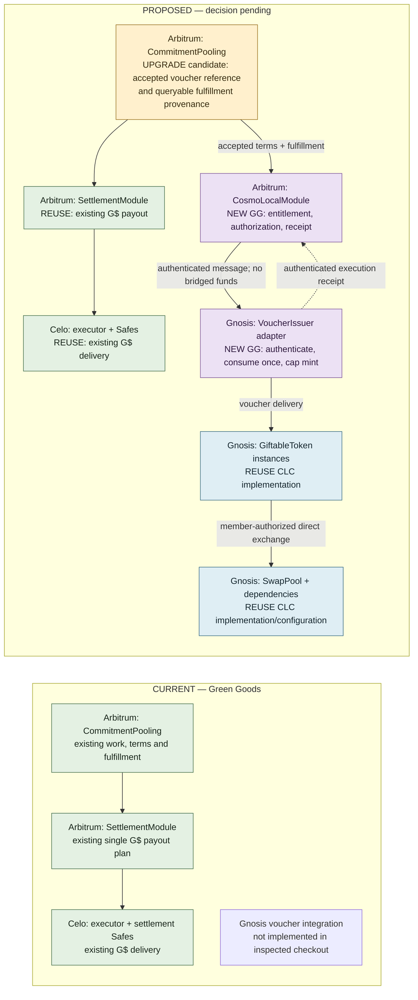

# Cosmo-Local architecture alignment — first pass

> Historical proposal. The 21 October accepted [specification](spec.md) supersedes core-upgrade,
> adapter-minting, optional-acknowledgment and unresolved allocation/confirmation proposals here.
> Retained for rationale; use the current spec and contracts handoff for implementation scope.


**As of:** 20 October 2026 UTC / 19 October Pacific. **Status:** research-backed proposal for
discussion and Claude's second-pass review; no implementation or deployment authorized.

**Accepted user intent:** one Green Goods commitment can receive both vouchers and G$, with both
terms agreed at commitment acceptance.
The earlier several-G$-installments interpretation is withdrawn. The original four goals remain:
Gnosis integration, the Tech and Sun story, PWA/admin cohesion, and a public Q4 strategy.

## The recommendation in plain language

Keep one commitment and one account of the work completed. Attach the agreed voucher entitlement
to that commitment, alongside any existing G$ consideration. After eligible fulfillment, the
G$ path pays on Celo and a separate authorization causes vouchers to be issued on Gnosis.
Track each result independently. The work stays fulfilled even if one reward is delayed.

For example, a commitment could promise **100 G$ plus 10 Tech and Sun service-voucher units**.
These are illustrative quantities, not agreed issuer prices or a conversion rate. When work is
confirmed, the two deliveries can complete in either order. Receiving those vouchers is distinct
from later attending and confirming the service they represent.

This preserves the initial issuer-service intention: contribution earns access to useful services;
supporters can separately purchase access. It does not require several G$ payments, a token bridge,
a new exchange protocol, or a universal accounting currency.

**Accepted product decision:** voucher and G$ terms bind at acceptance.
**Architecture recommendation, not yet selected:** use a narrow CommitmentPooling upgrade and a dedicated Cosmo-Local module on Arbitrum,
plus a restricted issuer adapter on Gnosis. Reuse the existing G$ settlement contracts unchanged
unless compatibility proof exposes a specific necessary change.

## Evidence and freshness

| Finding | Classification and source |
|---|---|
| The official protocol reference describes v1.1.0. Stateful instances can share implementations; ownership and proxy administration differ. | **ESTABLISHED** — [overview](https://docs.cosmolocal.credit/protocol/overview/), read 20 October |
| Voucher minting is a writer permission; burning is owner-only. Pool swaps and issuer service delivery are different operations. The bounded swap includes minimum output and deadline. | **ESTABLISHED** — [smart contracts](https://docs.cosmolocal.credit/protocol/smart-contracts/) |
| Route discovery does not execute swaps. Pool inventory, limits and governance remain local to each pool. | **ESTABLISHED** — [network](https://docs.cosmolocal.credit/protocol/network/) |
| Voucher, token, Offering, presentment, fulfillment and discharge have different meanings. A listing or transfer does not prove real-world delivery. | **ESTABLISHED** — [concepts](https://docs.cosmolocal.credit/introduction/concepts/) |
| v1.1.0 resolves to commit `ce090fd3d5a7493c726fb939da39af15ef1c9d7c`, but its README's deployment table is labeled Gnosis v1.0.0. The listed security report is an internal review, not independent certification. | **CORRECTED / UNRESOLVED** — [pinned README](https://github.com/cosmo-local-credit/protocol/blob/ce090fd3d5a7493c726fb939da39af15ef1c9d7c/README.md). Do not infer that listed addresses implement every v1.1.0 method. |
| The protocol specifies mint, writer, pool and deployment interfaces; it does not supply Green Goods commitment authorization or an Arbitrum-to-Gnosis fulfillment proof. | **ESTABLISHED** interface coverage; **INFERRED** integration boundary — [pinned SPEC](https://github.com/cosmo-local-credit/protocol/blob/ce090fd3d5a7493c726fb939da39af15ef1c9d7c/docs/SPEC.md), [DEPLOY](https://github.com/cosmo-local-credit/protocol/blob/ce090fd3d5a7493c726fb939da39af15ef1c9d7c/docs/DEPLOY.md) |
| Green Goods has one consideration structure and one stable G$ payout-plan pointer per commitment. | **ESTABLISHED** current source — [interface](../../../packages/contracts/src/interfaces/ICommitmentPoolingModule.sol#L95), [commitment](../../../packages/contracts/src/interfaces/ICommitmentPoolingModule.sol#L197), [plan creation](../../../packages/contracts/src/lib/Settlement/PlanLib.sol#L139). This restriction need not prohibit a separate voucher entitlement. |
| Ordinary/fallback fulfillment emits provenance, while dispute fulfillment takes a separate code path. There is no unified stored fulfillment receipt in the inspected commitment structure. | **ESTABLISHED** source — [CreditLib](../../../packages/contracts/src/lib/CommitmentPooling/CreditLib.sol#L232), [TerminalLib](../../../packages/contracts/src/lib/CommitmentPooling/TerminalLib.sol#L222). A getter for another contract cannot read historical event logs by itself. |
| Existing Gnosis deployment/version, actual controller roles and chosen issuer instances are not freshly verified in this pass. | **UNRESOLVED** — must be pinned before claiming deployment reuse or executing a fork against a selected version. |
| The current Gnosis CCIP directory lists an Arbitrum outbound lane at version 2.0.0; the hub's August 1.5.0 claim is stale. | **CORRECTED** — [Chainlink directory](https://docs.chain.link/ccip/directory/mainnet/chain/xdai-mainnet). Both directions, routers, selectors, delivery behavior and funding still need release-specific verification. |

Only protocol documentation, release metadata and README were read from the upstream repository.
No upstream `src/`, implementation import, dependency installation or contract execution occurred.
The protocol website and its SPEC can phrase behavior differently; deployed bytecode and bounded
conformance tests must settle consequential differences before implementation is certified.

The previous chain inventory remains dated evidence: at 2026-10-20T01:38:54Z, Arbitrum block
516456240 and Celo block 80559576, there were 42 commitments and no commitment payout plans,
member funding, refunds or loans; there were three confirmed funding disbursements and active
funded settlement routes. This is **not an empty deployment**. This pass did not refresh it.

## Current and proposed contract relationships

Legend: green = reused Green Goods; blue = reused CLC implementation or configured instance;
amber = candidate upgrade; purple = new Green Goods code. Labels carry the same meaning as color.
“Reused CLC” does not certify a particular live address. New issuer/pool instances may be needed
even when their implementation is reused.



The proposal is asynchronous across chains, not an atomic “both or neither” transaction.
No external message send should be required for the original work-confirmation transaction to succeed.

```mermaid
sequenceDiagram
  participant C as Arbitrum commitment
  participant A as Arbitrum voucher module
  participant G as Celo G$ path
  participant V as Gnosis issuer adapter
  participant U as Participant
  participant E as Service evidence
  C->>C: Accept G$ and voucher terms
  C->>C: Record eligible work fulfillment
  par G$ settlement
    C-->>G: Existing fulfilled commitment permits payout
    G->>U: G$ delivery under agreed allocation
  and Voucher issuance
    A->>C: Read accepted terms and fulfillment
    A->>V: Authorized entitlement, stable identity
    V->>U: Mint agreed voucher units once
    V--xA: Acknowledgment delayed or lost
    A->>V: Reconcile same entitlement
    V-->>A: Stored execution receipt; no second mint
  end
  U->>E: Later present voucher and receive service
  E->>E: Confirm delivered units and discharge under issuer terms
  Note over G,E: Funding/payment, voucher delivery and service evidence remain separate
```

| Component | Chain | Proposed treatment and responsibility |
|---|---|---|
| CommitmentPooling and its acceptance/terminal libraries | Arbitrum 42161 | **Candidate upgrade:** freeze an optional voucher-terms reference consistently at acceptance; expose authentic terminal fulfillment provenance, including dispute/fallback cases. Exact storage/API needs review. |
| CommitmentRegistry, credit/evidence foundations, Hats | Arbitrum | **Reuse:** work units, identities, authorization and recognition. A voucher is not a transferable version of the registry commitment. |
| CosmoLocalModule (working name) | Arbitrum | **New GG:** owns voucher terms/entitlements, issuer authorization binding, dispatch identity and authenticated result. Reads fulfillment; does not custody G$ or pretend to bridge value. |
| SettlementModule | Arbitrum | **Reuse by default:** existing Celo consideration and one payout plan remain valid. No installment rewrite. Any required change must be demonstrated rather than presumed. |
| CeloSettlementExecutor, settlement Safes and existing routes | Celo 42220 | **Reuse:** preserve existing funds, IDs, permissions and retry history. |
| VoucherIssuer adapter (working name) | Gnosis 100 | **New GG:** verifies source and command, enforces entitlement uniqueness and issuer budget, invokes permitted minting, and emits/acknowledges the outcome. No pool-withdrawal authority. |
| GiftableToken; SwapPool; registry, Limiter, quoter and fees | Gnosis | **Reuse CLC implementations**, configuring community-controlled instances where needed. Pin actual version and controller topology. No new custom voucher token or swap engine is proposed. |
| Messaging infrastructure | Arbitrum ↔ Gnosis | **Reuse a verified transport**, with new application peers/messages. CCIP is the leading candidate because of existing project experience; compatibility and both directions remain a proof obligation. |
| Service redemption/discharge | Primarily issuer workflow plus indexed evidence | **Open design:** reuse existing work/confirmation evidence where it fits. Do not create a new on-chain redemption registry by default. Mint permission does not grant owner-only burn permission. |

## Choices to discuss

| Decision | Recommendation | Why / remaining decision |
|---|---|---|
| When do voucher terms bind? | Agree amount, issuer, asset, recipient/allocation policy and service-terms version at commitment acceptance. | **User accepted** during this pass. Participants know the promise before work. A later discretionary award must be labeled separately, not backdated as agreed consideration. |
| What is the initial operation? | Earned issuance under the responsible issuer's delegated budget. Keep member pool exchange as a later, separately signed action. | Closest to the initial plan. Transferring issuer inventory is an alternative if COM-46 chooses pre-issued supply; do not silently grant mint power over Tech and Sun vouchers to any garden steward. |
| Can both rewards apply? | Yes: an optional existing G$ obligation and a separately identified voucher entitlement on the same commitment. | **User-confirmed intent.** Never add unlike units into one amount or treat one receipt as proof of both. |
| What makes vouchers eligible? | A queryable fulfillment result plus the explicitly agreed issuer policy. Preserve ordinary/fallback/dispute provenance. | “Ordinary” is not universally “the beneficiary personally confirmed.” A strict pilot can restrict eligibility, but the allowed paths need agreement. |
| What does completion mean? | Work fulfilled; G$ delivered/retained under its existing rules; voucher delivered; later service delivered/discharged are distinct facts. | Overall agreed rewards complete only when every required obligation has its valid result. No voucher requirement means not applicable. Indexer projections cannot authorize minting. |
| What should be generalized now? | Stable commitment/entitlement IDs and chain-qualified asset/receipt references. | Leave fiat execution, FX, arbitrary tokens, netting and installments out. Future off-chain receipts need their own verifier and status; they cannot impersonate an on-chain transfer. |

### Three architecture candidates

1. **Narrow core upgrade plus dedicated integration — recommended, CANDIDATE.**
   Current friction is the singleton consideration shape and event-only fulfillment provenance.
   Add the minimal acceptance reference/fulfillment getter in the core; keep voucher policy in the
   integration. Deleting that module would scatter issuance policy, replay and receipt reconciliation
   across core and UI. Local Solidity dependencies are in-process; messaging/CLC are true-external
   dependencies requiring fork and conformance proof. Existing G$ callers stay stable; new readers
   consume the integration. Main risks: storage compatibility and acceptance atomicity. Confidence:
   medium until the exact acceptance API and issuer terms are reviewed.
2. **Sidecar with no core upgrade — viable for explicitly separate awards, not the default promise.**
   An issuer can approve an award after observing existing fulfillment. This minimizes migration but
   introduces attester trust for event provenance and a second terms/consent workflow if vouchers
   must be promised at acceptance. Keep the source of truth explicit; do not label indexer data an
   on-chain proof. Test attestation authorization/replay and user consent. Deletion moves those
   checks back to operators. Lower code risk; weaker fit for a native accepted reward bundle.
3. **Rewrite settlement as a general multiasset engine — defer.**
   It could unify arbitrary obligations and payment executors but changes core G$ plan, funding,
   allocation and recovery consumers without a demonstrated pilot need. Deletion removes much of
   the speculative machinery. Highest migration/test cost and failure coupling. Revisit only when
   a concrete second payment executor or broader agreement model demands it.

No candidate has been marked SELECTED or entered into the module-seam registry.

## Failure, accounting and legacy rules

These are recommended invariants for review, not an implemented ABI:

- Freeze accepted terms before work. A voucher-terms hash must identify retrievable terms, not just
  an opaque hash. Updates before acceptance invalidate prior authorization; unilateral changes after
  acceptance cannot increase/reduce an entitlement or change its recipient.
- Source authority must include the voucher issuer's consent/delegated budget, not merely the
  Green Goods payer's hat. The Gnosis adapter must be restricted to registered issuers/assets.
- Key an entitlement by source chain, source contract, commitment, accepted terms revision and
  entitlement identity. Bind destination, issuer, asset, exact recipient allocation, amount and
  season. Transport retries keep the same entitlement. Both transport replay and newly packaged
  replay must be harmless; consumed state and minting must be one destination transaction.
- Persist a destination result independently of sending the acknowledgment. If mint succeeds and
  the acknowledgment is delayed or fails, reconciliation resends/retrieves the receipt without
  minting again. A timeout means unknown/pending, not failed; never authorize replacement value
  until the original outcome is known. Return peer and payload authentication are required too.
- Reserve issuer capacity for accepted promises under explicit policy. The adapter's season cap
  bounds its own authorized issuance; owner/other-writer mint powers require governance and
  reconciliation. CLC's Limiter bounds pool holdings, not service delivery capacity or global supply.
- Keep the existing G$ allocation and retention rules. Define voucher allocation separately;
  contributor weights may be derived from existing recognition if issuer terms choose that basis.
  Freeze the allocation policy at acceptance, exact atomic recipient amounts before dispatch, and
  conserve each asset's total with deterministic remainder assignment. Reject invalid decimal
  precision rather than silently truncating. No cross-asset total or new installment rounding.
- Allow one reward to complete while the other is pending. G$ funding closes under its own existing
  obligation rules; outstanding voucher capacity stays tracked separately. Do not keep Celo funds
  locked solely because a voucher acknowledgment is delayed.
- Legacy commitments have no implied voucher entitlement. Preserve identifiers, terms, funds and
  existing receipts. Any opt-in amendment requires explicit consent/versioning. Historical
  fulfillment may remain “legacy provenance unavailable”; do not invent a confirmer.
- Redemption requires a unique service-use record and units remaining under issuer terms.
  Presentment, partial delivery, confirmation and token discharge cannot be double counted.
  Owner-controlled token burn and the evidence of service performance remain separate actions.

## PWA, admin, indexer and public story

Indexer identity includes chain, contract and record ID. Project work fulfillment, G$ result,
voucher entitlement/delivery and subsequent service use separately, with reorg/finality and stale
states. Join them by stable references. Shared owns queries, translation and transaction workflows;
the indexer is not the economic authority and UI totals are not permission checks.

PWA commitment detail should say what work was agreed and what the participant receives:
for example, “G$ received; service vouchers pending.” Show issuer, service units and how to use
the vouchers. Admin extends the current commitment inspector with terms review, issuer budget,
per-obligation receipts and safe recovery. No new installment dashboard or new navigation is needed.
PRD-1323/1324 own only this linked-rewards slice in 2.1.0; PRD-1297 retains the broader holdings,
exchange and service-use implementation, under PRD-1299 design and PRD-1261 cohesion.

The friendly pitch remains: “Communities record work they have completed. A contribution can earn
G$ support and vouchers for useful local services. Supporters can see the funding, vouchers and
delivery evidence separately.” Label planned/rehearsal capabilities; do not imply automatic cash
conversion, audited impact or live deployment. MAR-32 and GROW-68 own the pitch and public Q4
content; PRD-1194 owns publication.

## Deployment, audit and next decision

Add Gnosis network/artifact/indexer configuration through existing repository-owned wrappers;
do not transplant upstream deployment scripts. Pin CLC implementation versions and instances,
source/destination peers, chain selectors, proxy admins, Safe roles, token writers, cap policies,
gas/message sponsorship and pause/recovery owners. Simulate wiring before enabling authority.
An approved narrow Arbitrum upgrade needs explicit targets and layout/fork proof; it is not covered
by an unrelated integration-module deployment target.

Prefer preserving the existing Arbitrum proxy and funded Celo system over redeployment, conditional
on storage/API proof. Early adoption reduces historical entitlement migration, but it does not
remove live funds or integration risk. If safe additive storage is impossible, return with a
specific replacement/migration proposal rather than stretching embedded structs.

Audit intake needs a frozen candidate, accepted economic rules, authority graph, message/receipt
state machine, storage diff, legacy replay, accounting/replay invariants, selected-version CLC
conformance, adversarial integration/fork proof, deployment rehearsal and rollback. Upstream internal
review is not an external audit of this integration. Preserve existing live-release gates.

Next: Claude independently reviews this artifact and the [corrected plan](commitment-upgrade-plan.md).
Terms timing is accepted. Afo still selects issuer operation/allocation policy, eligible fulfillment paths,
service-discharge approach and exact contract boundaries. Only that acceptance can freeze PRD-1315.
