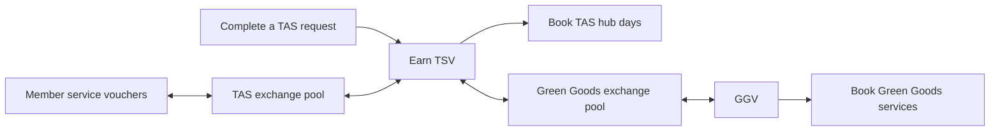

# Garden exchange pools — selected plan, 7 November 2026 Pacific

**Status: implementation authorized and in progress; live deployment pending.** This amendment replaces
the October single-pool topology. Other accepted issuer, consent, reward and redemption rules
remain in force. It does not certify earlier proof for the new topology or dispatch live actions.

## Two pools for this pilot

Reuse the existing **Green Goods Network Exchange Pool** as the curated Green Goods pool. Add
**one Tech and Sun exchange pool**. The pilot needs two exchange pools in total, not two new
pools and not a third shared exchange. Individual gardeners issue vouchers, not personal pools.

| Exchange | Initially admitted vouchers | Curation authority | Purpose |
|---|---|---|---|
| Tech and Sun | TSV and explicitly approved member service vouchers | TAS's approved pool authority | Local service exchange between gardeners and the hub |
| Green Goods | GGV and explicitly approved TSV | Green Goods's approved pool authority | Access to the curated Green Goods service offering |

TSV is the **same token in both pools**. Admission to TAS never implies admission to Green Goods.
Every later participating garden can have its own local pool; its voucher enters the Green Goods
pool only by a separate Green Goods decision. Green Goods's curated pool already serves its garden;
do not create another Green Goods local pool merely to satisfy the per-garden convention.



The work/commitment pools on Arbitrum are a different concept. Existing TAS work pool 3 and
Green Goods protocol work pool 1 do not count as these Gnosis exchange pools. A service catalog,
an issuer reserve and a redemption escrow are also not additional exchange pools.

## The three user flows

| Flow | Gardener experience | Settlement and exchange | Required change |
|---|---|---|---|
| 1. Work earns hub access | Accept a TAS request with an exact TSV reward; complete the work; see the confirmed reward; choose and book a hub day. | Verified fulfillment and accepted terms authorize delivery from the TAS reserve. Redeem TSV directly for the approved TAS service. **No swap.** | Make TAS rewards, balance, service price, booking and delivery status connect clearly. Verify the real source reward authority separately from the reserve owner. |
| 2. Gardeners exchange services | A designer publishes an approved design service and its own voucher. An engineer does the same. A holder exchanges a specified amount for the other service voucher, then books that provider. | Both tokens must be admitted to TAS, with output inventory and input-cap headroom. Use the existing bounded CLC swap and issuer-specific redemption. **One swap** for a directly stocked pair. | Support member issuance/consent, local admission and pool selection; let issuers spend their own holdings; distinguish services offered from vouchers held. |
| 3. Hub work earns Green Goods services | Hold earned TSV, choose a Green Goods career call or subscription, review the TSV cost and GGV received, exchange, then book. | Swap TSV to GGV **directly in the Green Goods pool**, then use existing GGV redemption. **One swap.** | Green Goods admits TSV on its own terms; checkout connects the approved exchange to the selected service and shows recoverable progress. |

A member voucher can reach Green Goods through **member voucher → TSV in TAS → GGV in Green
Goods**, when both legs are available. This is a two-hop extension of flow 2, not a requirement
for somebody who already earned TSV, and it adds no pool. Use explicit, bounded paths through
approved pools; no arbitrary network search or promise that every voucher is convertible.

Career calls must have their own approved provider, offer, price, availability and remedies. The
current Green Goods metadata describes an assisted session and a subscription; a career call is
not already live merely because GGV exists. Retain actual provider subscription terms and capacity.

## Validated baseline and limits

- The release configuration and Gnosis deployment record contain one exchange. Its configured
  address is `0x6AFc963B583fBB536F05B2D7ae832880662b98A4`, named Green Goods Network Exchange
  Pool. Read-only chain calls observed on 8 November at 03:41–03:43 UTC confirmed its name,
  registry and registry admission of GGV and TSV. This was not a scan for every possible pool,
  nor proof of current liquidity, all permissions or complete user journeys.
- [Release configuration](../../../packages/contracts/config/clc-pilot-release.json),
  [deployment record](../../../packages/contracts/deployments/100-pilot-downstream.json) and
  [live pins](../../../packages/shared/src/modules/commitment-pooling/service-issuer-live-pins.ts)
  support reusing that pool. Recheck current implementations, owners, AccessManager roles, proxy
  administrators, dependencies, assets, allowances and outstanding activity before rollout.
- [Issuer types](../../../packages/shared/src/modules/commitment-pooling/service-issuer-types.ts)
  mix issuer information with one pool's price, cap and delisting. The
  [member release planner](../../../packages/contracts/script/utils/clc-member-release.ts)
  targets the base plan's single pool. Those assumptions must change.
- [Swap projections](../../../packages/indexer/src/handlers/voucher-issuer.ts) already identify
  exchanges by chain and source pool. [Indexer configuration](../../../packages/indexer/config.yaml)
  currently registers one CLC pool. Extend registration and tests; reuse the projection.
- CLC supports independently configured pools and shared-token paths. Its routing documentation
  does not make a quoted path an executed or guaranteed trade. Green Goods remains responsible
  for execution, approvals, bounds and recovery. See the primary
  [network documentation](https://docs.cosmolocal.credit/protocol/network/) and
  [contract documentation](https://docs.cosmolocal.credit/protocol/smart-contracts/).

## Model, authority and inventory

Keep one authoritative issuer/token record for ownership, reserve, source approval authority,
service terms and capacity. Add explicit exchange-pool records and listings keyed by
`(chainId, poolAddress, tokenAddress)`. A listing owns admission, price, fees, holding cap and
delisting history; current inventory is observed onchain. A garden references its local exchange;
membership is not token admission. Keep work-pool IDs and exchange identities distinct in APIs.

**Interface choice:** duplicating the current issuer route for each pool would duplicate reserves,
capacity and service obligations. Select separate issuer, pool and listing records instead, with
a temporary compatibility adapter for the existing GG route during migration. A quote/review
binds account, chain, exact pool path, tokens, amounts, fees, output bounds, deadline and configuration.
Pending-operation keys and receipts must preserve that identity across refreshes and account changes.
Remove the compatibility adapter once all known consumers use the new records.

Reuse CLC's deployed token and swap implementations and Green Goods's existing earned-reward
adapter and redemption escrow. Do not deploy an adapter or escrow per pool. A delisted or unavailable
exchange must not disable redemption or recovery of an already-held voucher or accepted booking.

TAS and Green Goods need independently controlled admission, pricing and limits. Prefer separate
mutable registry/quoter/limiter and pool-fee instances for TAS, reusing published implementations.
Reuse a protocol-fee component only where the shared policy and authority are intentional. Record
pool owner, delegated administrative roles and upgrade control separately. TAS curation must not
write Green Goods policy; neither pool authority may mint or spend a member's reserve by implication.

Preserve the selected TAS **one-approval Safe policy** and steward synchronization boundary.
Do not call `finalizeBootstrap()` or silently impose a second signature. The
[contracts handoff](handoffs/two-pool-contracts.md) records the unresolved
source-authority boundary: token ownership by the Gnosis Safe does not establish a usable Arbitrum
reward-approval account. Revalidate and explicitly bind the supported source authority before
enabling flow 1. This amendment does not select an unrelated Safe-policy migration.

Set separate inventory budgets for the issuer reserve, TAS pool and Green Goods pool. Transfer
existing TSV into those budgets; do not duplicate its supply or count the same units twice.
Member inventory likewise comes from issuer-authorized issuance/deposits backed by the agreed
service capacity; listing a token does not fund its exchange inventory.
Decide initial stock, replenishment responsibility, exchange rates, fees and exposure caps before
activation. Rates need not be 1:1 or equal across pools. A funded reserve is not automatically pool
inventory, and a holding cap is not a global issuance or service-capacity cap.

Green Goods accepting TSV takes exposure to TAS's promise. Curating TSV limits direct acceptance
of member tokens; it does not remove the need to assess TAS capacity, issuance policy and any
inventory cycling through the local pool. Confirm replenishment and suspension behavior so one
direction of demand cannot silently drain Green Goods services.

Keep finite, revocable earned-reward allowances. This plan does not introduce automatic reserve
earmarking, overdrafts, insurance or a common currency. Issuing one's future service is different
from earning a reward for completed work. Delivered vouchers return to the issuer; that return
does not recreate consumed service capacity.

## Checkout, wallet and steward experience

- **Wallet:** show vouchers held by issuer, usable services, pending deliveries and bookings.
  Show a shared token balance once, even when two pools accept it; never sum unlike voucher units
  into one spendable number. Explain availability using actual prices, capacity and exchange quotes.
- **Profile:** separate “Services I offer” and their obligations from “Vouchers I hold.” Offering a
  service starts issuer-approved terms and capacity; it does not award the provider free garden credit.
- **Service checkout:** start with the desired service. Offer direct redemption when the holder
  already has its voucher; otherwise show the available exchange, fees and exact outcome. Exchange
  success is not a confirmed booking. If booking fails, show the received voucher and a recovery action.
- **Steward console:** select the garden/pool explicitly. Separate local token admission from Green
  Goods admission, issuer consent from pool curation, and reserve funding from pool inventory. Show
  the exact authority required for each action.

Prefer atomic same-chain execution for a two-hop swap only when the actual account supports it
and the ordered calls have been proved against real CLC runtimes. Reuse the existing transaction
batch capability and journal. Bound both hops, account for intermediate TSV actually required and
received, disclose residual TSV, and do not sweep unrelated wallet balances. A batch must revert
both hops if the second fails. Otherwise present a deliberate sequential route: confirm the first
receipt, show held TSV, refresh and review the second quote. Never retry the first successful swap.
Cross-chain booking remains a separate state machine; no atomic booking guarantee is implied.

## Steward awards for past contributions

Retain the user's earlier requirement as a distinct voucher-award operation. A steward prepares
the recipient, issuer/token, exact amount, reason and optional past-work reference; the actual
reserve authority authorizes the transfer. Award TSV for TAS access/exchange, or GGV from the
Green Goods reserve when Green Goods explicitly funds that award. No exchange is required to send it.

Use a stable award record and the existing Safe/transaction preparation and reconciliation path.
Bind the reviewed award to its sender, recipient, amount and Safe transaction hash/nonce; record
draft, awaiting authorization, submitted, confirmed or failed separately. On an interrupted or
ambiguous submission, reconcile the same transaction before offering any replacement. The recipient
sees an “Award for past contribution” receipt, separately from acceptance-bound earned rewards.

The award record needs durable duplicate protection across sessions, not only a disabled button.
Before enabling this slice, prove an existing persistence owner can provide that guard; if it
cannot, return the narrow storage/contract choice for selection. Do not disguise a raw ERC-20
transfer as an exactly-once business award or introduce a new issuance engine without that decision.
Retain public-safe provenance and keep private contribution notes outside public records.

Do not rewrite historical requests, fabricate old claimant consent, mint automatically or route
arbitrary awards through `VoucherEntitlementModule`. Its earned terms belong to acceptance and
fulfillment. A garden role alone does not authorize another issuer's reserve. Awards consume
existing available inventory and must not be presented as reserving funds for other obligations.

## Implementation sequence

The user authorized implementation of this plan and retrospective awards on 8 November 2026 UTC.
Current execution and fresh proof live in [the implementation handoff](handoffs/two-pool-implementation.md).
Deployment, transaction broadcast and activation remain separate actions. These are planned
checkpoints, not completed lanes. Keep source changes in dependency order and
split a checkpoint further if the actual diff exceeds one session or roughly four files. Use the
existing hub and owner modules; no parallel exchange engine, automatic token factory or new service.
For runtime work, start with failing behavior proof and record GREEN before wiring consumers.

Paths under Shared below refer to `packages/shared/src/modules/commitment-pooling`; hooks remain
in `packages/shared/src/hooks`. Tests belong to the existing owning package suites.

| Step | Bounded change and primary files | Completion proof |
|---|---|---|
| P1 | Extend `clc-pilot-release.json`, `clc-release.ts` and its test for named GG/TAS pools; model adoption of GG and deployment of TAS separately. | Existing pool is adopted unchanged; exactly one additional pool and its approved dependencies are planned. Existing token addresses remain identical. |
| P2 | Update member inputs/release planner and their focused tests to choose a local pool independently of issuer ownership. | A member is admitted to TAS without any GG registration; reject mismatched chain, owner and pool dependencies. |
| P3 | Extend release/member simulation and readback helpers in bounded follow-up commits. | Fresh readback proves both pools' authorities and allocations, preserved accepted terms/receipts, verified issuer/escrow bindings and only explicitly approved source-authority changes; no live send. |
| P4 | Extend `CLCMemberProjectFixture.sol` and `GnosisVoucherPilot.t.sol` using the published CLC runtimes. | Two independent pools, member exchange, TSV-to-GGV exchange, per-pool rejection/caps, liquidity exhaustion and preserved redemption all behave as specified. |
| P5 | Register the second pool in `packages/indexer/config.yaml`; reuse `voucher-issuer.ts` and extend its tests. Change schema only for a demonstrated missing fact. | Events from either pool replay without collision. Initiator is never inferred to be output recipient; existing booking/reward identities remain stable. |
| P6 | Separate issuer, pool and listing types in `service-issuer-types.ts`; adapt metadata through a temporary compatibility mapping and focused tests. | TSV has one issuer/reserve/capacity record and two independent listings; deleting one listing does not delete holdings or obligations. |
| P7 | Adapt `service-issuer-chain.ts`, `service-issuer-pool.ts` and focused tests to explicit pool reads and independent service validity. | Wrong-pool configuration fails closed for exchange while valid existing redemption/recovery still works. |
| P8 | Adapt `service-issuer-operations.ts`, `service-issuer-commands.ts`, pending identity and operation tests. | Exact one-hop review/execution/reconciliation binds the chosen pool, uses finite approval and rejects stale terms, bounds or account changes. |
| P9 | Add bounded path composition beside those operations, reusing transaction batches and tests. | Prove atomic two-hop rollback for supported accounts; explicit sequential recovery for others; report intermediate residue without duplicate first-hop execution. |
| P10 | Wire validated pool records into issuer/service live configuration and Shared hooks in separate small commits. Remove the temporary single-pool adapter after consumer migration. | Existing GG direct use remains valid; TAS and member services resolve correctly; each action reads the authoritative record once. |
| P11 | Update Client wallet/profile (`VouchersTab`, `ServiceAssets`, `ServiceIssuerPanel`/form) in bounded component-and-test commits. | Holdings appear once, issuer obligations remain separate, and a provider can exchange their own held voucher. Include labeled rendered proof. |
| P12 | Connect Client request reward and service checkout (`ServiceRewardsSection`, `ServicePromise`, `ServiceAccessPanel`) with focused tests. | A user completes all three journeys; sees confirmed delivery versus pending, unavailable quotes and failed booking recovery without chain jargon. |
| P13 | Update Admin issuer onboarding/dialogs and Shared governance drafts for explicit pool selection, with tests. Prepare the separate award-record/authority slice above before adding the award action. | TAS admission cannot change GG; exact reserve authority approves an award; duplicate/unknown submissions reconcile without a second transfer. Persistence choice is a stated award-slice gate. |
| P14 | Rehearse the connected flows, prepare exact rollout artifacts, then perform separately authorized activation and post-state checks. | Fresh critical checks, actual-account signing proof, explicit issuer terms/inventory and recorded readback support release. No old one-pool receipt certifies this rollout. |

P1–P5 establish protocol/configuration evidence; P6–P10 establish the application model and
execution; P11–P13 establish the member/steward experience; P14 is the release checkpoint.
P13 awards can ship separately from two-pool exchange and must not weaken existing reward consent.
Its unresolved persistence choice gates awards, not the three exchange/service journeys.
Do not add the not-yet-deployed TAS address to production config or activate routes ahead of receipts.
Keep legacy GG reads usable during rollout; reject changed pending reviews rather than silently
retargeting them. New-pool rollback disables new exchanges while preserving balances, bookings
and recovery. Do not withdraw existing inventory or abandon the current pool as a planning action.

## Acceptance and operational decisions

| Proof | Required result |
|---|---|
| Pool count and identity | Exactly two configured pilot exchanges; GG reused and TAS new. Same TSV token in both, no third bridge pool, no duplicate balance or supply. |
| Flow 1 | Exact accepted reward reaches its intended holder; direct TSV hub booking works; an incomplete/unauthorized reward does not appear spendable. |
| Flow 2 | Two distinct member issuers approve their obligations; holder exchanges in TAS and redeems the received voucher. Unadmitted member token cannot enter GG. |
| Flow 3 | Earned TSV converts directly to GGV in GG, then books the approved offer. Lack of GG stock or input headroom produces a useful unavailable state. |
| Two-hop route | Bounds and fees apply to both hops. Atomic second-hop failure rolls back first; sequential failure leaves visible, recoverable TSV. No unintended balance sweep. |
| Independent governance | TAS cannot mutate GG admission/rates/caps; delisting in one pool does not erase issuer identity, unrelated listings or booked obligations. |
| Service capacity | Confirmed capacity, reserve, allowances and pool stock are distinct; returned vouchers do not create new deliverable capacity. |
| Steward award | Actual reserve authority approves exact recipient/amount; historical work is referenced without modifying accepted terms; duplicates and ambiguous submission recover safely. |
| Continuity | Existing token holders, reward receipts, pending service bookings and refund paths survive migration. Indexer replay does not create duplicate exchange history. |

Before live configuration, confirm issuer service units, prices, inventory allocations, pool
owners/delegates, fees, rates, caps, member cohort, valid source approval path and replenishment
responsibility. These are operating inputs, not a reason to add another pool. Career-call terms
and the award persistence owner remain explicit inputs. The user has selected topology; this
document does not invent financial quantities, member consent or deployment authority.

Run the repository validation selector on each implementation slice. Contract/release changes
require the critical contract gate and consumer proof; transaction-writing Shared changes require
its focused suite/typecheck and consumer typechecks. Indexer config changes require codegen before
tests/build. Label rendered proof; actual signing needs authenticated-session proof. Use Bun
wrappers and existing release simulation commands. No dependency upgrade is required by this plan.

## Planning task record

Task: `cosmo-local-credit-interop` two-pool amendment | Type: planning | Outcome: complete
Agent: Codex; exact model: unknown | Coverage: current planning segment only; earlier investigation timing not included.

| Phase | Start → end (UTC) | Result |
|---|---|---|
| Investigate | 2026-11-08 03:54:44 → 04:00:50 | Reconciled source, current hub and prior chain readback; focused independent source review found no architectural blocker to GG reuse. |
| Implement | 2026-11-08 04:00:50 → 04:04:37 | Plan documents only; runtime, deployment, existing lane states and external records unchanged. |
| Verify | 2026-11-08 04:04:37 → 04:06:25 | Plan-hub validation passed for 31 hubs; initial JSON formatting failure corrected and selected QA passed. Local links and preserved state checked; independent review found no blockers and two wording corrections were applied. |

Fresh planning commands, observed by 04:06:25 UTC:

```sh
node scripts/dev/ci-local.js --intent qa --changed .plans/backlog/cosmo-local-credit-interop/brief.md,.plans/backlog/cosmo-local-credit-interop/spec.md,.plans/backlog/cosmo-local-credit-interop/plan.todo.md,.plans/backlog/cosmo-local-credit-interop/eval.md,.plans/backlog/cosmo-local-credit-interop/status.json,.plans/backlog/cosmo-local-credit-interop/pilot-issuer-terms.md,.plans/backlog/cosmo-local-credit-interop/garden-exchange-pools.md
node scripts/harness/plan-hub.mjs validate
```

The selector chose only formatting; Biome checked `status.json`, not Markdown. Additional scoped
whitespace, relative-link and JSON preservation checks passed. Existing feature/lane/Linear
metadata and all previous history/notes were preserved. These are uncommitted working-tree
documents, not a tested implementation commit; no runtime tests or deployment were performed.
Human corrections in this segment: 0 observed; human attention: unknown. Rendered proof: none;
no UI code changed. The existing untracked TAS policy handoff was read and left untouched.
