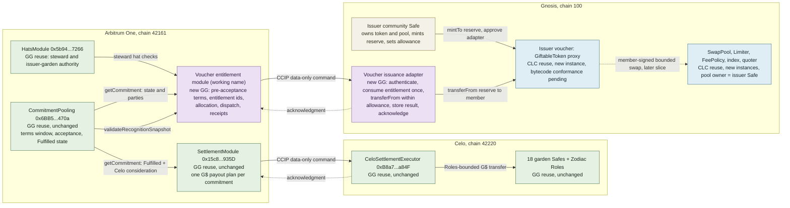

# Claude second-pass architecture review: results

**As of:** 2026-10-20T04:52Z (19 October Pacific). **Status:** review complete; it recommends an
architecture decision and does not select, implement, deploy or mark PRD-1315 complete.
**Where this file lives:** it was written in the session worktree copy of this hub because the
harness blocks writes into the planning checkout; copy it beside `architecture-alignment.md` on
the `codex/cosmo-local-planning` working tree so the relative links below resolve.
**Reviewed inputs:** [architecture-alignment.md](../architecture-alignment.md),
[commitment-upgrade-plan.md](../commitment-upgrade-plan.md), the hub
[brief](../brief.md), [spec](../spec.md), [plan](../plan.todo.md), [eval](../eval.md) and
[status](../status.json); the current contracts at commit `23d445898` (identical to `06a31dbf5`
outside `src/mocks/`); live Linear records RESR-73, PRD-857, PRD-1314 through PRD-1327,
PRD-1299, PRD-1297, PRD-1261, PRD-1262, PRD-796, PRD-651, COM-46, PRD-1096, PRD-1197 and
RESR-74; the Cosmo-Local Credit (CLC) protocol overview, smart-contracts and network pages, the
pinned README, `docs/SPEC.md` and `docs/DEPLOY.md` at `ce090fd3d5a7493c726fb939da39af15ef1c9d7c`,
GitHub tag and compare metadata, Gnosisscan contract metadata, and the Chainlink CCIP directory
read in a browser. The 10 October research record on PR
[#1068](https://github.com/greenpill-dev-guild/green-goods/pull/1068) was read from that branch.
**Clean room held:** no upstream `src/` file, verified-source endpoint or AGPL implementation
was opened. Labels follow the research skill: **ESTABLISHED**, **CORRECTED**, **INFERRED**,
**UNRESOLVED**; each finding also says whether it is a fact, an inference, a recommendation or a
decision that stays with Afo.
**Corrected later on 20 October:** finding F10 overstated what the ontology gate catches, and the
section 4 table named the payer garden's steward as the terms author instead of the pool garden's.
Both are fixed in place below.

## Corrections carried forward on 21 October

This remains a dated review, not the current dispatch contract. The [spec](../spec.md),
[complete freeze inventory](../plan.todo.md#sequence-and-completion-evidence) and
[rehearsal handoff](prd-1096-rehearsal-dispatch-draft.md) own the reconciled requirements.
Pre-acceptance edits alone do not bind a pending claimant to an approved revision: PRD-1317 must
supply exact-revision consent. Allowance/cap limits reserve nothing. Presentment and discharge now
include contract work in PRD-1315/1317/1318, while service operations/UI and terms remain with
PRD-1297/COM-46. Acknowledgments remain an open live decision and are absent from the bounded
rehearsal. Its retired-peer recovery requirements supersede the scenario below; a source-side
failure record alone cannot make an old command deliverable after retirement.

## 1. Decision summary

The product intent stands and is enforceable: one commitment can promise G$ and vouchers, both
promises are fixed before anyone accepts, and each reward completes on its own.

The first pass got the shape right (an Arbitrum module that owns entitlements, a restricted Gnosis
adapter, reused CLC token and pool implementations, the G$ rail untouched) and got one premise
wrong: **the CommitmentPooling core does not need an upgrade for this slice.** Existing views expose the
pre-acceptance editing window and Fulfilled state used by the G$ rail. A voucher module can forbid
post-acceptance edits, but this alone does not bind a pending claimant to an approved revision.
Exact-revision consent remains PRD-1317 work before the boundary freezes. The accepted candidate
keeps core storage, library re-link and live-proxy changes outside this slice; that is a boundary
decision, not proof that the outstanding consent mechanism is complete.

Two further changes to the proposal. First, prefer **allowance-bounded delivery from the issuer's
own reserve** over granting Green Goods code a `GiftableToken` writer role: a writer can mint
without limit, while an ERC20 allowance is the only budget the token itself enforces, and the
issuer can revoke it at any time. Second, drop limiter writes from the adapter's authority in the
first slice; pool exposure limits are the pool owner's business.

Two facts narrow the risk register. The documented v1.1.0 versus v1.0.0 mismatch is only
`OracleRelay`: the GitHub compare between the two tags is one commit touching OracleRelay, docs
and tooling, so the token, pool and limiter sources are the same at both tags. The unresolved part
is different: none of the Gnosis implementation addresses is verified on Gnosisscan, so conformance
has to be proven against the published build artifacts or by the upstream team verifying them.
That proof now exists: a read-only check on 2026-10-20 found the deployed runtime code of the
token, pool, limiter and factory byte-identical to the published artifacts (see the
[conformance evidence](claude-conformance-evidence-2026-10-20.md)). The Arbitrum to Gnosis CCIP
lane exists in both directions at version 2.0.0, and both routers quote fees for the codec's
extra-args form.

The hardest open item is not architecture. A passkey member account derives to the same address
on Gnosis but cannot be deployed there today because the WebAuthn validator the app uses has no
code on chain 100 (observed 10 October, not re-read here). Vouchers can be delivered to that
address; the member cannot act from it until that is resolved.

## 2. Answers to the nine review questions

| # | Question | Answer | Label |
|---|---|---|---|
| 1 | Terms bound at acceptance without two sources of truth? Exact core change? | The no-core-change candidate can enforce the editing window, not exact claimant consent by that check alone. PRD-1317 must bind the approved revision and counterparty consent. The module writes voucher terms only while `getCommitment(id).state` is `Offered` or `Requested`, the same window `TermsLib._requireEditableTerms` enforces for G$ terms ([TermsLib.sol:153-166](../../../../packages/contracts/src/lib/CommitmentPooling/TermsLib.sol#L153)). G$ terms live in the core, voucher terms in the module: two owners and two obligations. One acceptance act remains the intended behavior, requiring the additional consent binding. The optional core change is a stored fulfillment path (see 2). | ESTABLISHED / recommendation |
| 2 | Does the fulfillment record cover ordinary, fallback, dispute and legacy paths? | The on-chain record is the terminal state `Fulfilled`, reached by ordinary and fallback confirmation ([CreditLib.sol:232-249](../../../../packages/contracts/src/lib/CommitmentPooling/CreditLib.sol#L232)) and by dispute resolution ([TerminalLib.sol:222-258](../../../../packages/contracts/src/lib/CommitmentPooling/TerminalLib.sol#L222)); it is terminal because `raiseDispute` accepts only Accepted, ReadyForConfirmation or Expired ([TerminalLib.sol:94-98](../../../../packages/contracts/src/lib/CommitmentPooling/TerminalLib.sol#L94)). The confirmation path exists only in events and the indexer already projects it (`confirmationPath`, `fulfilledBy`, dispute-resolved fulfillment with path null). The G$ rail gates on the state alone ([PlanLib.sol:159-163](../../../../packages/contracts/src/lib/Settlement/PlanLib.sol#L159)). Legacy commitments carry no entitlement unless one is registered. | ESTABLISHED |
| 3 | Initial issuance versus transferring pre-issued inventory? Can a steward authorize only the delegated budget? | Prefer the issuer minting to its own Safe and approving the adapter for a bounded allowance. `GiftableToken` writers can mint without a per-writer budget (SPEC: `mintTo` is "Owner or writer only"; no cap is specified), so under the writer model the only budget is the adapter's own code. Under the allowance model the token enforces the budget and the issuer revokes it with `approve(adapter, 0)`. On Arbitrum, bind each voucher asset to an issuer garden and require that garden's steward hat for the budget, so a payer garden cannot spend another issuer's vouchers. | ESTABLISHED facts / recommendation |
| 4 | Asynchronous outcomes safe? | Yes if the adapter copies the Celo executor's order of operations: authenticate, dedupe by execution key, store the result before any side effect, then acknowledge with deferral codes ([Execution.sol:35-68](../../../../packages/contracts/src/modules/CeloSettlement/Execution.sol#L35), [Base.sol:64-92](../../../../packages/contracts/src/modules/CeloSettlement/Base.sol#L64)). Two additions are required: an entitlement id that does not include the attempt number, consumed only on success, and a refusal of a consumed entitlement even on a fresh message. See section 5 for each scenario. | ESTABLISHED pattern / recommendation |
| 5 | Reservations, other mint authorities, allocation, rounding, discharge specified without a payment engine? | There is no reservation: allowance and optional season caps are shared delivery limits, and the allowance is revocable. Approved/accepted obligations may oversubscribe them; exhausted allowance/reserve must fail without consuming the entitlement, then deliver once after repair (rehearsal G4). The issuer owner can always mint more; the passport must show issuer supply separately from Green Goods deliveries. Allocation reuses `validateRecognitionSnapshot` and PlanLib's deterministic remainder rule ([PlanLib.sol:760-788](../../../../packages/contracts/src/lib/Settlement/PlanLib.sol#L760)); whole-unit vouchers need an explicit rounding policy or a single recipient. After the 21 October direction, PRD-1315 owns the authenticated presentment handshake and live escrow placement/custody decision, PRD-1317 the authorized discharge/return commands, and PRD-1318 once-only Gnosis settlement. Service operations/UI and issuer terms remain PRD-1297/COM-46 work. | recommendation / decision |
| 6 | Reused instance, reused implementation, upgrade, or new code? Chains and authorities? | Section 4 table. In short: Arbitrum CommitmentPooling, SettlementModule, HatsModule, Celo executor and Safes are reused unchanged; CLC `GiftableToken`, `SwapPool`, `Limiter`, `FeePolicy`, `TokenUniqueSymbolIndex`, a quoter and the Solady `ERC1967Factory` are reused implementations with new Gnosis instances; the Arbitrum voucher module and the Gnosis adapter are new Green Goods code; no upgrade is required in v1. | ESTABLISHED |
| 7 | Source and receipt authentication, live transport version and selected CLC deployment proven or pending? | Authentication is proven in code for the Celo lane and transfers by construction. Transport: Gnosis router `0x4aAD6071085df840abD9Baf1697d5D5992bDadce`, selector `465200170687744372`, outbound Arbitrum One lane OnRamp `0x7FcD...448B` v2.0.0 and inbound Arbitrum One lane OffRamp `0xF941...9AD9` v2.0.0 (directory read 2026-10-20). `EVMExtraArgsV1`, which the codec uses, is accepted by `getFee` on both routers (checked 2026-10-20, F5 update). CLC deployment: bytecode conformance established on 2026-10-20 (F2 update). Timeout is treated as pending in the existing design; `failStrandedSubject` only records a source-side failure after the peer is retired ([LifecycleLib.sol:369-398](../../../../packages/contracts/src/lib/Settlement/LifecycleLib.sol#L369)). | ESTABLISHED; live delivery stays a rehearsal item |
| 8 | Legacy contracts, funded routes, indexer identities, app consumers preserved? | Yes by construction when no core upgrade ships: the Arbitrum proxies, the 18 Celo Safes and routes, the payout-plan singleton and `getCommitment` ABI are untouched. The indexer already keys entities by `chainId-id` and needs chain 100 plus new entities, not changes to existing ones. Shared needs chain 100 in its registry; today it lists only Ethereum, Sepolia, Arbitrum and Celo ([chains.ts:1-7](../../../../packages/shared/src/config/chains.ts#L1)). | ESTABLISHED |
| 9 | Dependencies, estimates and audit evidence credible? | The dependency graph is sound and acyclic. The 3-5, 5-8 and 8-12 working-day ranges are plausible only for the narrowed boundary (no core upgrade, allowance model, acknowledgment lane optional) and they exclude every external gate: COM-46 terms, the Gnosis passkey validator, CLC bytecode conformance, an external audit, two weeks of testnet operation and the 48-hour timelock. No live Gnosis pilot can meet the 27 October submission under those gates; the rehearsal story already in the plan is the realistic path. | INFERRED |

## 3. Prioritized findings

Each finding names its evidence and its consequence. "Fact" means directly observed, "inference"
means reasoned from facts, "recommendation" means this review's proposal, "decision" means a
choice only Afo can make.

### F1. A core upgrade is not required to bind voucher terms at acceptance (High, CORRECTED)

**Facts.** The first pass names two frictions: the singleton `DeclaredConsideration` and
event-only fulfillment provenance
([ICommitmentPoolingModule.sol:162-167, 233](../../../../packages/contracts/src/interfaces/ICommitmentPoolingModule.sol#L162)).
Both are real. Neither forces a core change:

- `getCommitment(id)` is an external view and another contract already consumes it: the
  SettlementModule reads it to build the G$ payout plan
  ([PlanLib.sol:150-151](../../../../packages/contracts/src/lib/Settlement/PlanLib.sol#L150)).
  It exposes `state`, `creator`, `counterparty`, `leadProvider`, `providerGarden`,
  `payerGarden`, `metadataCID` and `creationPayloadHash`.
- The core's own rule for frozen terms is "pre-acceptance state, steward only"
  ([TermsLib.sol:153-166](../../../../packages/contracts/src/lib/CommitmentPooling/TermsLib.sol#L153)).
  A module can apply the identical rule by reading the state in the same transaction.
- `isEligibleContributor` and `validateRecognitionSnapshot` are external views
  ([ICommitmentPoolingModule.sol:901-908, 1017](../../../../packages/contracts/src/interfaces/ICommitmentPoolingModule.sol#L901)),
  so per-contributor voucher allocation can use the same canonical recognition vector the G$ plan
  uses.
- The G$ rail requires only `state == Fulfilled` plus a declared Celo consideration
  ([PlanLib.sol:159-163](../../../../packages/contracts/src/lib/Settlement/PlanLib.sol#L159));
  it never reads the confirmation path.

**Inference, qualified on 21 October.** Registering only while `Offered` or `Requested` and
refusing changes afterward enforces an editing window; it does not bind a pending claimant to the
exact approved voucher revision. PRD-1317 must provide that separate consent binding. G$ and voucher
terms remain distinct obligations with one owner each. The earned-reward path may use `Fulfilled`
under the rehearsal default; curated/purchased issuance against future capacity is a separate
21 October decision. No discretionary post-acceptance award is added by this review correction.

**Consequence.** No storage change in a frozen 38-entry layout with a 12-slot gap
([Storage.sol:91-93](../../../../packages/contracts/src/modules/CommitmentPooling/Storage.sol#L91)),
no redeployment of the deployed behavior libraries, no new selectors against the EIP-170 budget
([CommitmentPooling.sol:8-17](../../../../packages/contracts/src/modules/CommitmentPooling.sol#L8)),
no UUPS upgrade of a live proxy holding 42 commitments, and an audit intake limited to new code.

**Remaining gap and decision.** If COM-46 wants eligibility restricted to ordinary confirmations
(the person served confirmed), the path is not readable on chain: it is carried only by the
`CommitmentFulfilled` event and absent on dispute-resolved fulfillment
([TerminalLib.sol:166](../../../../packages/contracts/src/lib/CommitmentPooling/TerminalLib.sol#L166)).
Enforcing that rule trustlessly needs the core change the first pass proposed (a stored
fulfillment record written in `fulfillCommitment` and `_resolveDisputeFulfilled`, which touches
CreditLib and therefore every library that inlines it). The alternatives are an issuer attestation
per entitlement (attester trust, the first pass's objection) or accepting any `Fulfilled`, which is
the G$ precedent. **Decision for Afo and COM-46.** This review recommends the G$ precedent for
the pilot and recording the path from the indexer for display.

### F2. The v1.1.0 versus v1.0.0 question is narrower than stated, and the real gap was bytecode verification (High, CORRECTED; conformance ESTABLISHED on 2026-10-20)

**Facts.**
- GitHub compare `94e52d0...ce090fd` (tags v1.0.0 and v1.1.0): one commit; changed files are
  `Makefile`, `README.md`, `cmd/ge-publish/main.go`, `main_test.go`, `docs/DEPLOY.md`,
  `docs/PUBLISH.md`, `docs/SPEC.md`, `pkg/publish/contracts/oraclerelay/*`, `src/OracleRelay.sol`,
  `test/OracleRelay.t.sol`, `test/OwnerInitialization.t.sol` (file names only were read). The
  GiftableToken, SwapPool, Limiter, FeePolicy, index and quoter sources are the same at both tags.
- Gnosisscan reports "Contract source code not verified" for the README implementation
  addresses of `GiftableToken` (`0x34445d13...`), `SwapPool` (`0x9e694D34...`) and `Limiter`
  (`0x258AAd6c...`), so no ABI or source is published there (read 2026-10-20).
- Creation metadata: `ERC1967Factory`, `GiftableToken`, `Limiter` and `SwapPool` implementations
  were created by `0x33a5...2645` on 2026-08-18 between 10:31 and 10:32 UTC, the day of the v1.0.0
  tag; `OracleRelay` on 2026-09-08 09:44 UTC, the day of the v1.1.0 tag.
- The v1.0.0 tree publishes build artifacts `pkg/publish/contracts/{giftabletoken,swappool,limiter}/*.bin`.

**Inference.** The README table label is stale only for OracleRelay. The deployed token, pool
and limiter implementations are very likely the v1.0.0 build, which equals the v1.1.0 source for
those contracts. "Very likely" is not conformance.

**Recommendation.** PRD-1319 and PRD-1325 should prove conformance by comparing the deployed
runtime bytecode with the runtime portion of the published v1.0.0 artifacts (build outputs, not
source, so inside the clean room), or by asking Grassroots Economics to verify the implementations
on Gnosisscan. Either result also settles which implementation addresses the Green Goods proxies
point at. Interface conformance can additionally be exercised on a Gnosis fork against SPEC: the
10 October record already found that `expires()` and `expiresAt()` do not exist while `expired()`
does, which is exactly the kind of drift a fork catches.

**Update, 2026-10-20T05:42Z.** The comparison was run as a read-only follow-up. At Gnosis block
48848261 the deployed runtime code of `GiftableToken`, `SwapPool`, `Limiter` and
`ERC1967Factory` is the exact suffix of the published v1.0.0 creation artifacts (which are
byte-identical to the v1.1.0 artifacts), so conformance is established for the four contracts
the first slice uses. The embedded metadata records solc 0.8.34, not the 0.8.36 the README
states. Details, hashes and commands are in the
[conformance evidence](claude-conformance-evidence-2026-10-20.md).

### F3. The issuer budget should be token-enforced, not adapter-enforced (High, recommendation)

**Facts.** SPEC: `mintTo(to, amount)` is "Owner or writer only"; `addWriter` and `deleteWriter`
are owner only; no per-writer cap, supply cap or expiry-independent limit is specified for
`GiftableToken`. `Limiter.setLimitFor(token, holder, value)` caps a pool's balance on deposit and
swap entry; it is not an issuance budget. The current Celo executor never holds token authority
of its own: it executes through Zodiac Roles with caps the Safe configured
([Execution.sol:230-254](../../../../packages/contracts/src/modules/CeloSettlement/Execution.sol#L230)).

**Inference.** Under the first pass's writer model, a defect in new, unaudited Green Goods code
could mint another organization's voucher without bound until the issuer notices and calls
`deleteWriter`. Under an allowance model the issuer mints its own reserve, approves the adapter
for a bounded amount, and the token's `transferFrom` enforces the budget; the adapter's season
cap becomes a second, optional bound. The allowance also works with any ERC20, which lowers the
exposure to version drift (F2), and it matches CLC's own vocabulary: minting is issuance by the
issuer, transfer is delivery.

**Trade-offs.** `totalMinted` rises before delivery, so the passport must show "issuer reserve"
separately from "delivered to members"; the issuer Safe must hold inventory; expiry, if ever set,
freezes both paths equally (SPEC: transfers and mints revert once expired). The 10 October record
already proposed pre-minting to the pool for purchased issuance, so the reserve pattern is not
new to the plan.

**Decision for Afo and COM-46.** Allowance from the issuer reserve (recommended) or writer role
plus adapter cap (first pass). Either way, remove `Limiter` writes from the adapter in v1; PRD-857
and spec.md currently grant them.

### F4. Members cannot act on Gnosis until the passkey validator exists there (High, dated UNRESOLVED)

**Fact (observed 10 October, not re-read in this review).** The WebAuthn validator that the app's
`permissionless` 0.2.57 Kernel v3.1 configuration installs,
`0xbA45a2BFb8De3D24cA9D7F1B551E14dFF5d690Fd`, has code on Arbitrum and Celo and none on Gnosis;
`KernelFactory.getAddress` returns the same address on all three chains; a simulated
`createAccount` reverts on Gnosis with `InitializeError()`. Source: the 10 October research record
and the project memory of that read.

**Inference.** Delivery to the member's counterfactual address succeeds (an ERC20 transfer to an
address without code is ordinary), so the dual-reward slice can complete "voucher received". Any
member act on Gnosis (approve, swap, present) cannot happen from that account until a validator
is deployed at that address, a different validator is chosen (which changes the address), or a
Safe-signed fallback acts for the member.

**Consequence.** PRD-1096's "gardener account signs a sponsored Gnosis transaction" and
PRD-1297's exchange and service-use screens depend on an authorized deployment that is not a
research step. PRD-1324 can still show "vouchers received" truthfully. No Linear issue tracks the
validator gap on its own (a search for "validator Gnosis" returns only the parent records), so the
plan should either file one or carry it explicitly in PRD-1096 and PRD-1325.

### F5. The CCIP lane exists both ways at 2.0.0 and quotes the codec's extra-args form (Medium, ESTABLISHED)

**Facts.** Chainlink directory, Gnosis page, read in the browser pane on 2026-10-20: router
`0x4aAD...adce`, selector `465200170687744372`, outbound lane to Arbitrum One with OnRamp
`0x7FcD...448B` at version 2.0.0, inbound lane from Arbitrum One with OffRamp `0xF941...9AD9`
at version 2.0.0; fee tokens GHO, LINK, WXDAI and native XDAI. The 10 October record read the
same router and selector on chain, confirmed `isChainSupported` both ways and quoted about
0.000044 ETH per command from Arbitrum and about 0.14 xDAI per acknowledgment from Gnosis. The
existing codec builds messages with `Client.EVMExtraArgsV1`
([CommandLib.sol:227-244](../../../../packages/contracts/src/lib/Settlement/CommandLib.sol#L227)).

**Update, 2026-10-20T05:42Z.** `getFee` on both routers accepted `EVMExtraArgsV1`,
`GenericExtraArgsV2` and empty extra-args with identical quotes (45,710,905,756,923 wei from
Arbitrum, 140,025,061,685,540,473 wei from Gnosis); both on-ramps report `OnRamp 2.0.0` behind
`Router 1.2.0`. The first pass's "both directions remain a proof obligation" is answered at the
fee-quoter level; a real `ccipSend` remains a rehearsal item. See the
[conformance evidence](claude-conformance-evidence-2026-10-20.md).

### F6. Two boundary records conflict and the first pass does not reconcile them (Medium, UNRESOLVED decision)

**Facts.** PRD-796 (Done) freezes a compatibility contract in which future backing starts from
fulfilled instances, reserved-capacity backing stays disabled, and the Pool's reserved
`settlementAdapter` is a versioned router seam. PRD-651 (Backlog, updated 2026-10-20) says
capacity-backed issuance needs "explicit fresh scope decisions". The issuer-service model makes
Tech and Sun's voucher an issuer instrument, not a wrap of a Green Goods promise, and PRD-857
includes purchased issuance, which is capacity-backed by definition. The project memory recorded
this gap on 16 September; it is still open.

**Recommendation.** Record one of two framings before PRD-1315: (a) issuer vouchers are third-party
instruments outside the PRD-796 wrap boundary, and the entitlement module only consumes Green
Goods fulfillment facts once; or (b) purchased issuance is a recorded supersession of the
fulfilled-first ordering. Framing (a) is consistent with CLC's own definitions and with the
`settlementAdapter` seam staying unused. **Decision for Afo.**

### F7. Receipt and replay semantics should copy the Celo lane and add business-level dedup (Medium, recommendation)

**Facts.** The settlement lane keys each command by
`keccak256(sourceSelector, source, isBatch, subjectId, attempt)`
([CommandLib.sol:91-93](../../../../packages/contracts/src/lib/Settlement/CommandLib.sol#L91)),
stores the payload and retries the same bytes while unacknowledged
([CommandLib.sol:126-146](../../../../packages/contracts/src/lib/Settlement/CommandLib.sol#L126)).
The executor refuses tokens, checks source selector, current or grace-window peer and version,
dedupes by execution key, stores the result before processing, and re-sends the acknowledgment
on a duplicate ([Execution.sol:20-68, 76-91](../../../../packages/contracts/src/modules/CeloSettlement/Execution.sol#L20)).
Acknowledgment sends defer with `QuoteFailed`, `FeeReserveLow` or `SendFailed` and can be
retried sponsored or caller-funded
([Acknowledgments.sol:18-36](../../../../packages/contracts/src/modules/CeloSettlement/Acknowledgments.sol#L18)).
The source refuses acknowledgments from retired peers and ignores duplicates and stale attempts
([AcknowledgmentLib.sol:49-79](../../../../packages/contracts/src/lib/Settlement/AcknowledgmentLib.sol#L49)).
A `requeue` creates a new attempt and therefore a new execution key
([LifecycleLib.sol:266-289](../../../../packages/contracts/src/lib/Settlement/LifecycleLib.sol#L266)).

**Inference.** Transport dedup alone is not enough for vouchers: a requeue after an unknown
outcome would be a new execution key and could deliver twice. The adapter must also keep
`consumed[entitlementId]`, where the entitlement id excludes the attempt, consume it only on
success, and refuse any later message carrying it. The 10 October record specified this; the
first pass states it as an invariant. Both agree.

### F8. Allocation and rounding have a working precedent; whole units need a policy (Medium, recommendation and decision)

**Facts.** The G$ plan derives contributor amounts from recognition weights in basis points,
floors each share and assigns the remainder deterministically by largest remainder then lowest
address ([PlanLib.sol:506-540, 760-788](../../../../packages/contracts/src/lib/Settlement/PlanLib.sol#L506)),
conserving the declared total. Vouchers may have few or zero decimals (SPEC: `decimals` is an
initializer argument).

**Recommendation.** Reuse the same algorithm in the new module as a small pure library (do not
modify PlanLib), reject a configuration whose unit precision cannot express a share, and offer a
single-recipient mode (lead provider or garden Safe) that avoids rounding entirely. Never mix
assets in one total. **Decision for Afo and COM-46:** per-contributor recognition split (same
basis as G$) or single recipient for the pilot.

### F9. Indexer and legacy records are preserved by construction (Medium, ESTABLISHED)

Entities are already keyed `chainId-id`; the `Commitment` entity carries `confirmationPath`,
`fulfilledBy`, `fulfilledByFallback`, `payoutPlanId` and `acceptanceAt`
([schema.graphql](../../../../packages/indexer/schema.graphql)), and dispute-resolved fulfillment
sets the path null rather than inventing a confirmer
([commitment-pool-lifecycle.ts:42-48](../../../../packages/indexer/src/handlers/commitment-pool-lifecycle.ts#L42)).
The dated inventory (42 commitments, 18 routes, 11,900,000 G$ across three Safes at
2026-10-20T01:38Z) was not refreshed here. With no core upgrade, no existing record changes
meaning. New work is additive: chain 100 configuration, issuer and adapter addresses, and new
entities for entitlements, deliveries and receipts.

### F10. New voucher vocabularies must join the ontology sidecar in the same change (Medium, CORRECTED)

`green-goods-ontology.json` has no voucher, Gnosis or Cosmo-Local entry today. Any new Solidity
enum (entitlement kind, delivery status, failure code) is a chain-backed vocabulary under the
ontology rules, so PRD-1317, PRD-1318 and PRD-1320 must include the sidecar and projection
updates. The first pass does not mention this.

**Correction (20 October, while drafting the PRD-1096 handoff).** This finding first said
`bun run check --only ontology` would block a push that adds an undeclared enum. It would not:
`scripts/quality/check-ontology.mjs` checks only the vocabularies and pattern watches the sidecar
already declares, so a new enum in a new file passes unnoticed. Declaring each one is a
repository rule that review must enforce.

### F11. Shared and configuration gaps are concrete and small (Medium, ESTABLISHED)

`chains.ts` lists Ethereum, Sepolia, Arbitrum and Celo only; `networks.json` has no `gnosis`
entry; the 10 October record found `getChainConfig(100)` falling back to Sepolia and chain 100
absent from the Pimlico endpoints, settlement account profiles and deployed chain ids (not
re-verified here). PRD-1321, PRD-1322 and PRD-1325 should name these edits explicitly; a wrong
silent fallback is a sensitive-tier defect for any Gnosis read.

### F12. The estimates are credible only for the narrowed boundary (Low, INFERRED)

The forecast assumes a core upgrade, an acknowledgment lane and a writer model. Without the core
upgrade the Arbitrum work shrinks and the storage, fork and library-link proofs drop out. What
remains on the critical path is external: COM-46 terms (due 21 October), the Gnosis passkey
validator, CLC conformance, the external audit, two weeks of testnet operation and the 48-hour
timelock named in PRD-1197 and PRD-651. Treat 3-5 days as a mocked-transport fork proof, 5-8 as a
rehearsal, and 8-12 as internal audit intake for new code only.

### F13. Smaller corrections to the first pass (Low)

- The CCIP statement should cite the 10 October on-chain reads on PR #1068 rather than treat both
  directions as unproven; the directory now shows 2.0.0 both ways (F5).
- The diagram's "GiftableToken: REUSE CLC implementation" needs "bytecode unverified on
  Gnosisscan; conformance pending" (F2).
- "Hat-authorized ... issuance and limit changes" (PRD-857, spec.md) should drop limit changes
  for v1 (F3).
- The reserved `Pool.settlementAdapter` and `settlementEnabled` fields
  ([ICommitmentPoolingModule.sol:140-143](../../../../packages/contracts/src/interfaces/ICommitmentPoolingModule.sol#L140))
  could later record the module address per pool through an ABI-only setter with no storage change.
  It is still a live-proxy upgrade and is not needed for v1; the indexer can hold the address.
- The hub documents and PR #1068 hold two uncommitted copies of the same reconciliation. Commit the
  hub on one branch before PRD-1315 so the review has a stable base.

## 4. Corrected architecture

Legend: **GG reuse** (deployed Green Goods contract, unchanged), **CLC reuse** (new instance of a
published CLC implementation through the Solady factory), **new GG** (new Green Goods code),
**optional upgrade** (not in v1). Addresses are the deployed Arbitrum and Celo proxies from the
deployment artifacts; Gnosis instances do not exist yet.



| Component | Chain | Treatment | Authority | Notes |
|---|---|---|---|---|
| CommitmentPooling proxy and 14 behavior libraries | Arbitrum | GG reuse, unchanged in v1 | Owner: protocol Safe; stewards via Hats | Optional later: ABI-only `settlementAdapter` setter (F13) or stored fulfillment path (F1), each a separate critical-tier upgrade |
| SettlementModule and 7 settlement libraries | Arbitrum | GG reuse, unchanged | Owner: protocol Safe; payer-garden stewards | Pays on `state == Fulfilled`; voucher outcomes never touch it |
| HatsModule | Arbitrum | GG reuse | Hats tree 92 | Supplies `isStewardOf` and `isOwnerOf` for pool and issuer gardens |
| Voucher entitlement module | Arbitrum | New GG | Pool-garden steward registers terms (an Offer has no payer garden before acceptance); issuer-garden steward approves budget; no value custody | Reads core views; dispatches data-only CCIP commands; stores receipts; funds its own fee reserve |
| CeloSettlementExecutor, garden Safes, Zodiac Roles, routes | Celo | GG reuse, unchanged | Safes 2-of-3 with recovery owners | G$ leg only |
| Voucher issuance adapter | Gnosis | New GG | Owned by the issuer Safe (pause, peer, cap); holds an allowance, never pool funds | Copies the Celo executor's authenticate, dedupe, store, acknowledge order |
| GiftableToken instance per issuer | Gnosis | CLC reuse (implementation `0x3444...f2d8`, bytecode conformance established on 20 October, F2 update; re-read at deployment) | Owner: issuer Safe; proxy admin: timelock or second principal (DEPLOY.md requires admin to differ from owner) | Allowance model keeps writer set empty |
| SwapPool, Limiter, FeePolicy, TokenUniqueSymbolIndex, RelativeQuoter or DecimalQuoter | Gnosis | CLC reuse, new instances | Owner: issuer Safe; admin: timelock | Owner `withdrawLiquidity` survives sealing; disclose it |
| Solady ERC1967Factory `0xB286...162b` | Gnosis | CLC-deployed MIT factory | Permissionless `deployAndCall` | Use through a repository-owned wrapper, not upstream scripts |
| CCIP routers Arbitrum `0x141f...dDE8`, Gnosis `0x4aAD...adce` | Both | External reuse | Chainlink | Lanes 2.0.0 and extra-args fee quotes established both ways on 20 October (F5 update); deployment-block re-read and live delivery remain |

## 5. One success and failure sequence

Funding (G$), vouchers and later delivery evidence stay on separate lanes. Both legs start from
one fulfilled commitment and finish independently.

```mermaid
sequenceDiagram
  autonumber
  participant S as Steward (Hats, Arbitrum)
  participant CP as CommitmentPooling (Arbitrum, unchanged)
  participant VM as Voucher module (Arbitrum, new)
  participant SM as SettlementModule and Celo executor (unchanged)
  participant VA as Voucher adapter (Gnosis, new)
  participant T as Issuer GiftableToken (Gnosis, CLC)
  participant M as Member account
  S->>CP: setDeclaredConsideration (G$ terms) while Offered or Requested
  S->>VM: registerVoucherTerms(commitmentId, asset, units, allocation, termsCID)
  VM->>CP: getCommitment(id).state must be Offered or Requested
  M->>CP: claimCommitment, or steward acceptClaim
  Note over CP,VM: After Accepted both term sets are frozen, the voucher module by the same state rule
  CP->>CP: work, evidence, confirmation, state becomes Fulfilled
  par G$ leg, existing
    S->>SM: createCommitmentPayoutPlan, finalize, dispatch
    SM-->>SM: Celo transfer and acknowledgment as today
  and Voucher leg, new
    S->>VM: dispatchEntitlement(commitmentId)
    VM->>CP: state is Fulfilled, isEligibleContributor, validateRecognitionSnapshot
    VM->>VA: CCIP command {entitlementId, asset, recipients, amounts, termsHash}
    VA->>VA: authenticate source and peer, execution key unseen, entitlement unconsumed
    VA->>T: transferFrom(issuerSafe, member, amount) within allowance
    VA->>VA: store Success, mark entitlement consumed
    alt acknowledgment delivered
      VA-->>VM: ack(executionKey, success)
      VM->>VM: entitlement Delivered
    else acknowledgment lost or deferred
      VA--xVM: ack missing
      S->>VM: retry(executionKey) resends the same payload
      VM->>VA: same command
      VA->>VA: duplicate execution key, no second transfer
      VA-->>VM: ack resent from the stored result
    end
    alt allowance or season cap exhausted
      VA->>VA: store Failed(CapExceeded), entitlement stays unconsumed
      VA-->>VM: ack(failed)
      VM->>VM: entitlement Failed, requeue after the issuer raises the allowance
    end
  end
  Note over M,T: Voucher held by the member. Later service facts are separate; contract presentment/discharge work belongs to PRD-1315/1317/1318, operations and terms to PRD-1297/COM-46
```

Scenario coverage, each against the mechanism that handles it:

| Scenario | Handling |
|---|---|
| G$ succeeds, voucher waits | Separate modules; the payout plan completes under its own rules, the entitlement stays Pending |
| Mint or transfer succeeds, acknowledgment lost | Result stored before the acknowledgment; retry of the same payload hits the stored execution key and resends the acknowledgment |
| Duplicate transport message | Execution key dedup, as the Celo executor does today |
| Duplicate entitlement in a new message or new attempt | `consumed[entitlementId]` refusal, consumed only on success |
| Stale terms | Intended terms freeze plus an approved revision hash; exact claimant consent remains PRD-1317 work. The command carries termsHash and immutable economic bindings; the adapter checks asset/deadline. |
| Cap or allowance exhausted | Stored `Failed`, entitlement unconsumed, acknowledgment carries the failure code, requeue after repair |
| Cancellation | Only while Queued or Failed, never Dispatched, mirroring the G$ rule |
| Peer retirement | Historical recommendation: grace and source-side failure recording. Current rehearsal requires explicit issuer-Safe recovery of an approved retired-peer entitlement, preserving economic terms and global consumption; see G17/G18 in the dispatch handoff. Ordinary retired-peer messages remain rejected. |
| Timeout | Pending, never failed |

## 6. Recommended final boundary

In scope for PRD-1315:

1. **Arbitrum voucher entitlement module (new GG).** Terms registration restricted to
   pre-acceptance state read from the core; terms frozen afterward; an honest `Award` kind for
   post-acceptance registrations if Afo wants them at all; issuer-garden steward approval binding
   asset, budget and season; entitlement id derived from chain, module, commitment and terms
   revision, never supplied; eligibility `state == Fulfilled`; allocation through
   `validateRecognitionSnapshot` and the PlanLib remainder rule, or single recipient; data-only
   CCIP dispatch with stored payload, fee reserve floor, retry, acknowledgment handling and
   stranded-subject close-out modeled on the settlement lane; no custody of any asset.
2. **Gnosis voucher issuance adapter (new GG).** Owned by the issuer Safe; authenticates source
   selector, peer with grace window and version; refuses tokens; dedupes by execution key and by
   entitlement; `transferFrom` the issuer reserve within the allowance (default) or `mintTo` as
   a writer (alternative); stores results before acknowledging; deferral codes and sponsored
   retry; pause; no limiter writes and no pool authority.
3. **CLC instances (reused implementations).** Token, pool, limiter, fee policy, index and quoter
   proxies deployed through the published factory with admin different from owner, after bytecode
   conformance of the implementations is recorded; seal registry and limiter bits after wiring.
4. **G$ rail unchanged.** SettlementModule, Celo executor, Safes and routes untouched.
5. **Indexer, Shared, apps.** Chain 100 configuration, new entities, ontology sidecar entries,
   chain registry without silent fallback, per-obligation status readers, and the PRD-1323 and
   PRD-1324 slices showing promised versus received per reward.

6. **Presentment and discharge contract boundary (21 October correction).** PRD-1315 records
   authenticated escrow-to-promise binding and live escrow placement/custody; PRD-1317 authorizes
   exact-revision-consented discharge/return commands and binds delivered/refundable quantities;
   PRD-1318 authenticates those commands and settles one immutable full/partial escrow decision
   exactly once across replay and reordering. This does not assign escrow custody to the delivery
   adapter or claim the mechanism is implemented.

Out of scope for PRD-1315, owned elsewhere: service operations and UI (PRD-1297), issuer terms and
remedy/disposal policy (COM-46), and member exchange UI (PRD-1297, blocked on F4). Purchased
issuance follows the 21 October future-capacity decision in the spec; F6 is the historical choice
record. Any CommitmentPooling upgrade (F1/F13) and a general multiasset settlement engine remain
outside this accepted candidate.

### Exact changes to the first-pass proposal

| First pass | This review |
|---|---|
| Narrow CommitmentPooling upgrade for accepted voucher reference and fulfillment getter | No core upgrade in v1; terms held by the module under the core's own pre-acceptance rule; eligibility by `Fulfilled` state as the G$ rail does; stored fulfillment path only if path-restricted eligibility is chosen |
| Adapter is a GiftableToken writer, bounded by its own season cap | Adapter holds an ERC20 allowance from the issuer reserve (default); writer model kept as the alternative |
| Adapter may write the Limiter | Removed from v1 |
| "Compatibility and both directions remain a proof obligation" for CCIP | Both directions (2.0.0) and the codec's extra-args fee quotes established on 20 October ([evidence](claude-conformance-evidence-2026-10-20.md)); fee reserve sizing, deployment-block re-read and live delivery remain |
| v1.1.0 versus v1.0.0 mismatch unresolved | GiftableToken, SwapPool, Limiter and ERC1967Factory deployed bytecode matches the published v1.0.0 artifacts, identical at v1.1.0 ([evidence](claude-conformance-evidence-2026-10-20.md)); other implementations and deployment-block re-read remain |
| Candidate 2 (sidecar) "viable for explicitly separate awards, not the default promise" | The sidecar can carry the default promise because the core exposes the pre-acceptance window and the terminal state on chain |
| Estimates assume the upgrade and acknowledgment lane | Re-forecast for the narrowed boundary; external gates dominate |

### Why not the other candidates

- **Core upgrade plus integration (first pass).** Adds storage, library re-link and live-proxy
  risk to buy one thing the pilot does not need (an on-chain confirmation path). Keep it as the
  documented path if COM-46 insists on path-restricted eligibility.
- **General multiasset settlement engine.** Nothing in the pilot needs a second payment executor
  with shared plan, funding and refund semantics; it would change the G$ consumers that must stay
  stable. Defer, as the first pass also concluded.

## 7. Decisions that stay with Afo

1. **Eligibility rule.** Any `Fulfilled` commitment (G$ precedent, no core change), or ordinary
   confirmation only (core change or issuer attestation). Shared with COM-46.
2. **Issuer budget mechanism.** Allowance from the issuer's reserve (recommended) or writer role
   with adapter cap.
3. **Allocation basis for the pilot.** Recognition split per contributor, or a single recipient.
4. **Purchased issuance in this slice, and the PRD-796 framing** (issuer instrument outside the
   wrap boundary, or a recorded supersession of fulfilled-first ordering).
5. **Acknowledgment lane in v1.** On-chain acknowledgments (fee reserve on Gnosis) or
   indexer-joined "pending until the Gnosis event appears" for the first rehearsal.
6. **Gnosis member accounts.** Ask ZeroDev to deploy the passkey validator, replay the MIT init
   code through the deterministic deployer, or accept delivery-only for members in October.
7. **Who owns the Gnosis proxies' admin role** (timelock delay and Safe signers), required before
   any instance is created.

## 8. Proposed plan and Linear corrections (not applied)

Hub documents (uncommitted in the planning checkout):

- `architecture-alignment.md`: replace the recommended candidate with the no-core-upgrade boundary
  of section 6; record F2 and F5 as corrections; cite the 10 October research record; add the
  ontology and Shared configuration items; keep the core-upgrade path as conditional on decision 1.
- `commitment-upgrade-plan.md`: re-scope PRD-1316 (below); re-forecast; list the external gates as
  the critical path.
- `spec.md`: "narrow Arbitrum CommitmentPooling upgrade" becomes conditional; "Hat-authorized
  bounded command ... limit changes" drops limit changes; add the allowance model.
- `plan.todo.md`: link this review under RESR-73; add decision items 1 to 7.
- `status.json`: add `links.architecture_review_results` pointing here; note the review in
  `notes`.
- `handoffs/README.md`: add this file.
- PR #1068 and the planning branch: commit one copy of the hub so the research record and this
  review share a base.

Linear (external writes need Afo's separate authorization):

- **RESR-73.** Attach this review; list decisions 1 to 7 as the remaining human choices.
- **PRD-1315.** Keep Backlog. Replace "narrow core upgrade plus integration" with the section 6
  boundary; add decisions 1 to 7 to Done when.
- **PRD-1316.** Re-scope from "CommitmentPooling upgrade" to "verify the existing views suffice,
  and specify the stored fulfillment path only if decision 1 requires it". Keep the id.
- **PRD-1317.** Add pre-acceptance terms registration, issuer-garden budget approval, entitlement
  id independent of attempt, recognition allocation or single recipient.
- **PRD-1318.** Default to allowance-bounded `transferFrom`; consume the entitlement only on
  success; remove limiter writes; store before acknowledging; deferral codes.
- **PRD-1319.** Cite the 2026-10-20 bytecode conformance and extra-args evidence, re-run both
  reads at the deployment block, and extend conformance to the fee policy, index and quoter
  implementations if used; drop the core storage proof unless decision 1 selects the upgrade.
- **PRD-1320.** Add chain 100 indexer configuration and the ontology sidecar entries.
- **PRD-1321 and PRD-1322.** Name the Shared edits: chain 100 in the registry without silent
  fallback, Pimlico endpoints, settlement account profile, deployed chain ids.
- **PRD-1325.** Add the `gnosis` entry in `networks.json` (router `0x4aAD...adce`, selector
  `465200170687744372` as a string), proxy creation through the published factory with admin
  different from owner, and the allowance or writer wiring.
- **PRD-1326.** Add "delivery to a counterfactual member account" and the labeled validator
  stand-in (`vm.etch`) as explicit rows.
- **PRD-1327.** Scope the audit intake to the two new contracts plus conformance evidence.
- **PRD-857 and PRD-1096.** Drop "limit changes" from the issuer authority; name the passkey
  validator gap as a blocker, or file one issue for it after searching again.
- **PRD-651 or PRD-796.** Record the framing chosen in decision 4.

## 9. Verification record

Observed checks, all read-only:

| Check | Command or source | Result |
|---|---|---|
| Contracts identical across checkouts | `git diff --stat 06a31dbf5..HEAD -- packages/contracts/src` | Only `src/mocks/*` differ; interfaces, modules and libraries identical |
| Core views and rules | Read `ICommitmentPoolingModule.sol`, `Storage.sol`, `Base.sol`, `TermsLib.sol`, `CreditLib.sol`, `ConfirmLib.sol`, `TerminalLib.sol`, `AcceptanceLib.sol`, `ClaimsLib.sol`, `GuardLib.sol`, `ViewsLib.sol` | Line references above |
| Settlement lane | Read `ISettlementModule.sol`, `PlanLib.sol`, `CommandLib.sol`, `AcknowledgmentLib.sol`, `LifecycleLib.sol`, `SettlementMessageCodec.sol`, `CeloSettlement/*.sol` | Line references above |
| Deployment and config | `deployments/42161-latest.json`, `42220-latest.json`, `42220-settlement-safes.json`, `networks.json`, `config/commitment-pooling-release.json` | Addresses in section 4; no `gnosis` entry |
| Upstream version facts | GitHub API: tags, tree at both tags, compare `94e52d0...ce090fd` (file names only) | One commit; OracleRelay plus docs and tooling |
| Upstream deployment facts | Etherscan API chain 100: contract creation for five implementations; ABI for three | Created 2026-08-18 and 2026-09-08 by `0x33a5...2645`; "Contract source code not verified" |
| CCIP lanes | Chainlink directory, Gnosis page, browser pane, outbound and inbound tabs | Arbitrum One 2.0.0 both ways |
| Bytecode conformance (follow-up) | `cast code` at Gnosis block 48848261 versus the published v1.0.0 `.bin` artifacts | Exact suffix match for GiftableToken, SwapPool, Limiter, ERC1967Factory; solc 0.8.34 metadata |
| Extra-args acceptance (follow-up) | `cast call getFee` on both routers, three extra-args forms | All quoted, identical per direction; on-ramps `OnRamp 2.0.0` |
| Indexer handling | `packages/indexer/src/handlers/commitment-pool-lifecycle.ts`, `schema.graphql` | Path indexed; dispute-resolved fulfillment sets path null |
| Linear | `get_issue` on the records listed above (2026-10-20, about 04:10Z) | States as described; all 14 roadmap records Backlog; PRD-796 Done; PRD-651 Backlog |
| CI wiring | `.github/workflows/contracts.yml` | `check:sizes` runs in CI; storage-layout check is selector-driven |

Not run: any build, test, fork, or RPC read of current Celo state. The Gnosis bytecode comparison
and the CCIP fee quotes ran after the review as read-only follow-ups and are recorded in the
[conformance evidence](claude-conformance-evidence-2026-10-20.md). Rendered proof: none (no UI
change). The 10 October on-chain facts (validator gap,
fee quotes, factory census) are cited as dated evidence, not re-observed.

Task record: Cosmo-Local architecture second-pass review / RESR-73 | Type: review | Outcome:
complete; architecture decision supported, not taken.
Agent/model: Claude Code, Claude Fable 5.1 (claude-fable-5-1) | Coverage: this review segment only.

| Phase | Start to end (UTC, 20 October 2026) | Result / evidence |
|---|---|---|
| Investigate | about 03:55 to 04:35 | Hub documents, contracts, deployment artifacts, upstream docs and metadata, Linear, CCIP directory, memory notes |
| Analyze | 04:35 to 04:50 | Nine questions answered; findings F1 to F13 |
| Record | 04:50 to 05:05 | This file; link and validator checks follow in the closing handoff |
| Follow-up proofs | 05:40 to 06:00 | Bytecode conformance and CCIP fee quotes, recorded in the conformance evidence file; F2 and F5 updated |

Human corrections: 0 in this segment; attention: unknown. Timestamps are observed boundaries, not
effort.
