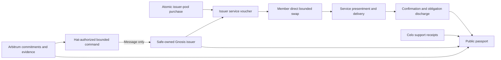

# Cosmo-Local Integration — architecture

**Current planning baseline:** 2026-10-21 UTC, adding the voucher-direction decisions below. This preserves the September issuer-service model and
[whitepaper v0.8 review](whitepaper-v8-review.md), with the user's voucher-plus-G$ clarification and
[first-pass architecture research](architecture-alignment.md). Contract choices remain proposals;
Claude's second-pass review is complete, and Afo accepted the no-core-upgrade boundary on 20 October.
It does not authorize implementation or live funds.
The original August model remains in Git at `06a31dbf5`; current unresolved choices are explicit below.

## Voucher direction (decided 2026-10-21)

Afo made these five decisions on 21 October after a research brief compared this plan with a
voucher-native implementation. They refine the accepted no-core-upgrade boundary and authorize no
implementation, deployment or tracker change. The Linear updates were applied on 21 October after
Afo's approval and read back; the applied texts are in
[`handoffs/claude-linear-voucher-direction-drafts-2026-10-21.md`](handoffs/claude-linear-voucher-direction-drafts-2026-10-21.md).

1. **Promises run on vouchers.** An Offer can accept vouchers and a Request can pay in them.
   Presenting vouchers opens a Green Goods promise that ends in discharge. Pooling (curation,
   valuation, limits and exchange) stays in Cosmo-Local pools, and a kept promise can still earn
   vouchers.
2. **Curated gardener issuance.** Gardeners, as well as hubs and Green Goods, may issue vouchers
   once a steward admits them. Each gardener's voucher is its own token, and the gardener's ongoing
   Offer carries its terms. Until the WebAuthn validator exists on Gnosis, the garden's Safe issues
   within the gardener's cap and the gardener stays the named issuer. Issuer duties for
   individuals need a legal check through COM-46.
3. **Presentment is a promise in the live design.** Whoever presents vouchers becomes the
   promise's counterparty and confirms by default, which resolves
   [tension 4](tensions.md#4-transferability-breaks-counterparty-confirmation). Presented vouchers
   wait in a Gnosis escrow keyed to the promise; keeping the promise sends a discharge command, and
   a remedy returns them. The PRD-1096 service desk is a fork-only stand-in. Not yet designed: the
   handshake that turns an escrow into a promise. It must bind presenter, promise, token, amount and
   escrow receipt, be replay-safe, and show the escrow exists before the presenter becomes the
   counterparty, either through a Gnosis-to-Arbitrum message or by gating delivery on the indexed
   escrow. The live escrow contract placement and custody authority are undecided; the delivery-only
   adapter is not assigned escrow custody. Before custody is assigned, PRD-1315 must specify setup
   recovery for deposit success followed by receipt rejection/delay or failed promise creation.
   Idempotent retries and authenticated setup cancellation/expiry/refund must converge to one
   escrow/promise outcome, including delayed/reordered activation-versus-abort races. Timeout alone
   is not proof that promise creation failed. A setup-refunded escrow cannot activate a promise;
   an activated escrow cannot receive a setup-abort refund, while normal authorized service remedies
   remain available. PRD-1317/1318 must prove no duplicate promise, double settlement or stranded
   holder balance. Record finality, deadline/clock, activation and abort authority in the handshake
   decision alongside escrow placement and the open acknowledgment-lane choice.
4. **The instrument is called "voucher".** User-facing copy names it with its issuer and unit, for
   example "Tech and Sun voucher, one solar class seat"; terms and docs may say "service voucher"
   at first mention. "Credit", "token" and "points" stay off the instrument, and "Redeem" keeps its
   existing vault meaning. Proposed for PRD-1299, not yet decided: the verbs earn, buy, swap and
   use; "voucher exchange" for a Cosmo-Local pool in Green Goods copy; "vale" in Spanish and
   Portuguese, pending the term list; and "kept" for promises against "used" for vouchers.
5. **Curated, capped issuance replaces the kept-promises-first order.** This formally supersedes
   commitment-pooling Decision Log #52 and #53 and PRD-796's fulfilled-first clause:
   - a steward admits each issuer with published terms: what the voucher buys, its unit,
     capacity, timing, presentment and remedy;
   - each issuer's outstanding vouchers are capped, and the cap grows with kept promises in the
     register, so kept promises still come first, as proof of capacity rather than as backing;
   - each pool still decides how much of an issuer's voucher it accepts;
   - a failed delivery ends in a remedy that returns the units, a steward can pause an issuer,
     and outstanding obligations stay visible.

   The accepted contracts do not enforce the cap on-chain: the issuer's Safe owns the token's mint
   authority, and the adapter's allowance bounds only its own delivery path. Until PRD-1315 chooses
   a cap-enforcing mint controller or records the cap as monitored governance policy, the cap is a
   published issuer rule, not a contract invariant.

   Vouchers earned by kept promises remain a second issuance source. The PRD-651 release gates
   are unchanged.

### Further decisions before the implementation boundary freezes

**Voucher-accepting Offer funding remains open.** The accepting claimant is the payer, whose
identity becomes known only after claim selection. PRD-1315 must record how that payer authorizes
the exact payment, how its vouchers are reserved, escrowed or debited, and how failure,
cancellation and refund converge. The PRD-1317/1318 interfaces must carry that recorded rule before
implementation dispatch, and completion must prove the chosen funding route.
Delivery from an issuer's reserve is an earned reward; it cannot stand in for collecting the
claimant's payment. An unfunded or unauthorized claim must not appear paid.

**Gardener issuer identity remains open.** Before PRD-1317/1318 dispatch, PRD-1315 must specify
the gardener's distinct issuer identifier, its relationship to the garden, controlling Safe and
voucher token, and who admits that identity. Authorization and outstanding-voucher caps must stay
isolated per gardener: two gardeners sharing one garden or Safe must not become one issuer or
share a cap by implication. The rehearsal's `issuerGarden` key covers its two organizational
issuers only; it does not establish this identity model.

**Steward-controlled issuer suspension remains open.** The steward-pause product rule above is
not enforced by the accepted candidate: issuer-Safe adapter pause is not an independent steward
stop. Before freezing, PRD-1315 must record the authorized steward/admission identity, cross-chain
propagation/order, per-issuer pause state and affected minting, earned-issuance and purchase routes,
including issuer-Safe/alternate-route bypasses. Specify outstanding service/discharge/refund
behavior and recovery authority. PRD-1318 must enforce and test the recorded scope, issuer isolation,
unauthorized/replayed changes and in-flight commands. Any required stop that reused CLC contracts
cannot enforce remains a release blocker; do not describe a policy or UI flag as enforcement.

These decisions join the [complete freeze inventory](plan.todo.md#sequence-and-completion-evidence).
The approved bounded rehearsal does not settle them or expand to cover them.

Grounding: the Cosmo-Local whitepaper v0.8 defines a commitment as a promise and a voucher as its
token (p. 9), defines Offering, presentment, fulfillment and discharge but no request or need
(pp. 34–35), says its contracts record no real-world fulfillment (pp. 8 and 10), and names
evidence standards, remedy paths and separate presentment, fulfillment and discharge records as
controls (p. 26). Ruddick's *Intro to Commitment Pools* (May 2024) describes providers issuing
their own vouchers and drawing from pools with them.

## Domain boundaries

Use **service voucher**, shortened to **voucher**, for the issuer instrument, following the supplied
Cosmo-Local Credit whitepaper v0.8 (30 September 2026), pages 9–11. Cosmo-Local Credit remains the
product-family name; credit facilities and the separate Commitment Credit companion retain their
own meanings. CLC’s Commitment Pool is a governed arrangement; `SwapPool` is its current vault and
direct-swap component. See the accepted [four-goal alignment](delivery-alignment.md).

A Green Goods commitment records a promise, its parties, terms, evidence and confirmation. Its
registry identity remains non-transferable. A service voucher separately represents its issuer's
future services under published terms and is transferable in this planned integration. Earning a
voucher and fulfilling its service are different obligations.

Tech and Sun and Green Goods each issue their own service voucher, and curated gardeners may issue
theirs (decision 2 above). Members may earn vouchers under
published rules; supporters may buy vouchers for themselves or a cohort. A purchase need not pretend
to be a previously fulfilled member contribution. Earned reserve delivery consumes a derived
entitlement once. The approved rehearsal purchase is one atomic pool swap of existing inventory,
without a separate purchase entitlement or cross-chain message. Both remain subject to the
issuer's capacity and supply policy; the rehearsal does not prove total issuer-cap enforcement.

| Context | Proposed owner and location | Boundary |
|---|---|---|
| Commitments and confirmation | Green Goods on Arbitrum | Evidence and confirmer provenance; not token custody |
| Issuance authorization | Hat-authorized Arbitrum module | Registers terms while the commitment is Offered or Requested; names issuer, source kind, entitlement, recipient, amount and season |
| Issuer and voucher | Issuer's community Safe on Gnosis | Authenticated commands, replay protection, delivery within the issuer's allowance (or bounded minting if the writer model is chosen); no limiter writes in the first slice |
| Registry, quoter, limits, fees and pool | Community-owned instances on Gnosis | Explicit local terms and inventory. The adapter and Arbitrum stewards have no pool authority; the issuer Safe owns the selected pool and retains `withdrawLiquidity`, even after registry/limiter sealing. Disclose this custody and governance risk |
| Member exchange | Gardener's own Gnosis account | Direct executable swap with minimum output and deadline |
| G$ support | Existing Celo settlement path | Can coexist with voucher entitlement on one commitment; separate amounts and receipts, no G$ bridge |
| Passport | Indexer projections and Shared domain adapter | Join evidence without merging intent, issuance, payment and delivery |

The diagram above preserves the broad issuer-service journey. The
[contract comparison](architecture-alignment.md#current-and-proposed-contract-relationships)
adds the clarified relationship: one commitment may carry both G$ support and voucher entitlement.
The purchase route uses the pool's bounded swap under the approved rehearsal default; a later
separately settled purchase would need its own trusted receipt and entitlement rules. The diagram
shows required meaning, not a settled ABI or a new contract for every box.

## Commitment rewards — clarified intent, proposed architecture

The user confirmed that a commitment can receive vouchers and G$, with both terms agreed at
acceptance. This replaces the old exclusion
of a second linked voucher obligation; it does not require several installments of the same G$
amount. Retain work fulfillment, G$ settlement, voucher delivery and later voucher-service delivery
as distinct outcomes. Never sum different assets into one settlement amount.

The accepted candidate (20 October, after Claude's [review](handoffs/claude-architecture-review-results.md)) uses a dedicated Arbitrum
voucher entitlement module and a restricted Gnosis issuer adapter calling reused CLC contracts,
with no CommitmentPooling upgrade: the module reads the existing commitment views, registers
voucher terms only while the commitment is Offered or Requested, and delivers **earned rewards**
only on Fulfilled, the same gate the G$ rail uses. This earned-issuance gate does not govern
purchased or curated issuance against approved future capacity: those use the admitted issuer's
published terms and cap policy, with cap enforcement still an open decision. The rehearsal's
purchase route is the issuer pool's atomic swap, outside the entitlement module. The existing
G$ SettlementModule/Celo executor remain unchanged.
Acceptance-time agreement is a product requirement; its consent binding is still open.
The eligibility rule (any Fulfilled versus ordinary only),
the issuer budget mechanism, recipient allocation, issuer-cap enforcement, the presentment handshake
and terms consent remain decisions, not accepted ABI; the 21 October voucher direction settled
purchased issuance and service discharge.

Terms consent is not yet bound. The core takes no voucher revision or sidecar callback at claim
or acceptance. An open claim calls acceptance immediately inside `claimCommitment`; the
approval-gated `acceptClaim` likewise has no voucher-consent check. PRD-1317 must record and freeze
the exact approved revision and counterparty consent while the core is still Offered/Requested,
before either path accepts. Changing terms while a claim is pending cannot silently replace that
consent. Post-acceptance consent, a later dispute or exclusion at dispatch does not satisfy the
acceptance-time agreement. Prove direct calls to both core entrypoints cannot create a
voucher-bearing acceptance without the required consent. A frontend wrapper or sidecar dispatch
check alone is not that proof. If the no-core-upgrade candidate cannot enforce this invariant,
PRD-1315 must return the boundary for an explicit decision before implementation dispatch; no core
upgrade is selected or authorized here. RESR-73 owns research and the boundary remains unfrozen.
The consent mechanism must reject an earned-reward recipient equal to
the Gnosis reserve holder before accepting a voucher obligation; a self-transfer cannot satisfy
the exact recipient balance increase. The bounded rehearsal rejects known Offer overlaps at
approval and Request overlaps before dispatch, but leaves Request pre-acceptance eligibility
unproved. No general multiasset engine is assumed.

## Issuance and identity

The command must bind source chain and authorized sender, issuer/pool, entitlement identity,
source kind, recipient, amount and season. Reject both a duplicate transport message and a different
message reusing a consumed entitlement. Consume an entitlement only on success. Specify
acknowledgments, failure, retry and reconciliation before writing the implementation; a send event
is not proof that delivery completed.

For earned issuance, decide what confirmation paths qualify and retain their provenance. Current
Fulfilled status can include pool or protocol fallback; it cannot be described automatically as
confirmation by the person served. For the atomic purchase route, record payment/output finality,
recipient, minimum output, deadline and inventory delta. A later separately settled purchase must
define its asset, destination, allocation, refund/cancellation and duplicate-prevention rules.
Informational declared value is not a receipt.

Prove gardener Kernel account derivation, ownership and signing on Gnosis, including sponsored
spend and recovery. Garden-account identity and gardener identity require separate proof. The
cross-chain garden-account owner relay belongs to its own work and is not this authorization path.
A Safe call to its local issuer is a proposed fallback, with equivalent caps and audit trail.

## Pool economics and controls

Each community owns its instances and the authority behind upgrades, listing, prices, limits and
withdrawal. Verify exact deployed interfaces and effective ownership before relying on them.
Community ownership must be stated for each resource; it does not establish control of every
protocol-level fee, pause or upgrade capability.

Initial mutual acceptance at parity and roughly 500 units of cross-holding capacity are proposals.
A holding limit, token issuance cap, usable service capacity and lending credit line are separate.
Each pool sets its own terms; never create a universal cross-pool rate table. Demonstrate only the
direct routes whose execution is supported; quote-only multihop discovery is not executable routing.

Tech and Sun's proposed 24% voucher-to-money fee is rehearsal-only. Real cash-out needs agreed terms,
legal review, liquidity on Gnosis and a separately authorized route. It cannot withdraw money from
an Arbitrum Safe by implication; protocol fees must be accounted for separately. Green Goods vouchers
have no cash-out in this scope. G$ token units are not US dollars or automatically the service-voucher
unit; any service acceptance or conversion basis needs explicit terms.

## Service use and discharge

Define presentment or booking, availability, partial delivery, completion, confirmation, discharge,
failed delivery and remedy as separate facts. A swap, token return or token burn does not prove a
service was delivered. The current published burn authority must be checked independently of mint
writer authority. Choose whether issuer-received discharged units are burned, locked or reusable,
and prevent a second discharge of the same service obligation. Remedy refunds and refundable
partial-delivery units return to the holder; that disposal decision does not give the issuer custody
or burn rights over the holder's refunded balance.

When COM-46 permits partial delivery, authenticated commands must bind the presentment's confirmed
`deliveredUnits` and `refundableUnits` to the same escrow and promise, with
`deliveredUnits + refundableUnits = presentedUnits`. Delivered units go to the issuer and refundable
units to the holder. Each leg settles once across retries, replay and reordered commands; neither
can consume or strand the other's balance. PRD-1317 binds the split and PRD-1318 enforces it, as
recorded in their approved Done-when additions.

All escrow settlement commands must bind one immutable settlement decision: full discharge, full
return or the confirmed partial split. Use shared progress for that decision, with per-escrow and
per-leg accounting; a conflicting decision cannot replace it. Mark the escrow terminal only after
all authorized legs settle (a zero allocation needs no transfer). A full return excludes a later
discharge, and a full discharge excludes a later return. Test both orders and duplicates with two
escrows holding the same token: no replay or conflicting command may spend the other's balance.
Partial legs may arrive in either order, but must bind the same frozen split and settle once.

Decided 21 October: presentment opens a Green Goods promise (decision 3 above), and the rehearsal's
service desk is a fork-only stand-in.

Record remaining service obligations and capacity after each outcome. Transferring a voucher changes
its holder; it does not transfer the original commitment's confirmation authority automatically.
COM-46 must resolve these rules before the participant pilot can claim delivery.

## Passport and product experience

Every published measure needs its unit, time window, denominator where relevant, source and
freshness. Separate promises kept, eligible earned issuance, purchased issuance, actual payment,
service delivery, remaining obligations, pool inventory and available capacity. Consent to participate
does not imply consent to public reporting; use privacy-safe aggregates and no participant ranking.

Keep the PWA centered on useful activities, unfinished work and service use. The separate PWA hub
owns Home / Garden / Profile, remembered garden context and draft continuity. The four funding levels
are narrative and reporting audiences, not four new member tabs. Keep chain mechanics behind the
relevant technical details, while showing understandable states and recovery actions.

Contracts enforce authorization and accounting; the indexer projects receipts and provenance;
Shared owns the vendor adapter, domain translation, state and hooks; client/admin own presentation
and permitted interactions. These are ownership recommendations, not permission to create parallel
state or bypass existing module boundaries.

## Funding paths around the integration

Direct support, service purchases, shared payment structures, endowments and impact certificates
have different rights, liquidity and evidence. The existing yield splitter has three destinations;
a CLC cash pool would require an explicit fourth-path decision and implementation. A pool deposit
alone grants no assumed LP shares or exit rights. Endowment design aims to retain principal but
does not guarantee its value. Certificate ownership is not automatically equity, land ownership,
audited impact or a carbon credit.

Fiat contributions remain the separate Garden Fiat Contributions project. RESR-82 qualifies the
provider and corridor; PRD-1031 defines the exact asset, account, recipient and recovery contract.
A sandbox donation demonstration may be a stretch after qualification. PRD-1038 retains any live
pilot approval. No recurring paid platform plan or new spend is authorized here.

## Explicitly retired or deferred

- The August weighted contribution unit, per-cycle ValuationPolicy and new inert pool types.
- Same-asset installment payments and a general multiasset/fiat settlement engine. A linked Gnosis
  voucher obligation is now in intended scope; its precise integration boundary remains proposed.
- CLC-owned venue control as the intended community pool topology.
- General federation, multihop execution, netting, insurance or governance-token work.
- The separate records-only Commitment Credit lending companion.

## Decisions and release authority

RESR-74's completed due diligence is dated evidence and must be refreshed before deployment.
Use published CLC documentation and hand-written interfaces; never read, import or vendor AGPL
implementation source for this integration. The four first-slice Gnosis implementations match the
published v1.0.0 build artifacts ([checked 20 October](handoffs/claude-conformance-evidence-2026-10-20.md)); verify the rest the same way
before PRD-1325.

PRD-1197 owns the 22 October human go/no-go. The PRD-651 gates remain explicit: external audit,
3-of-5 Safe ownership, 48-hour timelock, two weeks of testnet operation and tested rollback. Any
proposed substitution must be named and accepted separately; a local fork or a completed issue
is not automatically an equivalent. No-go is a valid hackathon outcome with an honest demo.
