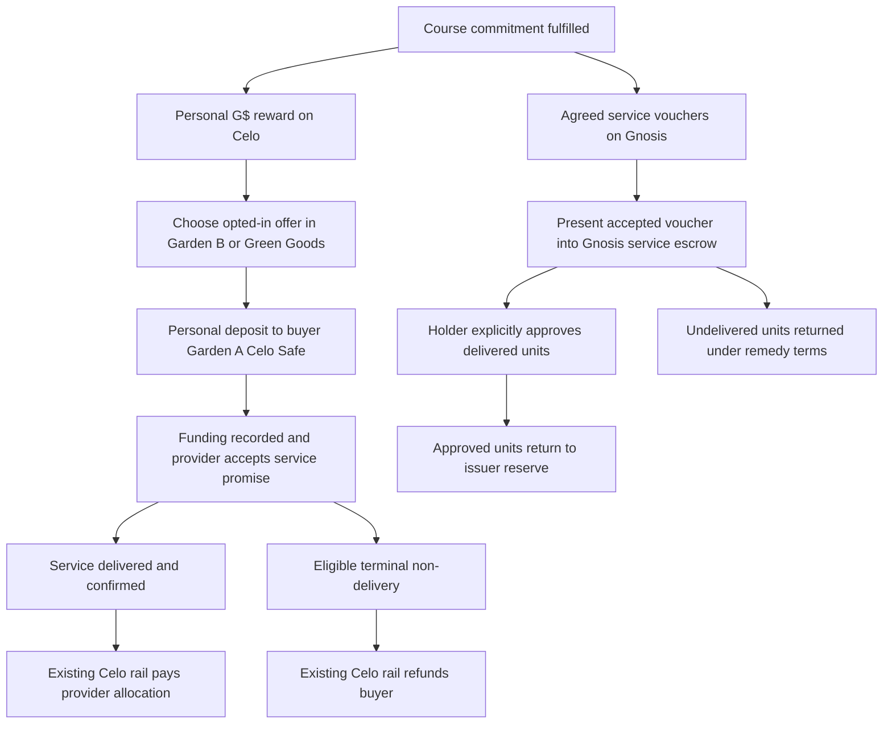

# Cosmo-Local Integration — architecture

## Accepted pilot amendment — member and garden issuers, 23 October Pacific

Individual issuance is required in the pilot. Members and garden/collective issuers share **one
curated Gnosis exchange pool**. Steward-assisted onboarding is accepted: a steward can prepare
terms and configuration, publish an approved offer and administer pool admission, but the member
owns their voucher and reserve and approves the exact service obligation. This amendment
supersedes the two-organization-only pilot assumption. It is accepted architecture and planned
work, not evidence that individual issuance is implemented or deployed.

| Decision | Responsibility and boundary |
|---|---|
| Member-owned service | The named member's supported account owns the token and reserve and approves issuance, service terms and any delegated authority. A garden affiliation does not transfer that promise to the garden. |
| Garden/collective service | The collective's existing issuer authority owns the promise and arranges delivery. A member may deliver on its behalf without issuing a personal voucher. |
| Assisted onboarding | A steward prepares and submits permitted configuration; membership or stewardship alone cannot mint a member's voucher, spend their reserve, approve for them or take token ownership. |
| Shared exchange | Pool administrators curate assets, rates, fees and pool holding caps. Admission is separate from issuance and does not guarantee service delivery, demand, cash conversion or pool inventory. |
| Existing service controls | Retain exact issuer/holder consent, escrow before core acceptance, acceptance-bound activation and one immutable delivered/refundable allocation. Delivered units return to that issuer; undelivered units return to that holder. |
| Independent money | Optional G$ rewards and personal cross-garden G$ service purchases remain on Celo. Each accepted offer revision selects one payment route; no mixed checkout or G$ bridge. |

An offer describes a service; its voucher describes a transferable entitlement under the issuer's
terms; a booking binds a particular delivery. Start with one clearly bounded service per member
issuer. Repeated bookings use the same appropriate service voucher, not a new token per booking.
A token may later cover several services only when their common unit and shared capacity budget
are explicit. Individual services, member count, quantities, prices and exchange rates are not
selected by this amendment; the existing GG/TAS baseline does not apply automatically to them.

### Onboarding and authority

1. The member and steward define a service unit, available capacity/calendar, terms and remedies.
   Record the member's acceptance; publishing a profile or offer is not acceptance to issue.
2. Verify the actual member-controlled account and its approved same-address profile on Arbitrum,
   Gnosis and Celo. Token owner, reserve, source approval authority, mint writers, proxy
   administrator and recovery powers must be explicit. Do not default member token administration
   to the shared-pool Safe or create a new member Safe without a demonstrated need and selection.
   For the reused pilot path, the Gnosis issuer address is both the token owner and the address
   receiving delivered vouchers; use that member-controlled account as the reserve. Separating
   these addresses is not part of this amendment. Bind the source approval authority explicitly.
3. Deploy/configure the issuer token using the existing published CLC implementation and approved
   controls. Initialize ownership atomically to the member; prove any temporary deployment powers
   are removed. Only the member, or a separately approved delegate, authorizes issuance and the
   reserve's finite adapter allowance. Service capacity is not enforced by token supply alone.
4. The existing governance owner registers the issuer/token/source authority; the member configures
   their reserve through the existing adapter boundary. Batch onboarding during the required paused
   configuration window. Restore only the reviewed prior activation state; never silently rebind
   accepted terms or broaden the owner-only registry into steward minting authority.
5. The steward publishes the approved service and the pool administrator admits the asset with
   explicit quote, fee, exposure and inventory settings. Current steward-controlled offer terms and
   claim acceptance may remain for this assisted pilot. Member approval of the exact booking remains
   required even when a steward performs core acceptance.
6. The member completes issuance, exchange and redemption proof, including issuer return to their
   own reserve. A steward's signature or the operator's working account is not proof of member control.

Token ownership and proxy upgrade control are distinct. The release package must show both and
obtain the member's approval of any delegated upgrade/recovery authority. No mandatory 48-hour
delay remains: the user's zero-delay decision retains owner authorization, pause, compatibility
and exact-candidate checks. Existing collective Safe controls remain unchanged.

### Capacity, circulation and failure

Track deliverable capacity, issued units, usable reserve, finite allowance, accepted undelivered
rewards, outstanding service obligations and pool inventory separately. Issuing or exchanging a
future service promise differs from earning someone else's voucher after completed work. Returned
delivered vouchers do not replenish consumed service capacity; reuse requires an approved remaining
budget. Pool holding caps bound pool exposure, not total minting or all outstanding promises.

If an issuer cannot deliver, the agreed refund returns that issuer's voucher; it does not undo an
earlier swap or promise G$, cash or another issuer's service. Suspend new issuance/admission or
booking as appropriate, retain existing obligations, and expose the agreed remedy. De-listing must
not erase balances, accepted bookings or their recovery paths. No automatic insurance or pooled
guarantee is introduced.

### Contract change boundary and deployment impact

The release planner currently restricts issuers to `greenGoods | techAndSun`, although the source
authority map, reserve adapter and escrow use issuer/token addresses. Extend the owning planner and
configuration to explicit individual and collective issuer records, preserving existing keys and
receipts. For N member service assets, plan N additional voucher-token instances. The exact proxy
administration deployment count depends on the approved control arrangement. Reuse the one pool,
its dependencies and the existing voucher modules; do not assert either a new module or no source
change until the member-authority proof is complete.

The smallest selected approach retains steward-assisted offer administration. Self-service member
administration, a new issuer factory/registry and a second exchange engine are deferred. Add a
narrow contract change only for a demonstrated authorization or lifecycle gap. The source planner,
shared routes, indexer and UI must stop assuming every issuer is an organization Safe. Exact work
and pre-deployment proof are in [the implementation sequence](plan.todo.md#member-and-garden-issuer-pilot--accepted-23-october-pacific)
and [acceptance criteria](eval.md#member-and-garden-issuer-acceptance--23-october-pacific).

### Selected TAS project rehearsal — three participants and a member exchange

The user selected a TAS impact-website example for implementation on the existing branch. Use one
shared brief/reference and three existing commitments, assigned to distinct designer, analyst and
engineer accounts. Each commitment retains its own terms, acceptance, evidence and outcome. The
brief groups the work for people; it is not an implemented aggregate project state or a guarantee
that the group will finish. A coordinator confirms prerequisites before downstream work is booked.

| Rehearsal commitment | Separately accepted result |
|---|---|
| Designer | A reviewed landing-page and impact-section design |
| Analyst | A metrics definition, sample-data validation and impact summary |
| Engineer | A working website implementation using the accepted design and data contract |

Actual participants, accepted services, capacities, rates and funded rewards remain unconfirmed.
Fixture identities, transport and delivery must be labeled. The connected rehearsal includes at
least two member-controlled voucher assets alongside collective assets in the same curated Gnosis
pool. It proves an exchange of one member's service voucher for another member's voucher, followed
by booking and redeeming the received service. Replaying only the GG/TAS exchange does not meet
this boundary; the designer need not issue a token.

Keep the exchanged peer-help service distinct from a separately rewarded project deliverable.
For example, general measurement coaching and a standalone integration-help lesson may be the two
fixture services; the project's impact summary and website implementation are different work.
Use separate capacity/obligation entries and evidence. Never count the same work or future service
capacity twice. Test exact member approval, issuer custody, partial delivery/refund, return to the
correct member reserve and retry without duplicate issuance, swap or payout.

A garden can fund these milestones with vouchers it is authorized to distribute and optional G$.
A single existing multi-contributor Request instead divides one agreed issuer/token reward total
using canonical recognition after fulfillment. It does not guarantee an arbitrary negotiated
designer/analyst/engineer percentage, a whole service unit for every person, or a basket of assets.
Where distinct deliverables need fixed rewards or independent completion, use separate commitments.

Member vouchers let a project obtain a named person's future service through the shared pool;
they are not project equity or a claim on everyone else's labor. A future collective project voucher
would require one accountable issuer, accepted team obligations, capacity and replacement rules,
and project-wide remedies. No joint-liability, automatic revenue split, multi-issuer escrow or new
project contract is selected. Broader project tokens, arbitrary payout splits, atomic bundles,
automatic dependency scheduling and multi-issuer escrow remain outside this implementation.

## Existing integration baseline and release disposition

**Current hackathon release decision, 22 October 2026 Pacific:** the intended outcome is a
controlled **live** pilot with deployed contracts by Saturday, 24 October. The pitch deck is
targeted for Saturday and participant testing for Sunday/Monday, 25–26 October. External audit
evidence and audit intake are outside this hackathon's prerequisites. The user explicitly replaced
the older two-week testnet wait with focused pre-deployment tests, deployment simulation and
post-deployment smoke checks. These substitutions are accepted decisions, not open approval items.

Continue the same-address Gnosis work and prepare the exact deployment package through the
repository workflow. The member address must remain identical on Arbitrum, Gnosis and Celo;
optional G$ stays independently accounted for on Celo, with one shared Gnosis exchange pool.
Existing Safe controls, the accepted zero-delay upgrade policy, consent, escrow, activation and immutable
final-allocation rules remain intact. The policy change does not establish a usable signer,
configured provider, issuer terms/caps or a passing deployment simulation. Make the concrete
candidate and operations reviewable before execution. The
[live deployment package](handoffs/codex-live-pilot-deployment.md) owns current readiness and
technical inputs. The [working issuer terms](pilot-issuer-terms.md) record accepted prices,
issuance/cohort ceilings and the initial exchange ratio for hub access, assisted sessions and
Claude Team access. Assistance costs two GG vouchers per forty-five minutes (approved 27 October 2026). The issuer operating
terms were approved on 27 October 2026; control addresses and accountable identities still go
through the private path. Older local-only and audit/soak restrictions below
are historical dispatch limits.

**Earlier blocker/readiness continuation, 22 October:** the user authorized cohesive internal
contract refactoring and real Admin stories to clear the local branch gates. Existing consent,
custody, acceptance, activation and final-allocation behavior stays authoritative. The
[current proof record](handoffs/codex-local-blockers-and-readiness.md) records fresh Alchemy and
issuer observations. That bounded dispatch did not itself grant new account, issuer or deployment authority.

**Local pilot dispatch, 22 October 2026:** voucher-led requests, direct service redemption and
bounded voucher-to-voucher exchange in one curated shared Gnosis SwapPool are now authorized
for local implementation. Continue in the existing checkout on `feature/cosmo-local-contracts`,
commit validated owned work with required signing. That slice was local-only; the newer hackathon
decision above now governs live deployment preparation and execution. The
[pilot gap map and execution record](handoffs/codex-local-voucher-pilot.md) owns this slice.
This dispatch supersedes conflicting planning-only and uncommitted-only language below.

An offer describes a service; a request describes needed contributions. Neither creates or
distributes vouchers automatically. A request names the required work, evidence/review, voucher
asset and redeemable quantity, and any optional G$ reward. Voucher and monetary outcomes have
separate receipts and recovery. Existing G$-only behavior and cross-garden personal G$ purchases
remain intact; each accepted offer revision still selects exactly one payment route.

The pilot has one shared exchange pool for participating issuers and gardens, distinct from
Arbitrum garden/protocol commitment pools. Issuers retain inventory and obligation authority;
pool administration grants no right to mint or spend another issuer's reserve. A holder with
the correct voucher redeems directly. A different voucher may be exchanged through one bounded
direct pool call after reviewing input, net output, fees, minimum output and validity. SwapRouter
quotes routes and does not execute them. WXDAI remains a separately labeled rehearsal asset.

The shared Gnosis pool includes Tech and Sun, Green Goods and admitted member vouchers in the
pilot. It is not limited to a bilateral pair or a mandatory universal pool.
A garden and a voucher issuer are different roles. New gardens may participate using existing
admitted vouchers without issuing their own. A new issuer needs agreed service obligations,
capacity, inventory, exposure limits, quotes/fees and explicit admission before its asset joins.
The existing Green Goods Gnosis Safe administers both the network exchange pool and the Green
Goods issuer reserve, preserving its observed 2-of-5 configuration. No separate pool Safe or
automatic garden representation is required. Tech and Sun controls its own issuer reserve;
its active garden stewards are the signer source. The selected threshold is fixed at **two valid
steward signatures**, regardless of roster size, superseding the earlier majority policy.
Fewer than two valid stewards blocks spending. An immutable Arbitrum publisher reads canonical
roles and automatically dispatches changes using native CCIP fee fuel; failures leave a
permissionless refresh/caller-funded dispatch retry. Delivery feeds an authenticated,
revision-ordered Gnosis mirror. The receiver owns a dedicated Hats tree and creates a locked
Hats Signer Gate v2 Safe with fixed ABSOLUTE min=2,target=2. **Superseded for new gardens,
26 October:** the Safe mirrors the steward roster (ABSOLUTE min=1,target=2, locked at
deployment): one steward signs alone, two or more need two signatures, and an optional starting
signer's exception ends when its own Hats status is mirrored. The live Tech and Sun Safe keeps
fixed-two after its [finalization](handoffs/tas-steward-safe-finalize-runbook.md). Revocation is
committed before best-effort owner cleanup. Source grants recover a zero/one-steward Safe; loss of source garden
admin authority remains a separate recovery problem. This is local implementation pending live
inputs, source upgrade/observer registration, dispatch operation and activation. Each
issuer retains its own service obligations. Other communities can operate separate exchange pools; federation and
multi-hop execution are outside this pilot. This matches the published
[CLC network model](https://docs.cosmolocal.credit/protocol/network/).

The individual-contributor pilot uses canonical recognition and a total sufficient for a whole
fictional service unit. Group allocation still divides an agreed total: it does not guarantee a
whole unit to every participant. Accepted rewards reserve no inventory. Show reserve, finite
allowance, accepted undelivered rewards and recoverable shortages separately. Fictional terms
identify full access versus a discount, quantity, duration, booking, activation and remedies.

Future monetary rewards may identify another approved asset, amount, recipient, funder, payment
method and receipt. This slice preserves G$ and documents those boundaries without building
multi-currency settlement, fiat payments, FX, mixed checkout, G$-to-voucher purchases or cash-out.
External fiat settlement would require independent verification. Existing voucher consent,
escrow-before-acceptance, permanent activation and immutable final allocation safeguards remain
authoritative. No token transfer, timeout, escrow closure or activation proves external delivery.

**Newer accepted safeguards, 21 October 23:42 UTC:** the user adopted escrow before voucher
promise activation, exact earned/payment voucher consent enforced before every core acceptance
path, and one immutable final delivered/refundable allocation. These supersede conflicting
sequencing and incremental-release descriptions below. The earlier signed checkpoint and its
tests do not certify these safeguards. The narrow core consent
integration is now authorized; personal G$ remains on its independent Celo rail. See
[the reconciliation record](handoffs/codex-voucher-reconciliation.md) for exact boundaries,
checkpoint preservation and the separate implementation/proof sequence. Broader issuer identity,
cap enforcement and independent steward suspension mechanisms remain unresolved live gates.

**Safeguards implementation, 22 October UTC:** the exact core guard, v2 setup/Activate/Abort
convergence, immutable final allocation and affected consumer flow are implemented locally.
The reconciliation handoff separates their passing local evidence from the signed checkpoint and
records remaining live proof. That dated continuation originally kept changes uncommitted;
the later signed checkpoints and current local pilot dispatch require coherent signed local
commits. No live authority is granted.

**Current continuation, 21 October:** the user dispatched the prepared service-access slice after
closing the purchase proof gaps. The approved validator repair separates fresh checks from optional
receipt fingerprints; it requires no secret-file read or permission change for a fresh run. The
399-test harness and five-check contract baseline passed before the service extension. New core
consent, personal funding and voucher escrow are implemented and verified locally, with proof in
[the execution handoff](handoffs/codex-service-access-execution.md). Earlier slice receipts do not
certify the extension. The later user continuation authorizes Indexer projections, Shared state/actions
and member journeys, with cohesive local commits. The
[integration record](handoffs/codex-service-access-integration.md) owns that bounded implementation
and its proof limits. Live authority and release gates are unchanged.

**Accepted implementation baseline:** 2026-10-21 UTC. The user's earned-voucher dispatch
supersedes the core-upgrade, adapter-minting and universal fulfillment-first proposals in the
[20 October research](architecture-alignment.md), [phased proposal](commitment-upgrade-plan.md)
and [second-pass review](handoffs/claude-architecture-review-results.md). The review's claim that
a pre-acceptance edit window alone proves participant consent is insufficient: v1 must bind and
freeze the exact expected revision. That initial dispatch covered only earned-voucher distribution,
authenticated acknowledgments and recovery. Purchase and redemption execution have separate slice authority.
No live deployment, authority, issuer commitment or release waiver is granted.

**Service-access amendment and later dispatch, 21 October:** gardeners must be able to spend their own
G$ on opted-in offers across gardens, including Green Goods protocol-pool offers, alongside the
voucher-redemption route. G$ stays on Celo. The initial amendment authorized planning only; the
subsequent user request explicitly dispatched the
[service-access prompt](handoffs/codex-service-access.md). The earlier no-core/no-G$-change
boundary remains true for the earned-voucher slice. The later dispatch supersedes it only for
the narrowly scoped opt-in offer eligibility and personal-funding extension described below.
Separately authorized direct Gnosis purchase-swap work retains its own scope and execution handoff;
this planning amendment neither cancels it nor expands it into personal G$ funding or service escrow.

**Direct-swap implementation dispatch, 21 October:** the user's next-slice follow-up authorizes
bounded direct Gnosis voucher purchases in the existing checkout. Reuse the published bounded
SwapPool entrypoint through a hand-written interface, with real implementation/configuration
proof and explicit limits in [the purchases handoff](handoffs/codex-contracts-purchases.md).
CommitmentPooling, registry, Hats, G$ settlement and the earned-voucher endpoints remain unchanged
in this slice. No service escrow, G$ purchase integration or app activation is dispatched here.

## Voucher direction (decided 2026-10-21)

This decision record came from develop when the contracts branch was merged. Where the newer
dated sections above differ, they supersede it, including its open items and release gates.

Afo made these five decisions on 21 October after a research brief compared this plan with a
voucher-native implementation. They refine the accepted no-core-upgrade boundary and authorize no
implementation, deployment or tracker change. The Linear updates were applied on 21 October after
Afo's approval and read back; the applied texts are in
[`handoffs/claude-linear-voucher-direction-drafts-2026-10-21.md`](handoffs/claude-linear-voucher-direction-drafts-2026-10-21.md).

1. **Promises run on vouchers.** An Offer can accept vouchers and a Request can pay in them.
   Presenting vouchers opens a Green Goods promise that ends in discharge. Pooling (curation,
   valuation, limits and exchange) stays in Cosmo-Local pools, and a kept promise can still earn
   vouchers.
2. **Curated gardener issuance.** Gardeners, as well as hubs and Green Goods, may issue vouchers
   once a steward admits them. Each gardener's voucher is its own token, and the gardener's ongoing
   Offer carries its terms. Until the WebAuthn validator exists on Gnosis, the garden's Safe issues
   within the gardener's cap and the gardener stays the named issuer. Issuer duties for
   individuals need a legal check through COM-46.
3. **Presentment is a promise in the live design.** Whoever presents vouchers becomes the
   promise's counterparty and confirms by default, which resolves
   [tension 4](tensions.md#4-transferability-breaks-counterparty-confirmation). Presented vouchers
   wait in a Gnosis escrow keyed to the promise; keeping the promise sends a discharge command, and
   a remedy returns them. The PRD-1096 service desk is a fork-only stand-in. Not yet designed: the
   handshake that turns an escrow into a promise. It must bind presenter, promise, token, amount and
   escrow receipt, be replay-safe, and show the escrow exists before the presenter becomes the
   counterparty, either through a Gnosis-to-Arbitrum message or by gating delivery on the indexed
   escrow. The live escrow contract placement and custody authority are undecided; the delivery-only
   adapter is not assigned escrow custody. Before custody is assigned, PRD-1315 must specify setup
   recovery for deposit success followed by receipt rejection/delay or failed promise creation.
   Idempotent retries and authenticated setup cancellation/expiry/refund must converge to one
   escrow/promise outcome, including delayed/reordered activation-versus-abort races. Timeout alone
   is not proof that promise creation failed. A setup-refunded escrow cannot activate a promise;
   an activated escrow cannot receive a setup-abort refund, while normal authorized service remedies
   remain available. PRD-1317/1318 must prove no duplicate promise, double settlement or stranded
   holder balance. Record finality, deadline/clock, activation and abort authority in the handshake
   decision alongside escrow placement and the open acknowledgment-lane choice.
4. **The instrument is called "voucher".** User-facing copy names it with its issuer and unit, for
   example "Tech and Sun voucher, one solar class seat"; terms and docs may say "service voucher"
   at first mention. "Credit", "token" and "points" stay off the instrument, and "Redeem" keeps its
   existing vault meaning. Proposed for PRD-1299, not yet decided: the verbs earn, buy, swap and
   use; "voucher exchange" for a Cosmo-Local pool in Green Goods copy; "vale" in Spanish and
   Portuguese, pending the term list; and "kept" for promises against "used" for vouchers.
5. **Curated, capped issuance replaces the kept-promises-first order.** This formally supersedes
   commitment-pooling Decision Log #52 and #53 and PRD-796's fulfilled-first clause:
   - a steward admits each issuer with published terms: what the voucher buys, its unit,
     capacity, timing, presentment and remedy;
   - each issuer's outstanding vouchers are capped, and the cap grows with kept promises in the
     register, so kept promises still come first, as proof of capacity rather than as backing;
   - each pool still decides how much of an issuer's voucher it accepts;
   - a failed delivery ends in a remedy that returns the units, a steward can pause an issuer,
     and outstanding obligations stay visible.

   The accepted contracts do not enforce the cap on-chain: the issuer's Safe owns the token's mint
   authority, and the adapter's allowance bounds only its own delivery path. Until PRD-1315 chooses
   a cap-enforcing mint controller or records the cap as monitored governance policy, the cap is a
   published issuer rule, not a contract invariant.

   Vouchers earned by kept promises remain a second issuance source. The PRD-651 release gates
   are unchanged.

### Further decisions before the implementation boundary freezes

**Voucher-accepting Offer funding remains open.** The accepting claimant is the payer, whose
identity becomes known only after claim selection. PRD-1315 must record how that payer authorizes
the exact payment, how its vouchers are reserved, escrowed or debited, and how failure,
cancellation and refund converge. The PRD-1317/1318 interfaces must carry that recorded rule before
implementation dispatch, and completion must prove the chosen funding route.
Delivery from an issuer's reserve is an earned reward; it cannot stand in for collecting the
claimant's payment. An unfunded or unauthorized claim must not appear paid.

**Gardener issuer identity remains open.** Before PRD-1317/1318 dispatch, PRD-1315 must specify
the gardener's distinct issuer identifier, its relationship to the garden, controlling Safe and
voucher token, and who admits that identity. Authorization and outstanding-voucher caps must stay
isolated per gardener: two gardeners sharing one garden or Safe must not become one issuer or
share a cap by implication. The rehearsal's `issuerGarden` key covers its two organizational
issuers only; it does not establish this identity model.

**Steward-controlled issuer suspension remains open.** The steward-pause product rule above is
not enforced by the accepted candidate: issuer-Safe adapter pause is not an independent steward
stop. Before freezing, PRD-1315 must record the authorized steward/admission identity, cross-chain
propagation/order, per-issuer pause state and affected minting, earned-issuance and purchase routes,
including issuer-Safe/alternate-route bypasses. Specify outstanding service/discharge/refund
behavior and recovery authority. PRD-1318 must enforce and test the recorded scope, issuer isolation,
unauthorized/replayed changes and in-flight commands. Any required stop that reused CLC contracts
cannot enforce remains a release blocker; do not describe a policy or UI flag as enforcement.

These decisions join the [complete freeze inventory](plan.todo.md#sequence-and-completion-evidence).
The approved bounded rehearsal does not settle them or expand to cover them.

Grounding: the Cosmo-Local whitepaper v0.8 defines a commitment as a promise and a voucher as its
token (p. 9), defines Offering, presentment, fulfillment and discharge but no request or need
(pp. 34–35), says its contracts record no real-world fulfillment (pp. 8 and 10), and names
evidence standards, remedy paths and separate presentment, fulfillment and discharge records as
controls (p. 26). Ruddick's *Intro to Commitment Pools* (May 2024) describes providers issuing
their own vouchers and drawing from pools with them.

## Domain boundaries

Use **service voucher**, shortened to **voucher**, for the issuer instrument, following the supplied
Cosmo-Local Credit whitepaper v0.8 (30 September 2026), pages 9–11. Cosmo-Local Credit remains the
product-family name; credit facilities and the separate Commitment Credit companion retain their
own meanings. CLC’s Commitment Pool is a governed arrangement; `SwapPool` is its current vault and
direct-swap component. See the accepted [four-goal alignment](delivery-alignment.md).

A Green Goods commitment records a promise, its parties, terms, evidence and confirmation. Its
registry identity remains non-transferable. A service voucher separately represents its issuer's
future services under published terms and is transferable in this planned integration. Earning a
voucher and fulfilling its service are different obligations.

The proposed issuers remain subject to COM-46 approval. Local tests use fictional services,
inventory and accounts. Curated issuers may create inventory against future capacity; delivering
an earned reward requires the agreed work to reach a legitimate core `Fulfilled` state.

## Contract inventory and ownership

| Contract or capability | Slice boundary |
|---|---|
| Existing CommitmentPooling | Unchanged in the earned slice; local additive service-offer extension for opted-in cross-garden Individual Offer claims and accepted terms. Core lifecycle and recognition remain authoritative |
| Existing CommitmentRegistry and Hats | Reused unchanged; non-transferable promise identity, provider membership and garden authority remain intact |
| Existing SettlementModule | Unchanged in the earned slice; local personal funding through the buyer's garden, immutable purchase binding and exclusive payout/refund outcomes |
| Existing Celo executor, G$ token, garden Safes and scoped execution permissions | Reuse existing custody and payment/refund transport. No new G$ bridge or Celo escrow vault; any demonstrated executor change requires a separately described scope decision |
| New VoucherEntitlementModule | Arbitrum voucher terms, issuer/participant authorization, exact allocation, command dispatch and authenticated result reconciliation |
| New GnosisVoucherAdapter | Community Safe-owned, finite allowance-backed `transferFrom` from each issuer reserve; durable once-only results and acknowledgment recovery |
| New VoucherMessageCodec and VoucherEndpoint | Versioned authenticated voucher wire domains, fixed peers, emergency pause and owner-authorized zero-delay upgrades; preserve compatibility checks |
| CLC GiftableToken | Reused implementation; issuer-controlled inventory, no adapter writer/mint/limiter or pool-withdrawal authority |
| CLC SwapPool, registry, limiter, quoter and fee configuration | Current direct-purchase slice: reuse community-owned instances with explicit pool-local terms |
| ICommitmentServiceOffers and service-offer namespace | Additive exact terms revision, claim nonce and accepted consent. Existing pooling interface and linear storage stay unchanged |
| ISettlementPersonalServicePurchases and personal-purchase namespace | Additive frozen purchase and typed receipt records; existing settlement interface, funding tuple and linear storage stay unchanged |
| VoucherRedemptionModule, VoucherRedemptionCodec and VoucherRedemptionReceiver | Separate authenticated authorization/result domain for an existing accepted voucher service promise; financial result reporting does not confirm service delivery |
| GnosisVoucherEscrow and VoucherRedemptionTransfers | Finite holder-approved escrow, separate service/voucher quantities, explicit approval, atomic release/return and durable retry/acknowledgment recovery |

Closest implementations are the existing Celo executor's authenticated command and deferred-ack
pattern and CommitmentPooling's recognition validator. Voucher delivery needs a stable entitlement
identity across retries, reserve allowances and voucher-specific terms; these belong in the new
voucher module/adapter rather than G$ settlement policy. The codec shares wire knowledge between
the two endpoints. No general multiasset settlement engine or future-slice runtime is introduced
by the earned slice. Personal G$ funding belongs to SettlementModule; service-voucher custody
belongs to the new redemption integration, not the earned-reward adapter.

## Service access across gardens

The acceptance story is: a gardener in Garden A completes its requested course, receives the
agreed G$ and/or voucher rewards, then personally obtains an AI membership offered by Green Goods
or a service offered by Garden B. The course and the purchased service are separate commitments.
The gardener need not become a member of the provider's garden to buy an opted-in offer. Holding
a voucher likewise grants only the service rights in its terms, never garden governance rights.

The user has selected personal G$ purchases and voucher redemption as required product outcomes.
The custody and sequencing below own the accepted behavior; the execution handoff owns which
implementation and checks have passed. Concrete service eligibility, prices, units and
remedies still require provider-approved terms; the AI membership is an example, not a live offer.

### Personal G$ purchase route

1. **Separate the actors.** The buyer/funder is the gardener's own account. `buyerGarden` is
   the selected home garden through which they are eligible; `providerGarden` owns the offer.
   `payerGarden` continues to identify the garden whose registered Celo Safe executes settlement,
   and must equal `buyerGarden` for this route. The funding record identifies the gardener as the
   economic funder. A garden-sponsored purchase remains a distinct mode, never an automatic fallback.
2. **Opt in to external buyers.** Extend only approval-gated Individual Offers with explicit
   cross-garden access and purchase terms. Recheck the buyer's membership in their selected garden
   at request and acceptance; do not require provider-garden membership. Provider creation,
   contributor membership, Request claims, institutional Garden claims and legacy offer defaults
   retain their rules. Provider stewards accept service requests; they gain no spending permission
   over the buyer garden. The same rules must cover ordinary garden pools and the protocol pool.
3. **Bind consent before taking money.** Freeze the exact offer/terms revision, price in canonical
   Celo G$ base units, service units, buyer, recipient (the buyer in this slice), both gardens,
   custody Safe, payment mode and refund account. Bind the pending claim and subsequent acceptance
   to those terms. Stale terms require new consent, not a silent reprice or reassignment. A stable
   purchase identity survives retries and cannot fund two accepted promises.
4. **Keep custody on Celo.** The buyer explicitly sends their own G$ to their selected garden's
   existing registered Celo Safe. Reuse its established stewardship, recovery and bounded executor
   permissions. This is Safe custody with an earmark, not a trustless escrow lock. No remote
   provider can pull a buyer's wallet or authorize a buyer-garden spend. Missing account/configuration
   blocks this purchase route; do not silently charge a treasury or route to the provider's Safe.
5. **Record actual funding.** Initially retain the steward-verified deposit model. The buyer-garden
   steward verifies a canonical Celo transfer receipt, actual received amount and authorized
   depositing account against the bound purchase before recording it. Bind chain, token, Safe,
   transaction/log reference and funder; a Safe balance change or user-supplied hash alone is not
   deposit proof. One transfer cannot fund two purchases. Funding must cover the exact price under
   the canonical token's fee behavior; display the required gross amount and treatment of excess
   before signing. Preserve the existing full-refund-of-recorded-deposit rule on non-delivery;
   successful excess is a disclosed garden top-up, not an implicit service-price increase.
6. **Keep acceptance and funding distinct.** The intended sequence is claim, terms/funding pledge,
   deposit and verification, provider acceptance, then buyer-garden funding consumption. Preserve
   settlement reading pooling, without a reverse pooling-to-settlement dependency. Core acceptance
   alone never certifies payment. The new personal-purchase mode must reject payout-plan creation,
   finalization and execution without the matching consumed funding. An unfunded acceptance cannot
   fall through to the legacy garden-funded path or debit unrelated treasury funds.
7. **Settle once.** After legitimate core fulfillment, reuse the existing recognized provider
   payout allocation on Celo, including zero payer-garden retention across gardens. Do not silently
   redirect payment to a provider Safe when the current offer pays its contributors. Refund uses
   the buyer's bound account on Celo. Payout and refund must be mutually exclusive across accept,
   consume, cancel, dispute, retry and acknowledgment races, including the accepted-before-consumed
   window. A queued/dispatched outcome remains pending until authenticated receipt reconciliation;
   timeout never authorizes an alternative payout or refund.
8. **Preserve the custody limitation.** Earmarks must be visible to the buyer-garden steward;
   ordinary Safe owners can still spend assets outside those earmarks. Insufficient Safe funds
   produce recoverable failures, not successful receipts or a subsidy from another garden. Initial
   G$ purchases use one complete service unit/order with full settlement or the existing eligible
   full refund; partial G$ settlement is a later decision. Voucher partial delivery remains supported.

The closest existing implementation is
[`SettlementFundingLib`](../../../packages/contracts/src/lib/Settlement/FundingLib.sol), with
[`SettlementPlanLib`](../../../packages/contracts/src/lib/Settlement/PlanLib.sol) owning payment.
Today funding fixes its garden to the offer pool and requires `claim.gardenContext == garden`.
[`CommitmentPoolingAcceptanceLib`](../../../packages/contracts/src/lib/CommitmentPooling/AcceptanceLib.sol)
also limits ordinary garden-pool claimants to that garden. Extend these owning boundaries rather
than changing role ownership, fabricating membership or adding a second G$ settlement system.
Legacy records must retain their original identity and semantics; use explicit opt-in/versioned
data for the new route and prove upgrade/storage/event compatibility before any implementation
is called release-ready.

### Relationship to vouchers

An offer may publish G$ and voucher alternatives, but each accepted service promise selects one
payment route. No double charge, automatic G$-to-voucher conversion, mixed G$/voucher checkout,
or implicit voucher issuance follows a G$ service purchase. Both reward assets may still be earned
from one prior commitment, with independent delivery receipts. The new opt-in consumer eligibility
must also support the named voucher holder purchasing service across garden boundaries without
altering provider authority; it must not create an unfunded G$ consideration obligation.

G$ purchase of vouchers is separately deferred. It would require authenticated Celo payment,
reserved Gnosis inventory and explicit cross-chain failure/refund handling. WXDAI swap rehearsal
does not implement that route. All messages carry authorizations or results; G$ remains on Celo
and vouchers remain on Gnosis. Existing app settlement release gates remain unchanged.

## Accepted earned reward terms and consent

One voucher asset per commitment. Register or revise terms only while the real core is `Offered`
or `Requested`, under the applicable pool garden owner/steward authority. Bind the destination
chain-qualified asset, issuer reserve, issuer's explicit source-chain authority, total units,
canonical-recognition allocation policy, service-terms reference, season and monotonic revision.
The issuer authority must approve that exact revision before acceptance. The destination issuer
Safe independently enables that token/source-authority combination and controls its reserve allowance.
A garden's authority cannot spend another issuer's reserve.

The creator explicitly consents to the expected approved revision before acceptance, freezing it.
The eventual canonical counterparty must also consent to that frozen revision before acceptance.
For a Garden claim this means the actual GardenAccount's consent through its existing execution
interface, not relabeling the human requester's consent as the garden's. A stale expected revision
fails; once frozen no terms update is allowed. If the core accepts without these consents, voucher
delivery is unavailable. The module cannot change or intercept the core acceptance interface.
This gives entitlement safety without a core upgrade. Legacy commitments have no implicit reward.

Only the frozen, accepted revision can authorize delivery. Any legitimate core `Fulfilled` qualifies,
including authorized fallback and dispute resolution. Reporting retains the actual confirmation
or dispute events; `Fulfilled` must never be relabeled as personal beneficiary confirmation.

Use `CommitmentPooling.validateRecognitionSnapshot` to prove the complete eligible contributor
set and canonical weights. Convert those weights to exact voucher amounts with deterministic
largest-remainder rounding, breaking ties by ascending contributor address. Conserve the agreed
total; do not apply G$ retention or create another contribution-weight model.

## Distribution, authentication and recovery

Derive entitlement identity from the authoritative source chain, module, commitment and canonical
revision, independent of CCIP message IDs and retries. The immutable authorized payload binds
issuer/source authority, destination, token, recipients, amounts, terms, recognition and policy.
Messages authorize execution; they bridge neither money nor tokens. Authenticate the router,
source selector and EVM chain, fixed peer, wire domain and v1; reject attached token transfers.

Reject conflicting reuse of a transport message or entitlement. Store the authorized economic
payload on destination and execute all transfers atomically. Successful consumption occurs once.
Exhaustion, revoked allowance, pause and token failure remain visible, recoverable failures;
retry uses the same payload. A Safe fallback may retry only an already authenticated authorization
through the same budget, pause and replay guards. There is no alternate mint or spend path.

Destination execution results survive acknowledgment quote, send and delivery failures. The v1
acknowledgment lane authenticates the return peer and binds the same entitlement and payload hash.
A result sequence prevents old failures from replacing newer success. Retry acknowledgments
without executing transfers again; late acknowledgments and timeouts remain pending/unknown,
never a reason to issue replacement value. Voucher failure cannot reopen or repeat G$ payment.

The adapter sponsors at most one acknowledgment attempt on first authenticated intake. Duplicate
messages and execution retries do not consume its fee reserve. A separate acknowledgment resend
requires the caller to fund exactly the current quote and sends only the stored result. After
execution repair, explicitly reconcile that new result through this acknowledgment lane.

### Accepted PRD-1317 source recovery scope (29 October Pacific)

The earned source retains a positive owner-configured native fee minimum after every initial
send or same-byte retry. Configuration is owner-only while paused. An unset minimum rejects
sends; the release owner selects the amount, funds the endpoint and reads back the retained
balance before separately authorized activation. A refused send or router failure reverts the
whole transaction, including transport effects and source history.

The source owner may administratively close further dispatch of an already-dispatched Pending
or Failed reward with a nonzero evidence hash. The record is immutable and repeatable with the
same evidence. This closes source dispatch only: it does not cancel destination authorization,
prove nonpayment, forgive the obligation or permit a replacement entitlement. Delayed execution
and authenticated acknowledgments remain valid, including while paused; a late success still
records Delivered. Keep this annotation separate from delivery state and the setup-abort lane.

The accepted issuer model binds each issuer/token to an explicit source approval authority and
issuer-controlled reserve. A member uses their supported account; existing collective Safe
controls remain. Garden affiliation and pool admission confer no reserve-spending rights.
Finite reserve allowance is enforced onchain, reviewed capacity/issuance preparation is a
client/operator policy, and pool caps bound pool exposure. Hard global outstanding-cap enforcement,
independent per-issuer steward suspension and actual-member signing remain separate release gates.
Returned vouchers do not restore consumed service capacity.

## Budgets, capacity and privileged powers

Keep finite delegated ERC20 allowance and actual reserve, accepted undelivered rewards,
outstanding service obligations and deliverable capacity, and pool token holding limits distinct.
An allowance is not a global supply cap or service-capacity cap. Accepted rewards do not reserve
inventory automatically and cannot be rewritten when inventory or allowance is exhausted.
The ERC20 unlimited-allowance sentinel is rejected. Every successful batch consumes its entire
authorized allowance amount, including any legitimate issuer self-allocation, with exact net
reserve/recipient balance checks. Amounts are token base units, not inferred service prices.

The issuer-controlled account or collective Safe can replenish inventory, change/revoke allowance
and manage its token privileges within approved capacity. Authorized upgrade owners may execute
without a mandatory waiting period; emergency pause grants no upgrade authority. Token/factory proxy administrators have their
own powers and must be verified at release. Cap increases need explicit issuer decisions with
evidence, never an automatic reputation formula. No fixture establishes real service prices,
capacity, issuer approval or signer identities; those remain COM-46 prerequisites.

## Current slice: direct Gnosis voucher purchases

Use a bounded direct Gnosis pool swap delivering vouchers to the named learner, with minimum output
and deadline protection. WXDAI is only an explicitly labeled local-rehearsal payment asset. The swap
receipt proves that purchase; never create a duplicate Arbitrum distribution entitlement for it.
Offchain/fiat receipt verification is outside this build. Prices are pool-local; rehearsal parity
is not a universal conversion rate. No global rate table or multihop execution is authorized.

Use the existing six-argument `withdraw(tokenOut, tokenIn, amountIn, learner, minAmountOut, deadline)`.
The integration interface deliberately exposes only this bounded overload. Quotes can change
before execution, so retain minimum output and deadline in the actual call. Pool registry, limiter,
relative quoter, fee policy, protocol fees and inventory all remain authoritative at execution.
The payer authorizes its own token allowance; sponsorship changes the recipient, not the payer.
The settlement event, output-token Transfer and bounded calldata together bind the purchase and
learner. Receiving vouchers does not establish service delivery, discharge or an earned entitlement.
Repeating a successful call is a second paid purchase; later app recovery must inspect the receipt
before submitting again. Current proof and unverified capabilities belong in the purchases handoff.

## Service presentment and redemption

The reconciled local implementation and connected rehearsal are recorded in the deployment handoff.
The lifecycle below describes the intended behavior; it does not certify live activation or the new
member-issuer path. The immutable final-allocation requirement supersedes incremental release wording.

Presentment links Gnosis voucher escrow to an existing Green Goods service promise. The holder
explicitly approves the delivered units through the integration alongside the existing promise
lifecycle. Only those approved delivered units return to the issuer reserve for reuse within its
budget; return undelivered units under agreed remedy terms. Partial outcomes must not count a unit
twice. A timeout alone proves neither delivery nor non-delivery. Do not automatically burn vouchers
or create a competing promise/redemption registry. Returning tokens is distinct from proving service
delivery; token supply is distinct from outstanding service obligations.

Bind holder, issuer, asset, service commitment, terms revision and quantities before presentment.
Use a redemption identity independent of message attempts. Bound cumulative approved releases plus
returns by the actual escrowed units; a unit may take only one terminal path. Authenticate command
and result peers, record execution before acknowledgment, and retry the stored result without
moving vouchers twice. Generic core `Fulfilled`, a swap receipt or a timeout is not holder approval.
Membership activation and the period of access delivered must follow the offer's explicit service
unit definition; neither a payment nor a voucher transfer automatically provisions an external service.

## Passport and product experience

Every published measure needs its unit, time window, denominator where relevant, source and
freshness. Separate promises kept, eligible earned issuance, purchased issuance, actual payment,
service delivery, remaining obligations, pool inventory and available capacity. Consent to participate
does not imply consent to public reporting; use privacy-safe aggregates and no participant ranking.

Keep the PWA centered on useful activities, unfinished work and service use. The separate PWA hub
owns Home / Garden / Profile, remembered garden context and draft continuity. The four funding levels
are narrative and reporting audiences, not four new member tabs. Keep chain mechanics behind the
relevant technical details, while showing understandable states and recovery actions.

Contracts enforce authorization and accounting; the indexer projects receipts and provenance;
Shared owns the vendor adapter, domain translation, state and hooks; client/admin own presentation
and permitted interactions. These are ownership recommendations, not permission to create parallel
state or bypass existing module boundaries.

## Funding paths around the integration

Direct support, service purchases, shared payment structures, endowments and impact certificates
have different rights, liquidity and evidence. The existing yield splitter has three destinations;
a CLC cash pool would require an explicit fourth-path decision and implementation. A pool deposit
alone grants no assumed LP shares or exit rights. Endowment design aims to retain principal but
does not guarantee its value. Certificate ownership is not automatically equity, land ownership,
audited impact or a carbon credit.

Fiat contributions remain the separate Garden Fiat Contributions project. RESR-82 qualifies the
provider and corridor; PRD-1031 defines the exact asset, account, recipient and recovery contract.
A sandbox donation demonstration may be a stretch after qualification. PRD-1038 retains any live
pilot approval. No recurring paid platform plan or new spend is authorized here.

## Explicitly retired or deferred

- The August weighted contribution unit, per-cycle ValuationPolicy and new inert pool types.
- Same-asset installment payments and a general multiasset/fiat settlement engine. The accepted earned-voucher
  boundary above is the first implementation slice.
- G$-to-voucher purchases, mixed G$/voucher checkout, automatic renewals and partial G$ settlement.
  Personal G$ purchases of complete service orders across gardens are included in the planned scope.
- CLC-owned venue control as the intended community pool topology.
- General federation, multihop execution, netting, insurance or governance-token work.
- The separate records-only Commitment Credit lending companion.

## Decisions and release authority

RESR-74's completed due diligence is dated evidence and must be refreshed before deployment.
Use published CLC documentation and hand-written interfaces; never read, import or vendor AGPL
implementation source for this integration. The four first-slice Gnosis implementations match the
published v1.0.0 build artifacts ([checked 20 October](handoffs/claude-conformance-evidence-2026-10-20.md)); verify the rest the same way
before PRD-1325.

PRD-1197 records the exact candidate and human go/no-go for the controlled live pilot targeted
for 24 October. The dated 22 October hackathon disposition removes external audit/audit intake
and replaces the two-week testnet period with focused pre-deployment tests, simulation and
post-deployment smoke checks. PRD-1327 is outside hackathon scope. No renewed approval for either
substitution is needed.

Retain the owning contract/release workflow's Safe controls and accepted zero-delay policy,
pause authority, persisted deployment receipts and tested recovery/rollback. Verify exact owner,
admin, writer, peer, allowance and cap state for the selected deployment and activation phase.
A passing local fork, a policy substitution or an issue state does not establish those facts.
Unresolved technical prerequisites must be named in the deployment package without restoring
the superseded audit, testnet-duration or blanket local-only policy.
