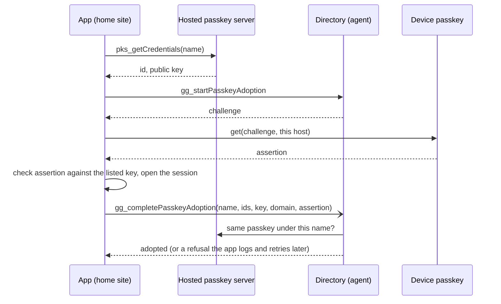

# Keep Older Passkey Accounts Working on Every Site Spec

## Summary

Older passkey accounts get the reach that directory accounts have, without becoming new accounts.
Two mechanisms do it. **Adoption** adds an older account to the directory under its name, keyed to
the same credential and public key, after the person proves on a fresh challenge that they hold
the passkey. **Related origins** (`/.well-known/webauthn`) let a browser use a passkey tied to
`www.greengoods.app` or `beta.greengoods.app` on the other Green Goods sites. The account address
follows the passkey's key and credential ID, never the name or the site, so neither mechanism
moves anyone.

## Users

Counts are one-off reads of PostHog sign-ups in the app project, taken 2026-10-16. They are
people per month, summed.

| Group | Made | Passkey domain | Account record | Opens today | People |
|---|---|---|---|---|---|
| App-made | Jan to early Aug 2026, www | `greengoods.app` | Only in the creating browser's storage | In that browser, on www | ~45 |
| Hosted, www | Aug to 13 Oct 2026 | `www.greengoods.app` | Hosted server (name, ID, key) | www and its installed app, on any device the passkey syncs to | ~15 |
| Hosted, beta | Sep to 5 Oct 2026 | `beta.greengoods.app` | Hosted server | beta only | 8 |
| Hosted, staging | Jun to Jul 2026 | `staging.greengoods.app` | Hosted server, which stopped accepting the origin (probed 4 Oct) | A saved session only | 3 |
| Directory | From 14 Oct 2026 | `greengoods.app` | Directory | Every Green Goods site | 1 |

In the 30 days to 2026-10-16, 6 people used a passkey session on www and 3 on beta.

- **Primary:** gardeners and operators in the older groups who want another site or device.
- **Secondary:** stewards, who otherwise re-add moved accounts to gardens; Afo, who handles the
  support requests.

## How it works today (v2.0.1)

- **Sign-up** goes to the directory, which issues `greengoods.app` (`PASSKEY_RP_ID`) to https
  pages under it (`packages/agent/src/services/passkey-directory.ts`).
- **Sign-in by name** asks the directory first (`signInWithDirectory`: lookup, in-page ceremony
  under the entry's domain, local signature check). When the name isn't there, it falls back to
  the hosted server, whose options name the page's own host (`authenticateWithServer` in
  `packages/shared/src/workflows/authServices.ts`). On the wrong site the device has no passkey for
  that host. The prompt fails with `NotAllowedError`, and the app shows "Sign in was cancelled."
- **A saved session** restores with no ceremony. Signing uses the stored domain, or the site's
  hostname when none was stored (`cachedPasskeyRpId`).
- **"Use this device's passkey"** signs in from the remembered credential, and is the only way
  in for the app-made group.

## Functional Requirements

1. **R1 Adoption.** A person whose older account works on the current site can add it to the
   directory. They prove possession with an assertion over a single-use directory challenge. The
   entry keeps the stored credential ID string exactly, the browser's credential ID, the public
   key, the passkey's domain and the origin it was adopted from.
2. **R2 Hosted names keep their owner.** A name the hosted server holds can be adopted only by the
   passkey the hosted server lists for it, with equal ID bytes and public key.
3. **R3 Taken remembered names.** An app-made account whose remembered name is now taken, in
   either list, is asked for another name. The account does not change.
4. **R4 Hex IDs.** Directory sign-in names a passkey whose stored ID is hex, as some hosted
   accounts are.
5. **R5 Related origins.** A host-bound passkey signs in and signs on every Green Goods site in a
   browser that supports related origin requests.
6. **R6 Clear failures.** On the wrong site, or in a browser without related-origin support, the
   app says where the passkey works instead of "Sign in was cancelled."
7. **R7 Sign-in first.** Adoption never blocks, delays or fails a sign-in. Without the directory,
   sign-in runs as today.
8. **R8 Same account.** Adoption sends nothing unless the entry rebuilds the session's own
   address.
9. **R9 Telemetry.** Adoption outcomes, plus off-site hosted failures, are measurable without
   names, keys or IDs.

## Design

### Adoption inside sign-in (decision 2)

The person sees one passkey prompt, as today. Their next sign-in by name on any site finds the
directory entry first. A saved session gets the same exchange from a button in the account screen
(decision 6). An app-made account adopts from "Use this device's passkey" or that button.

### Related origins (decision 4)

The browser fetches `https://<passkey domain>/.well-known/webauthn` and continues only if it lists
the calling origin. www and beta are the client project's production and beta deployments, so one
static file in `packages/client/public/.well-known/` serves both, and staging inherits it from beta.
With an adopted entry, the existing directory sign-in already runs the ceremony under the entry's
domain, and its local check compares the page origin and the domain hash. The rig ran it unchanged.

### Contract changes

- `PasskeyDirectoryCredential` gains optional `signingId`. `id` stays the Kernel identity input.
- New RPC methods `gg_startPasskeyAdoption` and `gg_completePasskeyAdoption` on the existing
  `/public/passkeys/rpc` route, with the same origin allowlist and the registration rate-limit
  class.
- Store: `signingId`, `source` (`registered` or `adopted`) and a challenge `purpose`.

### Draft copy

The login screen says "passkey" in Spanish and Portuguese, so these drafts do too. The admin
screens say "clave de acceso" and "chave de acesso"; that mismatch predates this plan.

| Key (proposed) | en | es | pt |
|---|---|---|---|
| `app.account.passkeyEverywhere.title` | Sign in on every Green Goods site | Inicia sesión en todos los sitios de Green Goods | Entre em todos os sites do Green Goods |
| `app.account.passkeyEverywhere.body` | Your passkey works here. Turn this on to use it on every Green Goods site and device, with the same account. | Tu passkey funciona aquí. Activa esto para usarla en todos los sitios y dispositivos de Green Goods, con la misma cuenta. | Sua passkey funciona aqui. Ative isto para usá-la em todos os sites e dispositivos do Green Goods, com a mesma conta. |
| `app.account.passkeyEverywhere.action` | Turn on | Activar | Ativar |
| `app.account.passkeyEverywhere.done` | Done. Sign in with {name} on any Green Goods site. | Listo. Inicia sesión con {name} en cualquier sitio de Green Goods. | Pronto. Entre com {name} em qualquer site do Green Goods. |
| `app.account.passkeyEverywhere.nameTaken` | {name} is taken. Choose another name to sign in with. Your account stays the same. | {name} ya está en uso. Elige otro nombre para iniciar sesión. Tu cuenta no cambia. | {name} já está em uso. Escolha outro nome para entrar. Sua conta continua a mesma. |
| `app.login.error.otherSite` | Sign in didn't finish. If you made this account on another Green Goods site, sign in there once to use it everywhere. | No se completó el inicio de sesión. Si creaste esta cuenta en otro sitio de Green Goods, inicia sesión allí una vez para usarla en todas partes. | O login não foi concluído. Se você criou esta conta em outro site do Green Goods, entre lá uma vez para usá-la em qualquer lugar. |
| `app.login.error.relatedOriginUnsupported` | This browser can't use your passkey here. Sign in on {site} instead, or update your browser. | Este navegador no puede usar tu passkey aquí. Inicia sesión en {site} o actualiza tu navegador. | Este navegador não consegue usar sua passkey aqui. Entre em {site} ou atualize seu navegador. |

If decision 2 is declined, `app.login.error.otherSite` ends instead with "sign in there and turn
on Sign in on every Green Goods site."

## Research Evidence

- **Clean-room proof (2026-10-16):** [reports/2026-10-16-clean-room-proof.md](reports/2026-10-16-clean-room-proof.md).
  Headless Chromium 148 with a CDP virtual authenticator, the real hostnames on the default port
  through a local proxy, and the app's own sign-in, verifier, signing owner and Kernel encoding.
  Signatures were checked against the deployed validator with a read-only `eth_call`.
- **Validator source:** WebAuthn validator `0xbA45a2BFb8De3D24cA9D7F1B551E14dFF5d690Fd` on
  Arbitrum One (verified source). Its `WebAuthn.verifySignature` checks the flags, the response
  type, the challenge and the P-256 signature. It states that it does not check the origin or the
  RP ID hash.
- **Live probes (2026-10-16):** the www, beta, admin and beta.admin bundles all carry the directory
  client. The agent accepts the apex, www, beta, staging, admin, beta.admin and staging-admin
  origins and refuses other subdomains. `/.well-known/webauthn` on www and beta answers 200
  `text/html` (the app shell, via the catch-all rewrite), while `/.well-known/assetlinks.json`
  answers `application/json`.
- **Lockfile:** `bun.lock` hoists `@peculiar/asn1-schema` 2.6.0, which `@simplewebauthn/server`
  13.3.3 uses. `@peculiar/asn1-ecc` 2.10.0 and its siblings require `^2.10.0`. In the rig the
  library threw "Cannot get schema for 'ECDSASigValue' target" on every assertion, loaded as ESM
  under Bun from the agent package, as the agent loads it.
- **Browser support for related origin requests:** see the next section.
- **Code reviewed:** `authServices.ts`, `auth-passkey-directory.ts`, `auth-passkey-adapters.ts`,
  `auth-passkey-ids.ts`, `modules/auth/session.ts`, `modules/auth/passkey-assertion.ts`,
  `config/passkeyServer.ts` (shared); `passkey-directory.ts`, `passkey-directory-adapters.ts`,
  `db/passkey-directory.ts`, `api/routes/passkey-directory.ts` (agent);
  `packages/client/vercel.json`; permissionless 0.2.57 Kernel signature encoding
  (`accounts/kernel/utils/signMessage.js`).
- **Open inferences:** that the app-made group's passkeys carry the apex rests on code reading
  plus the fact that they signed on 1.2, which signed under the apex. That the staging accounts
  are team tests is unconfirmed. Device behaviour on Android and iPhone is unproven.

### Browser support for related origin requests

Checked 2026-10-16.

| Platform | Support | Source |
|---|---|---|
| Android | Chrome and Edge 128+, Firefox 152+ | [passkeys.dev device support](https://passkeys.dev/device-support/) |
| iPhone and iPad | iOS and iPadOS 18+ (every iOS browser uses WebKit) | passkeys.dev; [Safari 18 release notes](https://developer.apple.com/documentation/safari-release-notes/safari-18-release-notes): "Added support for using passkeys across related origins." |
| macOS | Safari on macOS 15+, Chrome and Edge 128+, Firefox 152+ | passkeys.dev |
| Windows, ChromeOS, Linux | Chrome and Edge 128+, Firefox 152+ | passkeys.dev |

- Chrome introduced the feature with Chrome 128 and 129
  ([Chrome blog](https://developer.chrome.com/blog/passkeys-updates-chrome-129)).
- Chrome Status's own entry for it is stale ("No active development", no milestones), so it is
  not a source here.
- [web.dev](https://web.dev/articles/webauthn-related-origin-requests) still says Firefox was
  "still considering" the feature as of January 2026. Mozilla's standards position closed as
  positive on 2026-03-11 (mozilla/standards-positions#1052). The Firefox 152+ rows rest on
  passkeys.dev alone; Firefox's own release notes were not checked.

What the [specification](https://www.w3.org/TR/webauthn-3/#sctn-related-origins) (WebAuthn Level
3) requires of step 8:

- **Where and how it's fetched.** The browser fetches `https://<RP ID>/.well-known/webauthn` on
  the default port, over HTTPS, without credentials or a referrer. Redirects are followed only
  over https, and the final status must be 200.
- **Format.** The content type must be `application/json`, and the file must contain an `origins`
  array of strings. An entry that is not a URL is skipped.
- **Which pages it covers.** It applies to both `create()` and `get()`. The RP ID's own origin
  doesn't need listing.
- **Label limit.** Browsers must support at least five registrable-origin labels; Chrome's cap is
  five. Every Green Goods origin shares the one label `greengoods`.
- **Without support.** A browser throws `SecurityError`.
  `PublicKeyCredential.getClientCapabilities()` reports `relatedOrigins` when supported (Chrome
  133+), so step 9 can choose its copy before trying a ceremony.

What this leaves: iPhones on iOS 17 or earlier, and any browser outside these rows, keep a
host-bound passkey on its home site. Adoption still gives those accounts sign-in by name there
from any device the passkey syncs to.

## Human Judgment Points

- Decisions 1 to 8 in [plan.todo.md](plan.todo.md#decision-log).
- Protected or high-risk surfaces: shared Auth workflows and the agent's passkey directory (both
  critical), and the client's static `.well-known` folder and `vercel.json`.
- Keep visible during review: the directory becomes the record for adopted accounts too; the
  hosted server stays the authority for hosted names; and nothing re-encodes a stored ID.

## Non-Functional Constraints

- **Package boundaries:** the agent consumes Shared only through `@green-goods/shared/public-contracts`;
  hooks live in `packages/shared/src/hooks`; no new export subpath.
- **Security:**
  - The challenge is single-use and spent first, with a 5-minute lifetime.
  - Both the origin allowlist and the domain allowlist apply.
  - Adoption happens on the passkey's own domain.
  - Possession is proven, and a hosted name must match its listed passkey.
  - Rate limits use the registration class.
- **Privacy:** names, keys and IDs stay out of logs and telemetry, as the directory already does.
- **Performance:** at most one extra request in a sign-in. The hosted lookup keeps its 4-second
  timeout, and adoption runs after the session opens.
- **Offline / sync:** adoption needs the network and is skipped offline; nothing is queued.
- **Localization:** en, es and pt for every new string.

## Package / Lane Mapping

| Area | Lane | Notes |
|---|---|---|
| Shared auth workflows, contract, verifier, telemetry | `state_api` | Steps 1, 2, 6, 10 |
| Agent directory store, hosted lookup, RPC | `state_api` | Steps 3, 4, 5 |
| Account row, copy, related-origins file | `ui` | Steps 7, 8, 9 |
| Contracts | `contracts` | `n/a`: the validator already accepts these signatures |
| QA | `qa_pass_1`, `qa_pass_2` | Step 11, sequential |

## Risks

- **A browser without related-origin support.**
  - Risk: a host-bound passkey stays on its home site there.
  - Mitigation: decision 4's copy names that site, and adoption still gives sign-in by name across
    devices on the home site.
- **An adopted entry that opens a different account.**
  - Risk: a re-encoded ID or the wrong key would point the name at another address.
  - Mitigation: the exact ID string, matched ID bytes, a proven key, and the client's address guard
    before sending.
- **The hosted server down during adoption.**
  - Risk: the directory can't confirm who holds a hosted name.
  - Mitigation: refuse with `unavailable` and retry later; sign-in is unaffected.
- **A wrong related-origins response.**
  - Risk: the app's HTML is served instead of the file, or it's served with the wrong type.
  - Mitigation: a static file, an explicit header, and a smoke check on www and beta.
- **Losing the directory database.**
  - Risk: it becomes the only record for adopted accounts as well.
  - Mitigation: the existing Fly volume backup concern now covers more rows; record it in the
    agent runbook before step 5 ships.

## Related

- PRD-1107 built the directory. COM-39 holds the current move plan (decision 8).
- `green-goods-name-reservation` owns name normalization and reservation; adoption applies the
  directory's existing name rules (`isRegistrablePasskeyName`).
