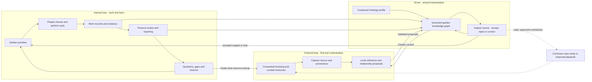
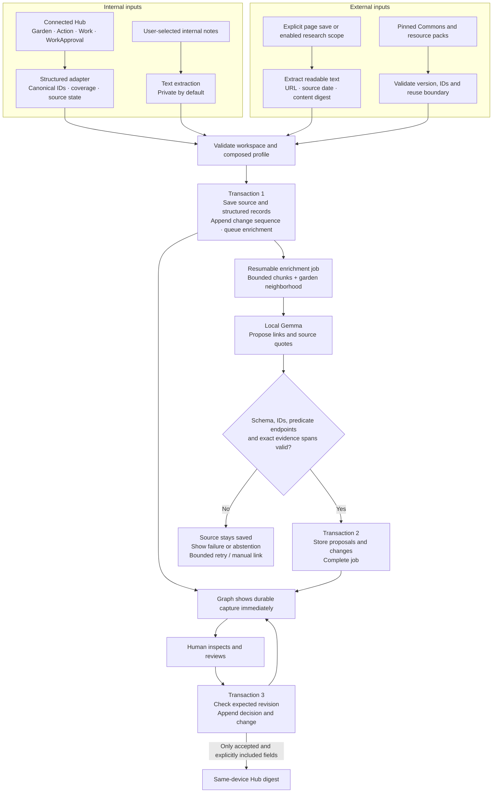

# Grove learning loops and ingestion

These are proposed system flows. Solid arrows describe the bounded MVP; dotted arrows mark future integrations. People make garden decisions in Green Goods. Grove stores evidence and suggestions locally and returns reviewed insights to the same-device Hub.

## Two loops joined by garden memory



The internal loop asks what was done, what is known, what is missing and what to improve. The external loop brings in relevant practices, people, tools and resources. Their joining point is a source-backed relationship in the graph, inspected in the context of a real garden question.

Example: a garden records a composting activity. A steward wants a more useful record of the method used. They capture a public playbook; Grove suggests a relationship to the Action and exposes its quote. The steward accepts the link and sees it in the Hub. Later work can cite the method and report what happened. A future, separately reviewed case study could contribute the lesson back to the Commons. Neither reading the playbook nor accepting the link proves an ecological outcome.

For this MVP, “find” means local lookup in a pinned resource pack plus the user's consented research. Garden context stays local. Unattended web search, background crawling and publishing a Commons contribution are later capabilities.

## Internal and external ingestion



Structured protocol import bypasses inference; the model only proposes additional interpretation. Already-validated structured resource records can also import directly. Note/page extraction is untrusted input. Instructions found inside content never grant tool, network or graph-write access.

Network access and inference occur outside IndexedDB transactions. A save is acknowledged only after its transaction commits. Invalid mapping input is quarantined; interrupted jobs resume from persisted state. Partial snapshots do not prove deletion, and stale model/review results cannot overwrite newer revisions. See the [storage and review contract](spec.md#knowledge-contract-and-time).

## Why the graph feels alive

```mermaid
sequenceDiagram
  participant C as Capture / Hub adapter
  participant D as Dexie revisions
  participant M as Local model host
  participant G as Graph tab
  participant U as Person
  C->>D: Save source + records + queued job (sequence 41)
  D-->>G: Committed change: new source node
  D->>M: Leased job, pinned source/profile versions
  M-->>D: Validated proposal, transaction commits (42)
  D-->>G: New relationship; retain camera and positions
  U->>G: Inspect quote and accept expected revision
  G->>D: Append review revision (43)
  D-->>G: Reviewed relationship
  U->>G: Compare sequences 41 and 43
  G->>D: Read historical projections
  D-->>G: Source only vs source + reviewed relationship
```

“New” comes from committed change sequences after the person's seen cursor. A new edge can connect two old nodes. The timeline shows what Grove knew at that time; a late import is not backdated. Personal feedback changes retrieval/review state, not model weights. New captures should settle into place; continuous force motion is unnecessary.
