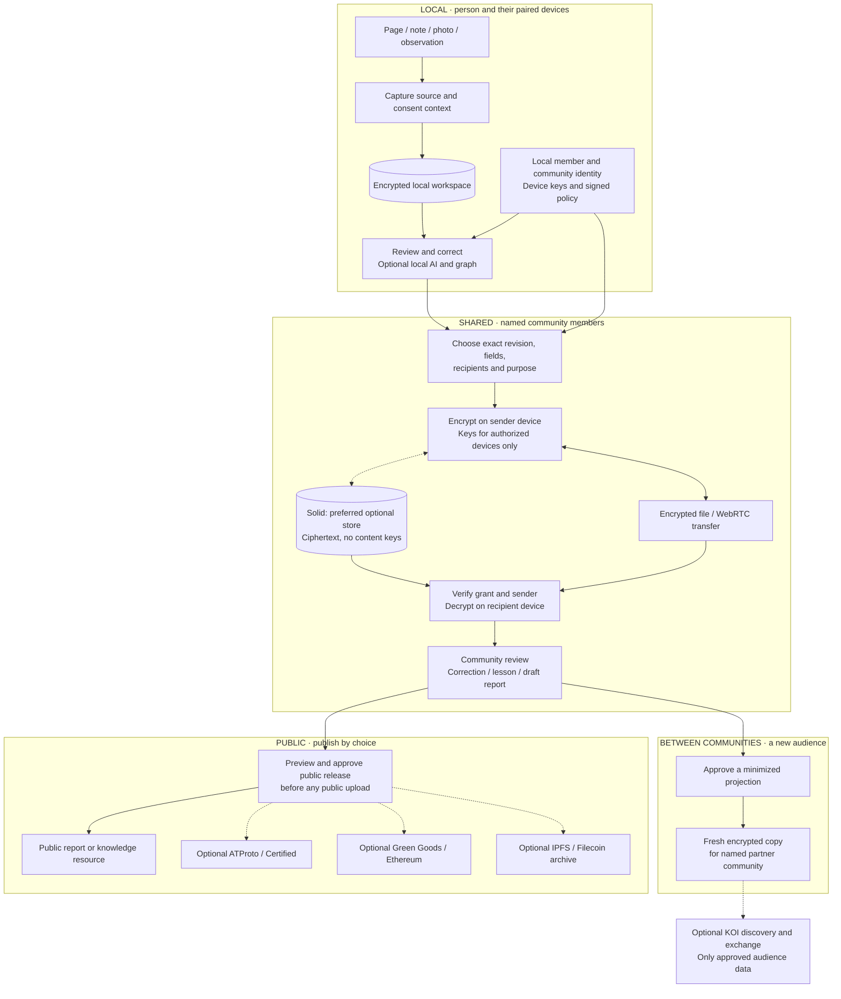
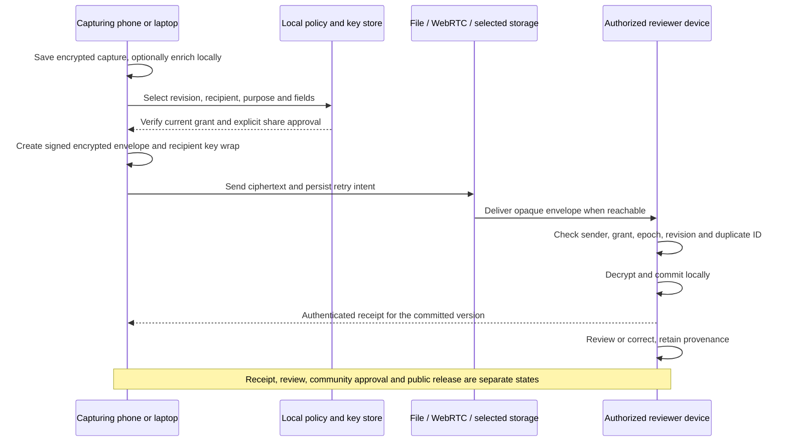
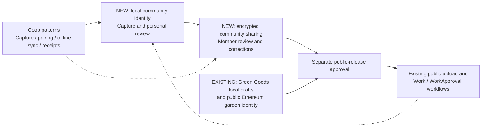
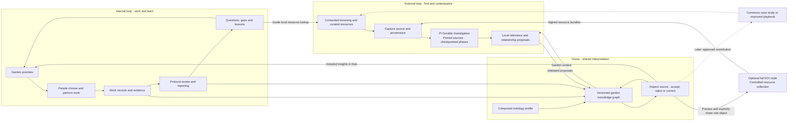
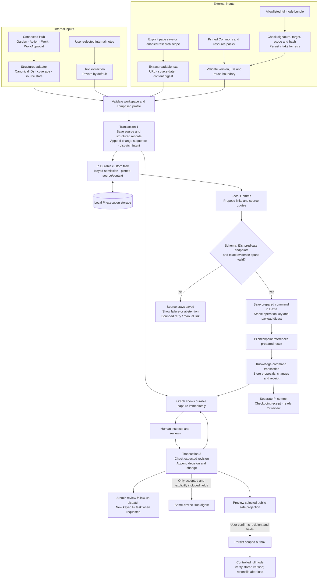
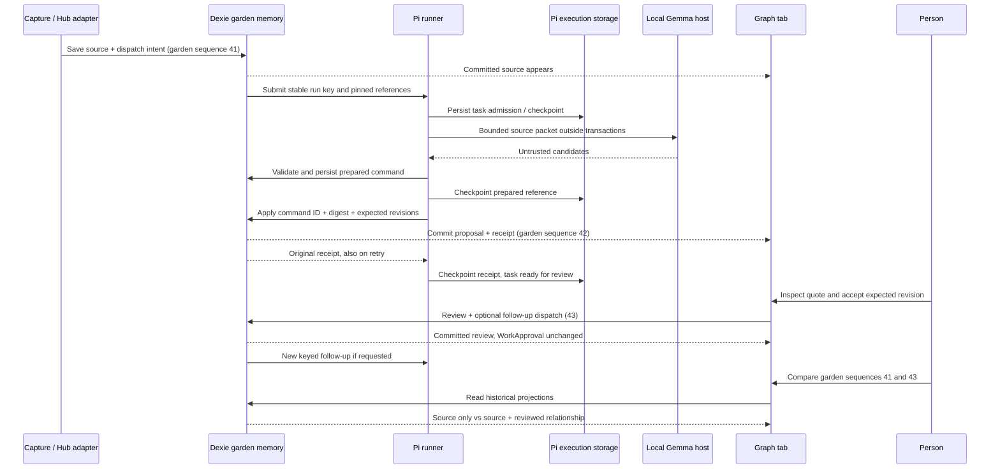
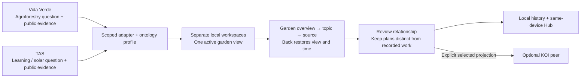

# Grove: capture → review → share

**Current direction:** 13 November 2026. These are proposed flows, not runtime proof. [Community identity and encrypted sharing](community-sharing.md) owns the contract: local identity/keys, preferred optional Solid storage and Yjs co-editing. [C0a/C5 research](collaboration-passkey-spike.md) retains passkey/recovery proof and experimental Automerge + Keyhive; EDV is a storage research alternative. Dotted arrows show optional connections.

## Local, shared and public contexts

These contexts are the privacy rings. Moving outward creates a deliberate disclosure, not a change of visibility on the entire source archive. Local-only use is complete without any outer ring. A recipient can read a public summary without acquiring the underlying private evidence. Public destinations are independent choices, not a required sequence or a guarantee of permanence.

Yjs is the preferred optional draft-merge engine, with encrypted updates and verified writers; it supplies neither community identity nor content-key custody. EDV and Automerge + Keyhive remain research alternatives. None is required to capture, review or exchange selected encrypted records locally.

## Initial user flows

| Step | Knowledge capture | Impact evidence capture | Privacy/authority boundary |
|---|---|---|---|
| 1. Start locally | Create a community workspace or accept a verified invitation | Same; optionally bind an existing public garden later | No wallet or provider login needed. Each device gets separate keys. |
| 2. Capture | Save a guide, page excerpt, lesson or note | Save an observation, photo or account of work; sensor imports later | Save locally first, with source/time/context and consent. A failed model/network never loses the capture. |
| 3. Review personally | Correct a summary, inspect sources, add a connection | Check date, attribution and evidence; preserve planned/reported/recorded distinctions | Local AI proposes. The person decides. No protocol attestation is created. |
| 4. Share for review | Choose an excerpt or resource and named reviewers | Choose the evidence fields and reviewers; omit unnecessary personal/location data | Confirm exact revision, audience and purpose. Encrypt before sending; original remains local. |
| 5. Review together | Members discuss/correct a lesson or approve a shared resource | Authorized reviewers assess the evidence and prepare a report or claim draft | Record reviewer identity and version. The community's policy governs approval; decryption alone gives no review authority. |
| 6. Share an outcome | Send a useful summary to a partner community | Send a report to a named funder or partner | New audience, fresh minimized projection, new approval and keys. A report need not be public. |
| 7. Publish by choice | Release a public learning resource | Release selected impact information or use a protocol publication flow | Separate review before the first upload. Existing Work/WorkApproval rules still apply. |

Example: a steward captures soil observations offline, while a learning facilitator saves a workshop lesson. Each reviews on their own device and shares selected records with the community's reviewers. A funder receives a reviewed summary; culturally restricted knowledge, participant details and precise ecological locations can remain in narrower contexts.

## What happens when two devices share

Show delivery as **saved locally → queued → stored by selected destination / received by device**. Show review and publication separately. If only a Pod upload is confirmed, do not claim that the reviewer received or read the record. Changed content or recipients invalidate the prior approval. If offline membership is stale, preserve the capture and queue the share pending policy reconciliation.

## Identity and processing ownership

The [identity/role map](identity-role-mapping.md) separates the community's GardenAccount/WebID/group account from each member's wallet/WebID/personal account. Account associations are private by default and confer no role or decryption key. Local/community role grants, service delegations and public protocol authority each retain their own scope.

The [Pi capture/review flow](durable-execution.md#where-pi-belongs-in-capture--review--share) keeps source saving and human review in Grove transactions. Pi resumes optional multi-step enrichment, then finishes ready for review; a human correction can enqueue a new keyed investigation. The [storage comparison](storage-comparison-spike.md) tests two backends on the same two-device flow, while [local-first options](local-first-options.md) remain conditional collaboration choices.

## How this extends Green Goods and Coop

Grove adds local/community identity and shared evidence contexts before the existing public boundary. Existing draft queues, public IPFS uploads and onchain identity are not an encrypted shared layer. Coop provides inspected patterns, not a pre-proven host-blind implementation. No application or contract behavior changes in this plan revision.

## Earlier graph and ingestion baseline

The diagrams below preserve the earlier research/work interpretation loop and command-recovery detail. Their public-safe controlled KOI peer is optional. For confidential data, the encryption/recipient boundary above applies before every outbound adapter. Pi owns resumable investigations; the graph and review lists derive from scoped committed knowledge.

## Two loops joined by garden memory

The internal loop asks what was done, what is known, what is missing and what to improve. The external loop brings in relevant practices, people, tools and resources. Their joining point is a source-backed relationship in the graph, inspected in the context of a real garden question.

Example: a garden records a composting activity. A steward wants a more useful record of the method used. They capture a public playbook; Grove suggests a relationship to the Action and exposes its quote. The steward accepts the link and sees it in the Hub. Later work can cite the method and report what happened. A future, separately reviewed case study could contribute the lesson back to the Commons. Neither reading the playbook nor accepting the link proves an ecological outcome.

For this MVP, “find” means local lookup in a pinned resource pack, a selected KOI resource collection, and the user's consented research. Garden context stays local. Unattended web search, background crawling and publishing a Commons contribution are later capabilities.

## Internal and external ingestion

Structured protocol import bypasses inference; the model only proposes additional interpretation. Already-validated structured resource records can also import directly. Note/page extraction is untrusted input. Instructions found inside content never grant tool, network or graph-write access.

Pi checkpoints and garden mutations commit separately; stable command receipts recover the gap. Pi owns investigation scheduling, while deterministic capture and KOI delivery have their own workers. Network access and inference occur outside IndexedDB transactions. A save is acknowledged only after its transaction commits. Invalid mapping input is quarantined; interrupted jobs resume from persisted state. Partial snapshots do not prove deletion, and stale model/review results cannot overwrite newer revisions. See the [storage and review contract](spec.md#knowledge-contract-and-time).

## Why the graph feels alive

“New” comes from committed change sequences after the person's seen cursor. A new edge can connect two old nodes. The timeline shows what Grove knew at that time; a late import is not backdated. Planned time and reported/recorded activity are separate dimensions. Accepting a planned trial or receiving a signed bundle never makes it completed Work. Personal feedback changes retrieval/review state, not model weights. New captures should settle into place; continuous force motion is unnecessary.

## Two gardens, one implementation

The [first-spike walkthrough](first-spike.md) defines the public evidence, failure cases and limits. The [KOI contract](koi-integration.md) separates current-object exchange from durable local history and describes the application-level collection inventory used for recovery.

The [Pi execution contract](durable-execution.md) defines host ownership, source privacy, review continuation and interruption recovery. A Pi execution sequence is never substituted for the garden timeline sequence.
