# Grove: capture → review → share

**Current direction:** 13 November 2026, with the decisions of 14 November. These are proposed flows, not runtime proof. [Community sharing](community-sharing.md) owns the contract and its [terms](community-sharing.md#terms); [spec.md](spec.md#decision-log) owns the decisions cited here as D-numbers. Solid lines are the MVP. Dotted lines are next lanes or later work.

## Four audiences

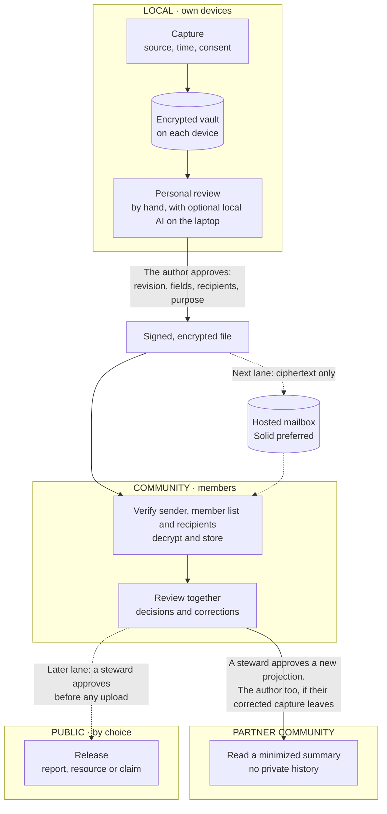

Local means one person's own phone and laptop; community means named members' devices; a partner community is named recipients elsewhere; public is anyone. Moving outward is a deliberate disclosure of one projection, never a change of visibility on the source. Local-only use is complete without any other audience. A partner can read a summary without receiving the evidence under it. Each crossing has its own approval and its own approver (D17).

## Initial user flows

| Step | Knowledge capture | Impact evidence capture | Boundary and authority |
|---|---|---|---|
| 1. Start locally | Create a community or accept a verified invitation | Same; a public garden can be linked later | No wallet or provider login. Each device gets its own keys. A recovery code is created |
| 2. Capture | Save a guide, page excerpt, lesson or note | Save an observation, photo or account of work | Saved first, with source, time and consent. No model, network or unlock is needed to save |
| 3. Review personally | Correct a summary, inspect sources, add a connection | Check date, attribution and evidence; keep planned, reported and recorded apart | By hand on either client. On the laptop, local AI may propose; the person decides. No protocol attestation is created |
| 4. Share for review | Choose an excerpt or resource and named reviewers | Choose the evidence fields and reviewers; leave out unneeded personal and location data | The author approves the exact revision, fields, recipients and purpose. The file is encrypted before it leaves; the original stays |
| 5. Review together | Members discuss and correct a lesson | Reviewers assess the evidence and prepare notes for a summary | Each reviewer's decision is recorded with their identity and the revision. Reading gives no authority to release |
| 6. Share an outcome | Send a useful summary to a partner community | Send a report to a named funder or partner | A steward approves a new, minimized projection. The author approves too if a corrected version of their capture is leaving |
| 7. Publish by choice | Release a public learning resource | Release selected impact information or use a protocol flow | Later lane. A steward approves before the first upload. Existing Work and WorkApproval rules still apply |

Example: a steward captures soil observations offline on a phone, while a learning facilitator saves a workshop lesson on a laptop. Each reviews on their own device and shares selected records with the community's reviewers. A funder receives a reviewed summary; culturally restricted knowledge, participant details and precise ecological locations stay in narrower audiences.

## Sequences

### Capture and personal review

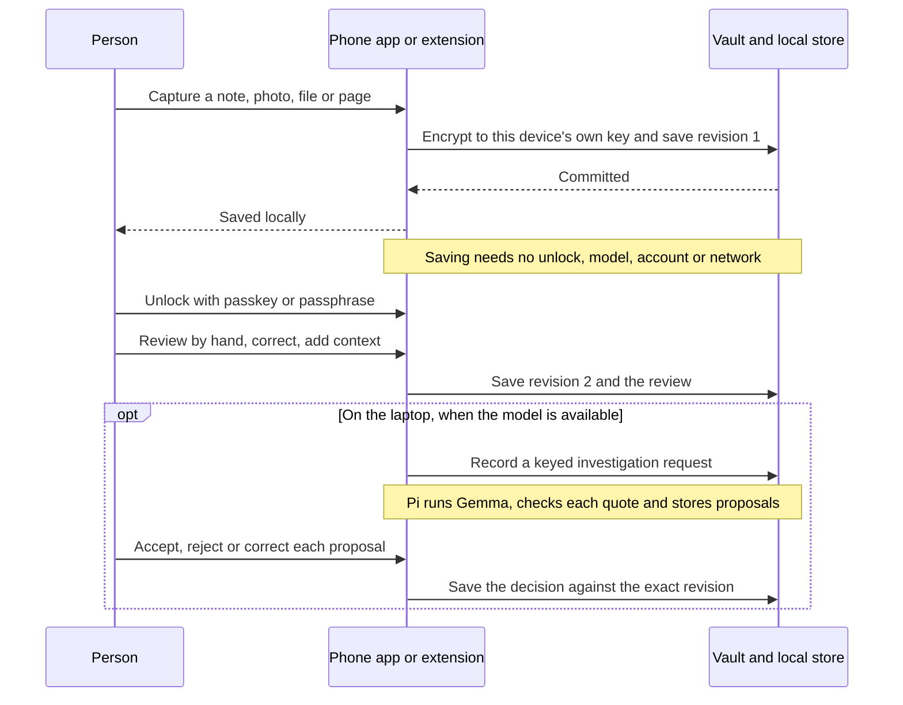

A save is acknowledged only after its transaction commits. Inference is optional and happens after the save, never before it.

### Phone to laptop

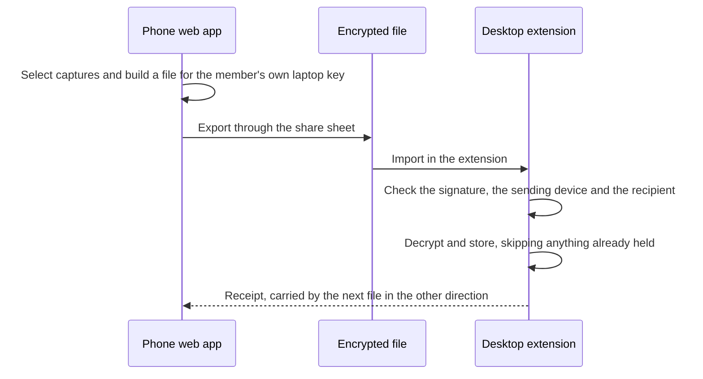

The two clients have separate storage. Nothing moves between them except through a file a person carries across (D21).

### Share and recipient review

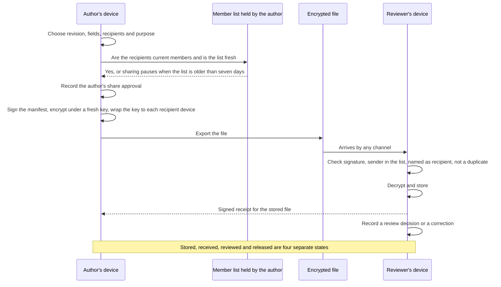

Show delivery as **saved locally → exported → received by device**. Show review and release separately. A receipt means a device stored the file, not that anyone read or accepted it. Changed content or recipients need a new approval.

### Correction and partner summary

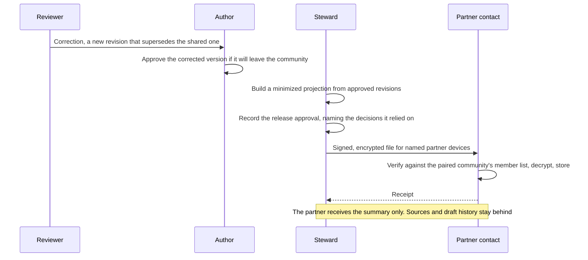

### Removing a device

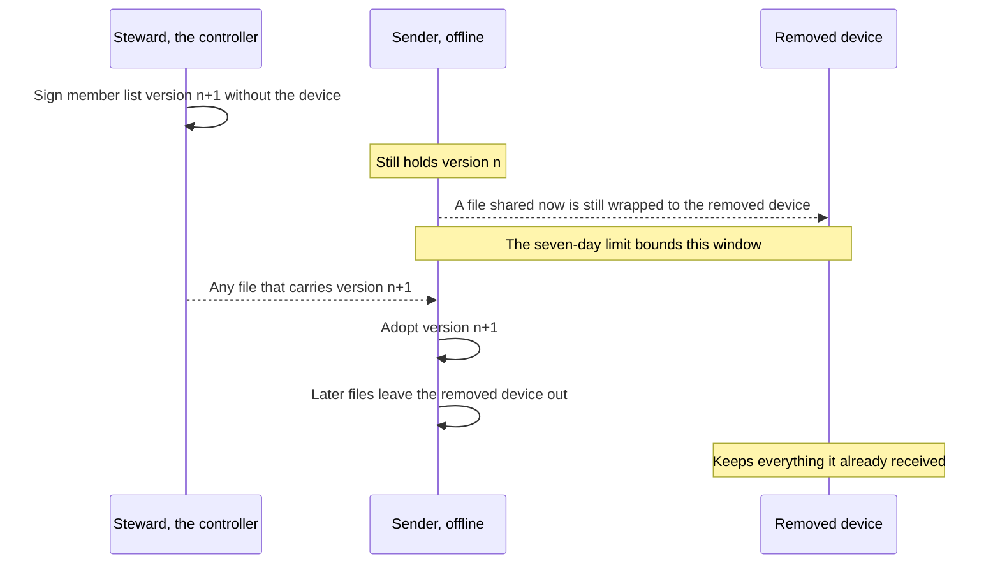

### Unlock and recovery

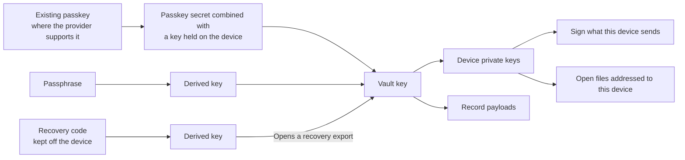

The passkey unlocks; it does not identify a device, sign Grove records or decrypt shared files. A restored device makes new keys and is added to the member list again.

### Optional publication, a later lane

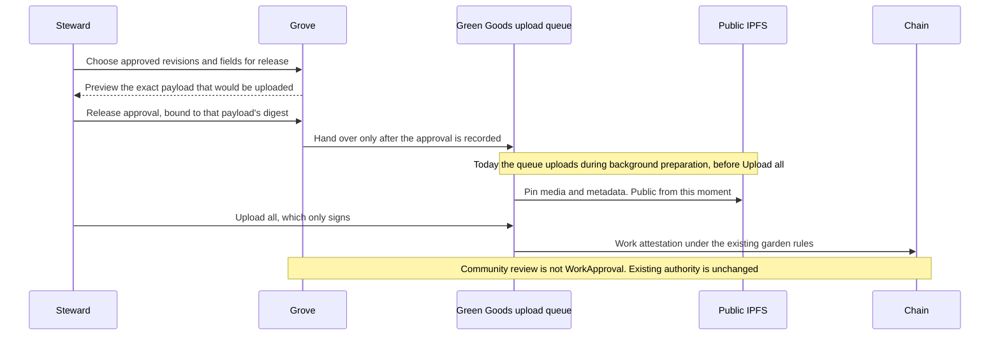

This sequence is why the release approval sits before the hand-over and not before the signature. The upload behavior is current code, read on 14 November; the Grove steps are proposed.

## Identity and processing ownership

The [identity and role map](identity-role-mapping.md) separates a community's garden, WebID and group accounts from each member's wallet, WebID and personal account. Associations are private by default and confer no role and no key.

The [Pi capture and review contract](durable-execution.md#where-pi-belongs-in-capture--review--share) keeps saving and human review in Grove transactions. Pi resumes optional multi-step enrichment on the laptop and finishes ready for review; a human correction can request a new investigation.

## How this extends Green Goods and Coop

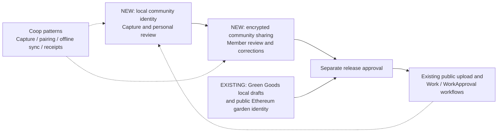

Grove adds local and community identity and shared evidence before the existing public boundary. Existing draft queues, public IPFS uploads and onchain identity are not an encrypted shared layer. Coop provides patterns that were read from source, not an implementation that has been shown to keep a host blind, and its code cannot be copied until its license is settled. No application or contract behavior changes in this plan revision.

## The laptop workspace

The diagrams below describe the laptop's graph and investigation lane, which is part of the MVP (D25). Three things in them are next lanes and not the MVP (D22): the Admin Hub import and digest, the KOI peer, and structured Garden, Work and WorkApproval records, which arrive with the Hub import. In the MVP the graph shows Grove's own captures, reviewed links and received records. For confidential records, the encryption and recipient rules above apply before any outbound adapter. Pi owns resumable investigations; the graph and the review lists read committed knowledge.

## Two loops joined by garden memory

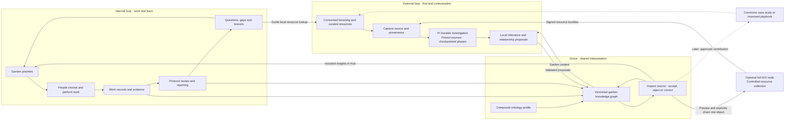

The internal loop asks what was done, what is known, what is missing and what to improve. The external loop brings in relevant practices, people, tools and resources. Their joining point is a source-backed relationship in the graph, inspected in the context of a real garden question.

Example: a garden records a composting activity. A steward wants a more useful record of the method used. They capture a public playbook; Grove suggests a relationship to the Action and exposes its quote. The steward accepts the link and sees it in the Hub. Later work can cite the method and report what happened. A future, separately reviewed case study could contribute the lesson back to the Commons. Neither reading the playbook nor accepting the link proves an ecological outcome.

For this MVP, “find” means local lookup in a pinned resource pack, a selected KOI resource collection, and the user's consented research. Garden context stays local. Unattended web search, background crawling and publishing a Commons contribution are later capabilities.

## Internal and external ingestion

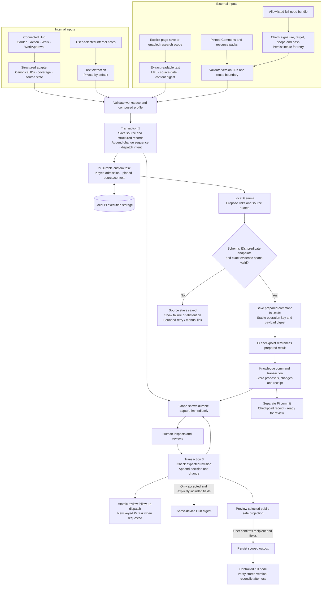

Structured protocol import bypasses inference; the model only proposes additional interpretation. Already-validated structured resource records can also import directly. Note/page extraction is untrusted input. Instructions found inside content never grant tool, network or graph-write access.

Pi checkpoints and garden mutations commit separately; stable command receipts recover the gap. Pi owns investigation scheduling, while deterministic capture and KOI delivery have their own workers. Network access and inference occur outside IndexedDB transactions. A save is acknowledged only after its transaction commits. Invalid mapping input is quarantined; interrupted jobs resume from persisted state. Partial snapshots do not prove deletion, and stale model/review results cannot overwrite newer revisions. See the [storage and review contract](spec.md#knowledge-contract-and-time).

## Why the graph feels alive

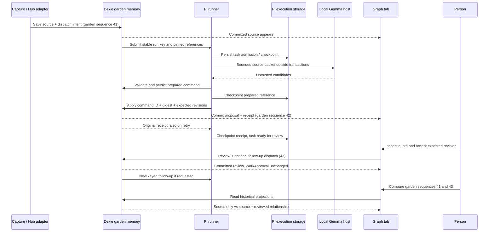

“New” comes from committed change sequences after the person's seen cursor. A new edge can connect two old nodes. The timeline shows what Grove knew at that time; a late import is not backdated. Planned time and reported/recorded activity are separate dimensions. Accepting a planned trial or receiving a signed bundle never makes it completed Work. Personal feedback changes retrieval/review state, not model weights. New captures should settle into place; continuous force motion is unnecessary.

## Two gardens, one implementation

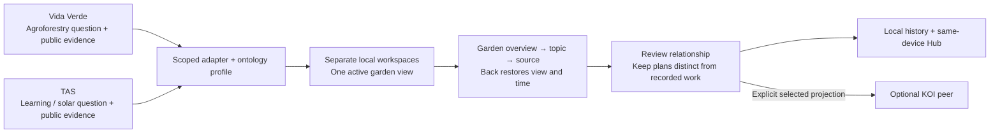

The [first-spike walkthrough](first-spike.md) defines the public evidence, failure cases and limits. The [KOI contract](koi-integration.md) separates current-object exchange from durable local history and describes the application-level collection inventory used for recovery.

The [Pi execution contract](durable-execution.md) defines host ownership, source privacy, review continuation and interruption recovery. A Pi execution sequence is never substituted for the garden timeline sequence.
