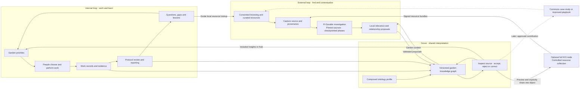
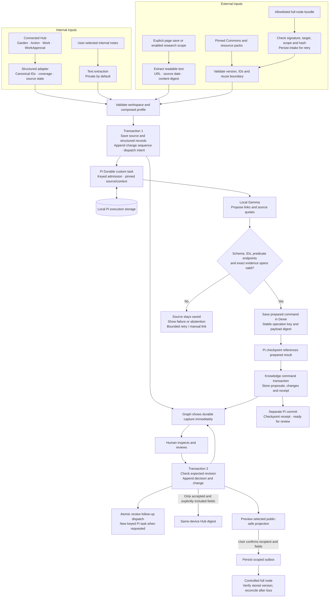
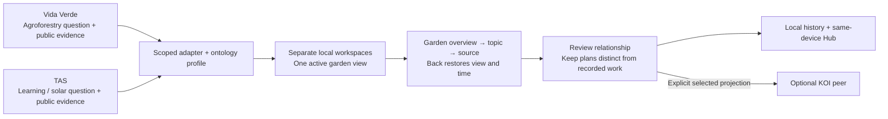

# Grove learning loops and ingestion

These are proposed system flows. Solid arrows describe the bounded MVP or controlled spike; dotted arrows mark later integrations. KOI exchange is optional: disconnecting the full node does not interrupt the local loop. Pi Durable owns resumable local investigations; the graph remains the only primary interface. People make garden decisions in Green Goods. Grove stores evidence and suggestions locally and returns reviewed insights to the same-device Hub.

## Two loops joined by garden memory



The internal loop asks what was done, what is known, what is missing and what to improve. The external loop brings in relevant practices, people, tools and resources. Their joining point is a source-backed relationship in the graph, inspected in the context of a real garden question.

Example: a garden records a composting activity. A steward wants a more useful record of the method used. They capture a public playbook; Grove suggests a relationship to the Action and exposes its quote. The steward accepts the link and sees it in the Hub. Later work can cite the method and report what happened. A future, separately reviewed case study could contribute the lesson back to the Commons. Neither reading the playbook nor accepting the link proves an ecological outcome.

For this MVP, “find” means local lookup in a pinned resource pack, a selected KOI resource collection, and the user's consented research. Garden context stays local. Unattended web search, background crawling and publishing a Commons contribution are later capabilities.

## Internal and external ingestion



Structured protocol import bypasses inference; the model only proposes additional interpretation. Already-validated structured resource records can also import directly. Note/page extraction is untrusted input. Instructions found inside content never grant tool, network or graph-write access.

Pi checkpoints and garden mutations commit separately; stable command receipts recover the gap. Pi owns investigation scheduling, while deterministic capture and KOI delivery have their own workers. Network access and inference occur outside IndexedDB transactions. A save is acknowledged only after its transaction commits. Invalid mapping input is quarantined; interrupted jobs resume from persisted state. Partial snapshots do not prove deletion, and stale model/review results cannot overwrite newer revisions. See the [storage and review contract](spec.md#knowledge-contract-and-time).

## Why the graph feels alive

```mermaid
sequenceDiagram
  participant C as Capture / Hub adapter
  participant D as Dexie garden memory
  participant P as Pi runner
  participant X as Pi execution storage
  participant M as Local Gemma host
  participant G as Graph tab
  participant U as Person
  C->>D: Save source + dispatch intent (garden sequence 41)
  D-->>G: Committed source appears
  D->>P: Submit stable run key and pinned references
  P->>X: Persist task admission / checkpoint
  P->>M: Bounded source packet outside transactions
  M-->>P: Untrusted candidates
  P->>D: Validate and persist prepared command
  P->>X: Checkpoint prepared reference
  P->>D: Apply command ID + digest + expected revisions
  D-->>G: Commit proposal + receipt (garden sequence 42)
  D-->>P: Original receipt, also on retry
  P->>X: Checkpoint receipt; task ready for review
  U->>G: Inspect quote and accept expected revision
  G->>D: Review + optional follow-up dispatch (43)
  D-->>G: Committed review; WorkApproval unchanged
  D->>P: New keyed follow-up if requested
  U->>G: Compare garden sequences 41 and 43
  G->>D: Read historical projections
  D-->>G: Source only vs source + reviewed relationship
```

“New” comes from committed change sequences after the person's seen cursor. A new edge can connect two old nodes. The timeline shows what Grove knew at that time; a late import is not backdated. Planned time and reported/recorded activity are separate dimensions. Accepting a planned trial or receiving a signed bundle never makes it completed Work. Personal feedback changes retrieval/review state, not model weights. New captures should settle into place; continuous force motion is unnecessary.

## Two gardens, one implementation



The [first-spike walkthrough](first-spike.md) defines the public evidence, failure cases and limits. The [KOI contract](koi-integration.md) separates current-object exchange from durable local history and describes the application-level collection inventory used for recovery.

The [Pi execution contract](durable-execution.md) defines host ownership, source privacy, review continuation and interruption recovery. A Pi execution sequence is never substituted for the garden timeline sequence.
