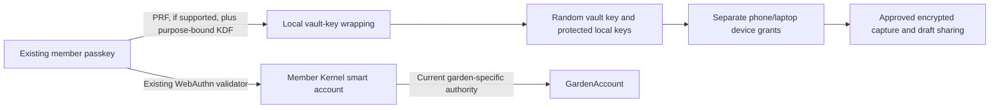

# Grove: two-device collaboration and passkey comparison

**Accepted planning scope:** 13 November 2026. **State:** planned, unrun. This owns C0a/E24 and C5/E25 in [the delivery plan](plan.todo.md#community-sharing-delivery-order) and [acceptance gates](eval.md#community-sharing-gates). It adds no implementation, installation, account migration or deployment authorization. **14 November:** Pass A is an MVP gate, because the existing passkey unlocks the vault where its provider supports that (D19 in [spec.md](spec.md#decision-log)). Pass B is backlog research and gates nothing (R11).

**Yjs with encrypted, authenticated adapters is preferred for optional co-editing. Automerge Repo + Keyhive remains an experimental research alternative.** Retain the two-device comparison and independently prove existing-passkey reuse, offline unlock and recovery. Solid is the preferred optional storage adapter; EDV remains research. All content keys and community/member identity stay local. Completing an experiment records its result without implying production readiness or installing the alternative.

## Fixed fixture and responsibilities

- Use two physical devices: a phone browser/PWA candidate and a laptop's packaged Brave extension. Record device, OS, browser, application origin, RP ID, authenticator/provider and exact package/source pins. Two tabs do not prove two devices or mobile compatibility.
- Give each device its own signing/encryption keys. Use separate contextual member identities for two communities, an explicitly granted shared collection and a private capture inbox. The same member's phone/laptop case and the separate contributor/reviewer case are distinct runs. A clean denied-member profile can run on either existing device.
- Use the same synthetic lesson/page, field observation, bounded attachment and shared draft on both engines. Save before enrichment; bind review and sharing to exact revision, audience and purpose. A sync receipt is not a review decision or WorkApproval.
- Keep the encrypted record/outbox baseline. Dexie owns authoritative captures/review/consent; each engine owns only its selected collaborative draft state. Do not dual-write the same authoritative record into Dexie and Repo. Return a versioned proposal through Grove commands; concurrent editing cannot rewrite grants or release approvals.
- Give the operator full relay/storage access, logs, service credentials and the ability to bypass server ACLs. Test local storage separately with a copied locked profile. A trusted packaged client/update path remains an assumption; E2EE does not defend an unlocked compromised endpoint.
- No wallet, provider account, cloud inference or new hardware is required for ordinary local capture/review. Passkey unlock is part of the MVP where the provider supports it (D19). The passphrase path keeps the flow whole for everyone else, so no account is ever a prerequisite. No production transaction, owner change or public identity link is part of the fixture.

## Pass A: existing passkey, offline unlock and recovery

Run this independently of either collaboration engine. Distinguish an existing credential, its smart account, a local member identity, device keys and collection keys. A passkey assertion is not an encryption key or a universal protocol signature.

The inspected [account construction](../../../packages/shared/src/modules/auth/passkey-kernel-account.ts) already uses a WebAuthn owner with Kernel; [configuration](../../../packages/shared/src/config/passkeyServer.ts) uses `greengoods.app` for current registrations and retains legacy RP handling. No PRF vault path was found in the inspected auth files. This is working-copy source evidence, not live account or phone proof. Preserve the existing credential ID, RP, chain/profile recipe and account address; do not silently create a new account to make a test pass.

### What is already settled

Read from code on develop at `3ee6594ef` and from platform sources on 14 November. These need no experiment:

- There are two populations of existing credentials: current ones under the relying-party ID `greengoods.app`, and older ones bound to each site's own hostname. Test both.
- No existing credential was created with PRF requested. Registration asks for a platform authenticator with user verification and no extensions.
- A page on any `greengoods.app` subdomain can use a current credential. An extension can too, with host permission for that domain, since Chrome 122 and Firefox 150; the origin recorded is the extension's own.
- The passkey directory accepts calls only from its configured origins, which do not include an extension. Unlock must work from locally held credential details, without the directory.
- A PRF secret belongs to the credential. It is the same from every `greengoods.app` site and on every device the passkey syncs to. So the vault key is wrapped under that secret combined with a key held on the device (R4), and a passphrase wrap and a recovery-code wrap always exist beside it.

Still unknown, and what this pass is for: whether each passkey provider returns a PRF secret for a credential created without the request; whether it does so on an extension page; and whether it works with the network blocked. A vendor-compiled matrix reports that iCloud Keychain and Google Password Manager do, that Windows Hello needs recent updates, and that Chrome's own profile authenticator does not. Treat that as a lead.

| Case | Required observation / rejection |
|---|---|
| U1: existing credential reuse | Request the already enrolled credential through a supported origin/RP path; record the exact credential/RP and unchanged smart-account recipe/address locally. Test wrong origin/RP, wrong credential, cancellation and expired/replayed association challenges. A replacement credential is a separate recovery result, not successful reuse. Keep credential identifiers out of public reports. |
| U2: existing-credential PRF | Check the actual credential's PRF result, not browser support alone. If supported, derive a purpose-bound wrapping key and protect a random vault key with a reviewed implementation. Never use signature bytes, a credential ID or a stored adjacent plaintext secret as wrapping material. Combine the PRF secret with a key held on the device, so that neither a copied profile nor another `greengoods.app` site is enough alone. Existing PRF availability is unproven. |
| U3: offline unlock | After initial supported setup and local caching, block internet, auth directory, PDS/Pod, RPC and signaling. Lock, close/reopen each client and attempt local unlock, capture and review. Distinguish a locally available credential from cloud sync or cross-device authentication requiring another reachable device. Record cold/evicted-app limits separately. |
| U4: unsupported or failed unlock | On each device test no PRF, denied prompt, missing credential and wrong/corrupt wrapper. Show the failure without losing ciphertext or reporting an empty successful vault. A documented local recovery-secret/second-device path may restore access; record passkey reuse as Fail/Unproven when it did not work. No silent cloud custody fallback. |
| U5: one device lost | Erase only a disposable fixture profile. Recover through an authorized remaining device and independently through a protected offline export. Restore authorized records, key/grant history and pending review without reviving stale approvals; enroll a fresh device key and reconcile revocation. Record required unlock/recovery material and all manual steps. |
| U6: credential loss or replacement | Test recovery without the original passkey; rewrap the same vault to an explicitly enrolled replacement where recovery succeeds. Corrupt export, forgotten recovery material and loss of all authorized paths fail visibly. A provider or directory reset alone cannot decrypt. Restoring a local vault does not establish recovery of the Ethereum account. |
| U7: device removal and synced passkeys | Remove one device and rotate future content access. A shared/synced passkey does not identify an individual device. Mere possession of it must not silently re-enroll the removed device; require current device-admission authority and reconcile old snapshots. Already received plaintext remains available to a former recipient. |
| U8: identity boundaries | A successful unlock grants neither community administration nor a public protocol role. Keyhive keys, contextual DIDs and content keys remain separate from the passkey. Optional Solid/ATProto/account associations remain private, require explicit proofs and do not publish the cross-context identity graph. |

**E24:** record Pass / Fail / Unproven for each case on both devices, including the actual RP/origin route and whether unlock works without a remote dependency. A failed existing-credential reuse result blocks that convenience claim, not Grove's independent local identity flow. An unrecoverable or exposed vault blocks private use of that vault design. Do not weaken the existing account's authentication or validator to obtain compatibility.

## Pass B: Yjs versus Automerge + Keyhive

| Boundary | Yjs variant | Automerge + Keyhive variant |
|---|---|---|
| Persistence/merge | Pinned Yjs and local persistence; Grove protects stored data and validates imported changes | Pinned Repo/IndexedDB integration; inspect document bytes, identity JWKs and key/prekey storage, adding protected local storage where required |
| Identity | Grove member/device identity; Yjs client IDs convey no authority | Bind Keyhive contact cards/device identities to Grove grants; an Ed25519 identity is not the current P-256 passkey |
| Permission | Reviewed encrypted carrier plus independently verified writer grants | Exercise Keyhive `relay/read/edit/admin`, delegation and revocation; prove receiving clients enforce authorship/write authority, not only server admission |
| Transport/storage | Authenticated WebRTC where supported, encrypted files and an optional ciphertext relay | Test native Keyhive/Subduction relay and supported adapter path; record custom work for WebRTC/files rather than assuming adapter parity |
| Grove authority | Signed role/device policy and revision-bound review/share commands | Same domain outcomes; Keyhive document power is not a steward role or public WorkApproval |

1. **Offline convergence:** independently edit both drafts, restart while disconnected, reconnect and exchange duplicate/reordered/interrupted updates. Verify acknowledged captures, review decisions and source provenance survive. Distinguish merged draft text from a newly approved artifact.
2. **Community permissions:** a reader attempts a write; an editor attempts membership administration; a funder requests private evidence; a forged device or wrong-community grant arrives. Have a malicious relay inject/replay updates. Recipients reject invalid authorship and authority even when server access checks are bypassed.
3. **Revocation under partition:** remove a device/member while offline, change keys, reconnect and attempt stale writes plus fresh-key self-reenrollment. State the causal cut-off and handling of previously unseen offline edits. Old plaintext cannot be recalled; new content must exclude the removed recipient after reconciliation. No claim of instant global revocation.
4. **History and audience:** keep private source text out of shared drafts. Add a new member; inspect history, deleted text and awareness/presence. Create a fresh minimized projection for a new audience and prove it contains no private draft history. Adding a member to the existing Keyhive document deliberately grants its history; never treat that as summary-only access.
5. **Host and local privacy:** inspect wire/storage/logs, key state, attachments and presence. The operator cannot decrypt or issue a valid grant. Inventory visible IDs, membership, timing and sizes rather than claiming metadata anonymity. A locked copied profile without unlock material cannot recover the vault keys/content.
6. **Recovery and availability:** repeat Pass A recovery with engine state, document history and grants; recover without reviving a removed device or stale approval. Test staggered online times through a reachable relay, relay outage and export/restore with a different host. A sleeping phone is not an always-on replica.
7. **Build burden and device cost:** record exact packages, source/release distinction, licences, bundled WASM/CSP behavior, custom adapters/crypto/recovery work, owned files, processes, migration/export limitations and observed bytes/timings/memory/power evidence. No invented effort percentage or score.

**E25:** one evidence sheet records each case and each variant as Pass / Fail / Unproven, with reproduction steps and the reused versus Grove-built behavior. Passing merge tests cannot compensate for failed confidentiality, writer authorization, revocation or recovery. Compare with encrypted record exchange before adding a production CRDT. “Neither is ready” remains a valid recommendation.

## Keyhive experimental boundary and source observations

The research inspected upstream source on 13 November 2026; these are not installed versions or runtime receipts:

- [Integration manifest](https://github.com/automerge/automerge-repo-keyhive/blob/main/package.json), blob `9edebd7954bd13e55cda68f20d7086b27cc2a9b1`, identifies `0.8.0-alpha.1` and a particular Repo/Subduction/Keyhive dependency set. Pin and verify the exact release/build before the eventual experiment.
- [Integration guide](https://github.com/automerge/automerge-repo-keyhive/blob/main/docs/automerge-repo-keyhive-api-guide.md), blob `5c55314e0eab4f8266fd36b309aa172980846597`, describes Ed25519 identities, history access for new readers, JWK/prekey persistence and no built-in recovery. Its protected `repo.create2` path differs from unprotected `repo.create`; include accidental unprotected creation as a mandatory negative case.
- [Core README](https://github.com/inkandswitch/keyhive/blob/main/README.md), blob `ac859e57a533280432e086e83d1c2343ccc22c9b`, warns against production use. [Threat model](https://github.com/inkandswitch/keyhive/blob/main/design/threat_model.md), blob `b66e57afaf9aa48328cf6c0b79cde67d49a20c15`, documents unaudited intended properties and current revocation/reconciliation gaps. Do not infer which gaps affect a packaged dependency without checking its exact source. Record this prerequisite even when a happy-path demo works.
- [Yjs offline support](https://docs.yjs.dev/getting-started/allowing-offline-editing) and [y-webrtc](https://github.com/yjs/y-webrtc) establish persistence and transport, not Grove membership, encrypted at-rest storage or recovery. The room password protects signaling; it is not a complete community authorization system.
- [WebAuthn PRF and RP/origin rules](https://www.w3.org/TR/webauthn-3/), [PRF key-wrapping guidance](https://developers.yubico.com/WebAuthn/Concepts/PRF_Extension/Developers_Guide_to_PRF.html) and [DID Core](https://www.w3.org/TR/did-core/) inform Pass A. Actual existing-credential support, extension route and offline behavior remain unproven.

Keyhive remains experimental even if the fixture passes. Any later production proposal needs explicit adoption review, resolution/assessment of applicable security gaps, recovery proof and exact dependency review. Yjs also needs a proven confidentiality/authorization implementation; maturity of its merge engine does not prove Grove's security.

## Consequence for Solid and EDVs

Keep [C1a](storage-comparison-spike.md) as validation of preferred optional Solid storage, with EDV as the research alternative. Pass B may evaluate Keyhive's native ciphertext relay using synthetic data, without replacing the accepted Solid/Yjs preferences. Local/direct encrypted record exchange remains complete without either hosted API or a CRDT. Neither alternative becomes local identity or key authority.

A successful Keyhive relay demo does not prove production readiness, Solid/EDV wire compatibility, complete attachment storage or independent hosting. Record missing functions and build work. Research may run before implementing hosted storage; optional Yjs co-editing requires E20, while the alternative comparison remains E25 research. Neither blocks the initial capture → review → share flow.
