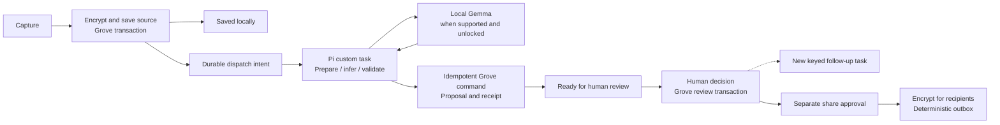

# Pi Durable: local investigation execution

> **13 November boundary:** [community-sharing.md](community-sharing.md) adds vault unlock, key custody and device/audience isolation. Pi keeps references/receipts, never content keys or decrypted source packets, and protected work pauses on lock. The [G0 report](reports/2026-10-24-g0-feasibility.md) demonstrates in-memory recovery only; persistent tab-close recovery remains unproven. KOI is optional; capture and manual review do not require inference.
>
> **14 November decision (D14, D25 in [spec.md](spec.md#decision-log)):** Pi stays in the MVP and runs investigations on the laptop. It never gates saving, manual review or delivery, and the phone needs none of it. The Hub import and KOI exchange that appear below are next lanes.

**Decision:** use Pi Durable as Grove's planned investigation runtime, selected 16 October 2026 and reaffirmed 14 November. Product integration and persistent browser recovery proof remain pending; G0 installed a bounded experimental package set. The extension stays local-first: the optional full node is unnecessary for local capture, inference, review or history.

Pi owns resumable execution. Dexie owns garden knowledge and its temporal history. KOI owns selected knowledge exchange. The [architecture](spec.md), [implementation sequence](plan.todo.md), [spike](first-spike.md) and [acceptance gates](eval.md) apply this boundary consistently.

## Basis and integration limits

### Research refresh: 13 November 2026

Current upstream `packages/durable/package.json` on `main` declares **1.5.2**, observed through the GitHub connector, blob `060a14d24136c467351cc2ff2f235629380a9351`. This is a source manifest observation, not a verified npm release/build pin or an approved upgrade. The inspected [README](https://github.com/earendil-works/pi/blob/main/packages/durable/README.md), blob `fc07256d6173a41f6181482eb53a066d34f2b66b`, still labels the API experimental. [IndexedDB source](https://github.com/earendil-works/pi/blob/main/packages/durable/src/storage/indexeddb.ts), blob `61dde41df134220491cec82724437e18dc8a5290`, supplies the browser adapter; the README requires one database owner and recommends a Web Lock.

The [current specification](https://github.com/earendil-works/pi/blob/main/packages/durable/docs/spec.md), blob `b8b9c7dd11a9ae4183b5ee715de5dea5cce86e15`, distinguishes stored commits from optional deferred progress commits. Deferred streamed progress can be visible before storage and lost on crash. Grove capture acknowledgment, review decisions, consent, commands and terminal ready-for-review state must follow the owning durable commit, never a provisional stream notification. Do not extend the earlier “all visible progress is durable” wording to unpersisted model tokens. Preserve the dated G0 results and earlier pins below as historical evidence; no dependency changes or new runtime tests were performed for this refresh.

### Source refresh: 14 November 2026

Read in this repository on develop at `3ee6594ef`: the G0 spike pins `@earendil-works/pi-durable`, `chord` and `pi-ai` at **1.5.0** ([package.json](../../../packages/extension/package.json)), and its [harness](../../../packages/extension/src/execution/harness.ts) still constructs `MemoryStorage`, with a comment that cites 1.3.0. So the installed version is ahead of the proof: no run has yet survived a closed tab on `IndexedDbStorage`. The release-age gate that blocked that run in October no longer applies, and P0 can proceed.

The 14 November review read the npm registry: 1.5.2 was published on 10 November, the package is MIT-licensed, and its README still says the API is experimental and changes between releases. The lockfile shows what the package brings with it: `pi-ai` depends on four AI provider SDKs and `pi-codemode` on a WebAssembly JavaScript engine. P0 must inspect what actually reaches the extension bundle.

Research inspected Pi commit [`8efd314fa3d3232ce197d8d7a6a5660530b9d83e`](https://github.com/earendil-works/pi/tree/8efd314fa3d3232ce197d8d7a6a5660530b9d83e/packages/durable), dated 16 October 2026. npm `@earendil-works/pi-durable` 1.3.0 was published 15 October; that commit also contains unreleased changes. These are evidence baselines, not interchangeable build pins. Select one compatible released Pi/Durable/Chord version set through the repository's dependency approval and release-age gate; record any reviewed patch explicitly. The [changelog](https://github.com/earendil-works/pi/blob/8efd314fa3d3232ce197d8d7a6a5660530b9d83e/packages/durable/CHANGELOG.md) and README still describe experimental APIs.

Established by the [specification](https://github.com/earendil-works/pi/blob/8efd314fa3d3232ce197d8d7a6a5660530b9d83e/packages/durable/docs/spec.md): task phases checkpoint through atomic Pi commits; visible Pi progress follows its storage commit; admitted inputs can deduplicate by request ID; interrupted tools rerun only when their stored and current replay policies both allow it. These guarantees cover Pi's storage, not independent graph or remote-peer effects. Upstream recovery tests were inspected, not executed for Grove.

The portable core separates Node adapters and provides a [storage conformance suite](https://github.com/earendil-works/pi/blob/8efd314fa3d3232ce197d8d7a6a5660530b9d83e/packages/durable/src/testing/storage-conformance.ts). The inspected package has memory, SQLite, JSONL and Cloudflare adapters, but no supplied IndexedDB/Dexie backend or browser Gemma adapter. Browser feasibility therefore gates implementation. Update, 23 October 2026: release 1.4.0 (21 October) adds `IndexedDbStorage` (`@earendil-works/pi-durable/storage/indexeddb`), one owner per database with a Web Lock recommended; the [prototype](prototype.md) uses it instead of a Grove-built adapter. The browser Gemma adapter remains Grove's to build. Node SQLite defaults to WAL / `synchronous = NORMAL`; do not extend process-crash claims to host/power-failure durability or to the unbuilt browser adapter.

## Ownership and deployment

| Owner | Authoritative state / behavior | Boundary |
|---|---|---|
| Grove knowledge store in Dexie | Source revisions, ontology mappings, entities, assertions, reviews, garden sequences, source erasure and command receipts | A Pi transcript, summary, fork or task completion cannot certify knowledge or completed Work |
| Pi Durable backed by browser storage | Investigation tasks, versioned checkpoints, execution attempts and persisted progress | References garden records by workspace and revision; no second authoritative garden graph |
| Grove dispatch/outbox | Undelivered run requests, review follow-ups, exact approved share payloads and delivery receipts | Transfers work across commits; it is not a competing investigation scheduler |
| KOI adapter | Signed scoped intake, collection reconciliation and deterministic outbound delivery | Pi may request an allowed operation; it never replaces signature, scope or recipient checks |
| Gemma bridge | One local inference operation with cancellation and bounded structured output | No graph-write, wallet, arbitrary network, code execution or approval authority |
| Graph workspace | Garden/topic/source navigation, timeline, review and compact investigation status | Pi task topology stays diagnostic; it does not become the garden graph or a separate chat dashboard |

Build `packages/extension/src/execution/` for the Pi composition, browser storage adapter, task definitions and domain-command adapter. `knowledge/` retains rules and mutations; `koi/` retains peer policy and protocol. Shared contracts remain browser-runtime independent. Pi types stay internal to Extension; Shared and Admin consume Grove schemas and summaries through declared exports.

Use one active local investigation at a time in the spike and one runner owner for its storage. Graph tabs are clients, never independent Harness writers. Keep storage/runner scope isolated per garden; switching gardens stops and joins the current runner before opening the other store. Jobs pending in the first workspace resume when it is reopened. Bind workspace identity immutably at admission and recheck it on every command/read, even if Pi exposes multiple conversations.

For P0, host the runner in the graph document or its dedicated worker, with the existing planned isolated model host. Closing that document pauses execution safely. Broader background operation may use an offscreen host only with a valid browser reason, packaged CSP and lifecycle proof; never invent a generic keepalive. The service worker persists capture/dispatch intent and reopens/resumes bounded work at supported wake points. A Pi timer or pending promise does not wake a terminated browser process. [Chrome lifecycle](https://developer.chrome.com/docs/extensions/develop/concepts/service-workers/lifecycle).

A future optional full node may use Pi's server adapters for permitted scheduled investigations. This is separate scope, with independent storage and authorization. Private local run state and source text are not uploaded as a shortcut to continuous execution.

## First workflow: custom tasks and bounded local inference

### Where Pi belongs in capture → review → share

| Phase | Owning behavior | Pi's value / boundary |
|---|---|---|
| Capture and acknowledge | Grove encrypts and durably saves the selected source, then writes follow-up intent in the same owning transaction | No Pi/model prerequisite for saving. A short save/extraction path needs no agent workflow. |
| Enrich a capture | Bounded source packet, optional local transcription/extraction, summary and evidence-linked proposals | Pi checkpoints genuinely multi-step processing, retries bounded failures and resumes pinned phases after reopening. A single cheap deterministic transform can remain an ordinary function. |
| Prepare review | Validate structured output and provenance, store candidates through idempotent domain commands | Pi exposes pending/paused/ready/error phases; it cannot declare the claim true or approve it. |
| Human review | A member accepts, rejects or corrects a particular revision under current permissions | Grove commits the human decision. End the enrichment task as ready-for-review; no live task waits for a person in the initial design. |
| Follow-up after review | An explicit review command can request re-analysis of the new revision | Atomically append keyed dispatch intent; admit a new Pi task. Stale tasks cannot overwrite the review. |
| Share/delivery | Approved audience/revision, crypto, encrypted outbox and transport receipts | Ordinary deterministic delivery/reconciliation owns retries. Pi is unnecessary for one approved upload; optional report assembly may use Pi before a fresh share approval. |

For example, a member records workshop notes or a field observation. Grove saves the source immediately. Pi can resume a longer local summarization/connection task if the tab closes between preparation and validated proposals. On reopening, stored phases and Grove command receipts prevent duplicated proposals. The member reviews the result whenever they return; Pi neither needs to stay running meanwhile nor gains permission to share it.

Pi supplies **execution recovery**, while Dexie supplies authoritative source/review history. A CRDT supplies **concurrent merge**, while a storage adapter supplies **remote persistence**. None replaces community authorization or content encryption. This separation keeps capture/manual review useful if Pi is unavailable, a model is too large for the phone, or the browser suspends processing.

### The agent's three jobs, decided 14 November

D26 to D30, D35 and D36 in [spec.md](spec.md#decision-log) give Pi its clearest work.

**Passive capture.** As the person browses, a plain text match against the garden's focus, which is its current assessment and any extra topics a steward added (D43), runs in ordinary code on every page the agent may read. A page that matches is queued, and one bounded Pi phase asks the model whether it is relevant. Only a relevant page is saved, as a capture.

**Assessment.** Each item the agent brought in gets three bounded phases: why it was brought in, its source, author and date, and what to check before sharing. Each phase checkpoints, so a closed tab costs one phase, and the result is stored beside the item through an idempotent command.

**Structuring.** When a free-form work report or promise is opened for review, one bounded phase proposes its structured version in the existing report contract or the existing promise fields. Its input is the record's own words, and photos are attached as evidence by reference. The result is a prepared command that adds a new revision, with the source words of each value and the model version. A closed tab resumes it with one result, and locking cancels it.

The text match, the block list and the rule that nothing is kept from other pages are not Pi's. They are ordinary code that runs before anything is queued. Pi never sees a page that was not queued, and its records hold references, not page text.

### Privacy and proof for the refreshed flow

Persist only opaque source/workspace/revision references, phase keys and sanitized receipts in Pi's execution store. References can themselves reveal metadata; enumerate that leakage and protect sensitive execution fields instead of treating every reference as harmless. The supplied IndexedDB adapter does not establish a Grove encrypted vault by itself. Decrypted prompts/source packets remain transient or in erasure-controlled encrypted Grove stores; no key material enters task state, telemetry, errors or transcripts.

Before admitting or applying a resumed task, recheck source revision, erasure, workspace, unlock state and current policy. Locking pauses/cancels protected work and clears usable model/key caches. Do not mark this complete merely because a Pi task resumes. E12–E14 must interrupt source save, task admission, model phase, prepared proposal, Grove commit and Pi checkpoint, plus lock/erasure/stale-review cases. A phase can rerun; exactly-once external effects are not guaranteed without Grove's idempotency/receipt design.

At P0, run the same investigation a second way: as a plain job row written in the same Dexie transaction as its effect (R10). That version has no gap between two stores; Pi has one, which the command receipts below bridge. D14 keeps Pi for open-ended, multi-step investigations, and the comparison records what that costs and buys. Do not move a button click, a permission check or a transfer retry into Pi. Persistent tab-close proof remains pending beyond the in-memory G0 experiment.

Use Pi `defineTask` phases for `grove.investigation.v1` first, rather than an open-ended model tool loop. The existing Gemma bridge is called from an explicit phase. A browser `pi-ai` custom provider remains a later option if conversation-driven planning becomes useful. Do not install the coding-agent tools, code mode, shell/file tools, remote-provider catalogs or subagent workflows into the Grove registry.

Persist only references and control state in Pi: run ID, workspace ID, source revision/hash, garden snapshot sequence, ontology/profile/mapping versions, model artifact/runtime version, operation IDs, prepared-result references and phase. Pin these at admission. The admission key is stable per run operation and bound to its input digest; a repeated key with a different digest is rejected. A Grove run-index document in Pi storage records that key, input digest and task ID in the same Pi commit that creates the task. A new source, review or context revision creates an explicit follow-up rather than silently changing an old run.

1. **Admit:** the source-save transaction records an investigation request in Grove's dispatch outbox. The single dispatcher invokes `admitInvestigation`: inside `conversation.commit`, read the run-index document, reuse the matching key or create a conversation-owned task through `tx.createTask`, and store its task ID atomically in that document. Then record the admitted ID in Grove dispatch state. If interrupted, retry this keyed admission. Do not use `submit({ type: "input" })` for custom-task admission: that starts the built-in generation path. A future conversation loop may use Pi's submission request IDs after its own scope is accepted.
2. **Prepare:** read the pinned source and small eligible graph neighborhood. Check consent, source availability and mapping versions. No inference occurs inside a database transaction.
3. **Infer:** call the real local Gemma bridge, at most three candidates. The model sees exact permitted spans and allowed terms, not the whole graph. An interrupted inference may restart from the pinned packet; no token-level continuation is promised.
4. **Validate and prepare command:** validate predicates, endpoints, IDs and spans. Store a bounded prepared command/result in Dexie under a stable run/step key before checkpointing its reference in Pi. Reopening first checks for that prepared result, so it cannot silently replace an already prepared command with a different stochastic answer. Invalid output records a failed/abstained result; the source remains saved.
5. **Apply:** invoke the idempotent knowledge command with the prepared reference and expected revisions. Save graph changes and the command receipt in one Dexie transaction, then checkpoint the returned receipt in Pi.
6. **Ready for review:** finish the current task and persist a minimal run summary. Human accept/reject/correct remains an independent Grove transaction. That transaction records any follow-up dispatch intent atomically; a new keyed custom task continues the logical investigation. Do not hold a live invocation or an in-memory promise while waiting days for review.

Pi owns investigation phase scheduling and checkpoint recovery; Grove defines bounded retry/backoff and terminal failures in its task phases. Grove's former enrichment `jobs` become dispatch/projection records for that path, not a second lease-based model executor. Deterministic capture and KOI intake/outbound delivery may retain their own bounded workers and leases because they own different operations. A task's retry never starts a second autonomous KOI delivery loop.

## Commands, replay and partial failure

The narrow internal command boundary is `applyKnowledgeCommand({ workspaceId, commandId, payloadDigest, expectedRevisions, preparedRef }) -> receipt`. It earns its place by hiding domain validation, deduplication, stale-write rejection and graph transaction rules from both the runner and UI. Use the real Dexie adapter and an interruption-capable test adapter; avoid a generic agent framework wrapper.

Command identity is independent of a model-issued tool-call ID and a Pi storage sequence. Derive a stable operation key from the admitted run and step; retain its payload digest. On retry, a matching receipt returns the original result. Reusing the ID with a different payload rejects. Apply the existing source/graph revision preconditions before the first mutation; stale or erased evidence yields an explicit conflict/cancellation, not silent rebasing.

| Interruption boundary | Required recovery |
|---|---|
| Source committed, Pi admission not recorded | Dispatch retries the same keyed admission; no lost source or duplicate run |
| Model interrupted before a prepared result exists | Restart bounded inference from pinned inputs; show saved source and paused/processing state |
| Prepared result committed, Pi checkpoint lost | Find the existing prepared reference and continue without replacing its payload |
| Graph committed, Pi checkpoint lost | Reapply the command key; return the existing receipt without a new sequence, node, edge or freshness signal |
| Human review committed, follow-up not admitted | Retry the review-revision keyed dispatch once; previous run cannot overwrite the decision |
| Share approved, peer response lost | Existing scoped KOI outbox reconciles the exact approved RID/hash; task replay cannot broaden fields/recipient or authorize a new share |
| Storage quota/write failure | Do not show successful save/proposal; Pi storage errors fail/close the Harness, then reopen only after storage is usable |

Pi and Grove commits are separate. Do not claim cross-store atomicity merely because both use IndexedDB. P0 must verify the approved upstream IndexedDbStorage against Pi's asynchronous `Storage` contract and Grove lifecycle requirements: atomic batch persistence, monotonically allocated IDs across reopen, conversation ancestry, paged scans, submission deduplication, versioned documents and detached reads. The adapter's transaction settles only after commit. Network/model awaits stay outside transactions. Even colocated tables do not grant a public cross-store transaction without a separately proved design.

If a future tool loop is used, mark read operations replay-safe only when their snapshot inputs and behavior are pinned. Graph mutations require the command receipt contract before being marked safe. All tools recheck current permission/source state at execution. Human review, consent and sharing approval cannot be inferred from tool replay metadata. Default replay-unsafe behavior is retained for operations without a proven idempotency contract. [Replay source](https://github.com/earendil-works/pi/blob/8efd314fa3d3232ce197d8d7a6a5660530b9d83e/packages/durable/src/harness/tool.ts).

## Privacy, history and visible progress

First-slice custom tasks keep raw source text, prompts, output spans and prepared candidates in the existing erasure-controlled knowledge stores or transient model memory. Pi checkpoints/results and diagnostics contain references, phase and sanitized error codes. Do not persist those source texts in Pi entries, prompt sections, tool outputs, exception strings or summaries. Verify the serialized store/export, not just the displayed UI. A future conversation loop that retains excerpts requires a tested purge/encryption/retention contract first; Pi reset/compaction retains older transcript history and is not erasure.

On source deletion, cancel/join affected tasks, invalidate pending commands, remove protected source/candidate/index data and prevent an in-flight response from reintroducing it. Preserve only permitted receipts/identifiers needed for duplicate protection. Store permission/source checks at the command owner, not only in a prompt. Protected capture requires the [community-sharing encryption contract](community-sharing.md); device-local storage by itself is not vault protection.

The graph shows **Saved**, **Finding connections**, **Paused**, **Ready for review**, or **Needs attention** next to the relevant source/connection. These are Grove projections from committed state; Pi watch streams can recover a current snapshot, but are not a durable garden change feed. A completed investigation means the workflow finished, never that a proposed trial occurred. Garden knowledge time, activity time and planned time remain independent of execution timestamps. Forking a conversation cannot fork or merge authoritative garden history.

## Build gate and rollout

P0 establishes browser bundling, storage conformance, single ownership, reopen behavior and a version-upgrade/migration case before Pi is wired into the product. P1 proves the knowledge-command bridge; P2 proves local Gemma investigation and review continuation. [E12–E14](eval.md) cover their complete exit conditions. P0 failure blocks the selected Pi integration; preserve the local graph and report the failed gate, rather than silently moving inference to a server or adding a competing scheduler.

Use the Vida Verde agroforestry resource first, then TAS learning/solar context. Force termination at each boundary above and record run IDs, source/profile/model versions, graph sequences and receipts with public-safe evidence. No browser, storage, model or upstream test has passed for Grove on the basis of this planning document.
