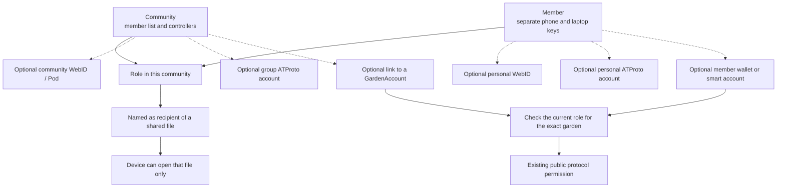

# Grove: identities and roles across contexts

**Updated:** 14 November 2026. **State:** proposed integration contract, unimplemented. [Community sharing](community-sharing.md) owns privacy, key custody and the [terms](community-sharing.md#terms) used here; [spec.md](spec.md#decision-log) owns the decisions cited as D-numbers. This map refines C0, C0a and C6 and gates E15, E21, E23 and E24. It changes no Green Goods permission and creates no onchain role.

The same person can hold several roles in several communities and show a different identity in each. A **role**, an **account association**, a **content-key grant** and a **public protocol permission** are four separate records. None implies another.

## Who controls what

This is an association map, not a migration path. Only the first three rows are needed to use Grove. Every other row is optional, added by choice, and private until separately approved.

| Identifier | Controlled by | Keys and where they live | Rotate or recover | What publishing the link reveals |
|---|---|---|---|---|
| Device keys, one pair per community | The person holding the device | A signing key and a key-agreement key in that client's own storage, never exported | Enrol a new device and drop the old one. A device key is never recovered | Nothing beyond the member list it appears in |
| Member, per community | The member's enrolled devices | None of its own | The controller adds a device, at the request of an existing device or after recovery | Using one member identity in two communities links them, so the default is a separate one in each |
| Community | Its controllers: one steward in the MVP, a second before real data (D18) | The controller's signing key on the steward's device. The identifier is the hash of the first member list | A signed member-list version. The recovery code can appoint a new controller device | That the community exists. A published member list would show its size and keys, so it is not published |
| Existing Green Goods passkey | The person, through their passkey provider | With the provider, on the device or synced | The provider's own sync and recovery | Nothing new. Grove writes no credential ID or public key into a member list or a shared file. The Green Goods passkey directory already answers a sign-in by name with the credential's public key, from which the account address derives, so those three are linked by design |
| Member smart account | The passkey holder | The passkey; the address derives from the credential | Through the passkey provider. Restoring a Grove vault restores no account | The name, the address and its onchain history |
| Member wallet | The wallet holder | The wallet | The wallet's own | The address and its history |
| GardenAccount | Whoever holds the garden token; roles come from Hats | The token holder's wallet | Token transfer; role grants through the Hats module | The garden and its public role graph |
| Solid WebID and Pod | The identity provider and the Pod operator | Session tokens on the device, disposable | Provider reset, then link again | Where ciphertext is stored, who operates it, the WebID profile |
| ATProto account | Whoever holds its rotation keys; the PDS signs | A signing key held by the PDS; optionally a self-held rotation key | A PLC operation, or migration to another PDS | The handle, the whole public repository and the identifier's history |
| Certified account or group | The Hypercerts Foundation's services | Sign-in by emailed code; the Group Service holds the group account's credentials | Not documented | An email address to the operator; public records |

Local controller keys decide membership and who receives content keys. A storage account decides availability only. An ATProto identifier decides public attribution. The garden token and Hats decide protocol actions. A provider never becomes the community's root, because the community's identifier is the hash of its own first member list and every association is a leaf the controllers sign and can drop.

The ATProto and Certified rows restate what the security review read on 13 November from [ATProto's DID specification](https://atproto.com/specs/did), its [migration guide](https://atproto.com/guides/account-migration) and Certified's [Group Service](https://docs.hypercerts.org/reference/services/certified-group-service) and [PDS](https://docs.hypercerts.org/reference/services/certified-pdss) pages. They differ in custody: an ATProto account can hold its own rotation key and move between hosts, while a Certified group account's credentials sit with the service. Neither supplies private, end-to-end encrypted data.

Dashed links need proof and consent. They are not identity migration and they propagate no permission. An outside account may already be public; keeping a link private protects the association, not the account's existence. Unlinking cannot erase a link that was published. Never publish the whole cross-context identity graph or a participant's real-world identity by default.

## What the existing passkey does

D19 makes the existing Green Goods passkey a way to unlock a vault where its provider supports that, with a passphrase everywhere else. It stays out of every other job.

| Job | Mechanism | Can the existing passkey do it? |
|---|---|---|
| Show it is you | A passkey assertion with user verification, checked locally against the stored public key | Yes, on any `greengoods.app` page and in an extension with permission for that domain. It proves a holder of the passkey, not which device |
| Unlock the vault | The vault key wrapped under the passkey's PRF secret combined with a key held on the device, with passphrase and recovery-code wraps beside it | Yes, where the provider returns that secret. C0a proves which providers do. It is never the only wrap |
| Enrol a device | A new device key and a member-list version signed by the controller | No. A passkey syncs, so it identifies no device and must never re-admit one |
| Sign Grove records | The device's signing key | No. It would prompt for every signature and produce a WebAuthn-shaped result |
| Encrypt shared content | A fresh key per file, wrapped to recipients' device keys | No. A passkey cannot decrypt to a public key |
| Recover a vault | The recovery code, a second device, or re-admission by the controller | It can add one more wrap to an export. A restore still creates a new device key |
| Recover an Ethereum account | The passkey provider's sync, or account-level recovery | A separate problem. Restoring a vault restores no account |

What code and platform rules settle today, read on 14 November:

- Current credentials use the relying-party ID `greengoods.app` ([passkey-directory.ts](../../../packages/shared/src/public-contracts/passkey-directory.ts)). Credentials issued earlier by the hosted server are bound to each site's own hostname ([passkeyServer.ts](../../../packages/shared/src/config/passkeyServer.ts)). "The existing passkey" is two populations.
- Registration asks for a platform authenticator with user verification and requests no extensions ([agent passkey-directory.ts](../../../packages/agent/src/services/passkey-directory.ts)). No existing credential was created with PRF requested.
- The existing [WebAuthn and Kernel construction](../../../packages/shared/src/modules/auth/passkey-kernel-account.ts) controls a member's smart account, not a GardenAccount.
- A page on any `greengoods.app` subdomain may use the credential. Twelve hostnames in this repository sit under that domain, and the PRF secret is the same from each.
- Since Chrome 122 and Firefox 150, an extension page may use a site's relying-party ID when it holds host permission for that site, and the recorded origin is the extension's own ([WebAuthn mailing list, 13 December 2023](https://lists.w3.org/Archives/Public/public-webauthn/2023Dec/0078.html); [MDN](https://developer.mozilla.org/en-US/docs/Mozilla/Add-ons/WebExtensions/Use_the_web_authn_api)).
- The passkey directory accepts calls only from its configured origins. An extension's origin is not one of them, so Grove's unlock must work without the directory.
- Nothing in the browser packages encrypts today. The Agent encrypts some records on the server with keys it holds, which is the opposite custody from Grove's.

Still unknown, and the subject of C0a: whether each provider returns a PRF secret for credentials created without the request, whether it does so on an extension page, and whether it works with the network blocked. A vendor-compiled matrix says iCloud Keychain and Google Password Manager do; that is a lead, not proof.

## Existing Green Goods roles and what they would mean in Grove

Six roles exist in the protocol. They are defined in [IHatsModule.sol](../../../packages/contracts/src/interfaces/IHatsModule.sol), named in [garden-roles.ts](../../../packages/shared/src/utils/blockchain/garden-roles.ts), and enforced by [GardenAccount](../../../packages/contracts/src/accounts/Garden.sol) and the [Work](../../../packages/contracts/src/resolvers/Work.sol), [WorkApproval](../../../packages/contracts/src/resolvers/WorkApproval.sol), [Assessment](../../../packages/contracts/src/resolvers/Assessment.sol) and [Testimony](../../../packages/contracts/src/resolvers/Testimony.sol) resolvers. This was read on develop at `3ee6594ef`; it is source evidence, not a check of any deployed garden.

| Role | What it authorizes today | In Grove it could | It would never |
|---|---|---|---|
| Gardener | Submit Work. The account check also passes for a steward or an owner | Capture and contribute under a local grant | Imply review, release or key rights |
| Evaluator | Create assessments. The check also passes for a steward or an owner; an evaluator alone does not pass the gardener check | Review evidence assigned to them | Carry WorkApproval or community authority |
| Steward, named operator in deployed contracts | Approve Work, but not their own; submit Work; assess; grant roles; manage the garden in the app | Be the community's natural choice of controller or release approver, if it chooses so | Read anyone's private captures by holding the role |
| Owner | Everything a steward can, plus owner-only settings | Take a recovery or controller duty if the community delegates it | Hold archive keys by default |
| Funder | No Work, WorkApproval or Assessment. Counts as a member for commitment pooling | Receive agreed reports as a partner contact | Receive evidence because of the label |
| Community | Give community testimony. Counts as a member for commitment pooling | Read and contribute in what it is granted | Mean a Grove community. The word is shared and the meanings differ (D23) |
| Student or learner | Nothing. It is not a protocol role | Be a local label for a participant with their own captures and a consented learning collection | Become a gardener by renaming |

Three corrections to the earlier version of this table. It cited `useRolePermissions`, which nothing but its own test uses; the app's checks go through [useGardenPermissions](../../../packages/shared/src/hooks/garden/useGardenPermissions.ts). It omitted the Community role's testimony right. And it used "member" loosely: the app counts owner, steward, evaluator and gardener as members of "my gardens" ([membership.ts](../../../packages/shared/src/modules/garden/membership.ts)), commitment pooling counts all six roles ([GuardLib.sol](../../../packages/contracts/src/lib/CommitmentPooling/GuardLib.sol)), and Grove's member is neither.

**Member accounts are not the garden.** A member's wallet or passkey smart account is the attester. The GardenAccount is the recipient of attestations and the place role checks are asked. The garden token is minted to the authorized minter, and the account's own signature follows whoever holds that token. So a community's link to a Garden is proved by an account that wears that garden's steward or owner Hat, with a role check made at that moment, and never by a GardenAccount signature (R8). A wallet signature alone is not authority to represent a garden.

**One person, several communities.** In the protocol this is guaranteed: each garden has its own Hats, and every resolver asks the recipient garden's own account, so a steward of garden A who tries to approve work in garden B is refused. In Grove it is only proposed, and these rules are what E23 must prove:

- A grant counts only if its signer chains to the controller of the community that owns the record. A grant from community A is meaningless in community B.
- A device holds a separate key pair for each community (W3).
- Search, the graph and local AI read one community's records at a time.

Example: a learner is a community member in a cultural learning circle, a gardener in a land project and an evaluator for an assigned study. Each grant names its community, purpose and collection. Combining labels does not combine access. A steward in garden A has no implied rights in garden B.

## Authority and proof at each boundary

| Context | What proves the association | What still grants authority |
|---|---|---|
| Fully local | A device key signs; the member list shows the device belongs to the member | The community's signed member list, and being named as a recipient of a particular file |
| Solid | A fresh Solid-OIDC sign-in proves control of the service identity to Grove; a local key signs the bounded association | The provider's access rules permit storage operations. Reading content still needs a file addressed to the device |
| ATProto | A fresh OAuth or service sign-in proves account control or a delegated ability; a local key approves the association | The requested publishing scope and the destination's own roles. A group-service admin does not own the underlying account |
| Ethereum | The member signs a domain-separated challenge with a nonce, audience and expiry; verify an EOA or an ERC-1271 contract account by its own path | The current role for the exact garden and operation, from existing readers and contracts. A local steward label cannot mint a Hat |

A sign-in is an event Grove observed, not a portable statement signed by the account owner. Store the kind of proof, the issuer and audience, when it was verified and what it does not establish. Keep no bearer or refresh token inside an association record. A newly created local identity logs in to neither Solid nor ATProto by itself: ATProto supports `did:plc` and `did:web` ([specification](https://atproto.com/specs/did)), and Solid needs its own WebID and issuer flow ([Solid-OIDC](https://solidproject.org/TR/oidc)).

Certified's [Group Service](https://docs.hypercerts.org/reference/services/certified-group-service) has `member`, `admin` and `owner` roles that govern its delegated writes. They are not gardener, evaluator or steward. A community chooses its publisher; most members need no Certified role or account.

## Minimum proposed records

| Record | Meaning and minimum fields |
|---|---|
| Member | An opaque local identifier within one community, its device keys and their history |
| Member-list entry | Member, device keys, role, the list version that added it and the one that removed it |
| Focus | The community, the revision, the topics, goals and open questions, and the signature of a steward's device. Accepted only while the current member list names the signer as a steward |
| Share approval | The author, the revision's digest, the fields, the recipients, the purpose, the destination, the time. Bound to a digest of the exact content |
| Release approval | The steward, the projection's digest, the audience, the destination, the review decisions relied on. The author's approval too when a corrected version of their capture is leaving |
| Review decision | The reviewer, the revision's digest, accept, reject or comment, the time |
| Account association | The local member or community, the service and account, the garden and chain if relevant, the kind of proof, audience and purpose, expiry, when verified, consent and visibility |
| Protocol authority observation | The exact account, garden and chain, the capability or Hat checked, the block or source, when observed and how long it may be relied on. Not a timeless certificate |

These are proposed logical records, not package APIs or ontology additions. Use the [ontology alignment](ontology-alignment.md) for semantic mappings. Keep personal identifiers, association records and grants inside the encrypted audience they belong to.

## Permission rules to prove

1. A local action needs a current place in the right community's member list and, to read, a file addressed to the device. A public protocol action separately needs the destination's own authority. Where a bridge action needs both, check both; never take the union of grants from different contexts.
2. An account association grants no role. A role grants no content key. A storage administrator cannot add a member. A signed review is not WorkApproval.
3. Governing a community and administering a collection's recipients can be different people. An owner or steward cannot read someone's private captures by holding a public role.
4. A community may choose to use a current onchain role as one condition of a local grant. That is opt-in, scoped and checked for freshness, and the recipient is still named explicitly. It never makes a public member graph mandatory.
5. An expired or revoked role observation authorizes no new outside write. Offline, keep captures and queue anything that depends on outside authority. Local and public revocation do not propagate to each other; reconciliation names the association and grants affected.
6. Account changes, shared wallets, garden transfers and controller recovery never merge identities or widen recipients. Check associations and attribution again. Recovering a device never reuses a lost device's key.
7. A public export may name the community as publisher without publishing any member's association. Public personal identity and public links between accounts each need their own informed consent.
8. A synced passkey never enrols a device, and unlocking a vault grants no role in a community and no public authority.

E23 exercises several roles in several communities, mismatched service roles, exact versus effective garden role checks, forged associations, stale observations and refusal to publish by default.
