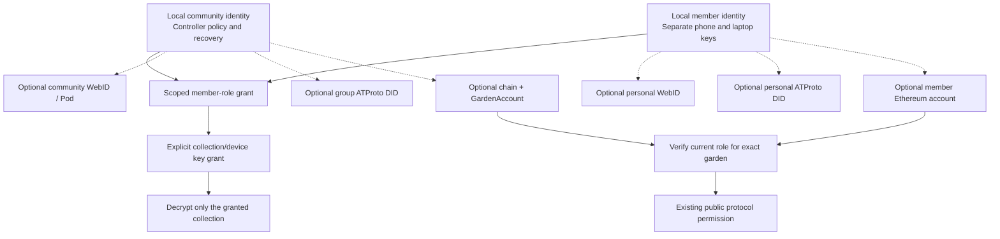

# Grove: identities and roles across contexts

**Updated:** 13 November 2026. **State:** proposed integration contract, unimplemented. [Community sharing](community-sharing.md) owns privacy/key custody. This mapping refines C0/C0a/C6 and E15/E21/E23/E24, without changing existing Green Goods permissions or creating onchain roles.

The same person can hold several roles in several communities and expose different identities in each context. A **role assignment**, an **account association**, a **content-key grant** and a **public protocol permission** are distinct records. None implies the others.

## Two identities, two sets of associations

| Local entity | Optional Solid association | Optional ATProto/Certified association | Optional Ethereum association |
|---|---|---|---|
| Community identity | Community WebID/service principal and selected Pod/container | Community/group publishing account DID; optional delegated group-service operator | Chain-scoped GardenAccount address |
| Member identity within that community | Personal WebID or a scoped delegated service principal | Personal publishing account DID and explicit group-service delegation | One or more member-controlled accounts, with roles checked for the exact garden |

A member's wallet is not the GardenAccount. A GardenAccount represents the garden; Hats/contract checks determine what each member account may do there. A public garden can already exist before a Grove workspace is created, and a local workspace can exist without any public garden. Associations are optional and may be many-to-many; never merge two member/community identities just because a label, email or service account matches.

Dashed associations require proof and consent; they are not identity migration or automatic permission propagation. Public association is a separate disclosure. External accounts may themselves already be public; keeping a binding private protects its association to the local identity, not the existence of that external account. Unlinking cannot erase an association already published. Never publish the complete cross-context identity graph or a participant's real-world identity by default.

## Authority and proof at each boundary

| Context | What proves the association | What still grants authority |
|---|---|---|
| Fully local | A local member key authenticates its devices; community controller policy validates membership | Signed, scoped local community grants; key grants for particular devices/collections |
| Solid | Fresh Solid-OIDC authentication proves control of the selected service identity to the Grove adapter; local key signs the bounded association | Provider ACLs permit storage operations; separate community policy/key grants permit meaningful content access |
| ATProto | Fresh OAuth/service authentication establishes account control or an explicitly delegated ability; local key approves the association | Requested publishing scope plus the destination's roles; a group-service admin is not automatically owner of the underlying account |
| Ethereum | Member signs a domain-separated nonce/audience/expiry challenge; verify EOA or ERC-1271 contract-account path | Current authority for the exact garden and operation, using existing readers/contracts; a local steward label cannot mint a Hat |

An OIDC/OAuth login is an adapter-observed authentication event, not automatically a portable signed statement by the service-account owner. Store proof kind, issuer/audience, verification time and assurance limits. Do not retain bearer/refresh tokens inside portable identity bindings. Public credentials or cross-party verification need an explicitly supported proof format.

Solid WebIDs and ATProto account DIDs are service-facing identifiers. A newly created offline DID does not automatically log into either service. ATProto currently supports `did:plc` and `did:web`; use a deliberate association to a supported account. Solid-OIDC requires its own WebID/issuer/client flow. [ATProto DID methods](https://atproto.com/specs/did), [Solid-OIDC](https://solidproject.org/TR/oidc).

[Certified Group Service](https://docs.hypercerts.org/reference/services/certified-group-service) exposes `member`, `admin` and `owner`, which govern its delegated group-account writes. Those are not equivalents of gardener, evaluator or steward. A community selects its publisher(s); most members need no Certified role or account. Group publishing may attribute contributions through an approved projection without exposing private aliases.

## Existing Green Goods roles and proposed local scopes

### Passkeys across these contexts

The existing [WebAuthn/Kernel construction](../../../packages/shared/src/modules/auth/passkey-kernel-account.ts) controls a member smart account, not the GardenAccount. [C0a/E24](collaboration-passkey-spike.md#pass-a-existing-passkey-offline-unlock-and-recovery) tests reuse of that existing credential without changing its RP/account recipe. A supported PRF-based vault unlock may protect separate contextual DID/Keyhive keys; ordinary signatures are not encryption keys. Existing-credential PRF support and the extension's RP/origin route remain unproven.

Keep passkey unlock, contextual member identity, per-device keys, service associations and public authority distinct. Keyhive's inspected integration uses Ed25519; the existing passkey owner uses P-256 WebAuthn, so no direct key substitution is assumed. A synced passkey is not proof of which enrolled device is acting and cannot silently re-admit a removed device. Recover local keys through an authorized device/protected export; record Ethereum account recovery separately. Solid/ATProto login still needs the destination's supported authentication. Publish no cross-context account map without explicit consent.

### Role scopes

Source evidence: [canonical role IDs](../../../packages/shared/src/utils/blockchain/garden-roles.ts), [UI permission helper](../../../packages/shared/src/hooks/roles/useRolePermissions.ts), [Hats module](../../../packages/contracts/src/modules/Hats.sol) and [GardenAccount](../../../packages/contracts/src/accounts/Garden.sol), inspected in the shared working copy at base HEAD `a0d503abc`. Unrelated local edits were present; this is code evidence, not deployed-chain verification. Effective account permissions can include inherited authority; exact Hat membership and effective permission checks are different queries. In the inspected GardenAccount, owner/steward satisfy both gardener and evaluator checks; an evaluator-only Hat does not satisfy the gardener check. Resolve the deployed garden/version before relying on any hierarchy.

The proposed local scopes below are defaults to discuss/test, not new protocol behavior or automatic decryption permissions.

| Role | Proposed local/community scope | Current public-protocol integration | External account mapping |
|---|---|---|---|
| Steward | Coordinate selected collections, assign review/publish duties and propose invitations under community policy | Existing submission/review/assessment/admin permissions, subject to actual current garden checks | May be a chosen Pod delegate or Certified publisher; neither is automatic |
| Gardener | Capture own work/knowledge and contribute selected records | Work submission under existing eligibility/rules | Personal login/wallet optional until using a destination; no publishing-admin grant implied |
| Evaluator | Review assigned evidence and create scoped assessment drafts | Assessment permission; evaluator alone is not steward WorkApproval authority | Usually only needs an assigned encrypted evidence collection, not group-account administration |
| Funder | Receive agreed reports and, if authorized, request evidence or add observations | Existing funder role is distinct; UI helper grants no work-approval/admin power from this label alone | Read-only report recipient can have no protocol or publishing account |
| Community member | Read/contribute to explicitly granted learning/community collections | Existing community role; no implied steward/admin authority | No provider or wallet required for local/community participation |
| Owner | Optional local controller/recovery duty only if community explicitly delegates it | Existing owner authority; current UI helper includes garden management | Onchain owner does not automatically hold private archive keys or become sole local controller |
| Student / learner | Context-specific participant label; own captures and a consented learning collection | No canonical student role exists in the inspected six-role set | Map to an existing protocol role only through an explicit eligible grant, never merely by renaming student to gardener |

Example: a learner is a community member in a cultural learning circle, a gardener in a land project and an evaluator for an assigned study. Each grant names its community, purpose and collection. Combining labels does not combine access across communities. A steward in garden A has no implied rights in garden B.

## Minimum proposed records

| Record | Meaning / minimum fields |
|---|---|
| Member identity | Opaque local subject ID and community context; method/key history; device references |
| Community role grant | Grant ID, issuer, subject, community, role label, capabilities, resource/collection/purpose scope, policy version/epoch, issued/expiry time and revocation reference |
| Device/content-key grant | Approved device encryption key, resource/collection/revision, key epoch and permitted historic access; separate from a role label |
| Account binding | Local subject/community, service/account identifier, garden/chain if relevant, proof kind/reference, audience/purpose, expiry, verification time, consent and visibility |
| Protocol authority observation | Exact account/garden/chain, checked capability or Hat, block/source/observation time and freshness limit; not a timeless role certificate |

Use the existing [ontology alignment](ontology-alignment.md) for semantic mappings. These are proposed logical contracts, not new package APIs or canonical ontology additions. Keep personal identifiers, account-correlation records and sensitive grants within the appropriate encrypted audience.

## Permission rules to prove

1. Local operations require a current applicable community grant and any necessary content key. Public protocol actions independently require the actual destination's authority. Where a bridge action needs both, enforce both; do not use a union of grants from different contexts.
2. An account association grants no role. A role label grants no private content key. A storage administrator cannot issue a valid community grant. A signed review is not WorkApproval.
3. Community governance and collection-key administration can have different delegates. An owner/steward cannot read someone's private capture inbox just by holding a public role.
4. A community may deliberately use a current onchain role as one condition of a local grant. Make this policy opt-in, scope it, verify chain freshness and still deliver keys explicitly. It must not make a public member graph mandatory.
5. Expired/revoked role observations cannot authorize new external writes. While offline, preserve captures and queue authority-dependent actions according to the agreed freshness policy. Local and public revocation do not propagate automatically; reconciliation must name the affected binding/grants.
6. Account changes, shared-wallet use, garden transfers and controller recovery cannot silently merge identities or widen recipients. Revalidate bindings and actor attribution. Device recovery is not reusing an old lost-device key.
7. Public exports may identify the community publisher without publishing every private member binding. Public personal identity and public cross-account correlation need separate informed consent.

E23 exercises multi-role/multi-community grants, mismatched service roles, exact versus effective garden role checks, forged bindings, stale observations and deny-by-default publication. The interactive companion in this conversation is an illustrative policy map, not a login tool or proof of implemented authorization.
