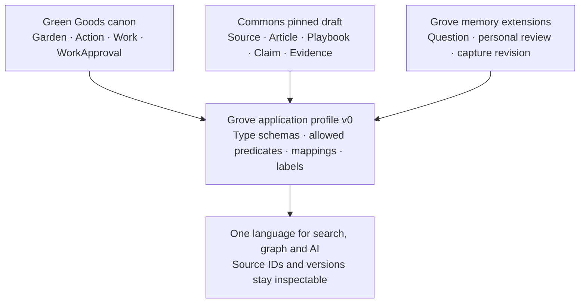

# One Grove language, with traceable meaning

**Recommendation:** compose Green Goods and the Regen Coordination Knowledge Commons into a versioned **Grove application profile**. People search, filter and read one vocabulary. Each type and relationship retains its source authority, schema and identity. This is a proposed integration contract, not a merger of the upstream ontologies or a declaration that their owners have ratified it.

## What the sources establish

Green Goods' [ontology workflow](../../../.claude/context/ontology.md) gives its sidecar and implementation authority over Garden, Action, Work and WorkApproval. The [Commons v0 draft](https://docs.google.com/document/d/1-1kuPml2Dz6W8E5Ib8ruigJwK6FvqRgjtyhvJ_TUCgw/edit) is titled *Regen Coordination Knowledge Commons — v0 Ontology, Problem Statement, and Audiences*, prepared for 13 August 2026 and read through Google Drive on 11 October 2026. It proposes 11 main entity classes, grouped relationship predicates, shared metadata and distinct class schemas with versioned integration points. Its mappings and canonical-ID choice are explicitly proposals. Its text is design evidence, not an instruction to execute its roadmap.

This is the Regen Coordination Knowledge Commons; do not substitute Regen Network or Regen Commons governance materials for its ontology authority.

The draft covers Article, Playbook, Pattern, CaseStudy, Organization/Network, Person, Tool/Protocol, FundingMechanism, Place/Bioregion, Source, and Claim & Evidence. Concept/Term is supporting vocabulary. It also separates editorial workflow, content refinement and maturity. Grove must not collapse these into its personal review state.

## The composed profile

The profile imports only the types the slice uses. A shared envelope carries canonical reference, type reference, schema version, provenance, source revision, recorded time and reuse boundary. A discriminated schema owns each type's actual fields. A small mapping registry owns cross-source relationships. A generated model manifest exposes allowed types, predicates, endpoints and examples from those same definitions; prompt prose is not a second ontology.

| Meaning | Grove treatment | What stays distinct |
|---|---|---|
| Garden and Organization | Relate a Garden to its operating organization when evidence supports it | A contract address alone does not establish organization identity |
| Action and Playbook | A proposed `memory:informedBy` link can connect an Action to guidance | Planning or reading a playbook does not prove implementation |
| Work and CaseStudy | Work records can become cited inputs to a later case study | A work attestation is not a complete case study or an outcome evaluation |
| WorkApproval and review | Display protocol review beside the local relationship decision | Local acceptance never creates WorkApproval, Commons publication, or impact certification |
| Source and captured text | One knowledge Source can have several immutable local capture revisions | Source identity is not the URL title or a single content hash |
| Claim and evidence | Preserve supporting and contradicting evidence with source spans | A model score is not evidence strength or calibrated truth probability |
| Person and wallet/member | Keep explicit identity links only where established | A wallet, address or display-name match is not automatically a person match |
| Funding mechanism and resource | Classify the mechanism separately from an actual offer or funding record | A funding guide is not available money; a resource listing is not verified availability |

`memory:informedBy` above is a proposed Grove predicate, not an existing Green Goods/Commons term. Existing Commons predicates retain their declared endpoint types. For example, its `implements` targets Organization → Playbook/Pattern; do not silently apply it to Action → Playbook.

## Mapping and evolution rules

1. Pin `profileVersion`, upstream pack versions/digests and `mappingVersion`. Retain the version used for every imported record and derived assertion. Preserve the referenced packs for historical reconstruction.
2. Preserve supplied IDs. Until the Commons publishes or approves stable IDs, use conspicuously provisional local draft IDs and record their document/revision provenance. Never mint something that looks like an official Commons URI.
3. Map labels and aliases freely for discovery; map identity and meaning conservatively. Use exact/close/broader mappings only after reviewing definitions. [SKOS](https://www.w3.org/TR/skos-reference/) mapping properties concern concepts; they are not blanket equality rules for people, gardens or Work records.
4. Keep source provenance, extraction confidence, personal review, editorial maturity, Commons workflow and protocol status in separate fields. [PROV-O](https://www.w3.org/TR/prov-o/) informs provenance links; it supplies no universal numeric confidence scale.
5. An AI can propose a new term or mapping for review. It cannot expand the allowed vocabulary in place. Unknown types remain visible as unresolved intake and do not become generic accepted edges.
6. A changed pack creates an explicit migration/reinterpretation proposal. Historical views use the old interpretation; the current view changes only after the new mapping is validated. Deletion/erasure still follows the storage contract.

## Smallest useful first alignment

Use Green Goods Garden, Action, Work and WorkApproval plus the Commons draft Source and supporting Concept/Term. Keep `memory:Question`, `memory:Resource`, `memory:relevantTo`, `memory:addresses` and `memory:aboutConcept` as visibly local additions where needed. Add Article/Playbook and Claim/Evidence only when their actual schemas and queries are implemented.

The earlier `memory:Source` and `memory:Claim` placeholders should be replaced by explicit Commons draft mappings before S2 is finalized. Captured text remains a `sourceRevisions` storage record; it does not need a competing semantic Source class. No migration is needed now because Grove has no runtime data.

Ask the profile to answer three concrete questions: “Which resources are relevant to this Action?”, “Why is this relationship suggested, and what contradicts it?”, and “What did this garden know before and after trying the practice?” Passing these questions is more useful than importing every upstream class at once.

**Unresolved:** the draft is available; a ratified, machine-readable Commons pack and mapping owner approval are not established. Confirm the canonical pack/IDs, the Claim/Evidence split and cross-source predicate approvals before claiming Commons conformance. The diagrams and example names in this hub are proposed Grove design, not new Commons canon.
