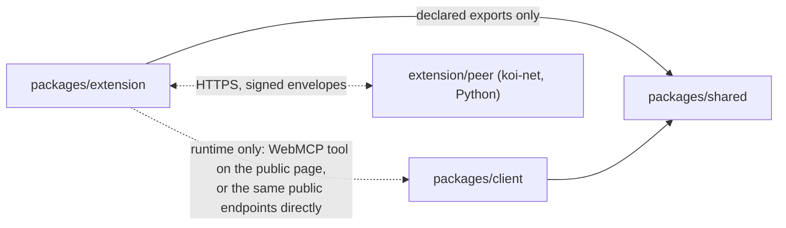
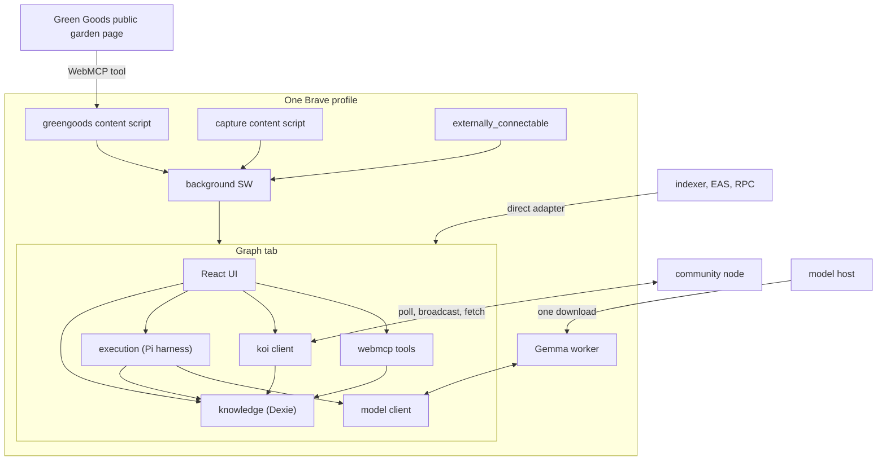
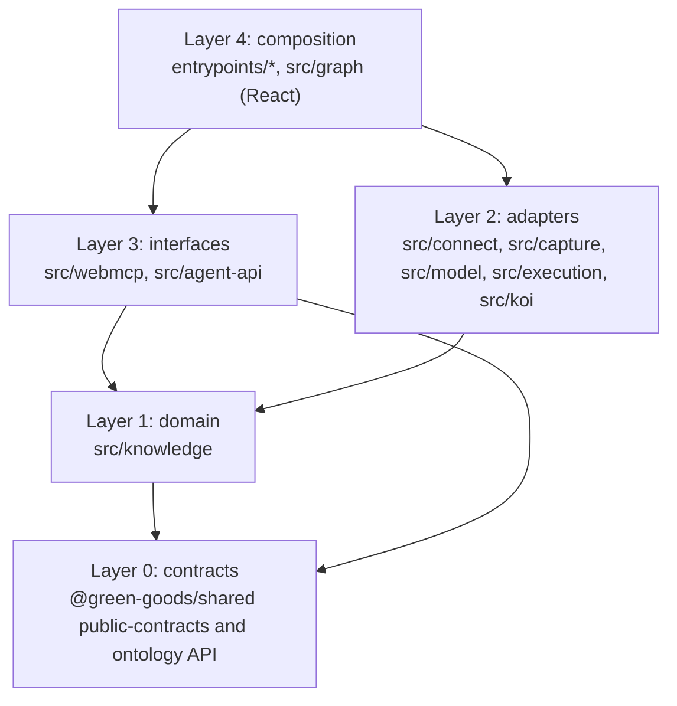
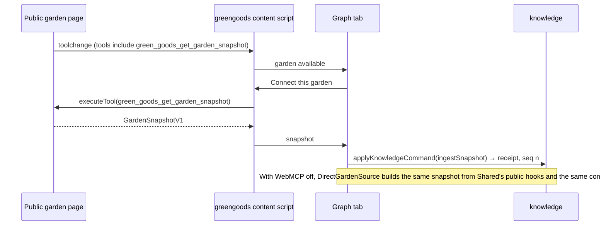

# Grove prototype architecture: packages, dependencies, modules, types

**Status:** architecture for the agreed prototype scope; nothing built. **Updated:** 24 October 2026.
**Companion to:** [prototype.md](prototype.md), which owns what we build and why. This document owns how: the packages, their dependencies, where code runs, the module layers, the types that cross module boundaries, the UI components and the data flows. Names below are proposals until G0 and G1 land them; every type is grounded in a source named next to it.

## 1. Packages

One new package, two existing packages touched, one development-only fixture.

| Package | State | Role in the prototype | Depends on |
|---|---|---|---|
| `packages/extension` | New. WXT (MV3), React 19, TypeScript. Brand: Grove | The whole extension: graph tab, Grove memory, Pi investigations, Gemma worker, KOI node, WebMCP bridge and tools, the external agent API | `@green-goods/shared` through declared exports only; the third-party packages in section 3 |
| `packages/shared` | Existing. One new file | `src/public-contracts/garden-snapshot.ts`: the `GardenSnapshotV1` type and its Zod schema, exported through the existing `./public-contracts` entry | Nothing new. Shared never imports the extension |
| `packages/client` | Existing. One edit, one new file | `src/webmcp.ts` registers on `document.modelContext` first and, on `/gardens/:id`, the garden snapshot tool; `src/views/Public/gardenSnapshotTool.ts` builds that tool from the hooks the page already uses | Shared, as today |
| `packages/extension/peer/` | New, development only, Python | A koi-net 2.1.2 full node configured as the community node for D5. Outside the TypeScript project and the extension bundle; run with `uv` | koi-net, rid-lib |

Untouched: admin, agent, indexer, contracts, qa, docs. The extension registers with the repo like any package: the `packages/*` workspace glob picks it up, turbo and the source-structure policy learn its root files, and its tests run through the Bun test wrapper.



The dotted edges are runtime relationships, not imports. The extension never imports the client, and the client never knows the extension exists.

## 2. Where the code runs

A browser extension is several programs that share storage. Grove keeps the number small and gives each one job.

| Context | Entrypoint | Owns | Never does |
|---|---|---|---|
| Graph tab (one full tab, React) | `entrypoints/graph/` | Grove memory writes, the Pi harness behind a Web Lock, the Gemma worker's lifetime, `grove_*` WebMCP tool registration, the KOI poll and broadcast loop while open | Run model code on its own thread; stay alive when closed |
| Gemma worker (dedicated Web Worker of the tab) | `entrypoints/gemma.worker.ts` | Loading `onnx-community/gemma-4-E2B-it-ONNX` through Transformers.js on WebGPU, one request at a time, cancellation | Touch IndexedDB, the network beyond the model download, or the DOM |
| Background service worker | `entrypoints/background.ts` | Opening or focusing the graph tab, relaying capture and bridge messages, the `externally_connectable` listener that forwards to the tab | Hold state, keep itself alive, run inference or Pi |
| Green Goods bridge (content script on Green Goods origins) | `entrypoints/greengoods.content.ts` | `document.modelContext.getTools()` and `executeTool()` for tools named `green_goods_*`; the **Connect this garden** affordance | Read cookies, storage or anything but the tool results |
| Capture (content script, on demand through `activeTab`) | `entrypoints/capture.content.ts` | Readable-text extraction of the current page on **Save to Grove**, hashed before it leaves the page | Run on pages the person did not act on |
| Community node (separate process) | `peer/community_node.py` | Accepting the two Grove nodes' edges, relaying NEW, UPDATE and FORGET events, serving bundle fetches | Hold Grove memory; it is a relay with a cache |

Storage, per browser profile:

| Store | Technology | Holds | Owner |
|---|---|---|---|
| `grove-knowledge-<workspace>` | Dexie 4.4.6 over IndexedDB | Sources, nodes, edges, changes, reviews, receipts, KOI inbox and outbox, seen cursor | `src/knowledge/store.ts` |
| `grove-pi-<workspace>` | Pi Durable `IndexedDbStorage` | Pi conversations, tasks, checkpoints, documents; references into Grove memory only | `src/execution/harness.ts` |
| `grove-keys` | IndexedDB, non-extractable `CryptoKey` | The node's P-256 key pair | `src/koi/identity.ts` |
| Model cache | Cache Storage (Transformers.js default) | Gemma weights and tokenizer, downloaded once | The worker |
| Settings | `chrome.storage.local` | Active workspace, garden source toggle, peer URL and pinned key, allowlist | `src/settings.ts` |

Workspace identity is `chainId + lowercased garden address`; every table is keyed by it, and the two gardens of the demo live in two profiles anyway.



Permissions the manifest asks for: `storage`, `tabs`, `activeTab`, `scripting`; host permissions for the configured Green Goods origins, the indexer, EAS and RPC endpoints the direct adapter reads, and an optional host permission for the community node the person enters; `externally_connectable` with an explicit extension-ID allowlist and no sites. No `<all_urls>`, no `history`, no `webRequest`.

## 3. Dependencies

Versions follow the lockfile and the release-age gate; where Shared already pins a package the extension matches it. "G0" means approved for the feasibility spike (prototype decision 17); later slices name their own approval point.

| Package | Version | Loaded in | Why | Approval |
|---|---|---|---|---|
| `wxt`, `@wxt-dev/module-react` | gate-latest | build | MV3 manifest, entrypoints, dev reload, content script `world` option | G0 |
| `react`, `react-dom` | ^19.2 (Shared's) | graph tab | UI | G0 |
| `react-intl` | ^10.1 (Shared's) | graph tab | Every UI string through messages, as the repo requires | G0 |
| `@tanstack/react-query` | ^5.101 (Shared's) | graph tab | The direct adapter reuses Shared's public hooks, which are React Query hooks | G1 |
| `dexie` | 4.4.6 (Shared's) | graph tab | Grove memory | G1 |
| `zod` | ^4.6 (Shared's) | graph tab | Validate snapshots, model output, bundles, messages | G0 |
| `@earendil-works/pi-durable` | 1.4.0 exact | graph tab, `src/execution` only | Durable investigation tasks, `IndexedDbStorage` | G0 |
| `@earendil-works/chord`, `@earendil-works/pi-ai` | the versions 1.4.0 requires | with pi-durable | Pi's document state and model-client types; no provider is configured | G0 |
| `@huggingface/transformers` | 4.2.0 (the agent package's pin) | Gemma worker only | Tokenizer and ONNX execution on WebGPU; `onnxruntime-web` arrives with it | G0 |
| `sigma` | 4.x | graph tab | WebGL graph rendering | G0 |
| `graphology`, `graphology-types` | current | graph tab | The in-memory graph Sigma draws | G0 |
| `@mozilla/readability` | current | capture content script | Readable text from a page | G2, not yet approved |
| `minisearch` | current | graph tab | Keyword index over source chunks for packet building; optional | G2, not yet approved |
| `webmcp-types` | current | types only | Typings for `document.modelContext`; a local `.d.ts` is the fallback, as the client does today | G1, types only |
| koi-net 2.1.2, rid-lib 3.3.0 | PyPI | `peer/` only | The community node | G3, Python, not in the lockfile |

Model artifact: `onnx-community/gemma-4-E2B-it-ONNX` at `q4f16`, a download of about 1.5 to 3 GB cached by the browser; data, not a dependency. Bundle notes: pi-durable's root loads TypeBox (about 4 MB tree-shaken) and stays behind `src/execution`; Transformers.js and its WASM live only in the worker chunk; the content scripts carry no third-party code beyond Readability.

## 4. Modules and their layers

Dependencies point down. Entry points compose; nothing below them knows about React, Chrome APIs or the DOM except where the table says so.



| Module | Responsibility | Public interface (what other modules import) | Depends on | Tests |
|---|---|---|---|---|
| `src/knowledge/schema.ts` | Dexie database class, table declarations, indexes, versioned migrations | `openKnowledgeDb(workspaceId)` | dexie | Migration from an empty database and from the previous version |
| `src/knowledge/store.ts` | Transactions that append revisions and changes; reads by id, by kind, since a sequence | `KnowledgeStore` | schema | Duplicate ingest is a no-op; a failed transaction leaves nothing |
| `src/knowledge/commands.ts` | `applyKnowledgeCommand`: idempotent mutations with receipts and expected-revision checks | `applyKnowledgeCommand`, `KnowledgeCommand`, `CommandReceipt` | store, zod | Same id and digest returns the first receipt; same id with a different digest rejects; a stale revision rejects |
| `src/knowledge/query.ts` | Neighborhood, search, new-since, projection for the canvas | `queryGraph`, `newSince`, `projectForCanvas` | store | Two-hop bound; scope applied before counts |
| `src/knowledge/vocabulary.ts` | The allowed node kinds and predicates with labels from Shared's ontology API; endpoint rules per predicate | `vocabulary`, `isAllowedEdge` | `@green-goods/shared` ontology query API | Unknown predicate rejected; endpoint rule enforced |
| `src/connect/garden-source.ts` | The `GardenSource` interface and the chooser that reads the settings toggle | `GardenSource`, `chooseGardenSource` | settings | Chooser honors the toggle |
| `src/connect/webmcp-source.ts` | Snapshot through the bridge's tool call | `WebMcpGardenSource` | messaging to the bridge, zod schema from Shared | Rejects a snapshot that fails the schema |
| `src/connect/direct-source.ts` | Snapshot built from `usePublicGardenDetail` and `usePublicGardens` results, normalized to the same schema | `DirectGardenSource` | `@green-goods/shared/hooks/public/*`, react-query | Produces the same snapshot shape as the tool for one fixture |
| `src/capture/extract.ts` | Readable text, title, canonical URL, content digest from a document | `extractSource` | readability, Web Crypto | Same page twice yields one digest; forms and scripts stripped |
| `src/model/gemma-client.ts` | Worker lifecycle, progress, one request at a time, cancellation, timeouts | `GemmaClient` | the worker protocol types | Cancelled request resolves as cancelled; a second request queues |
| `src/model/prompt.ts` | The packet-to-prompt rendering and the JSON output contract | `renderPrompt`, `parseProposals` | zod | Malformed output yields an empty, flagged result |
| `src/execution/harness.ts` | Opens `IndexedDbStorage` under a Web Lock, builds the Pi `Harness`, installs the task registry, exposes `resume()` and task watches | `openGroveHarness` | pi-durable | Opens without a model provider; a second opener waits on the lock |
| `src/execution/investigation.task.ts` | The `grove.investigation` task: five phases with checkpoints | `InvestigationTask` | harness types, packet, validate, commands, model client | Each interruption boundary of D3 |
| `src/execution/packet.ts` | Chooses source chunks and the garden neighborhood for one investigation | `buildPacket` | query, minisearch (optional) | At most eight chunks; allowed IDs only |
| `src/execution/validate.ts` | Turns model proposals into a prepared command or an abstention | `validateProposals` | vocabulary, store | Exact-quote check; unknown IDs dropped |
| `src/koi/identity.ts` | Node key pair and node RID; export of the public key in the format koi-net reads | `getNodeIdentity` | Web Crypto, IndexedDB | Key never extractable; RID stable across reopen |
| `src/koi/rid.ts` | Parse and format RIDs; Grove's RID namespaces | `parseRid`, `formatRid`, `GROVE_RID_TYPES` | nothing | Round trips rid-lib vectors |
| `src/koi/bundle.ts` | Manifest and bundle generation with RFC 8785 canonical JSON and SHA-256 | `createBundle`, `verifyBundle` | Web Crypto | Hash matches rid-lib vectors |
| `src/koi/envelope.ts` | Sign and verify `SignedEnvelope` the way koi-net does | `signEnvelope`, `verifyEnvelope` | identity, Web Crypto | Signature verifies in the Python node and vice versa |
| `src/koi/wire.ts` | The five endpoints as typed functions over `fetch` | `KoiWire` | envelope, bundle, zod | Malformed, wrong-target and unknown-publisher responses rejected |
| `src/koi/exchange.ts` | Edge proposal, poll loop, inbox intake to commands, outbox with stored-version verification, FORGET handling | `KoiExchange` | wire, commands, store | Lost poll response, duplicate event, wrong workspace, withdrawal |
| `src/webmcp/bridge.ts` | Runs inside the Green Goods content script: lists `green_goods_*` tools and executes one | `listGardenTools`, `callGardenTool` | `document.modelContext` | Ignores tools without the prefix; handles a missing API |
| `src/webmcp/tools.ts` | Registers the four `grove_*` tools on the graph tab's document | `registerGroveTools` | query, commands | Each tool's schema and annotation; writes ask first |
| `src/agent-api/external.ts` | `onMessageExternal` handler with the same four operations | `handleExternalRequest` | allowlist, query, commands | Unknown sender rejected; same answers as the tools |
| `src/agent-api/allowlist.ts` | Allowed extension IDs and origins from settings | `isAllowedSender` | settings | Default-deny |
| `src/graph/*` | React components (section 6) | components | query, commands, execution watches, koi exchange | Keyboard and pointer reach the same review |
| `src/settings.ts` | Typed `chrome.storage.local` access | `settings` | zod | Defaults applied; invalid stored values discarded |

Three rules hold the layers together. `src/knowledge` is the only module that writes Grove memory; every other module reaches it through `applyKnowledgeCommand`. Pi, Transformers.js and KOI types never appear in another module's signature; `src/execution`, `src/model` and `src/koi` translate them to Grove types at their edge. The direct adapter and the WebMCP adapter produce one schema, `GardenSnapshotV1`, and nothing downstream knows which one ran.

## 5. Types that cross boundaries

TypeScript sketches. Field names follow the sources named in each heading.

### 5.1 The Shared contract: `GardenSnapshotV1`

From `Garden` (`packages/shared/src/types/domain.ts`), `EASWork` (`types/eas-responses.ts`) and `PublicGardenDetail` (`hooks/public/usePublicGardenDetail.ts`). Public-safe by construction: approved Work only, no gardener addresses, no private notes.

```ts
export interface GardenSnapshotV1 {
  version: 1;
  garden: { chainId: number; address: Address; name: string | null; location: string | null; tokenAddress: Address | null };
  actions: Array<{ actionUid: number; actionId: string; title: string | null; domain: "solar" | "agroforestry" | "education" | "waste" | null }>;
  works: Array<{ id: string; title: string; actionUid: number; createdAt: string; approvedAt: string | null }>; // id is the attestation UID
  coverage: { partialData: boolean; unavailableSources: { works: boolean; assessments: boolean }; truncated: boolean; fetchedAt: string };
  source: { kind: "webmcp" | "direct"; toolName?: string; pageUrl?: string };
}
export const gardenSnapshotV1Schema: z.ZodType<GardenSnapshotV1>;
```

### 5.2 Grove memory rows

Dexie tables in `src/knowledge/schema.ts`. `seq` is the workspace change sequence; `revision` is per record.

```ts
type Origin = "protocol" | "source" | "model" | "human" | "peer";
type NodeKind = "garden" | "action" | "work" | "source" | "question" | "planned" | "concept";
type Predicate = "informedBy" | "relevantTo" | "addresses" | "aboutConcept";
type EdgeStatus = "proposed" | "accepted" | "rejected" | "superseded";

interface SourceRevision { id: string; workspaceId: string; url: string; title: string; digest: string; text: string; capturedAt: string; sourceDate: string | null; seq: number }
interface KnowledgeNode { id: string; workspaceId: string; kind: NodeKind; canonicalId: string; label: string; properties: Record<string, unknown>; origin: Origin; revision: number; seq: number; activityClass?: "recorded" | "reported" | "planned"; plannedFor?: string | null }
interface KnowledgeEdge { id: string; workspaceId: string; subject: string; predicate: Predicate; object: string; origin: Origin; status: EdgeStatus; evidence: { sourceRevisionId: string; quote: string; start: number; end: number } | null; provenance: { modelArtifact?: string; taskId?: string; peerNodeRid?: string; peerBundleHash?: string }; revision: number; seq: number; supersedes?: string }
interface Change { seq: number; workspaceId: string; kind: "add" | "update" | "review" | "correct" | "remove"; ids: string[]; at: string }
interface Review { id: string; edgeId: string; decision: "accept" | "reject" | "correct"; correction?: { object: string } ; actor: "person"; at: string; rationale?: string; expectedRevision: number }
interface CommandReceipt { commandId: string; payloadDigest: string; seq: number; appliedAt: string; result: "applied" | "noop" }
interface SeenCursor { workspaceId: string; seq: number }
```

### 5.3 Commands

The one write path, in `src/knowledge/commands.ts`.

```ts
type KnowledgeCommand =
  | { kind: "ingestSnapshot"; snapshot: GardenSnapshotV1 }
  | { kind: "addSource"; source: Omit<SourceRevision, "seq"> }
  | { kind: "addProposals"; sourceRevisionId: string; edges: Array<Pick<KnowledgeEdge, "subject" | "predicate" | "object" | "evidence" | "provenance">> }
  | { kind: "review"; review: Omit<Review, "id" | "at"> }
  | { kind: "addPlanned"; node: Pick<KnowledgeNode, "label" | "properties" | "plannedFor">; relatedTo: string[] }
  | { kind: "ingestPeerObject"; object: SharedProjection; peerNodeRid: string; bundleHash: string };

interface CommandEnvelope { workspaceId: string; commandId: string; payloadDigest: string; expectedRevisions?: Record<string, number>; command: KnowledgeCommand }
declare function applyKnowledgeCommand(db: KnowledgeDb, envelope: CommandEnvelope): Promise<CommandReceipt>;
```

A matching `commandId` and `payloadDigest` returns the stored receipt without writing. The same id with a different digest throws `CommandConflict`. A stale `expectedRevisions` entry throws `StaleRevision`. Each applied command writes its rows, one `Change`, and its receipt in one Dexie transaction.

### 5.4 Execution: the investigation task

Pi Durable's `defineTask<I, S extends { phase: string }, R>` from `@earendil-works/pi-durable`; the phases checkpoint through `runtime.commit`. Only references and digests live in Pi.

```ts
interface InvestigationInput { workspaceId: string; sourceRevisionId: string; sourceDigest: string; snapshotSeq: number; vocabularyVersion: string; modelArtifact: string }
type InvestigationState =
  | { phase: "prepare" }
  | { phase: "infer"; packetRef: string }
  | { phase: "validate"; packetRef: string; proposalsRef: string }
  | { phase: "apply"; commandId: string; payloadDigest: string }
  | { phase: "ready"; receiptSeq: number; outcome: "proposed" | "abstained" | "failed" };
interface InvestigationResult { receiptSeq: number | null; outcome: "proposed" | "abstained" | "failed"; proposalCount: number }
export const InvestigationTask = defineTask<InvestigationInput, InvestigationState, InvestigationResult>({ name: "grove.investigation", version: 1, initial: () => ({ phase: "prepare" }), phases: { prepare, infer, validate, apply, ready }, abort });
```

`packetRef` and `proposalsRef` point at rows in Grove memory's erasure-controlled `prepared` table, never at text inside Pi. `commandId` is derived from the task id and the source digest, so a rerun after a crash reapplies the same command and receives the same receipt.

### 5.5 Model: packet, proposals, worker protocol

```ts
interface InvestigationPacket { chunks: Array<{ id: string; text: string }>; targets: Array<{ id: string; kind: NodeKind; label: string }>; predicates: Predicate[]; question: string | null }
interface ModelProposal { targetId: string; predicate: Predicate; quote: string; reason: string }   // at most three
type GemmaRequest = { type: "load" } | { type: "generate"; requestId: string; prompt: string; maxTokens: number } | { type: "cancel"; requestId: string };
type GemmaResponse = { type: "progress"; loaded: number; total: number } | { type: "ready"; artifact: string } | { type: "result"; requestId: string; text: string; tokens: number; ms: number } | { type: "error"; requestId?: string; code: string };
```

### 5.6 Connect: the garden source

```ts
interface GardenRef { chainId: number; address: Address; name: string | null }
interface GardenSource { readonly kind: "webmcp" | "direct"; discover(): Promise<GardenRef[]>; snapshot(ref: GardenRef): Promise<GardenSnapshotV1> }
```

`WebMcpGardenSource.discover()` is the bridge reporting a page with a `green_goods_get_garden_snapshot` tool; `DirectGardenSource.discover()` is `usePublicGardens`. Both `snapshot()` results pass `gardenSnapshotV1Schema` before `ingestSnapshot` runs.

### 5.7 KOI wire types

From koi-net 2.1.2 `protocol/{event,node,edge,envelope}.py`, `protocol/api/models.py` and rid-lib 3.3.0 `ext/{manifest,bundle}.py`. Field names are the wire's, so the TypeScript keeps snake case here and translates at the module edge.

```ts
type Rid = string;                                   // "orn:<namespace>:<reference>"
interface Manifest { "@context"?: "orn:koi-net.context:manifest"; rid: Rid; timestamp: string; sha256_hash: string }
interface Bundle { manifest: Manifest; contents: Record<string, unknown> }
interface KoiEvent { rid: Rid; event_type: "NEW" | "UPDATE" | "FORGET"; manifest?: Manifest; contents?: Record<string, unknown> }
interface NodeProfile { "@context": "orn:koi-net.context:koi-net.node"; base_url: string | null; node_type: "FULL" | "PARTIAL"; provides: { event: string[]; state: string[] }; public_key: string | null }
interface EdgeProfile { "@context": "orn:koi-net.context:koi-net.edge"; source: Rid; target: Rid; edge_type: "WEBHOOK" | "POLL"; status: "PROPOSED" | "APPROVED"; rid_types: string[] }
interface SignedEnvelope<T> { payload: T; source_node: Rid; target_node: Rid; signature: string }
type Request = { type: "events_payload"; events: KoiEvent[] } | { type: "poll_events"; limit: number } | { type: "fetch_rids"; rid_types: string[] } | { type: "fetch_manifests"; rid_types: string[]; rids: Rid[] } | { type: "fetch_bundles"; rids: Rid[] };
type Response = { type: "rids_payload"; rids: Rid[] } | { type: "manifests_payload"; manifests: Manifest[]; not_found: Rid[] } | { type: "bundles_payload"; bundles: Bundle[]; not_found: Rid[]; deferred: Rid[] } | { type: "events_payload"; events: KoiEvent[] } | { type: "error_response"; error: string };
```

Grove's own RID types: `orn:grove.source:<sha256>` for a shared source, `orn:grove.connection:<uuid>` for a shared connection; the node is `orn:koi-net.node:<name>+<hash>`. The signature is koi-net's: the hex SHA-256 of the unsigned envelope's compact JSON, signed with ECDSA on P-256 with SHA-256, the raw `r||s` bytes in base64. The shared projection that travels as bundle contents:

```ts
interface SharedProjection { kind: "connection"; sourceUrl: string; sourceDigest: string; quote: string; predicate: Predicate; targetActionId: string; publisherNodeRid: Rid; sharedAt: string }
```

### 5.8 WebMCP tools and the external API

The tool definition is the one `document.modelContext.registerTool` takes; the client's `webmcp.ts` already declares it locally.

```ts
interface WebMcpTool { name: string; description: string; inputSchema: JsonSchemaObject; annotations?: { readOnlyHint?: boolean; untrustedContentHint?: boolean; consequentialHint?: boolean }; execute(input: Record<string, unknown>, options: { signal: AbortSignal }): Promise<unknown> }

type GroveOperation =
  | { op: "query_graph"; query: string; scope?: { kinds?: NodeKind[]; status?: EdgeStatus[] } }
  | { op: "list_sources"; since?: number }
  | { op: "save_source"; url: string; text?: string }
  | { op: "review_connection"; edgeId: string; decision: "accept" | "reject" | "correct"; correction?: { object: string } };
interface GraphAnswer { nodes: Array<Pick<KnowledgeNode, "id" | "kind" | "label" | "canonicalId">>; edges: Array<Pick<KnowledgeEdge, "id" | "subject" | "predicate" | "object" | "status" | "origin">>; sources: Array<Pick<SourceRevision, "id" | "url" | "title">>; asOfSeq: number }
```

The four `grove_*` tools and the `externally_connectable` handler both reduce to `GroveOperation` and share one implementation in `src/knowledge/query.ts` and `commands.ts`; `query_graph` and `list_sources` are read-only, `save_source` and `review_connection` confirm with the person. Garden-page tools on the client side use the same `WebMcpTool` shape; `green_goods_get_garden_snapshot` takes no input and returns a `GardenSnapshotV1`.

## 6. UI components

One React application in the graph tab, built from Shared's primitives (`Button`, `Alert`, `DialogShell`, `ConfirmDialog`) and the Warm Earth tokens from `@green-goods/shared/styles/theme.css`, with every string in the extension's own `react-intl` catalog (`en`, `es`, `pt`, following Shared's catalog layout).

```text
GraphApp                      providers: IntlProvider, QueryClientProvider, WorkspaceProvider, HarnessProvider
└── GraphView                 layout and keyboard routing
    ├── TopBar                garden chip, workspace switch, connection state, ConnectButton
    ├── QueryRow              text query, filter chips (kind, status, origin), result list toggle
    ├── GraphCanvas           Sigma over a Graphology graph; stable positions; selection; camera
    ├── ResultList            the same results as text; keyboard access to every node and edge
    ├── Inspector             node or edge detail, evidence quote with source link, Accept / Reject / Correct, planned-activity form
    ├── NewSinceStrip         changes since the seen cursor; "mark as seen"
    ├── InvestigationStatus   Saved, Finding connections, Paused, Ready for review, Needs attention
    └── ConnectionPanel       garden source toggle (WebMCP or direct), community node URL and key pin, node identity, share preview
        └── SharePreview      the exact projection fields, recipient, Confirm
```

In the client, `gardenSnapshotTool.ts` has no UI; `webmcp.ts` registers it on the garden route and nothing else changes on the page.

## 7. Data flows

Connect, in both modes:



Save, investigate, apply, review:

```mermaid
sequenceDiagram
  participant C as capture content script
  participant T as Graph tab
  participant K as knowledge
  participant PI as Pi harness
  participant W as Gemma worker
  C->>T: extracted source (url, title, digest, text)
  T->>K: addSource → seq n
  T->>PI: createTask(InvestigationTask, input keyed by digest)
  PI->>K: prepare: buildPacket → prepared row, checkpoint packetRef
  PI->>W: infer: prompt
  W-->>PI: JSON text
  PI->>K: validate: proposals → prepared command, checkpoint proposalsRef
  PI->>K: apply: applyKnowledgeCommand(addProposals) → receipt, seq n+1
  PI->>PI: ready, outcome proposed
  T->>K: review(accept | reject | correct, expectedRevision) → seq n+2
  Note over T,PI: Closing the tab between any two steps and reopening resumes the phase from its checkpoint; apply replays to the same receipt
```

Share and receive:

```mermaid
sequenceDiagram
  participant VV as Vida Verde Grove
  participant N as Community node
  participant TAS as TAS Grove
  VV->>N: events_payload [edge PROPOSED] (signed)
  N-->>VV: edge APPROVED on next poll
  VV->>VV: outbox: SharedProjection → bundle, manifest, NEW event
  VV->>N: events_payload [NEW connection bundle]
  VV->>N: fetch_manifests [rid] to confirm the stored version
  TAS->>N: poll_events
  N-->>TAS: events_payload [NEW ...]
  TAS->>TAS: verify envelope, target, hash → inbox → applyKnowledgeCommand(ingestPeerObject)
  TAS->>TAS: review like any suggestion; origin "peer", provenance peerNodeRid
```

Ask: a browser agent calls `grove_query_graph` on the graph tab, or an allowlisted extension sends `{ op: "query_graph" }` to the background worker, which forwards to the tab; both return a `GraphAnswer` with `asOfSeq`.

## 8. Invariants

- One writer: Grove memory changes only through `applyKnowledgeCommand`, and every applied command leaves a `Change` and a `CommandReceipt`.
- One owner: the graph tab holds the Pi storage under a Web Lock; a second tab opens it read-only or waits.
- Untrusted output: model text, page text and peer bundles are data; nothing in them becomes a command without validation against the vocabulary, the known IDs and the exact quote.
- Public only, both ways: the garden tool and the direct adapter read what the public page reads; Grove's tools and the external API expose this device's graph only while the tab is open and only to the agent the person is driving.
- Prefix discipline: the bridge calls only tools named `green_goods_*`; Brave may inject tools of its own into any site.
- Parity: the two garden sources produce one schema, and D1 must pass through either.
- Separate clocks: `seq` is knowledge time, `activityClass` and `plannedFor` are the garden's time, Pi's sequence is execution time; none substitutes for another.
- No raw text in Pi: tasks carry ids and digests; source text lives in erasure-controlled Grove tables.

## 9. Open implementation questions for G0 and G1

1. Content script world: whether an isolated-world script sees `document.modelContext` tools in Brave Beta, or the bridge must run with `world: "MAIN"`. G0 measures it.
2. Sigma 4 API in a WXT build with WebGL in an extension page; fallback is Cytoscape per the hub's dependency note.
3. The TypeBox cost pi-durable's root import adds to the tab bundle, and whether a leaf import avoids it.
4. Which Green Goods origins the bridge content script matches in development, staging and production, read from the root `.env`.
5. Where the `externally_connectable` allowlist comes from: settings UI, a build-time constant for the demo, or both.
