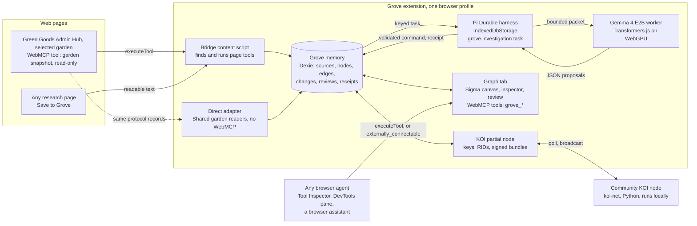

# Grove prototype: four parts, one loop

**Status:** prototype scope agreed on 24 October 2026; G0 authorized as a disposable spike; nothing built yet. **Updated:** 24 October 2026.
**Relation to the plan:** this narrows the [MVP architecture](spec.md) and the [implementation sequence](plan.todo.md) to the smallest build that shows Grove's four core parts working together. Where it departs from the architecture, the [decisions](#decisions) say so. The product gates in [eval.md](eval.md) stay as they are; the prototype has its own [demo checks](#demo-checks). The [architecture companion](prototype-architecture.md) owns the packages, dependencies, module layers, types, components and data flows; the [design brief](prototype-design.md) owns how Grove looks and behaves as the cockpit's dialect on a graph.

Grove is a browser extension that keeps a garden's living knowledge graph on the steward's own device. The prototype proves one loop: connect a garden, save a source, let a local model propose how it relates to the garden's work, resume that work after an interruption, review it, share one accepted piece with another garden, and let any browser agent ask the graph questions.

The four core parts and their one job each:

- **Gemma** is the intelligence: on-device proposals with exact quotes, never a cloud call.
- **KOI** is the exchange: a node identity per garden and signed, scoped knowledge objects between nodes.
- **Pi Durable** is the execution: investigations as checkpointed tasks that survive a closed tab.
- **WebMCP** is the interface: pages expose tools, agents call them, and Grove does both.

## What the prototype demonstrates

| Problem today | What the demo shows | Part that proves it |
|---|---|---|
| Useful research is read and lost. Nothing links a guide or a grant to the garden's Actions and Work | Save a page from the browser. The graph shows a suggested connection to a real Action, with the exact passage that supports it | Gemma, Grove memory |
| AI help arrives without provenance and without a person in charge | Every proposal carries a quote, a source revision and a model version. The steward accepts, rejects or corrects it. Acceptance never becomes protocol approval | Gemma plus validation in code |
| Long-running work in a browser is brittle. A closed tab loses progress or repeats it | Close the Grove tab during an investigation, reopen it, and the task continues from its last checkpoint with no duplicate edge | Pi Durable |
| Each garden learns alone. Sharing means sending files or giving up control | Vida Verde's node publishes one accepted connection. TAS's node receives it signed and labeled with its origin, and reviews it locally | KOI |
| Agents reach Green Goods by scraping screens or through one-off bridges | The Admin Hub exposes a read-only snapshot tool for the selected garden. Grove exposes graph tools. One standard interface serves Grove, DevTools and any browser agent | WebMCP |

## The shape

| Part | What we use | What we build |
|---|---|---|
| WebMCP | `document.modelContext`: Brave Beta 156 with the WebMCP runtime flag; Chrome 149 and later behind the origin trial or the same flag; the client's existing `packages/client/src/webmcp.ts` | One read-only garden snapshot tool on the Admin Hub, scoped to the selected garden and gated by a Hub setting; a bridge content script on the Hub origin; four `grove_*` tools on the graph tab. WebMCP is an adapter at both ends: the same snapshot also arrives through a direct adapter, and agents without WebMCP reach the graph through an `externally_connectable` messaging API |
| Gemma | Gemma 4 E2B instruction-tuned ONNX at q4f16; `@huggingface/transformers` (already pinned in `packages/agent`); WebGPU | A worker that loads once, takes a bounded packet and returns JSON; validation that drops anything that is not an exact quote or a known ID |
| Pi Durable | `@earendil-works/pi-durable` 1.4.0 with its `IndexedDbStorage` | One `grove.investigation` task with five phases; a Web Lock so one tab owns the harness; idempotent apply with receipts |
| KOI | koi-net 2.1.2 and rid-lib 3.3.0 (Python, MIT) as the community node; the KOI-net wire contracts | A TypeScript partial node: a P-256 key pair, RID forms (the node is `orn:koi-net.node:<name>+<hash>`), envelope signing, `/events/poll` and `/events/broadcast`, an inbox and an outbox |
| Grove memory and graph | Dexie (already in Shared); Sigma with Graphology | Six core tables (sources, nodes, edges, changes, reviews, receipts) plus the KOI inbox and outbox; an append-only change log with a seen cursor; a graph tab with an inspector |

Grove memory is not one of the four parts. It is the floor they stand on: what the garden knows, what changed, and who decided.

## The loop, step by step

1. **Connect.** The steward opens Vida Verde in the Admin Hub and, once, turns on **Allow browser extensions to read this garden** in its settings. The Hub registers its read-only snapshot tool for the selected garden; Grove's bridge sees it through `document.modelContext.getTools()` and offers **Connect this garden**. One click runs the tool. Garden, Actions, Work with its approval state and the WorkApproval records land in Grove memory with their chain, IDs and coverage. The graph tab opens on the garden overview. With WebMCP off, **Connect this garden** in the graph tab reads the same records through the direct adapter.
2. **Save.** On the agroforestry guide, the steward clicks **Save to Grove**. The readable text is extracted on the page, hashed and stored as a source revision. The source node appears at once, labeled **Saved**.
3. **Investigate.** Saving admits a `grove.investigation` task in Pi, keyed by source hash and garden. Its phases are `prepare` (pick source chunks and the garden neighborhood), `infer` (Gemma, in the worker), `validate` (IDs, predicates, exact quotes), `apply` (one idempotent graph command, one receipt) and `ready`. The graph shows **Finding connections**, then at most three **Suggested** edges, each with its quote.
4. **Interrupt and resume.** Close the Grove tab during `infer`. Reopen it. The harness reopens its IndexedDB storage, finds the task mid-phase and reruns that phase from its checkpoint. If the tab died after `apply`, the stored receipt comes back and no second edge is written.
5. **Review.** In the inspector the steward accepts one connection, rejects one and corrects the third's target. Each decision is a new revision with actor and time. Acceptance is personal garden memory; it is not WorkApproval and it records no work. The steward adds one **Planned** trial. It is drawn as planned and stays planned. A **New since your last visit** strip lists what changed, computed from the change log and a seen cursor.
6. **Share.** The steward picks the accepted connection and previews the projection: source URL, quote, predicate, target Action ID, and nothing else. Grove signs it as a KOI bundle and broadcasts it to the community node. It stays **Pending** until the node confirms it stored that version.
7. **Receive.** In a second browser profile, TAS's Grove polls the community node, verifies signature, target and hash, and shows the object as **Suggested by another garden's node** with its origin. TAS reviews it like any other suggestion. A bundle addressed to a different node is rejected and logged.
8. **Ask.** With the Grove tab open, a browser agent (Chrome's Model Context Tool Inspector, the DevTools WebMCP pane, or a browser assistant where available) calls `grove_query_graph` with "what does this garden know about soil care?" and gets a structured answer: nodes, edges, sources and review states. No scraping and no special bridge. With WebMCP off, an allowlisted extension gets the same answer through Grove's `externally_connectable` messaging API.

Step 1 needs the Hub open on the garden, and step 2 the page being saved. Steps 3 to 5 run with the browser offline once the model is cached. Steps 6 and 7 need the community node. Step 8 needs only the open tab.

## Code we will add

Keep each piece small enough to replace.

### Green Goods Admin Hub and Shared

| File | Change |
|---|---|
| `packages/shared/src/modules/garden-knowledge/contracts.ts` (new) | `GardenSnapshotV1` type and Zod schema, exported through the existing `./modules` entry. No new export subpath |
| `packages/shared/src/modules/garden-knowledge/snapshot.ts` (new) | `buildGardenSnapshot({ chainId, gardenId })` from the readers the Hub already uses (`getGarden`, the action reader, `readWorkList`, `readApprovedWorks`): Garden, Actions, Work with approval state, WorkApproval records, coverage. At most 100 latest Work records |
| `packages/shared/src/hooks/admin-ui/garden/useGardenWebMcpTool.ts` (new) | Registers `green_goods_get_garden_snapshot` on `document.modelContext` while a steward is signed in, a garden is selected and the garden's setting allows it; unregisters through an `AbortSignal` on garden switch, setting change or sign-out. `readOnlyHint: true`, `execute(input, { signal })` |
| `packages/admin/src/components/Garden/GardenWebMcpSetting.tsx` (new) | The setting **Allow browser extensions to read this garden**, off by default, beside the existing garden settings |
| `packages/admin/src/views/Garden/components/GardenWorkspaceContent.tsx` | Composes the hook in the garden workspace |
| `AGENTS.md`, `docs/docs/builders/agentic/mcp-guide.mdx` | The WebMCP rule gains a v2 scope: read-only, garden-scoped tools on the authenticated Hub behind the setting, never session state, credentials, notes or writes. A sensitive edit, reported in G1's PR |
| Tests | Snapshot builder on a fixture garden with pending and approved Work; the hook registers only when all three conditions hold and unregisters on each change; the setting round-trips |

The client package is untouched by Grove. Its existing WebMCP registration still names `navigator.modelContext`, which Brave 156 and Chrome 150 and later no longer provide; that fix ships in its own pull request, outside these slices.

### Grove extension: `packages/extension/` (new; WXT, React, TypeScript)

| Area | Files | Owns |
|---|---|---|
| Entrypoints | `entrypoints/background.ts`, `entrypoints/graph/index.html` and `main.tsx`, `entrypoints/greengoods.content.ts`, `entrypoints/capture.content.ts`, `entrypoints/gemma.worker.ts` | MV3 wiring, the graph tab, the WebMCP bridge on Green Goods origins, on-demand page capture, the model worker |
| `src/knowledge/` | `schema.ts`, `store.ts`, `commands.ts`, `query.ts`, `vocabulary.ts` | Dexie tables; `applyKnowledgeCommand` with receipts; "new since" queries; the allowed types and predicates with labels from the Shared ontology API |
| `src/execution/` | `harness.ts`, `investigation.task.ts`, `packet.ts`, `validate.ts` | The Pi harness over `IndexedDbStorage` behind a Web Lock; the five-phase task; packet building; proposal validation |
| `src/model/` | `gemma-client.ts`, `prompt.ts` | Worker protocol, load progress, cancellation, the JSON contract |
| `src/koi/` | `identity.ts`, `rid.ts`, `envelope.ts`, `bundle.ts`, `wire.ts`, `exchange.ts` | Keys in IndexedDB, RID forms, canonical hashing and signing, the five KOI-net endpoints, inbox and outbox |
| `src/webmcp/` | `bridge.ts`, `tools.ts` | Finding and executing page tools; Grove's own `grove_query_graph`, `grove_list_sources`, `grove_save_source`, `grove_review_connection`. The two read-only tools carry `readOnlyHint: true`; the two that change the graph do not, so an agent asks the person first |
| `src/connect/` | `garden-source.ts`, `webmcp-source.ts`, `direct-source.ts` | The `GardenSource` interface and its two adapters: the Hub's WebMCP tool through the bridge, and Shared's garden readers (`getGarden`, `readWorkList`, `readApprovedWorks`) with the same env and host permissions for the indexer, EAS and RPC origins. Both return `GardenSnapshotV1`; a toggle in connection settings picks the adapter |
| `src/agent-api/` | `external.ts`, `allowlist.ts` | The `externally_connectable` messaging API: the same query, list, save and review operations as the `grove_*` tools, for allowlisted extension IDs and origins. Every call is logged; the two writing operations ask the person first |
| `src/graph/` | `GraphView.tsx`, `GraphCanvas.tsx`, `Inspector.tsx`, `ConnectionPanel.tsx`, `NewSinceStrip.tsx` | Sigma rendering, review, connection state, freshness |
| `fixtures/` | `vida-verde.json`, `tas.json`, `sources/` | Public-safe source manifests from the [first-spike contract](first-spike.md); synthetic negatives labeled as such |
| `peer/` (development only) | `pyproject.toml`, `community_node.py`, `README.md` | A koi-net full node configured as the community node. Outside the extension bundle, never shipped |

Rough size: 3,000 to 4,000 lines of TypeScript in the extension, under 300 in the client and Shared, under 100 of Python.

Rules: Shared never imports the extension. The extension consumes Shared through declared exports only. Pi and KOI types stay inside the extension. Every UI string goes through i18n. No new Shared export subpath. The Hub's tool registers only with the steward's consent and returns protocol records, never session state. The WebMCP bridge and the direct adapter feed one snapshot schema and never diverge.

### The data the parts pass around

| Object | Shape | Who writes it |
|---|---|---|
| Garden snapshot | garden (chain, address, name), Actions (uid, id, title, domain), Work (id, title, Action, created, approval state, approval time), WorkApproval records, coverage (partial, unavailable sources, truncated, fetched at) | The Hub's tool, or the direct adapter |
| Source revision | URL, title, content digest, readable text, captured at, source date when known | Capture |
| Investigation packet | at most eight source chunks, the garden's Actions and open questions, the allowed predicates, the model and vocabulary versions | `prepare` phase |
| Proposal | target ID, predicate, quote, one-sentence reason; at most three | Gemma, then `validate` |
| Knowledge command | command ID, payload digest, expected revisions, edges to add | `apply` phase, review, KOI intake |
| Shared projection | source URL and digest, quote, predicate, target Action ID, publisher node RID, signature | Share preview, then the outbox |

## Demo checks

| # | Check | Passes when |
|---|---|---|
| D1 | Connect | In Brave Beta with the WebMCP flag, the Admin Hub's tool returns a snapshot for the selected garden and the graph shows its Actions and Work with approval state, chain and coverage. With the setting off, no garden selected or the steward signed out, no tool is registered. With the flag off, the direct adapter produces the same graph |
| D2 | Propose | On ten labeled Vida Verde packets, the real local model yields the labeled connection or a correct abstention on at least eight. No stored edge has an unknown ID, an unknown predicate or an inexact quote |
| D3 | Resume | Kill the tab during `infer`, during `validate`, after `apply` and before `ready`. After each reopen there is one task, one edge set and one receipt |
| D4 | Review | Accept, reject, correct and plan; reload offline; all four survive. The planned item never counts as work. The WorkApproval shown is the imported one |
| D5 | Exchange | Vida Verde shares one projection; the community node stores it; TAS receives and verifies it. A wrong-target or tampered bundle is rejected. Nothing unselected leaves the device |
| D6 | Ask | In Brave Beta with the flag, an external agent (Google's example WebMCP extension or the DevTools WebMCP pane) lists Grove's tools and gets a structured answer from `grove_query_graph` that matches what the graph shows. With the flag off, an allowlisted extension gets the same answer through the `externally_connectable` API |

Record with every run: browser build and flags, model artifact revision, Pi and koi-net versions, device, cold and warm load times, tokens per second. A fixture inference stub cannot pass D2. A mock page cannot pass D1.

## Decisions

| # | Decision | Why | Departs from the plan? |
|---|---|---|---|
| 1 | Superseded by 18. Connect through the public garden page's WebMCP tool, not an Admin Hub bridge | Public records are what the MVP imports anyway. The page already registers tools. No nonce, origin-locked relay or credential boundary to build | Yes: D5 and S7 move to the MVP |
| 2 | Use Pi Durable's own `IndexedDbStorage` | Shipped in 1.4.0 on 21 October 2026. Removes the P0 adapter and its conformance suite | Yes: P0 shrinks to a bundle and lifecycle check |
| 3 | The graph tab owns the harness; Gemma runs in a dedicated worker of that tab | Pi wants one owner. WebGPU runs in workers. Closing the tab pauses, reopening resumes. No service worker keepalive | No |
| 4 | Custom task phases, not a model tool loop | A 2B model is dependable at one bounded JSON step and not at planning. Validation in code keeps the trust story | No |
| 5 | The community node is a stock koi-net full node | Partial nodes cannot deliver to each other. The Python framework gives a full node in a few lines. Nothing to reimplement | No |
| 6 | Sigma with Graphology, no renderer benchmark | The hub's leading candidate. The prototype needs one working canvas, not a comparison | Narrows S0 |
| 7 | Freshness is "new since your last visit"; no time scrubber | A seen cursor over the change log is cheap and shows learning. As-of reconstruction waits for the MVP | Yes: S4 deferred |
| 8 | Two gardens are two browser profiles on one machine | Proves workspace isolation and a real exchange without multi-user sync | No |
| 9 | A short fixed vocabulary | Garden, Action, Work, Source, Question, Planned activity, Concept; predicates `informedBy`, `relevantTo`, `addresses`, `aboutConcept`; labels from the Shared ontology API | Narrows S2 |
| 10 | No Admin Hub digest | Agent access through the `grove_*` tools is the return path to show | Yes: S9 deferred |
| 11 | Superseded by 18. The public garden page is the first connection surface | Decided 24 October 2026. Public data, the existing WebMCP rule, no auth or relay to build; the Admin Hub waits for the MVP | Confirms 1 |
| 12 | Brave first: Brave Beta 156 with the WebMCP runtime flag carries the demo; Chrome is installed only if a Brave build cannot run it | Decided 24 October 2026. A headless probe of the installed Beta showed `document.modelContext` with the flag on and nothing without it. Brave's Leo side is Nightly-only and pending security review; it does not gate Grove, which is the consumer | New |
| 13 | Grove works without WebMCP: a `GardenSource` with a WebMCP adapter and a direct adapter on the Shared public hooks, one build, a toggle in connection settings | Decided 24 October 2026. WebMCP is an origin trial; neither the demo nor the product may depend on it | New |
| 14 | Agents without WebMCP use an `externally_connectable` messaging API with the same operations as the `grove_*` tools | Decided 24 October 2026. A second, allowlisted interface rather than none; specified, permissioned and tested like the tools | New |
| 15 | TAS is the second garden | Decided 24 October 2026. Two gardens and two sources; reuses the spike's TAS fixture | Confirms 8 |
| 16 | The prototype counts toward the A0 to A4 milestones; each slice records receipts against the checkpoints it names; no new milestone | Decided 24 October 2026 | No |
| 17 | G0 is authorized as a disposable feasibility spike in its own session and worktree. It may install wxt, pi-durable with its chord and pi-ai companions, transformers.js, sigma and graphology in `packages/extension` only, under the release-age gate | Decided 24 October 2026. The hub is not promoted; G1 onward waits for G0's results | No |
| 18 | The Admin Hub is the connection surface: a read-only `green_goods_get_garden_snapshot` tool registered while a steward is signed in, a garden is selected and the garden's setting allows it; the WebMCP rule gains a v2 scope for it in G1 | Decided 24 October 2026, correcting the first-round answer that chose the public page. Stewards connect from their cockpit; the Hub resolves approval state the public page cannot | Supersedes 1 and 11; returns to the hub's S7 surface with WebMCP as the transport |
| 19 | The snapshot carries protocol records with approval state: Garden, Actions, Work with pending, approved or rejected status, and WorkApproval records. No notes, assessments, gardener addresses or session data | Decided 24 October 2026. Richer than the public page, still protocol-only, no private data before the encryption and retention contract | Narrows S7 |
| 20 | The no-WebMCP path is the direct adapter on Shared's garden readers; protocol records need no session, so the Hub is not involved in direct mode | Decided 24 October 2026; amends 13 | No |
| 21 | The client's dead `navigator.modelContext` registration is fixed in its own pull request, outside Grove's slices | Decided 24 October 2026 | No |
| 22 | Grove is a third dialect of Warm Earth set to the cockpit's dials: 14px density on the cockpit type roles, pill buttons, 12px cards, elevation steps, the steward's voice; shared controls carry `data-surface="admin"`; the shared core is taken as is | Decided 24 October 2026. Stewards use the Hub and Grove in one sitting; a desktop graph tool wants the denser setting; no new dials to drift | New; see the design brief |
| 23 | The accent is the cockpit's garden tone on its five-use budget: active chip or tab, one filled action, the new-since count badge, the focus ring, the canvas's new-item halo | Decided 24 October 2026. Grove is garden knowledge; the Hub's Garden workspace and Grove match. The tone roles move to Shared in G1 | New |
| 24 | The canvas encodes meaning by shape, dash, weight and label in ink and stone; the accent marks only what is new and the selection; colors are read from the live tokens | Decided 24 October 2026. Never meaning by color alone; the 1 to 3 percent accent rule holds on the canvas | New |
| 25 | The dialect is proven on Storybook Design System pages beside App, Website and Admin, plus co-located component stories on the synthetic fixture | Decided 24 October 2026. Reviewed where the unification was reviewed, before the extension exists | New |

## Honesty rules the prototype keeps

- Local acceptance is garden memory. It is never WorkApproval, community review or verified impact.
- A planned activity stays planned. Neither acceptance nor time completes it.
- A proposal whose quote is not an exact substring of the saved text is discarded.
- No cloud inference and no fallback. With the model unavailable the graph stays usable and manual links work.
- A KOI signature proves which node sent an object. It does not prove garden membership or truth.
- The Hub's tool exposes protocol records of the selected garden and nothing from the steward's session; it exists only with the steward's consent. Grove's own tools expose this device's graph, only while its tab is open and only to the agent the person is driving. The `externally_connectable` API serves allowlisted callers only while the graph tab is open.
- The direct adapter reads only protocol records from the indexer and EAS, with no session. It adds no private source.

## Build order

Five pull requests, each demoable on its own.

| PR | Builds | Exit | Hub checkpoints it covers |
|---|---|---|---|
| G0 Feasibility | A bare extension with a graph tab; the Gemma worker answers a fixed packet; the Pi harness runs a three-phase dummy task across a tab close; a content script lists and runs a page tool in Brave Beta with the WebMCP flag | Timings and memory recorded; one valid proposal from synthetic text; the task resumes; the Brave probe result, pass or fail | S0, P0 |
| G1 Connect | The Hub's tool, its setting and the WebMCP rule update; the bridge on the Hub origin and the direct adapter behind one `GardenSource`; memory tables; a graph of Garden, Actions and Work with approval state | D1 in both modes against the Hub | S1, S5, S7; S2 and S3 narrowed |
| G2 Investigate | Capture, the investigation task, the Gemma step, validation, idempotent apply, the inspector, "new since" | D2, D3, D4 | S6, S8, P1, P2 |
| G3 Exchange | Node identity, the community node, share, receive, reject | D5 | K1; K2 narrowed |
| G4 Ask and demo | Grove's own tools and the `externally_connectable` API, driven from Google's example extension and the DevTools pane; the TAS run; a recorded demo | D6 in both modes and the whole loop on both gardens | The first-spike walkthrough, narrowed |

Each PR keeps the [plan's file budget](plan.todo.md): three or four implementation files per checkpoint, with its behavior test.

## Out of scope

Passive capture, the Hub digest (S9), public garden page tools, the time scrubber, export and import, a production community node, public KOI networks, Commons publishing, onchain writes, sensors, encryption at rest, a chat UI, a provider marketplace.

## Device and browser requirements

- Brave Beta 156 or later with the WebMCP runtime flag (`brave://flags/#enable-webmcp-testing`, or `--enable-blink-features=WebMCP` for a headless run), which exposes `document.modelContext`. Probed on 24 October 2026 on Brave Beta 156.1.99.44 in a headless throwaway profile: the API is absent without the flag and complete with it. Chrome 149 or later with the same flag or an origin trial token is the fallback, installed only if a Brave build cannot run the demo. Edge 150 runs the same origin trial. Brave's Leo tool calling is Nightly-only and pending security review; Grove does not depend on it.
- WebGPU with `shader-f16` and about 4 GB of GPU or shared memory for Gemma 4 E2B at q4f16. The first download is between 1.5 and 3 GB depending on the bundle, then cached in Cache Storage.
- Python 3.11 or later with `uv` for the community node, on the same machine or network, over HTTPS or an explicit loopback exception. No blanket certificate bypass.

## Risks

- Pi Durable is experimental and broke its API in three October releases; another storage change is already queued on its main branch. Pin one version and keep Pi types inside `src/execution`.
- WebMCP is an origin trial over a draft spec, and the client still registers on the older object name, which Brave 156 no longer provides. Feature-detect, keep the bridge to two calls (`getTools` and `executeTool`), and keep the direct adapter at parity so the demo never depends on the flag.
- Brave injects component-delivered WebMCP tools into matching sites, so a page may carry tools Green Goods did not write. The bridge calls only tools whose names start with `green_goods_`.
- `externally_connectable` widens the extension's surface. The allowlist is explicit extension IDs and origins, writes ask the person, and the API carries no raw source text by default.
- Gemma's quality on real guides is unmeasured, so D2 may fail. A failed D2 keeps automatic proposals off and leaves the rest of the loop intact.
- koi-net signs the SHA-256 of its unsigned envelope's compact JSON, as Pydantic serializes it, with ECDSA on P-256 and SHA-256, and sends the raw `r||s` signature in base64. Matching those bytes from Web Crypto needs vectors exported from the Python node before any interoperability claim.
- Pi's Harness requires a `models` option. The prototype passes an empty model catalog because tasks call Gemma directly; G0 confirms that a Harness opens and runs custom tasks without a provider.
- The Shared ontology API ships from the Shared root. If bundling it pulls unrelated modules, add a narrow leaf export rather than deep-importing.
- The Hub's tool lives on an authenticated page, and any extension or agent on that page can call it once registered. The controls are the consent setting, the read-only scope, the garden scoping and the absence of session data in results; G1 specifies and tests them before the rule in `AGENTS.md` changes.

## Decided on 24 October 2026

The four open questions were settled in discussion and recorded as decisions 11 to 17, and decision 11 was corrected the same day: the Admin Hub, not the public garden page, is the connection surface (18 to 21). Brave Beta with the WebMCP flag carries the demo, Chrome only as a fallback, and Grove works without WebMCP at both ends (12 to 14, 20); TAS is the second garden (15); the prototype counts toward the A0 to A4 milestones (16); G0 is authorized as a disposable spike (17).

## Sources

- WebMCP: [specification draft](https://webmachinelearning.github.io/webmcp/), [Chrome's imperative API page](https://developer.chrome.com/docs/ai/webmcp/imperative-api), [Chrome's overview](https://developer.chrome.com/docs/ai/webmcp) (content scripts may query and execute tools; local flag), [implementation status](https://github.com/webmachinelearning/webmcp/blob/main/implementation-status.md) (Chrome 149 origin trial, Edge 150, Brave experimental), [Google's example extension](https://github.com/GoogleChromeLabs/webmcp-extension).
- Pi Durable: [changelog](https://github.com/earendil-works/pi/blob/main/packages/durable/CHANGELOG.md) (1.4.0, `IndexedDbStorage`), [README](https://github.com/earendil-works/pi/tree/main/packages/durable) (one owner, Web Lock, custom tasks).
- KOI: [koi-net](https://github.com/DynamicalSystemsGroup/koi-net) (envelope, API paths), [rid-lib](https://github.com/DynamicalSystemsGroup/rid-lib), [KOI-net specification](https://dynamicalsystemsgroup.github.io/koi-net-spec/v1.0-draft-release.html).
- Brave: [Leo WebMCP tracking issue](https://github.com/brave/brave-browser/issues/55232) (test plan with the flag; on in Nightly), [enable-by-default change](https://github.com/brave/brave-core/pull/40616) (open, security review), [Brave WebMCP tool scripts](https://github.com/brave/brave-webmcp) (component-delivered tools injected into matching sites).
- Gemma: [Transformers.js in a Chrome extension](https://huggingface.co/blog/transformersjs-chrome-extension) (Gemma 4 E2B, q4f16, WebGPU), [the ONNX model](https://huggingface.co/onnx-community/gemma-4-E2B-it-ONNX).
