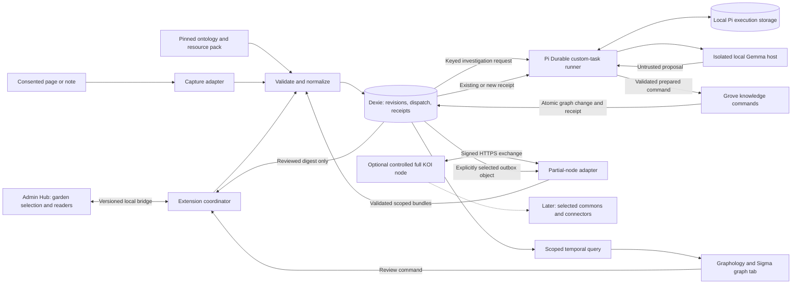

# Grove by Green Goods: MVP architecture

**Status:** implementation proposal; planning requested, product build not started.
**Updated:** 16 October 2026. **Owner:** Grove idea hub. **Package:** `packages/extension` (proposed).
**Companions:** [implementation sequence](plan.todo.md), [evaluation and evidence](eval.md), [ontology alignment](ontology-alignment.md), [learning loops](architecture-flows.md), [dependency map](dependencies.md), [visual exploration](visual-design.md), [KOI contract](koi-integration.md), [Pi Durable execution](durable-execution.md), [Vida Verde/TAS spike](first-spike.md).

Build a local browser extension whose main interface is a living garden graph. A steward can connect a garden from the Admin Hub, preserve useful research, inspect the relationships between research and recorded work, review suggested connections, and see what changed over time.

Grove is the user-selected brand for this extension: **Grove by Green Goods — Your garden’s living knowledge.** The living graph is its primary workspace. This self-contained hub records the architecture and implementation sequence for that scope; broader OS, sensor, mesh and publishing proposals are outside this plan. The user authorized a dedicated planning branch and draft PR. Product implementation and dependency installation remain unstarted.

## MVP boundary

| Included | Deferred |
|---|---|
| One active garden view; isolated Vida Verde and TAS workspaces on one desktop profile, with explicit chain scope | Cross-device or multi-user graph synchronization |
| Full-tab graph, search, typed filters, inspector, history, change highlighting | A separate chat, feed, inbox, or extension dashboard |
| Public Garden, Action, Work and WorkApproval records selected through the Hub | Private garden API credentials, signer access, onchain writes |
| Explicit page capture, then opt-in capture on selected research domains | Whole-history capture, unrestricted crawling, broad background access |
| User-selected text/Markdown notes; a pinned commons vocabulary and curated resource list | Automatic Drive ingestion, PDF/OCR/media parsing, live commons publishing |
| Pi Durable custom-task investigations with one local Gemma configuration | Provider marketplace, fine-tuning, autonomous external actions |
| Personal accept/reject/correct decisions with provenance | Garden governance votes, protocol WorkApproval, community truth certification |
| Same-device Hub insight digest and graph deep links | Shared server-side insight storage or unattended private-data refresh |
| Partial KOI node; optional controlled full-node resource exchange and explicit single-object sharing | Public federation, continuous private connectors, CRDT, sensor mesh, AT publishing |
| Portable local export/import and recovery | General-purpose graph server required on each gardener's machine |

The first spike uses source-backed Vida Verde and TAS fixtures and real bounded Hub imports, with synthetic negative cases kept separate. No private sync-note evidence is published in this public repository. See the [fixture and walkthrough contract](first-spike.md). Locally imported internal notes stay in the extension and are not automatically included in the Hub digest. Offline storage is local browser storage, not a claim of application-level encryption or protection from a compromised device. Sensitive-data pilots require a separately specified encryption, recovery and retention contract.

## Proposed decisions

| # | Decision | Reason |
|---|---|---|
| D1 | Add `packages/extension` in Green Goods; use Coop as a source of bounded adaptations | Direct access to Green Goods domain authority and coordinated Hub contracts without importing Coop's product workflows |
| D2 | WXT, React and TypeScript; a full-tab graph | Enough space for relationships, filtering and history; aligns with Coop's extension packaging |
| D3 | Sigma + Graphology, with a small imperative renderer adapter | Separates rendering and layout from persisted knowledge; Cytoscape is the fallback if the benchmark rejects Sigma |
| D4 | Dexie/IndexedDB revision tables and an atomic change sequence | Acknowledged saves, restart recovery, historical reconstruction and independent edge changes |
| D5 | Typed, origin-restricted Hub bridge; credentials stay in the Hub | Reuse garden readers without copying authentication, private keys or wallet state into the extension |
| D6 | Compose a versioned Grove application profile from Green Goods, a pinned Commons draft and local memory terms | One user-facing vocabulary with distinct source identities, per-type schemas and explicit mappings; see the [alignment proposal](ontology-alignment.md) |
| D7 | Source-linked model proposals, validated before storage | The model cannot commit facts, approve Work, or invent supported ontology predicates |
| D8 | Changes since last review and stable positions | The graph communicates learning rather than constant layout movement |
| D9 | Explicit capture first; bounded passive capture completes the MVP | Prove the useful loop before broadening browser access |
| D10 | Model failure leaves captured knowledge and graph queries usable | Inference availability does not determine whether a save succeeds |
| D11 | Browser partial KOI node with an optional full node | Reuse identity/exchange without requiring a server for local garden memory |
| D12 | Grove owns history, scoped inbox/outbox and collection reconciliation | KOI event signals/current-object caches do not guarantee durable history or complete delivery |
| D13 | Keep planned, reported and recorded activity distinct from review and transport state | A signature, local acceptance or recent import cannot prove completed work |
| D14 | Pi Durable owns investigation execution, using a conformant browser storage adapter | Resume bounded multi-step work while local graph memory stays usable independently |
| D15 | Idempotent Grove commands connect Pi checkpoints to garden mutations | Recover separate commits without duplicate edges, stale writes or broadened sharing |

Dependencies and a bounded implementation still need task-specific authorization before installation. Publishing this plan changes no application package, manifest, lockfile, license or runtime.

## Reuse: established capability, gap, and owner

Green Goods source baseline: `06a31dbf55c25e1edfca35423f0e3a7c77184c16`, inspected 11 October with unrelated local changes present. Coop remote source baseline: `901f57871ec578b0a31bb38c1eacdd0a85eed83a`. These are source observations, not deployment or browser proof.

| Existing component | What to reuse | Gap / new owner |
|---|---|---|
| [Green Goods ontology query API](../../../packages/shared/src/ontology/query.ts) and [ontology workflow](../../../.claude/context/ontology.md) | Canonical terms, aliases, relationships, maturity and version metadata | Shared owns a narrow graph vocabulary adapter and extension contracts. The manifest does not implement a complete runtime constraint validator. |
| [Garden reader](../../../packages/shared/src/modules/data/indexer-garden.ts) | Existing garden mapping, configured chain, hidden-garden behavior | Shared adds a bounded snapshot builder; preserve the existing default-chain rule. |
| [Work list](../../../packages/shared/src/modules/work/work-list.ts) | Work identity and existing approval resolution, including partial and conflicting results | Snapshot adapter must preserve unknown approval state and coverage. Never interpret a failed read as rejection or deletion. |
| [Public impact contract](../../../packages/shared/src/public-contracts/garden-impact.ts) and [readers](../../../packages/shared/src/modules/data/public-garden-impact-readers.ts) | Provenance and partial-data conventions; relevant lower-level readers | Its summary and capped recent-work response are not a complete graph export. A dedicated bounded snapshot is new. |
| [Pi Durable specification](https://github.com/earendil-works/pi/blob/8efd314fa3d3232ce197d8d7a6a5660530b9d83e/packages/durable/docs/spec.md) | Versioned task phases, persisted execution state, admission deduplication and committed progress | Extension builds browser storage, lifecycle and command adapters; no supplied Dexie/Gemma integration is assumed. See [execution ownership](durable-execution.md). |
| [Shared dependencies](../../../packages/shared/package.json), logger, i18n and primitives | Existing Dexie, Zod, domain types and UI foundations | Extension DB is separate from the PWA's transactional job queue. Browser-origin storage is not automatically shared. |
| [Coop capture handler](https://github.com/greenpill-dev-guild/coop/blob/901f57871ec578b0a31bb38c1eacdd0a85eed83a/packages/extension/src/background/handlers/capture.ts) | Snapshot extraction, URL/content deduplication and saved-before-routing pattern | Adapt small functions to garden identity and capture consent. Do not import Coop routing, drafts, side panel or notification flows. |
| [Coop WXT configuration](https://github.com/greenpill-dev-guild/coop/blob/901f57871ec578b0a31bb38c1eacdd0a85eed83a/packages/extension/wxt.config.ts) | Learn from service-worker bundling and packaged ONNX assets | New minimal manifest, permissions and build integration. Do not copy broad permissions or unrelated bundling workarounds. |
| [Coop Gemma bridge](https://github.com/greenpill-dev-guild/coop/blob/901f57871ec578b0a31bb38c1eacdd0a85eed83a/packages/extension/src/runtime/agent/gemma4-bridge.ts) | Initialization progress, request IDs, teardown, bounded document-hosted inference | Coop uses a sandboxed iframe for its runtime CSP constraints. Reuse requires packaged-runtime, message isolation and Brave lifecycle proof. |
| [Coop graph persistence](https://github.com/greenpill-dev-guild/coop/blob/901f57871ec578b0a31bb38c1eacdd0a85eed83a/packages/extension/src/runtime/agent/graph-persistence.ts) and [snapshot storage](https://github.com/greenpill-dev-guild/coop/blob/901f57871ec578b0a31bb38c1eacdd0a85eed83a/packages/extension/src/runtime/agent/graph-store-singleton.ts) | Provenance references and duplicate relationship handling as design evidence | Build revisioned persistence. A debounced replacement snapshot and merged confidence are insufficient for change history or evidentiary strength. |

Code reuse is conditional on the exact source revision's license. The remote `LICENSE` lookup at the pinned Coop revision returned 404. The separate local Coop checkout at `5b889eea30056877f1e3a0114e0cd4353a36cee4` declares `AGPL-3.0-only` in Shared and Extension manifests. These are different revisions. Resolve the intended licensed source before copying code; independent implementation of the small interfaces remains possible. This plan does not change either project's license.

## Component architecture

| Proposed placement | Owns |
|---|---|
| `packages/shared/src/modules/garden-knowledge/` | Hub transport schemas, snapshot mapping, ontology adapter and explicitly shared query/projection types |
| `packages/shared/src/hooks/knowledge/` | React subscriptions and Hub integration hooks; extension implementations enter through typed subscription/transport inputs |
| `packages/admin/src/views/Garden/components/` | Connect/open action and compact same-device insight digest using existing Admin primitives |
| `packages/extension/entrypoints/` | Background coordinator, graph page, scoped capture entrypoint, offscreen host and packaged model sandbox |
| `packages/extension/src/knowledge/` | Revision store, ingestion, entity resolution, query execution, review transitions, import/export |
| `packages/extension/src/graph/` | Canvas adapter, controls, inspector and saved layout |
| `packages/extension/src/runtime/` | Browser capture and local inference lifecycle |
| `packages/extension/src/koi/` | Browser protocol adapter, independent node identity, peer policy and resumable exchange |
| `packages/extension/src/execution/` | Pi composition, browser storage, versioned investigation phases, scoped admission and command adapter |

Names are proposed paths, not claims that files exist. Shared never imports Extension. Domain transitions remain independent of React, Sigma and Chrome APIs. New Shared imports use declared package exports; existing internal readers are called inside Shared. Add a narrow ontology leaf export if bundling the existing root API pulls unrelated modules. Do not deep-import Shared `src` from Extension. All React hooks remain in Shared under repository policy.

The graph and Hub require a real shared contract; persistence and model implementation remain local to Extension. Removing the knowledge-store module would scatter revision, deduplication and review rules across capture, model and graph consumers, so that module has a concrete responsibility. No microservice per local capability or generic agent framework is needed. The optional full node is a real network boundary. It is test infrastructure in the spike; a production service and continuous connectors require separate scope. The [KOI contract](koi-integration.md) owns transport, authorization, reconciliation and upstream limitations. The [Pi Durable contract](durable-execution.md) selects custom tasks for investigation execution. Start with one runner owner and one active investigation; graph tabs do not open competing Harness writers. The graph-document host pauses safely on close and resumes on reopen; broader offscreen scheduling requires its own lifecycle proof.

## Hub connection contract

Choose a content script limited to the exact configured Admin Hub origin, relaying a typed page bridge to extension runtime messaging. This avoids requiring the Hub to know an unpacked extension ID. An `externally_connectable` API with a fixed extension ID is a viable later distribution choice, not a second MVP transport.

1. User chooses **Connect garden graph** in the Hub. The extension displays the garden and bounded connection scope in the graph's connection state.
2. Create a per-installation binding for Hub origin, configured chain, garden and a random session nonce. Verify `event.source`, exact origin, top frame, browser-reported sender URL and message schema at each boundary. A nonce correlates an approved exchange; it does not prove a garden role.
3. The Hub uses existing readers to produce `GardenSnapshotV1`: schema version, export ID, garden/chain scope, ontology version, observation time, source coverage, records and explicit source references. Only allowlisted fields cross the boundary.
4. The extension durably ingests the snapshot before acknowledging receipt. Repeated export IDs or content-identical records are no-ops.
5. While the Hub is open and bound, changed query results or explicit refresh can send another snapshot. Show last synchronization and coverage. A closed Hub does not imply continuing private-data synchronization.
6. `getInsightDigest` returns a bounded set of locally accepted knowledge summaries and source references for that exact binding. The Hub labels them **On this device** and links to the graph. No raw captures or notes are returned by default; including a local note requires item-level inclusion.
7. Disconnect removes the binding and stops exchange. Local graph retention or deletion is an explicit user choice; disconnect never silently deletes the only copy.

V1 commands: `connectGarden`, `ingestSnapshot`, `openGraph`, `getInsightDigest`, `disconnectGarden`. Reject arbitrary URLs, arbitrary queries, mutations and model text as commands. The Hub keeps its authentication and authorization; no cookies, passkeys, signing keys or auth/session providers are copied. Initial snapshots contain public protocol records only. Local review authority is personal and must not be presented as a steward attestation.

Begin with a bounded snapshot of the garden, at most 100 selected/latest Work records, their Actions, and available approval records. Coverage explicitly records truncation, unavailable sources and observation time. Missing rows in a partial snapshot never delete prior knowledge. Full historical backfill is outside the first slice.

## Knowledge contract and time

Use an IndexedDB database owned by the extension. Every record and query is scoped by `workspaceId`; the workspace identity includes chain and normalized garden address. Canonical Green Goods IDs include chain and entity kind. Work identity comes from its attestation UID; Action identity comes from the authoritative reader's identifier, not a display title. Imported commons IDs retain their namespace/version. Local source/question IDs are independent of labels.

| Store | Minimum meaning |
|---|---|
| `workspaces` | Binding, schema/ontology versions and latest committed sequence |
| `sourceRevisions` | Immutable capture/import revision, source identity, content digest, extracted text, capture date, source date when known |
| `entityRevisions` | Stable entity ID, canonical type reference, revision, properties, recorded sequence, optional activity/validity time |
| `assertionRevisions` | Stable edge ID, subject/predicate/object, evidence spans, origin, review state, revision, recorded sequence, optional validity interval |
| `changes` | Ordered batch sequence and affected record IDs, distinguishing additions, updates, reviews, corrections and removals |
| `jobs` / dispatch outbox | Durable intake/dispatch requests; Pi admission ID and input digest for investigations. Deterministic capture/KOI workers retain their own operation-specific retries; no second model scheduler |
| `preparedCommands`, `commandReceipts`, `investigationSummaries` | Erasure-controlled proposal payloads/references, command ID and payload digest, atomic mutation receipt, minimal committed run summary |
| Pi-owned browser tables/database | Conformant execution records, checkpoints, IDs and documents; garden references only, separate sequence namespace |
| `views` | Device-local seen cursor, filters, selection and node positions; no domain authority |
| `peerBindings` | Workspace/collection allowlist, trusted node key reference and local connection policy; no wallet identity |
| `inbox`, `outbox`, `syncState` | Validated operation/revision identity, persisted delivery attempts, explicit share projection and reconciled collection generation |
| `ontologyPacks` | Pinned vocabulary/schema/mapping version, digest, publisher/source and draft status |

Keep revisions append-only in normal use. A knowledge command transaction allocates one workspace sequence and writes affected revisions plus its duplicate-protection receipt atomically. Matching command retries return the original receipt; a different payload under the same ID rejects. Source capture and human review atomically append any follow-up dispatch intent. Pi admission/checkpoint commits occur separately and recover through stable request/command IDs. Pi owns investigation phase scheduling, while deterministic intake/delivery workers retain operation-specific leases. Stale or erased source/model/review revisions cannot overwrite newer decisions. Acknowledgement follows the owning commit; no cross-store atomicity is claimed. Display notifications are expendable: another tab can recover changes by reading after its last sequence.

For the MVP, query indexed revisions to select the latest revision at or before a sequence. A current-state cache may accelerate the present view. Add periodic checkpoints only if measurement warrants them. This is local revision history, not a new event-sourced architecture for the Green Goods protocol.

**Recorded time** answers what the extension knew then. **Activity/validity time** answers when the source says something happened or applied. Never backdate recorded time to an imported report's date. History starts at the first import, even when underlying records are older. A source's later correction supersedes the old assertion; the earlier view remains inspectable. Explicit erasure removes protected content from history and indexes rather than preserving sensitive text in a tombstone.

**Planned time** is a separate optional field. Activity class (`recorded`, `reported`, `planned`) is independent of personal review state and assertion origin. Only authoritative evidence mapping can create a recorded activity; accepting a proposed trial cannot. KOI manifest time and receipt time are transport/source metadata, not activity completion. Timeline controls default to knowledge time; projected work stays labeled and filterable in every view.

Assertion origin (`protocol`, `source`, `model`, `human`) and personal review status are separate. Local candidates transition `proposed -> accepted | rejected`; a correction creates a new revision with `supersedes`. Expected-revision checks reject stale review commands. Accepted means accepted for this person's garden memory; it never means verified regenerative impact. Imported WorkApproval retains its protocol identity and decision separately.

The commons draft is packaged as versioned data. Preserve existing IDs when supplied; otherwise use visibly provisional draft IDs and an explicit mapping table. Do not claim a new canonical URI. In the test fixture, synthetic concepts are labeled synthetic. Runtime mapping recognizes supported predicate endpoint types and quarantines unknown terms; it does not quietly remap them to a generic relationship.

Use the [Grove application profile proposal](ontology-alignment.md) for one language across imported records, graph queries and model output. Map Source and supporting Concept/Term to the pinned Commons draft; keep capture revisions as storage records. The earlier `memory:Source`/`memory:Claim` placeholders are superseded by this alignment direction before S2. `memory:Question`, `memory:Resource`, `memory:PlannedActivity`, `memory:relevantTo`, `memory:addresses` and `memory:aboutConcept` remain proposed local additions. All provisional IDs stay visibly provisional. Display categories group types without merging their identities or review lifecycles.

## Ingestion and feedback

See the [internal/external learning loops and ingestion diagrams](architecture-flows.md) for the complete flow and the boundary around later Commons contributions.

1. Receive a scoped, signature/hash-validated KOI bundle or capture from an explicit action or enabled research scope. Save the source revision first. Strip form controls, credentials and hidden input; treat the retained text as untrusted evidence, never instructions.
2. Normalize conservative URL identity plus content hash. Preserve distinct changed content at one URL. Exact canonical entity IDs win; name similarity produces a suggestion, never an automatic merge.
3. Map structured Garden/Work/Action/WorkApproval records without a model. Record source coverage and source state separately from local review state.
4. Admit a keyed Pi investigation through the dispatch outbox, pinning source hash, garden sequence, profile/mapping and model versions. Its custom phases build a bounded model packet: selected source chunks, allowed ontology IDs, current question and a small garden neighborhood. For the first slice, request at most three candidate links to existing entities and an evidence quote for each. The model cannot create protocol records or choose external tools.
5. Validate Zod shape, allowed predicate/endpoint types, candidate IDs and exact quote spans in the captured source revision. Quote existence is evidence traceability, not proof of relevance; human review remains necessary.
6. Persist a validated prepared command under the run/step key, then apply it through Grove's idempotent knowledge command. Graph revisions and its receipt commit together; Pi subsequently checkpoints the receipt. Invalid or empty output leaves the source saved, with enrichment failed or no connection found. Bound retries in the task and allow manual linking. Raw source text and spans remain in erasure-controlled stores, outside Pi execution records.
7. Patch the visible Graphology projection using committed changes. Retain existing coordinates and camera; place new nodes near connected context. Unrelated metadata refreshes do not count as new knowledge.
8. Accept, reject or correct from the inspector. Persist the decision with actor/device, timestamp and rationale when supplied. Retrieval can exclude rejected suggestions and use accepted mappings; this is feedback-driven retrieval, not model training. A review may enqueue a keyed follow-up investigation in that same graph transaction. The previous task has already ended as ready for review; no live invocation waits for a person.

Research-session capture is off by default and enabled for selected domains with optional host permissions. It processes allowed active-page navigations while the browser is running; it does not request browser history or universal host access. Closing a research session stops new captures. Pi investigations resume only when their supported host is running; source capture remains independent. The first host is the graph document or its dedicated worker, with isolated model execution. Offscreen execution is conditional on valid browser reasons and lifecycle proof; unsupported/interrupted inference remains persisted. Do not keep service workers alive with artificial loops.

Curated external sourcing in the MVP means a versioned list of public resources indexed by commons concepts and linked to garden questions. Refresh known resources on demand. Arbitrary search engines, autonomous crawling, availability verification and private-context-bearing external searches are deferred.

## Graph, queries and dependencies

The graph begins with a garden overview, then a small topic neighborhood such as Soil care, then a source inspector. Keep a visible garden breadcrumb and Back to topic control that restores camera, query and timeline state. Mycelium curves and stable organic clusters support this route; a dense whole-network tangle is not the default. The graph has a query row, filter chips, a timeline and an inspector. Search results remain in context. Offer keyboard navigation and a text result list within the same graph workspace so the canvas is not the only access path. Do not introduce a separate product dashboard.

Freshness is computed from the workspace change sequence relative to an explicit seen cursor. A changes view highlights new edges even when their endpoints predate the window. Separate filters handle provenance, personal review, source coverage, node type and predicate. Removed/superseded edges appear only in historical or difference views. Apply scope before counts, search and traversal.

First slice queries are deterministic keyword/structured queries with at most two hops and a bounded result set. The natural-language query compiler is deferred until these operations are reliable; the architecture allows a later validated typed query plan. The model never emits executable JavaScript or SQL for the graph.

The [dependency map](dependencies.md) owns the categorized component list, package roles and selection state. Sigma + Graphology remains the leading candidate; Cytoscape is the comparison alternative. [Actual demo screenshots and the design brief](visual-design.md) separate renderer capability from the visual craft Grove must build. The user clarified OpenJev / OJV; its exact repository and embedding API still need confirmation. Keep it an unselected visualization research item, not an assumed decision scorer or a first-slice dependency.

Run inference outside the graph document so GPU/CPU work cannot own the graph's lifecycle. The offscreen host and model sandbox receive only the prepared packet and expose no graph-write, signing or arbitrary network capabilities. Check source window/request correlation, validate returned messages and discard responses from a previous model epoch. Bundle executable JS/WASM; downloaded model data must not become a route to remote executable code. Serialize inference and pause layout work during interaction if the benchmark shows contention.

## First end-to-end slice

The [Vida Verde and TAS spike](first-spike.md) replaces the earlier synthetic-only demonstration. It specifies public-source fixtures, actual Hub imports, local capture and inference, simple graph navigation, projected work, history, offline restart, controlled KOI exchange and two-workspace isolation.

Run Vida Verde first, then TAS through the same implementation. Completing the spike requires a loaded Brave extension and a real local model. Manual links, fixture imports and UI prototypes provide useful partial proof but cannot pass the AI or live Hub gates. No actual garden record, source claim or outcome is invented to make the scene look complete.

## Remaining implementation frontiers

- Pi's browser storage/bundle, single ownership, interrupted execution and migration must pass P0/E12 before integration; experimental upstream APIs require a pinned compatible version set. A failed gate does not authorize moving private execution to a server.
- Exact model artifact and minimum supported device depend on measured quality, memory and latency.
- Commons authority must supply or approve the pinned draft mapping before claiming commons conformance. A fixture pack proves mechanics only.
- Source-code reuse needs an exact licensed Coop revision; technical similarity is not a reuse permission.
- The shipped extension ID, allowed Hub origins and distribution channel need final packaging values. Development uses explicit loopback origins only.
- The controlled peer proves bounded exchange only. Production shared/community memory, confidential imports, role revocation and general synchronization require later contracts. Personal same-device review must not be marketed as collective knowledge governance.

Primary platform references: [runtime messaging](https://developer.chrome.com/docs/extensions/reference/api/runtime), [offscreen documents](https://developer.chrome.com/docs/extensions/reference/api/offscreen), [Transformers.js extension example](https://huggingface.co/blog/transformersjs-chrome-extension), [Sigma](https://www.sigmajs.org/get-started/quickstart/), [Graphology](https://graphology.github.io/), [Dexie live queries](https://dexie.org/docs/liveQuery()). Component support is not Green Goods browser proof.
