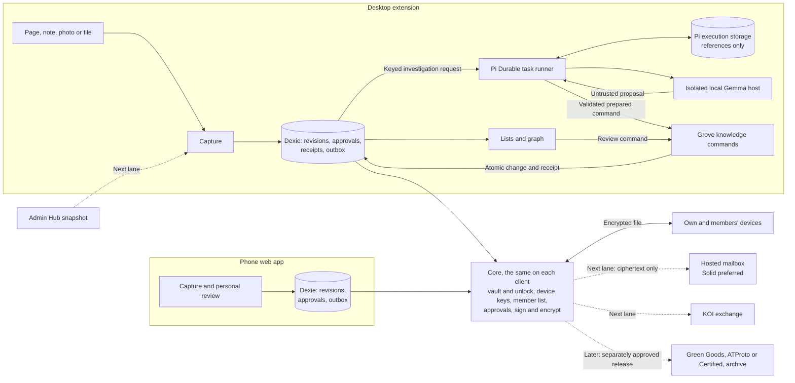

# Grove by Green Goods: MVP architecture

**Status:** implementation proposal; decisions recorded, product build not started.
**Updated:** 14 November 2026. **Owner:** Grove idea hub. **Clients:** `packages/extension` (a spike exists) and a phone web app (home open, see O2).
**Current contract:** [community sharing](community-sharing.md), [flows](architecture-flows.md), [identity and roles](identity-role-mapping.md), [implementation sequence](plan.todo.md), [gates](eval.md), [dependencies](dependencies.md), [Pi Durable execution](durable-execution.md).
**Earlier baselines:** [prototype](prototype.md), [prototype architecture](prototype-architecture.md), [design brief](prototype-design.md), [Vida Verde/TAS spike](first-spike.md), [KOI contract](koi-integration.md), [ontology alignment](ontology-alignment.md), [visual exploration](visual-design.md).

Grove is a local knowledge and evidence workspace built around **capture → review → share**. People begin without a wallet, a provider account, a model or a connection. They capture on a phone or a laptop, review by hand, pair their devices, and share selected encrypted records with named members of a community. On the laptop, a graph and optional local AI help them explore and connect what they hold.

Grove is the user-selected brand: **Grove by Green Goods — Your garden’s living knowledge.** Its principle is **Coordinate locally. Govern together. Share by context. Publish by choice.** Grove remains a focused project within Community Evidence Mesh; read the [Mesh alignment](mesh-alignment.md). A disposable [G0 experiment](reports/2026-10-24-g0-feasibility.md) exists. Identity, encryption, sharing and the phone app are unbuilt, and no security or privacy property described here has been tested.

This document owns three things: the MVP contract, the decision log, and the component architecture. Other documents refer to them instead of restating them.

## MVP contract

**Primary users (assumption W1).** One steward who creates and looks after a community, two to four members who capture and review, and one contact in a partner community who receives a summary. Records are synthetic or non-sensitive until the [loop gates](eval.md#which-gates-the-mvp-needs) pass, a second controller exists (D18) and the owner has answered O8.

**Devices (D2).** Two clients ship together:

| Client | Runs on | Does |
|---|---|---|
| Phone web app | An installed web app on Android Chrome or iOS Safari (Home Screen) | Capture, personal review, pairing, share and receive by encrypted file |
| Desktop extension | A packaged extension in a desktop Chromium browser, Brave first | Everything the phone does, plus page capture, an agent that brings in relevant pages as the person browses and assesses them, the graph, and Pi investigations |

The exact supported versions are a result of C0b and C0a, not a promise made here. The proposed floor is Chromium 137 on desktop and Android and iOS 18.4, for the reasons in [dependencies](dependencies.md#community-identity-encryption-and-device-sharing).

**Included workflows.**

1. Create a community and a member identity offline on either client, with a recovery code. The steward writes the community's focus: its topics, goals and open questions (D30).
2. Unlock with an existing Green Goods passkey where its provider supports it, and with a passphrase otherwise (D19).
3. Capture a note, photo, file, or link with an excerpt; on the laptop, capture a page. Each capture records source, time and consent context and is saved before anything else happens.
4. Review a capture personally, by hand, on either client.
5. Pair a member's own phone and laptop, and admit another member's device.
6. Move captures from phone to laptop as an encrypted file (D21).
7. On the laptop, an agent brings in relevant knowledge and resources as the person browses, guided by that focus, and assesses each item before the person reviews it (D26 to D29). The person browses records as lists and as a graph, and accepts, rejects or corrects what the agent proposes (D25).
8. Share: the author approves an exact projection, meaning which revision and which fields, for named recipients, a purpose and a destination, and the author's device signs that approval; the client signs and encrypts the file; the recipient verifies, stores it and returns a receipt (D17).
9. Review together: recipients record decisions and corrections. A corrected version leaves the community only with the author's fresh approval (D17).
10. Send a partner summary under a steward's approval, as a new projection with no private history (D17).
11. Remove a member or device, pause sharing on a stale member list (D24), and recover a lost device.

**Excluded from the MVP.** These are next lanes or research, each with its own entry in the [implementation sequence](plan.todo.md):

- Hosted storage of any kind. Solid is the preferred adapter for the next lane (D12, D21).
- The Admin Hub snapshot, WebMCP tools, the Hub digest and KOI exchange (D5, D22).
- Co-editing with Yjs, WebRTC transfer, Bluetooth sensors.
- Publication: the Green Goods work-submission bridge, ATProto/Certified, IPFS/Filecoin.
- EDV, Automerge + Keyhive and MLS, which stay research.
- A model or passive capture on the phone, and any real sensitive record before the loop gates pass, a second controller exists and O8 is answered.

**The MVP is done when all of these are observed** on a physical phone and a physical laptop:

1. No acknowledged capture is lost across restart, offline reopen and two weeks of an installed phone app sitting idle (E2, E26).
2. A person completes capture → review → share with no model, wallet, provider account or network (E17).
3. The recipient sees exactly the approved fields. A device that was not named, and anyone holding only the file, cannot read it. A tampered, replayed or re-addressed file is rejected (E16).
4. A removed device cannot read anything shared after the sender learned of the removal, and a sender whose member list is older than seven days is paused (E15).
5. A lost phone is recovered from the recovery code and from a second device. Losing every path fails visibly (E15, E16, E24).
6. Passkey unlock works with the network blocked where the provider supports it, the passphrase works where it does not, and a synced passkey cannot bring back a removed device (E24).
7. A corrected record cannot leave the community without its author's approval, and a partner summary carries a steward's approval and no private history (E17).
8. On the laptop, a real local Gemma investigation produces proposals with exact quotes, survives a closed tab through Pi with one result, and appears in the graph as new (E4, E6, E12–E14). Capture and manual review behave the same with the model absent.
9. As a person browses on the laptop, the agent brings in pages that fit the community's focus and nothing from a blocked site or a private window. It keeps nothing from a page it did not bring in. Each item it brings in shows why it was brought in, its source, author and date, and anything to check before sharing. An item it brought in can be kept and shared like any capture (E27, E28).
10. In a moderated check, participants say correctly who can see a record in each of the four audiences (E17).

## Decision log

The project owner decides. **Accepted** means the owner chose it, on the date shown. **Carried** means it was proposed in the 11 October plan, merged, and not contested since; it stays a proposal until the build confirms it. **Recommended** is this review's advice and is not decided. **Assumed** is a working default nobody has objected to, numbered W1 onward because A0 to A4 already name the earlier milestones. **Open** needs the owner's decision or an experiment, and names which.

### Decisions

| # | Decision | Reason or consequence | Standing |
|---|---|---|---|
| D1 | Add `packages/extension` in Green Goods; treat Coop as a source of patterns | Direct access to Green Goods domain authority without importing Coop's product workflows. Copying Coop code waits on O5 | Carried |
| D2 | A desktop extension and a phone web app ship together in the MVP | Both carry the first two-device proof. Costs: two codebases, two storage origins, pairing across them, and a stable extension ID | Accepted 14 Nov |
| D3 | Sigma + Graphology for the graph, behind a small renderer adapter | Separates drawing from stored knowledge; Cytoscape is the fallback | Carried |
| D4 | Encrypted local payloads, Dexie revisions and atomic command receipts | One authority per client for captures, reviews and approvals | Carried |
| D5 | An optional, origin-restricted, read-only Admin Hub connection; credentials stay in the Hub | Next lane (D22). Two designs exist in this hub and one must be chosen when it is scoped (O9) | Carried; moved to a next lane 14 Nov |
| D6 | A versioned Grove application profile composed from Green Goods, a pinned Commons draft and local terms | One vocabulary with distinct source identities; see [ontology alignment](ontology-alignment.md) | Carried |
| D7 | Model proposals are source-linked and validated before storage | The model cannot commit facts, approve Work or invent predicates | Carried |
| D8 | Personal and community review are separate and versioned | Who reviewed what, at which revision, without implying protocol approval. D17 names the approvers | Carried |
| D9 | Capture → review → share for both knowledge and impact evidence | Explicit capture on both clients. Passive capture on the laptop was added on 14 November (D26). Co-editing and sensors follow demonstrated need and consent | Accepted 13 Nov; amended 14 Nov |
| D10 | Capture and manual review never depend on a model | The manual path is the primary path, not a fallback | Accepted 13 Nov |
| D11 | Local, community-controlled identity with separate device, storage and public associations | No provider or Ethereum dependency for local use | Accepted 13 Nov |
| D12 | Solid is the preferred optional storage adapter, with encryption on the client | Next lane, behind a generic store interface (D21). EDV stays research | Accepted 13 Nov; sequenced 14 Nov |
| D13 | Planned, reported and recorded activity stay distinct from review and transport state | A signature, local acceptance or recent import cannot prove completed work | Carried |
| D14 | Pi Durable runs investigations in the MVP | It never gates saving, review or delivery. The tab-close proof on persistent storage is still owed (P0) | Accepted 16 Oct; reaffirmed 14 Nov |
| D15 | Idempotent Grove commands connect Pi checkpoints to stored knowledge | Recovers the gap between two stores without duplicates | Carried |
| D16 | Yjs is preferred for co-editing when a workflow shows the need; Automerge + Keyhive stays experimental research | Later lane. Encrypted record exchange is the baseline | Accepted 13 Nov |
| D17 | The author approves every share of their own capture, and again if a corrected version is to leave the community. A steward approves partner summaries and public releases | Keeps "publish by choice" with the person who captured it. More prompts for authors; a release can wait on an absent author | Accepted 14 Nov |
| D18 | One steward signs member and device changes. A recovery code is created at setup. A second controller is required before real data | One person can start a community. Until the second controller exists, losing the steward's devices and code ends it | Accepted 14 Nov |
| D19 | The existing passkey unlocks the vault from day one where its provider supports it; a passphrase does otherwise | C0a is a gate. The passkey is never a device identity, and a recovery path that does not need it always exists | Accepted 14 Nov |
| D20 | "The operator cannot decrypt" covers storage and relay hosts. Green Goods, as publisher of the client code, is trusted, and the documents say so | The phone web app may hold keys. A dishonest or compromised code host could read an unlocked phone vault | Accepted 14 Nov |
| D21 | Encrypted files carry records between devices in the MVP. A hosted mailbox is the next lane | No server and it works offline; every transfer is a manual step | Accepted 14 Nov |
| D22 | The MVP graph shows Grove's own records. The Hub snapshot and KOI exchange are next lanes | Changes the October prototype's order, where connecting a garden came first | Accepted 14 Nov |
| D23 | "Community" is Grove's word for the group that shares records, defined apart from a Garden and from the Community role | Terms live in the [sharing contract](community-sharing.md#terms). The term is a proposal for the ontology change protocol, not an ontology edit | Accepted 14 Nov |
| D24 | A device stops sharing when its copy of the member list is older than seven days, until a newer one arrives. Each community can change the number | Capture and personal review never pause. A removal can take up to the limit to reach an offline sender | Accepted 14 Nov |
| D25 | The MVP finish line includes the laptop workspace: the graph, Gemma suggestions and Pi investigations | The loop and privacy gates come first; the workspace runs alongside on synthetic records and counts once they pass. D26 to D30 say what the agent does there | Accepted 14 Nov |
| D26 | The agent captures relevant knowledge and resources as a person uses their browser, and brings them in for that person to review and then share with the community | Passive capture is in the MVP, on the laptop extension. What it brings in lands in the person's own local records first and reaches the community only through the approvals in D17 | Accepted 14 Nov |
| D27 | The agent may read every page the person visits, except private windows and a block list of sensitive sites that the person can extend | Closest to "as a user uses their browser" and catches the most. The extension must ask for access to all sites, which browser stores scrutinize, and a gap in the block list would let a private page's text reach local storage | Accepted 14 Nov |
| D28 | A person reviews everything the agent brings in and can discard it. The agent brings in only what it judges relevant, and never an item it would recommend discarding | Relevance is decided before anything is stored, so the agent makes no keep-or-discard recommendation. Getting relevance right matters more than bringing in more | Accepted 14 Nov |
| D29 | The assessment of a brought-in item first covers three things: why it was brought in, its source, author and date, and whether it is safe to share | Checking an item's claims against its source comes later; it is the hardest check for a small local model. The assessment is advice and never a decision (D17) | Accepted 14 Nov |
| D30 | The steward writes the community's focus, its topics, goals and open questions, in Grove | It is a community record signed by a steward's device and shared with members. Each member's agent uses it and refuses a focus signed by anyone else. It needs no wallet and no Garden. Reading it from a Garden's records waits for the Hub lane | Accepted 14 Nov |

The 25 [prototype decisions](prototype.md#decisions) stay as dated history. Where they conflict with this table, this table governs: decisions 18 to 21 (the Hub connection) and 5 (the KOI community node) describe next lanes, not the MVP.

### Recommended, not decided

| # | Recommendation | Why |
|---|---|---|
| R1 | Use one existing multi-recipient format for shared files, with a fresh key per file. Choose between age v1 and HPKE (RFC 9180) at C1 | No protocol to invent. A fresh key per file means removing a member needs no key rotation |
| R2 | Do not select a DID method for the MVP. Identify devices by their public keys and a community by the hash of its first member list | Nothing in the MVP needs an outside verifier. C0 today says to select and pin a method first |
| R3 | Keep the member list to one signed, hash-chained history with one active signer. Reject a fork; never merge one | No maintained browser library provides community membership, so Grove writes this part and it must stay small |
| R4 | Never make the passkey the only way to open a vault. Combine its secret with a key held on the device, and always keep a recovery-code path | The same passkey secret is available to every `greengoods.app` site and to any extension with permission for that domain |
| R5 | Prove key and capture durability on real devices before anything else (C0b) | It is the cheapest experiment that could change the design |
| R6 | Model share and release approvals on the Agent's publication consent: bound to a revision and a digest, with withdrawal honoured at every send | The pattern and its canonical digest already exist in this repository |
| R7 | Keep private records out of Shared's upload and telemetry helpers | Upload telemetry records file names and content identifiers |
| R8 | Prove a garden link with an account that wears a steward or owner Hat, plus a fresh role check. Never with the GardenAccount's own signature | That signature follows whoever holds the garden token |
| R9 | When co-editing arrives, use Yjs for merging only, one new document per audience, with every key holder able to write | Yjs has no encryption or author check; its stock providers store and relay plaintext |
| R10 | At P0, record how a plain job row in Grove's own database compares with Pi for the same investigation | D14 keeps Pi; the comparison shows what it buys and is evidence, not a reopened decision |
| R11 | Treat the Automerge + Keyhive comparison (E25) as backlog research, outside Grove's gates | It decides nothing the MVP or the next lanes need |
| R12 | Pin the extension's ID with a manifest key during development and list it in a store before a pilot | An unpacked extension's ID, and so its storage and keys, follows its build path |
| R13 | Create keys on a phone only when the app is installed to the Home Screen | Safari removes a site's stored data after seven days of use without a visit; installed apps are counted separately |
| R14 | Do not compute a "community approved" state in the MVP. Store each reviewer's signed decision; a steward's release approval names the decisions it relied on | D17 names who approves a release. A second, automatic status would need a rule for reviewers who disagree |
| R15 | Encrypt each new capture to the device's own public key | Saving then works while the vault is locked; reading, review and sharing still need it unlocked |
| R16 | Judge relevance in two stages: a plain text match against the focus on every page the agent may read, then the model only on pages that match, queued for when the laptop is idle | One model step took 35 to 42 seconds on the G0 laptop, so the model cannot run on every page |
| R17 | Keep nothing from a page the agent does not bring in: no text and no address. Show when the agent is reading, give a pause switch, and list what it brought in and from where | Access to all sites is the largest privacy exposure in the design, and D27 depends on people trusting it |
| R18 | Ship a block list that covers banking, mail, health, government accounts and password managers, and skip any page with a password field | D27 leaves the block list as the only thing between a private page and local storage |
| R19 | Run each assessment check as one bounded Pi phase, and store the result beside the item: what was checked, by which model version, what it found and what it could not check | The same pattern the connection proposals use (D7, D15), and it keeps the assessment inspectable |

### Assumed

| # | Assumption | Until |
|---|---|---|
| W1 | The pilot is one steward, two to four members and one partner contact, with synthetic or non-sensitive records | The owner names a pilot community |
| W2 | The extension reaches the existing passkey through host permission for `greengoods.app`; the phone app is served from a `greengoods.app` subdomain | C0a and O2 |
| W3 | Each device holds a separate key pair for each community it belongs to | C0 proves isolation between communities (E23) |
| W4 | The workspace lane runs on the laptop only; the phone needs no model | A measured phone result says otherwise |

### Open

| # | Question | Resolved by |
|---|---|---|
| O1 | Do existing credentials return a usable secret (WebAuthn PRF) on each provider, from an extension page, with the network blocked? | Experiment: C0a / E24 |
| O2 | Where does the phone web app live: its own app on a `greengoods.app` subdomain, or a route in the existing client PWA? The same answer decides where the code shared by both clients lives | The owner. Recommended: its own origin with no analytics in it, and the shared code as one module both clients import |
| O3 | Which envelope library: age v1 or HPKE? | Experiment: C1 / E16, decided by what the device floor supports |
| O4 | Do keys and captures survive on real devices, including a Safari tab, a Home Screen app and an extension reinstall? | Experiment: C0b / E26 |
| O5 | May Grove reuse Coop code? The AGPL licence is on an unmerged local branch and Coop's main branch carried no licence when last fetched | The owner. Until then, reimplement small pieces and copy nothing |
| O6 | How is a fork in the member list detected and refused once a second controller exists? | Design and experiment: C0 / E15 |
| O7 | What can an author withdraw after sharing, and what do recipients' devices do when they learn of it? | Design in C2; copies already received cannot be recalled |
| O8 | What limits code updates to the phone app before sensitive records are admitted? | The owner, before any sensitive pilot: no sensitive record is admitted until this is answered. D20 accepts the publisher as trusted |
| O9 | Which Hub connection design: the content-script relay below, or the WebMCP tool of prototype decisions 18 to 21? | The owner, when the Hub lane is scoped |
| O10 | When are the five Linear milestones, which still mirror A0 to A4, reconciled with this sequence? | The owner. No tracker change is authorized by this revision |
| O11 | Three outside claims in [sharing research](sharing-research.md) were not re-checked on 14 November: the Linked Web Storage draft date, the ATProto Spaces update, and Certified's EOA-only link schema | Whoever scopes the lane that depends on each |
| O12 | Will an extension that asks for access to all sites pass store review for the pilot, and is the block list enough? | The owner, at listing time, with evidence from E27 |
| O13 | Can a small local model judge relevance and assess items well enough, and fast enough, to keep up with ordinary browsing? | Experiment: E27 and E28 |

Dependencies and a bounded implementation still need task-specific authorization before installation. Publishing this plan changes no application package, manifest, lockfile, license or runtime.

## Reuse: established capability, gap, and owner

Green Goods source baseline: `06a31dbf55c25e1edfca35423f0e3a7c77184c16`, inspected 11 October with unrelated local changes present. Every local link in this table still resolves on develop at `3ee6594ef` (checked 14 November); the behavior behind each link was last read on 11 October. Coop remote source baseline: `901f57871ec578b0a31bb38c1eacdd0a85eed83a`. These are source observations, not deployment or browser proof.

Two existing Green Goods patterns were found on 14 November and belong in this table's spirit: the Agent's [publication consent](../../../packages/agent/src/services/reporting/consent.ts), which binds consent to a revision and digest and honors withdrawal at every dispatch, and the shared [canonical digest](../../../packages/shared/src/modules/agent-reporting/canonical.ts). Grove's share and release approvals should follow them (R6) instead of adding a parallel consent model.

| Existing component | What to reuse | Gap / new owner |
|---|---|---|
| [Green Goods ontology query API](../../../packages/shared/src/ontology/query.ts) and [ontology workflow](../../../.claude/context/ontology.md) | Canonical terms, aliases, relationships, maturity and version metadata | Shared owns a narrow graph vocabulary adapter and extension contracts. The manifest does not implement a complete runtime constraint validator. |
| [Garden reader](../../../packages/shared/src/modules/data/indexer-garden.ts) | Existing garden mapping, configured chain, hidden-garden behavior | Shared adds a bounded snapshot builder; preserve the existing default-chain rule. |
| [Work list](../../../packages/shared/src/modules/work/work-list.ts) | Work identity and existing approval resolution, including partial and conflicting results | Snapshot adapter must preserve unknown approval state and coverage. Never interpret a failed read as rejection or deletion. |
| [Public impact contract](../../../packages/shared/src/public-contracts/garden-impact.ts) and [readers](../../../packages/shared/src/modules/data/public-garden-impact-readers.ts) | Provenance and partial-data conventions; relevant lower-level readers | Its summary and capped recent-work response are not a complete graph export. A dedicated bounded snapshot is new. |
| [Pi Durable specification](https://github.com/earendil-works/pi/blob/8efd314fa3d3232ce197d8d7a6a5660530b9d83e/packages/durable/docs/spec.md) | Versioned task phases, persisted execution state, admission deduplication and committed progress | Extension builds browser storage, lifecycle and command adapters; no supplied Dexie/Gemma integration is assumed. See [execution ownership](durable-execution.md). |
| [Shared dependencies](../../../packages/shared/package.json), logger, i18n and primitives | Existing Dexie, Zod, domain types and UI foundations | Extension DB is separate from the PWA's transactional job queue. Browser-origin storage is not automatically shared. |
| [Coop capture handler](https://github.com/greenpill-dev-guild/coop/blob/901f57871ec578b0a31bb38c1eacdd0a85eed83a/packages/extension/src/background/handlers/capture.ts) | Snapshot extraction, URL/content deduplication and saved-before-routing pattern | Adapt small functions to garden identity and capture consent. Do not import Coop routing, drafts, side panel or notification flows. |
| [Coop WXT configuration](https://github.com/greenpill-dev-guild/coop/blob/901f57871ec578b0a31bb38c1eacdd0a85eed83a/packages/extension/wxt.config.ts) | Learn from service-worker bundling and packaged ONNX assets | New minimal manifest, permissions and build integration. Do not copy broad permissions or unrelated bundling workarounds. |
| [Coop Gemma bridge](https://github.com/greenpill-dev-guild/coop/blob/901f57871ec578b0a31bb38c1eacdd0a85eed83a/packages/extension/src/runtime/agent/gemma4-bridge.ts) | Initialization progress, request IDs, teardown, bounded document-hosted inference | Coop uses a sandboxed iframe for its runtime CSP constraints. Reuse requires packaged-runtime, message isolation and Brave lifecycle proof. |
| [Coop graph persistence](https://github.com/greenpill-dev-guild/coop/blob/901f57871ec578b0a31bb38c1eacdd0a85eed83a/packages/extension/src/runtime/agent/graph-persistence.ts) and [snapshot storage](https://github.com/greenpill-dev-guild/coop/blob/901f57871ec578b0a31bb38c1eacdd0a85eed83a/packages/extension/src/runtime/agent/graph-store-singleton.ts) | Provenance references and duplicate relationship handling as design evidence | Build revisioned persistence. A debounced replacement snapshot and merged confidence are insufficient for change history or evidentiary strength. |

Code reuse is conditional on the exact source revision's license. The remote `LICENSE` lookup at the pinned Coop revision returned 404 on 13 November. The local Coop checkout at `5b889eea30056877f1e3a0114e0cd4353a36cee4` does carry an AGPL-3.0 `LICENSE` and `AGPL-3.0-only` manifest fields, but that commit sits on an unmerged local branch, `chore/add-agpl-license`; the local copy of Coop's main branch, last fetched on 14 June, has neither. So nothing currently grants permission to copy Coop code, and code under AGPL-3.0 could not be copied into this MIT-licensed repository without changing how the result is licensed. Patterns and ideas are free to reuse; independent implementation of the small interfaces remains possible. O5 records the decision, which belongs to Coop's copyright holders. This plan does not change either project's license.

## Component architecture

Each client keeps its own Dexie database, which is the only authority for that client's captures, reviews and approvals. The same core code runs on both and is the only code that touches keys. Dotted lines are next lanes or later work, not part of the MVP.

| Proposed placement | Owns |
|---|---|
| Core used by both clients (home open, O2) | Vault and unlock, device keys, the member list, share and release approvals, signing and encrypting files, import and export. Framework-free, with no network access of its own |
| Phone web app (home open, O2) | Capture, personal review, pairing, share and receive |
| `packages/extension/entrypoints/` | Background coordinator, graph page, scoped capture entrypoint, offscreen host and packaged model sandbox |
| `packages/extension/src/knowledge/` | Revision store, ingestion, entity resolution, query execution, review transitions |
| `packages/extension/src/graph/` | Canvas adapter, controls, inspector and saved layout |
| `packages/extension/src/runtime/` | Browser capture and local inference lifecycle |
| `packages/extension/src/execution/` | Pi composition, browser storage, versioned investigation phases, scoped admission and command adapter |
| Next lane: `packages/shared/src/modules/garden-knowledge/`, `packages/shared/src/hooks/knowledge/`, `packages/admin/src/views/Garden/components/` | Hub transport schemas, snapshot mapping, Hub hooks, the connect action and the same-device digest |
| Next lane: `packages/extension/src/koi/` | Browser protocol adapter, independent node identity, peer policy and resumable exchange |

Names are proposed paths, not claims that files exist. Shared never imports Extension. Domain transitions remain independent of React, Sigma and Chrome APIs. New Shared imports use declared package exports; existing internal readers are called inside Shared. Add a narrow ontology leaf export if bundling the existing root API pulls unrelated modules. Do not deep-import Shared `src` from Extension. All React hooks remain in Shared under repository policy.

The two clients need one real shared contract: the record, approval and file formats the core defines. The graph, the model host and Pi stay local to Extension. Removing the knowledge-store module would scatter revision, deduplication and review rules across capture, model and graph consumers, so that module has a concrete responsibility. No microservice per local capability or generic agent framework is needed. In the later KOI lane, the optional full node is a real network boundary. It is test infrastructure in the spike; a production service and continuous connectors require separate scope. The [KOI contract](koi-integration.md) owns transport, authorization, reconciliation and upstream limitations. The [Pi Durable contract](durable-execution.md) selects custom tasks for investigation execution. Start with one runner owner and one active investigation; graph tabs do not open competing Harness writers. The graph-document host pauses safely on close and resumes on reopen; broader offscreen scheduling requires its own lifecycle proof.

## Hub connection contract

> **Next lane, not the MVP (D22).** The MVP graph shows Grove's own records. This section is one of two Hub designs in the hub; [prototype decisions 18 to 21](prototype.md#decisions) describe the other, a read-only WebMCP tool with a direct adapter. O9 chooses between them when the lane is scoped.

Choose a content script limited to the exact configured Admin Hub origin, relaying a typed page bridge to extension runtime messaging. This avoids requiring the Hub to know an unpacked extension ID. An `externally_connectable` API with a fixed extension ID is a viable later distribution choice, not a second MVP transport.

1. User chooses **Connect garden graph** in the Hub. The extension displays the garden and bounded connection scope in the graph's connection state.
2. Create a per-installation binding for Hub origin, configured chain, garden and a random session nonce. Verify `event.source`, exact origin, top frame, browser-reported sender URL and message schema at each boundary. A nonce correlates an approved exchange; it does not prove a garden role.
3. The Hub uses existing readers to produce `GardenSnapshotV1`: schema version, export ID, garden/chain scope, ontology version, observation time, source coverage, records and explicit source references. Only allowlisted fields cross the boundary.
4. The extension durably ingests the snapshot before acknowledging receipt. Repeated export IDs or content-identical records are no-ops.
5. While the Hub is open and bound, changed query results or explicit refresh can send another snapshot. Show last synchronization and coverage. A closed Hub does not imply continuing private-data synchronization.
6. `getInsightDigest` returns a bounded set of locally accepted knowledge summaries and source references for that exact binding. The Hub labels them **On this device** and links to the graph. No raw captures or notes are returned by default; including any nonpublic local material requires exact item/revision consent. Returning plaintext to a Hub page is a disclosure to that app context, not host-blind encrypted storage.
7. Disconnect removes the binding and stops exchange. Local graph retention or deletion is an explicit user choice; disconnect never silently deletes the only copy.

V1 commands: `connectGarden`, `ingestSnapshot`, `openGraph`, `getInsightDigest`, `disconnectGarden`. Reject arbitrary URLs, arbitrary queries, mutations and model text as commands. The Hub keeps its authentication and authorization; no cookies, passkeys, signing keys or auth/session providers are copied. Initial snapshots contain public protocol records only. Local review authority is personal and must not be presented as a steward attestation.

Begin with a bounded snapshot of the garden, at most 100 selected/latest Work records, their Actions, and available approval records. Coverage explicitly records truncation, unavailable sources and observation time. Missing rows in a partial snapshot never delete prior knowledge. Full historical backfill is outside the first slice.

## Knowledge contract and time

Use an IndexedDB database owned by each client origin. Every record/query is scoped by a locally generated `workspaceId`, independent of a chain address. Optional garden bindings include chain and normalized garden address; multiple bindings do not merge communities automatically. Canonical Green Goods IDs retain chain and entity kind. Work identity comes from its attestation UID; Action identity comes from its authoritative reader, not a title. Imported commons IDs retain namespace/version. Pairing must cross the phone/PWA/extension storage-origin boundary explicitly. Protected payloads and derived indexes follow the encryption contract; do not interpret the logical tables below as permission to persist private plaintext.

| Store | Minimum meaning |
|---|---|
| `workspaces` | Binding, schema/ontology versions and latest committed sequence |
| `sourceRevisions` | Immutable capture/import revision, source identity, content digest, extracted text, capture date, source date when known |
| `entityRevisions` | Stable entity ID, canonical type reference, revision, properties, recorded sequence, optional activity/validity time |
| `assertionRevisions` | Stable edge ID, subject/predicate/object, evidence spans, origin, review state, revision, recorded sequence, optional validity interval |
| `changes` | Ordered batch sequence and affected record IDs, distinguishing additions, updates, reviews, corrections and removals |
| `jobs` / dispatch outbox | Durable intake/dispatch requests; Pi admission ID and input digest for investigations. Deterministic capture/KOI workers retain their own operation-specific retries; no second model scheduler |
| `preparedCommands`, `commandReceipts`, `investigationSummaries` | Erasure-controlled proposal payloads/references, command ID and payload digest, atomic mutation receipt, minimal committed run summary |
| Pi-owned browser tables/database | Conformant execution records, checkpoints, IDs and documents; garden references only, separate sequence namespace |
| `views` | Device-local seen cursor, filters, selection and node positions; no domain authority |
| `peerBindings` | Workspace/collection allowlist, trusted node key reference and local connection policy; no wallet identity |
| `inbox`, `outbox`, `syncState` | Validated operation/revision identity, persisted delivery attempts, explicit share projection and reconciled collection generation |
| `ontologyPacks` | Pinned vocabulary/schema/mapping version, digest, publisher/source and draft status |
| `communityPolicies`, `deviceGrants`, `externalBindings` | Verified controller history, audience/purpose/expiry-scoped grants and explicit service/garden associations; no plaintext private keys |
| `encryptedPayloads`, `keyEnvelopes`, `releaseApprovals` | Versioned ciphertext, wrapped recipient keys and exact revision/audience/destination consent; key custody follows the sharing contract |

Keep revisions append-only in normal use. A knowledge command transaction allocates one workspace sequence and writes affected revisions plus its duplicate-protection receipt atomically. Matching command retries return the original receipt; a different payload under the same ID rejects. Source capture and human review atomically append any follow-up dispatch intent. Pi admission/checkpoint commits occur separately and recover through stable request/command IDs. Pi owns investigation phase scheduling, while deterministic intake/delivery workers retain operation-specific leases. Stale or erased source/model/review revisions cannot overwrite newer decisions. Acknowledgement follows the owning commit; no cross-store atomicity is claimed. Display notifications are expendable: another tab can recover changes by reading after its last sequence.

For the MVP, query indexed revisions to select the latest revision at or before a sequence. A current-state cache may accelerate the present view. Add periodic checkpoints only if measurement warrants them. This is local revision history, not a new event-sourced architecture for the Green Goods protocol.

**Recorded time** answers what the extension knew then. **Activity/validity time** answers when the source says something happened or applied. Never backdate recorded time to an imported report's date. History starts at the first import, even when underlying records are older. A source's later correction supersedes the old assertion; the earlier view remains inspectable. Explicit erasure removes protected content from history and indexes rather than preserving sensitive text in a tombstone.

**Planned time** is a separate optional field. Activity class (`recorded`, `reported`, `planned`) is independent of personal review state and assertion origin. Only authoritative evidence mapping can create a recorded activity; accepting a proposed trial cannot. KOI manifest time and receipt time are transport/source metadata, not activity completion. Timeline controls default to knowledge time; projected work stays labeled and filterable in every view.

Assertion origin (`protocol`, `source`, `model`, `human`) and personal review status are separate. Local candidates transition `proposed -> accepted | rejected`; a correction creates a new revision with `supersedes`. Expected-revision checks reject stale review commands. Accepted means accepted for this person's garden memory; it never means verified regenerative impact. Imported WorkApproval retains its protocol identity and decision separately.

The commons draft is packaged as versioned data. Preserve existing IDs when supplied; otherwise use visibly provisional draft IDs and an explicit mapping table. Do not claim a new canonical URI. In the test fixture, synthetic concepts are labeled synthetic. Runtime mapping recognizes supported predicate endpoint types and quarantines unknown terms; it does not quietly remap them to a generic relationship.

Use the [Grove application profile proposal](ontology-alignment.md) for one language across imported records, graph queries and model output. Map Source and supporting Concept/Term to the pinned Commons draft; keep capture revisions as storage records. The earlier `memory:Source`/`memory:Claim` placeholders are superseded by this alignment direction before S2. `memory:Question`, `memory:Resource`, `memory:PlannedActivity`, `memory:relevantTo`, `memory:addresses` and `memory:aboutConcept` remain proposed local additions. All provisional IDs stay visibly provisional. Display categories group types without merging their identities or review lifecycles.

## Ingestion and feedback

See the [internal/external learning loops and ingestion diagrams](architecture-flows.md) for the complete flow and the boundary around later Commons contributions.

In the MVP the sources are explicit captures on either client and, on the laptop, pages the agent brings in as the person browses (D26). KOI bundles (step 1) and structured Garden, Work, Action and WorkApproval records from the Hub (step 3) arrive with their next lanes (D22); the steps below keep them so the store is designed once.

1. Receive a scoped, signature/hash-validated KOI bundle or capture from an explicit action or enabled research scope. Save the source revision first. Strip form controls, credentials and hidden input; treat the retained text as untrusted evidence, never instructions.
2. Normalize conservative URL identity plus content hash. Preserve distinct changed content at one URL. Exact canonical entity IDs win; name similarity produces a suggestion, never an automatic merge.
3. Map structured Garden/Work/Action/WorkApproval records without a model. Record source coverage and source state separately from local review state.
4. Admit a keyed Pi investigation through the dispatch outbox, pinning source hash, garden sequence, profile/mapping and model versions. Its custom phases build a bounded model packet: selected source chunks, allowed ontology IDs, current question and a small garden neighborhood. For the first slice, request at most three candidate links to existing entities and an evidence quote for each. The model cannot create protocol records or choose external tools.
5. Validate Zod shape, allowed predicate/endpoint types, candidate IDs and exact quote spans in the captured source revision. Quote existence is evidence traceability, not proof of relevance; human review remains necessary.
6. Persist a validated prepared command under the run/step key, then apply it through Grove's idempotent knowledge command. Graph revisions and its receipt commit together; Pi subsequently checkpoints the receipt. Invalid or empty output leaves the source saved, with enrichment failed or no connection found. Bound retries in the task and allow manual linking. Raw source text and spans remain in erasure-controlled stores, outside Pi execution records.
7. Patch the visible Graphology projection using committed changes. Retain existing coordinates and camera; place new nodes near connected context. Unrelated metadata refreshes do not count as new knowledge.
8. Accept, reject or correct from the inspector. Persist the decision with actor/device, timestamp and rationale when supplied. Retrieval can exclude rejected suggestions and use accepted mappings; this is feedback-driven retrieval, not model training. A review may enqueue a keyed follow-up investigation in that same graph transaction. The previous task has already ended as ready for review; no live invocation waits for a person.

Passive capture runs in the extension while the browser is open (D26, D27). The agent may read the text of any page the person visits, except in private windows and on a block list of sensitive sites the person can extend. It keeps nothing from a page it does not bring in, and it does not read browser history. The earlier design limited this to selected domains inside a research session; the owner replaced it on 14 November. Pi investigations resume only when their supported host is running; source capture remains independent. The first host is the graph document or its dedicated worker, with isolated model execution. Offscreen execution is conditional on valid browser reasons and lifecycle proof; unsupported/interrupted inference remains persisted. Do not keep service workers alive with artificial loops.

In the MVP, sourcing is explicit capture and what the agent brings in as the person browses. Curated external sourcing arrives after the MVP with S10: a versioned list of public resources indexed by commons concepts and linked to garden questions, refreshed on demand. Arbitrary search engines, autonomous crawling, availability verification and private-context-bearing external searches are deferred.

## Graph, queries and dependencies

The graph begins with a garden overview, then a small topic neighborhood such as Soil care, then a source inspector. Keep a visible garden breadcrumb and Back to topic control that restores camera, query and timeline state. Mycelium curves and stable organic clusters support this route; a dense whole-network tangle is not the default. The graph has a query row, filter chips, a timeline and an inspector. Search results remain in context. Offer keyboard navigation and a text result list within the same graph workspace so the canvas is not the only access path. Do not introduce a separate product dashboard.

Freshness is computed from the workspace change sequence relative to an explicit seen cursor. A changes view highlights new edges even when their endpoints predate the window. Separate filters handle provenance, personal review, source coverage, node type and predicate. Removed/superseded edges appear only in historical or difference views. Apply scope before counts, search and traversal.

First slice queries are deterministic keyword/structured queries with at most two hops and a bounded result set. The natural-language query compiler is deferred until these operations are reliable; the architecture allows a later validated typed query plan. The model never emits executable JavaScript or SQL for the graph.

The [dependency map](dependencies.md) owns the categorized component list, package roles and selection state. Sigma + Graphology remains the leading candidate; Cytoscape is the comparison alternative. [Actual demo screenshots and the design brief](visual-design.md) separate renderer capability from the visual craft Grove must build. The user clarified OpenJev / OJV; its exact repository and embedding API still need confirmation. Keep it an unselected visualization research item, not an assumed decision scorer or a first-slice dependency.

Run inference outside the graph document so GPU/CPU work cannot own the graph's lifecycle. The offscreen host and model sandbox receive only the prepared packet and expose no graph-write, signing or arbitrary network capabilities. Check source window/request correlation, validate returned messages and discard responses from a previous model epoch. Bundle executable JS/WASM; downloaded model data must not become a route to remote executable code. Serialize inference and pause layout work during interaction if the benchmark shows contention.

## First end-to-end slice

The MVP is two lanes that meet at the [contract above](#mvp-contract).

**The loop lane** is the [capture → review → share walkthrough](architecture-flows.md#initial-user-flows), delivered in the [order the plan gives](plan.todo.md#mvp-order): device durability, passkey unlock, the vault and file format, identity and the member list, recovery, then the whole loop by encrypted file on both clients. It proves local identity, protected capture, member review and encrypted transfer before any sensitive record is admitted. Nothing in it needs a model, a wallet, a provider account or a network.

**The workspace lane** is the laptop's agent, graph and Pi investigations over Grove's own records. The agent has two jobs (D26 to D30): it brings in relevant knowledge and resources as the person browses, and it assesses each item before the person reviews it. It can be built alongside the loop lane on synthetic records. It counts toward the finish line only once the loop gates pass, and it never gates saving, manual review or delivery.

The earlier [Vida Verde and TAS spike](first-spike.md) specifies graph, Hub and KOI proof on public-source fixtures. Its source semantics and isolation cases remain useful for the workspace lane. Its Hub import and KOI exchange are next lanes (D22), and its graph-first scope does not override the sharing contract. A real local model is required to pass the workspace gates; manual links, fixture imports and UI prototypes are partial proof. No actual garden record, source claim or outcome is invented to make the scene look complete.

## Remaining implementation frontiers

- Device durability (C0b) and passkey unlock (C0a) are the first two experiments and can change the design: which phones may hold keys, and who gets passkey unlock rather than a passphrase.
- The phone web app has no home yet, and neither does the core both clients share (O2).
- Pi's browser storage, single ownership, interrupted execution and migration must pass P0/E12 before integration. The spike on develop pins Pi Durable 1.5.0 but still runs it on in-memory storage, so the tab-close proof is owed; nothing blocks it now. A failed gate does not authorize moving private execution to a server.
- Exact model artifact and minimum supported laptop depend on measured quality, memory and latency. On the G0 machine one investigation took 35 to 42 seconds.
- Commons authority must supply or approve the pinned draft mapping before claiming commons conformance. A fixture pack proves mechanics only.
- Coop code cannot be copied until its license is settled (O5); technical similarity is not a reuse permission.
- The shipped extension ID and distribution channel need final packaging values (R12). Development uses explicit loopback origins only.
- Community membership, encrypted sharing and removal have a design contract and remain unimplemented. Personal same-device review must not be presented as community review. The Hub snapshot, KOI exchange, hosted storage and publication are next lanes.

Primary platform references: [runtime messaging](https://developer.chrome.com/docs/extensions/reference/api/runtime), [offscreen documents](https://developer.chrome.com/docs/extensions/reference/api/offscreen), [Transformers.js extension example](https://huggingface.co/blog/transformersjs-chrome-extension), [Sigma](https://www.sigmajs.org/get-started/quickstart/), [Graphology](https://graphology.github.io/), [Dexie live queries](https://dexie.org/docs/liveQuery()). Component support is not Green Goods browser proof.
