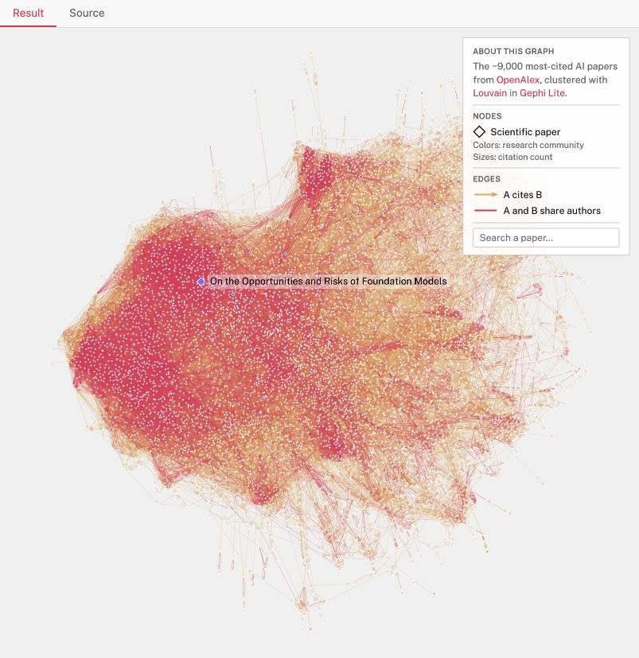
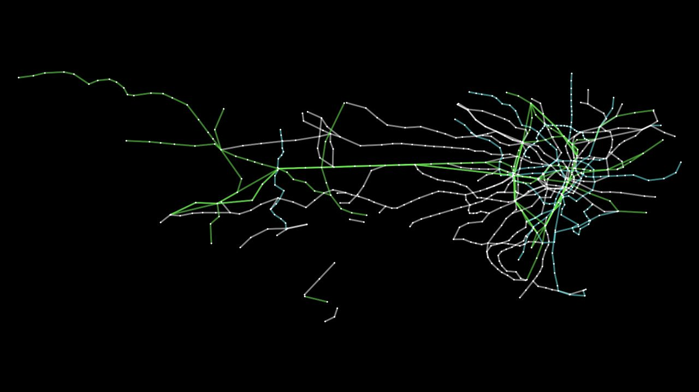

# Grove visual exploration

**Decision to explore:** a beautiful, legible garden knowledge workspace. The graph is the main interface. Search, history, evidence and personal review live around it. Library demos show rendering options; Grove still needs its own typography, colors, interaction hierarchy and information design.

## Actual browser references

Captured 11 October 2026 using the Codex in-app Chromium browser on public demos. These are reference screenshots, not Grove screens, a benchmark, authenticated Brave proof or installed-extension proof. The datasets, styling and viewport sizes differ; compare visual capabilities, not speed or density.

### Sigma + Graphology — leading candidate

[Live official Sigma demo](https://www.sigmajs.org/embed/homepage/demo/) · [documentation](https://www.sigmajs.org/get-started/quickstart/)

Sigma gives us a WebGL rendering surface backed by Graphology. This reference demonstrates overview density and cluster structure. Grove should initially show a useful neighborhood with readable labels; the whole-garden overview is an optional zoom level. New-item halos, edge selection, source inspector, keyboard results and temporal changes need implementation and proof. Current official documentation describes v4; select its compatible packages together.

### Cytoscape.js — alternative

[Official Tokyo railways demo](https://js.cytoscape.org/demos/tokyo-railways) · [documentation and examples](https://js.cytoscape.org/)

Cytoscape provides styles, selectors, graph operations and many layout options. This reference illustrates clear path structure and restrained color separation. A different stylesheet can provide labeled nodes, shaped entities and arrows. It remains a credible alternative if directed relationship readability and interaction work better on our actual dataset. The screenshot's black background is a demo choice, not a Cytoscape requirement or Grove decision.

| Evaluation | Sigma + Graphology | Cytoscape.js |
|---|---|---|
| Proposed strength | Spacious overview, larger visible graph, clean renderer/data separation | Detailed relationships, rich node/edge styles, layout and analysis toolkit |
| Cost to check | Label density, edge hit targets, custom styling, UI/model GPU contention | Density and pan/zoom performance with the exact chosen styles/layout |
| Shared product work | Timeline, provenance, filters, inspector, accessible result list | The same product work |
| Current status | Leading candidate, no Grove benchmark yet | Alternative, no Grove benchmark yet |

No library is selected because one unrelated screenshot looks prettier. Use the same Grove fixture, sizes, labels, interactions and machine for the selection spike.

## Three directions for Claude Code

These are compositions of the same graph screen, not three applications or renderer commitments.

| Direction | Visual idea | What to test |
|---|---|---|
| **Garden atlas** — recommended starting point | Warm canvas, dark ink, quiet organic clusters, deliberate whitespace, restrained green/amber accents and stable positions | Does a steward see the garden's work and new connections without being overwhelmed? |
| **Evidence map** | Tighter selected neighborhood, explicit arrow/relationship labels, prominent source excerpt and review inspector | Can someone explain why an edge exists and distinguish proposal, acceptance and protocol approval? |
| **Seasonal memory** | Graph remains dominant; a stronger recorded-time rail and before/after overlay make change the organizing device | Can someone distinguish when work happened from when Grove learned about it? |

Use root [DESIGN.md](../../../DESIGN.md) and the [AI UI brief](../../../.claude/skills/design/ai-ui-brief.md). Grove's extension dialect is proposed: a Warm Earth **Data Surface**, quiet solid canvas and compact tools. Do not copy the public website's hero styling or assume all Admin wrappers belong in an extension.

## Visual contract

- Begin with one selected garden and a small meaningful neighborhood. Reveal labels and neighboring detail with focus; offer an explicit broader view. Do not open to a dense full-network tangle by default.
- Keep a compact search/filter row, a clear “Since last visit” scope, one evidence inspector and a recorded-time control. Settings and capture status are utilities in the same workspace.
- Distinguish newness from review: a new-node ring or edge mark plus a count/text label; dashed proposed relationships; solid accepted relationships; a distinct selected treatment. Rejected items can be filtered out. Never encode meaning through color alone.
- Preserve node positions and camera across deltas and time comparisons. Labels and hit areas stay usable; selection must not depend on hovering a one-pixel edge. Offer text results and relationship selection in the inspector.
- Show the full sentence behind a relationship, its source quote, source date/capture date, and “Suggested” or “Accepted by you.” Keep protocol WorkApproval separately labeled. A large glowing node does not imply truth or impact.
- Show model unavailable, partial import, captured-but-processing, no matches, mapping unresolved, stale review, storage failure and offline states without replacing the graph with a chat interface.
- Use reduced-motion support, a complete keyboard path, readable contrast, and an in-workspace text mode. Do not run a perpetual force simulation. At narrow widths, the inspector becomes a drawer; this does not claim a mobile browser extension is supported.

## Design deliverable

Use the [Claude Code exploration prompt](handoffs/claude-design-exploration.md). It asks for three inspectable alternatives in sequence, consistent fixtures and screenshots, then a recommendation. This request prepares the prompt; it does not launch Claude Code or start the extension implementation.
