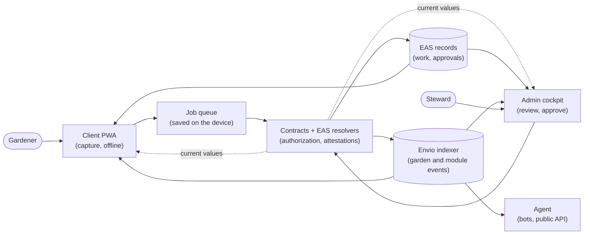

# Architecture

Green Goods carries one piece of work between two very different worlds. Regenerative work happens
in gardens, on phones, often without signal. Verification and funding happen on-chain, where
records are cheap to check and hard to fake. The whole architecture is the machinery for moving a
work submission from the first world to the second without losing truth along the way.

<figure className="gg-figure">
  
  <figcaption>A garden’s pool status, seasons and promises awaiting review.</figcaption>
</figure>

## One submission, end to end

Follow the arrows once and you have the system. A gardener documents work in the
[client PWA](./packages/client), offline if needed. The shared [job queue](./packages/shared)
keeps it on the device until the gardener is back online and taps Upload all. The submission then
lands in the [contracts](./packages/contracts) as an [EAS](./integrations/eas) attestation,
checked by a resolver at the moment it's written.

From there, apps read the data three ways:

- **Attestations**, meaning the work itself and every approval, come straight from EAS through the
  shared EAS data layer.
- **History**, like garden events, membership changes, and module activity, comes from the
  [indexer](./packages/indexer)'s GraphQL read models.
- **Current values**, like someone's roles in a garden or a vault's yield status, come from the
  contracts directly.

The client uses all three to show gardeners their status, the [admin cockpit](./packages/admin)
is where a steward reviews and approves, and the [agent](./packages/agent) serves bots and the
public API. An approval travels the same road as the work it approves.

Two consequences of this shape are worth knowing early. Apps don't dig through the chain's history
themselves, and EAS stays outside our indexer on purpose, so the attestation and history read
paths stay independent. And writes have exactly one door: everything that becomes protocol truth
goes through the contracts.

For the released member and steward workflow, see [Make a Promise](/community/gardener-guide/make-a-promise) and [Open a Pool](/community/steward-guide/open-a-pool). Those guides distinguish evidence, confirmation, and the money actions deferred from the 2.0 app release. [Commitment pooling, settlement and pilots](#commitment-pooling-settlement-and-pilots) below says what runs today.

## The ideas that carry the protocol

The contract layer is small on purpose. Six ideas do most of the work, and once you hold them you
can predict how the rest of the system behaves.

### A garden is an account

Each garden is an ERC-721 token whose
[ERC-6551 token-bound account](./integrations/tokenbound) is the garden itself, on-chain: it holds
the garden's treasury, wears its role tree, and receives its attestations. Nothing about a garden
lives in an app database that could disappear. Transfer the token and the account goes with it,
assets and history included, when transfers are allowed: the protocol can open them, limit them to
its admin, or lock them. The roles do not move with it: owners, stewards, evaluators and gardeners
keep their hats until someone rotates them, so a transfer on its own moves the treasury, not who
can approve work or run the garden. The [Garden account sources](./packages/contracts) and the
[deployment record](/builders/reference/deployments) show what this looks like per chain.

### A record is an attestation with enforced meaning

Work, approvals, and assessments are [EAS attestations](./integrations/eas), but not free-form
ones. Each schema is bound to a resolver contract that validates authorization at write time, so a
Work Approval from anyone but the garden's stewards or its owner simply cannot be recorded. That single
move relocates trust: you don't have to believe an app's database that a steward approved
something, because the record could not exist otherwise. The
[data model](./architecture/data-model) shows how these records relate.

### Authority is a hat

Roles are [Hats Protocol](./integrations/hats) tokens arranged in a small tree per garden: an
owner, stewards, evaluators, and gardeners. Gardeners submit work, evaluators attest assessments,
and stewards approve work. Roles stack, so a steward can also do what evaluators and gardeners do,
and the owner can do all of it. Because hats are on-chain tokens, the resolvers above can check
them directly, and because they're a tree, a garden's whole authority structure is inspectable at
once.

### Capital forms around verified work

Verified work is what money organizes around here, and the protocol gives a garden several ways
to let it.

An endowment through an [Octant](./integrations/octant) vault leaves a funder's deposit theirs to
withdraw, subject to strategy and contract risk, and sends the yield to the garden's work.

A [commitment pool](/community/steward-guide/open-a-pool) lets neighbors make promises to
each other, an offer or a request of work, under a charter. Each commitment names one accountable
lead and an optional team of contributors, lists repeatable action requirements, and is accounted
for in a non-transferable register rather than a token anyone can trade. The team freezes when the
commitment becomes ready for confirmation, and nobody on it may confirm: by default the person the
commitment serves confirms it, or a named group does.

Settled support for a fulfilled commitment splits into what the garden keeps and what its
contributors are paid, through a payout plan that is frozen before anything is dispatched. The
payout happens in G$ on Celo, and the settlement lane only carries the instruction and never holds
the money. The contracts are deployed, but the 2.0 apps keep these writes off; see
[settlement states and recovery](#settlement-states-and-recovery).

[Cookie jars](./integrations/cookie-jar) cover small, capped allowances, and
[hypercerts](./integrations/hypercerts) turn verified contribution into an impact claim a funder
can hold a fraction of. A season's certificate is built from its fulfilled commitments, with the
approved work inside them kept as evidence; the dashboard cannot mint that kind yet, and its
current wizard bundles approved work directly.

The common thread is the record. Deposits, jar funding, and new commitments are open doors; the
payouts are what is gated, and each points back to a record: a promise payout and a season
certificate to fulfilled commitments, the older work certificate to approved work. Every flow ends
in state a funder can inspect, which is what lets capital form around contribution without a
treasury anyone has to trust.

### Capabilities are modules, wired per chain

Vaults through [Octant](./integrations/octant), distributions through
[Cookie Jar](./integrations/cookie-jar), impact certificates through
[Hypercerts](./integrations/hypercerts), milestone reporting through
[Karma GAP](./integrations/karma), names through [ENS](./integrations/ens), and commitment pooling
with its settlement lane are modules the protocol wires to the garden token on each chain, not
code baked into the garden itself. A module exists where its deployment artifact says it does, and
nowhere else: the [Deployments & Addresses](/builders/reference/deployments) page is the canonical
record, and no page in these docs claims a module is live anywhere without it.

Minting a garden tells each wired module about it. Two of those calls are required, so the mint
reverts if either fails: creating the garden's hat tree and granting its owner role. Every other
one is best-effort by design, so a missing module is skipped and a failing one is caught: the
Karma project, the gardener and steward grants, the vault, the Gardens community, the jars, the
commitment pool, the action domains, and the ENS name. A garden can therefore exist without any of
them, and code that reads a module's state for a garden has to handle the gap instead of assuming
it was created.

### Capture is local-first; reads are indexed

The field is the other half of the protocol. The client keeps a submission on the device, in the
shared job queue, until the gardener is back online, and only then does it travel to the
contracts; nothing is lost to a dropped signal. On the way back, apps never crawl the chain: the
[indexer](./packages/indexer) projects contract events into GraphQL read models, attestations come
straight from EAS, and current values come from the contracts. Three read paths, one write door,
and the truth stays where anyone can verify it.

## Commitment pooling, settlement and pilots

Several parts share the commitment vocabulary, and they are at different stages. A deployed
contract is not the same as a feature someone can use, so keep these apart in code and in copy.

| Part | State | What that means |
|---|---|---|
| Promises, pools, seasons and campaigns | Released in Green Goods 2.0; in use during the network's Season One program | Members make, take up, evidence and confirm promises, and stewards set up and run the pool. Commitments are pooling-module records on Arbitrum One, never EAS attestations |
| G$ settlement for fulfilled commitments | Contracts deployed; switched off in the apps | `SETTLEMENT_ENABLED` is false in `packages/shared/src/config/app.ts`, so the apps create no new G$ reward, prepare no payout and change no settlement account. The Arbitrum `SettlementModule` read unpaused on 18 October 2026, and existing records stay readable |
| Tech and Sun Hub service-voucher pilot with Cosmo-Local Credit | In progress, not live | Its contracts were deployed on 24 October 2026: 16 on Gnosis and 7 on Arbitrum One. `100-pilot-downstream.json` and `42161-pilot-downstream.json` record the endpoints paused, with zero supply, pool inventory and reserve allowances, issuer terms and capacity unconfirmed, and owner activation pending. The pilot's app journeys are in the repository, but `SERVICE_LIVE_ROUTES` in `packages/shared/src/modules/commitment-pooling/service-access-live-config.ts` stays empty until verified deployment receipts are adopted, so no app reads those contracts |
| Commitment Credit, a records-only borrow-and-repay companion | Not available | The credit registry (`packages/contracts/src/registries/Credit.sol`), its indexer projection and its shared hooks (`packages/shared/src/hooks/commitment-pooling/useCredit.ts`) exist, but no client or admin screen uses them, so no garden can borrow or repay through Green Goods |

[Entity Matrix](./architecture/entity-matrix) carries each entity's per-chain availability, and
[Deployments & Addresses](/builders/reference/deployments) lists what is recorded where.

### Where each chain fits

Gardens live on two chains, and the second address is not a mistake.

| Chain | What lives there | Addresses people see |
|---|---|---|
| Arbitrum One | Gardens and their accounts, roles, actions, work and approvals, commitments, and the `SettlementModule` that issues payout instructions | The garden's account address in both apps, and a member's account address |
| Celo | Canonical G$, each garden's settlement Safe, and the `CeloSettlementExecutor` that carries out instructions | The garden's Celo Safe, a different address that the dashboard shows under **Pool Funding**; a member's Celo account, which has the same address as their Arbitrum account |
| Gnosis | The voucher pilot's endpoints and its shared exchange pool, in progress | None in a released app yet |

G$ never moves to Arbitrum. The protocol funds a garden through a protocol-to-garden transfer
(`queueFunding`), carried out on Celo like every other payout; it is the only modeled top-up route.

### Confirmation provenance

Every fulfilled commitment records who confirmed it and how. `CommitmentFulfilled` carries the
confirmer, the confirmation path (`Ordinary`, `PoolFallback` or `ProtocolFallback`) and, for a
fallback, its required reason, and the indexer stores them as `fulfilledBy`, `confirmationPath`
and `fallbackReason`. A fallback is possible only while no ordinary confirmer can still confirm.
`PoolFallback` needs a current steward of the pool's garden, and `ProtocolFallback` also needs the
commitment to have opted in before acceptance and a steward of the registered Green Goods
protocol garden; a caller who is both is recorded as `PoolFallback`, and module ownership alone
grants neither. Nobody on the frozen team may confirm on any path. A dispute resolved as fulfilled
clears all three fields, so a steward's resolution is never labeled as a confirmation.

### Settlement states and recovery

A fulfilled commitment's G$ follows one path, and only one state counts as arrived.

1. A steward of the paying garden (the side that asked; for a promise inside one garden, that
   garden) creates a payout plan. It divides the declared support into an explicit amount the
   garden keeps plus one row per eligible contributor, and the parts must add up exactly. A request
   that another garden claimed instead pays that garden's Celo Safe in one payment, with no
   contributor rows.
2. Recognition and payment stay separate. The recognition vector is hash-bound to the frozen team
   and the cycle's recognition policy, payment weights derive from the amounts, and an amount that
   departs from the default needs a written reason.
3. Finalizing freezes the plan without creating any payment. Preparing a contributor's row then
   creates exactly one queued child disbursement, and preparing it again returns the same child. A
   plan whose whole amount the garden keeps completes with no children.
4. The Arbitrum `SettlementModule` sends each child, or a batch of children, to Celo over CCIP as
   a message. The `CeloSettlementExecutor` authenticates it, pays from the garden's Celo Safe within
   its allowance, and acknowledges back.
5. A child is Confirmed only when the module authenticates a success acknowledgment for its
   current execution key and attempt. Dispatched is not arrived, executed on Celo with the
   acknowledgment still on its way is not arrived, and a delay is not a failure.

Recovery depends on where a payment stopped.

| Where it stopped | Recovery | What recovery never does |
|---|---|---|
| Queued, not sent | Cancel it with a reason (`cancelDisbursement`), or cancel a whole queued batch (`cancelBatch`) | Cancel one member of a queued batch, or cancel a payment while it is dispatched |
| Dispatched, message delayed | Resend the same command with the same execution key and attempt (`retryCommand`, `retryBatchCommand`) | Start a new attempt or cancel because time passed |
| Executed on Celo, acknowledgment stuck | Resend the stored acknowledgment from Celo (`retryAcknowledgment` or `retryAcknowledgmentSponsored`) | Pay a second time |
| Failure acknowledged | Start a new attempt (`requeue`), or cancel with a reason | Reuse the failed attempt |
| Dispatched, but its executor peer was retired | The owner-only `failStrandedSubject` marks it failed; confirm on Celo whether the payment landed before requeuing | Mark it Confirmed |

A plan's status is derived from its children, so one contributor's failure is retried on its own
while the others stand, and every child keeps its pointer to the plan. Member delivery has its
own gate: while `gardenerDeliveryEnabled` is off, contributor rows cannot be prepared, the garden
holds no claim on the member's behalf, and the plan, the retained amount and unprepared rows stay
visible. A payout whose destination is a garden Safe does not depend on that gate.

A garden's Celo Safe has two separate authorities. Its owners are recovery owners: the recorded
Safes in `packages/contracts/deployments/42220-settlement-safes.json` are two-of-three between the
garden's own account address and two reviewed recovery Safes. The executor's ability to move G$
is a different, scoped Zodiac Roles permission with an allowance, and a recorded Safe is not
evidence that this permission is granted. The 2.0 apps offer none of these operations; until a
settlement release turns them on, they stay with the release operators.

## The monorepo that serves it

Seven packages serve that loop. The [Monorepo Map](./packages) lists each one with what it owns
and where it runs in production; the shape to remember is the arrow.

Dependencies point one way: `contracts → indexer → shared → client / admin / agent`. Contracts
emit the events the indexer projects into read models, shared wraps both for the apps, and nothing
points back. The agent is the one exception on the read side: its reporting services
(`packages/agent/src/services/reporting/`) query the indexer directly rather than through shared,
which is why the Architecture diagram draws `indexer → agent`. That is the data flow; in package
terms the indexer imports nothing, and shared's indexer types are generated from the indexer's
schema. Apps import shared code only through its
[declared package exports](./packages/api-index), never `src/` paths, which is what keeps seven
packages refactorable by a small team (and its agents) without fear.

## Where data lives

The system deliberately splits state into two homes:

- **Local-first**: drafts, media being prepared, retry state, and install caches stay on the
  device. The shared job queue keeps captured work safe offline, and the gardener sends it with
  one tap on Upload all once they're back online.
- **Chain-global**: attestations, garden roles, approvals, and contract state form the durable
  coordination layer, scoped to a chain and shared by everyone.

One rule keeps the boundary honest: UI may explain that something is syncing or failed, but it
never presents unconfirmed work as protocol truth. If you're changing this boundary, start at the
shared job-queue and service-worker modules, and prove offline recovery before touching interface
copy.

## Design principles

Five tests guide the tradeoffs, in the spirit of the Ethereum ecosystem Green Goods builds on:

- **Verifiability.** Work, approvals, roles, and deployments all have inspectable sources of
  truth.
- **User agency.** A participant can keep their evidence and records without depending on any
  single interface vendor.
- **Least disclosure.** Public records carry only what coordination needs. Addresses, roles, and
  submitted evidence are public by design, and anything written on-chain or to IPFS stays public
  for good, so personal details stay out of them.
- **Open implementation.** Protocol and client behavior can be inspected, tested, and replaced.
- **Operational honesty.** A deployed address is never presented as a live, healthy feature
  without separate evidence.

## Next steps

- [Anatomy of a Work Submission](./architecture/anatomy) follows one real record through every stage.
- [Data Model & Ontology](./architecture/data-model) maps the entities and lifecycles, layer by layer.
- [Deployments & Addresses](/builders/reference/deployments) lists every recorded contract per network.
