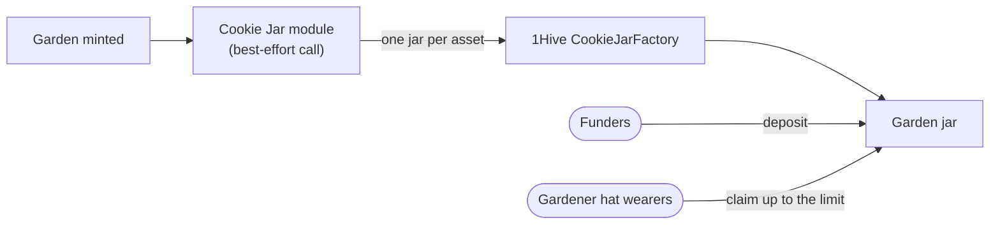

import {IntegrationProjection} from "@site/src/components/docs";

# Cookie Jar

Cookie Jars let a garden's community hand out small, capped allowances without a proposal for
every withdrawal. Where vaults hold an endowment, a jar holds spending money; it's the difference
between a treasury and a kitchen tin everyone trusts each other to dip into.

The jars come from [1Hive's Cookie Jar](https://github.com/1Hive/cookie-jar) protocol. When a
garden is minted, the mint asks the Green Goods Cookie Jar module to deploy one jar per supported
asset through 1Hive's `CookieJarFactory`. That call is best-effort: with no module configured it
is skipped, and a failing factory call is caught so the garden still mints. A garden can therefore
exist with no jars, so read them from the module (`getGardenJars`) and handle an empty list rather
than assuming an address per asset. Only people wearing the garden's gardener [hat](./hats) can
claim: the module configures each jar with an empty allowlist and ERC-1155 gating on that hat, so
the jar checks the hat directly. Each asset also has its own per-claim limit.

## Two kinds of jar

The same 1Hive contracts back two separate surfaces, and they do not share a data path:

- **Garden jars** are the ones this page describes: created by the module at mint, owned by the
  garden, gated by the gardener hat, claimed from the installed app's wallet, and funded from the
  admin Hub or a garden's public funding card. Apps read them straight from the module.
- **Campaign jars** are seasonal jars deployed through the factory directly, with an allowlist of
  claimants. The apps show only the ones whose creator the deployment registry trusts (its owner
  and its allowlist). The indexer follows the factory, and the public
  [Cookies page](https://greengoods.app/cookies) and the admin Cookies workspace read those indexed
  records. Nothing about a campaign jar's allowlist applies to a garden jar.

## How it flows

Garden jars are created with the garden when the module call lands, filled by funders, and emptied
a little at a time by the people doing the work.

<figure className="gg-figure">
  
  <figcaption>The public Cookies page is the campaign-jar surface: seasonal jars with an allowlist. Garden jars are claimed in the installed app instead.</figcaption>
</figure>

## Where it lives in the code

| Layer | Source |
|---|---|
| Module | `packages/contracts/src/modules/CookieJar.sol` |
| Factory interface | `packages/contracts/src/interfaces/ICookieJarFactory.sol` |
| Mint-time call | `packages/contracts/src/tokens/Garden.sol`, through `notifyCookieJar` in `packages/contracts/src/lib/GardenHooks.sol`, which skips a missing module and catches a failed call |
| Garden jar reads | `packages/shared/src/hooks/cookie-jar/useGardenCookieJars.ts`, `useAccessibleCookieJars.ts`, and `useUserCookieJars.ts`, which call `CookieJarModule.getGardenJars` |
| Garden jar writes | `useCookieJarDeposit.ts`, `useCookieJarWithdraw.ts`, and `useCookieJarAdmin.ts` in the same folder |
| Campaign jar reads | `packages/shared/src/modules/data/campaign-cookie-jars.ts` (indexed `CampaignCookieJar` records from trusted creators) with `useCampaignCookieJar.ts` and `useCampaignCookieJarCampaigns.ts` |

The jars themselves are 1Hive's contracts. The module above is the Green Goods side that creates
and configures a garden's jars; campaign jars never pass through it.

<IntegrationProjection id="cookie-jar" />

## Working with it locally

The [fork mode](../getting-started#other-modes) (`bun run dev -- fork`) runs a local fork of
Arbitrum One with the factory and module present, so jar creation and claim flows run locally
without real funds.

## Canonical upstream docs

- [1Hive Cookie Jar](https://github.com/1Hive/cookie-jar) is the upstream protocol behind every
  jar.
- [1hive.org](https://1hive.org) for the community that maintains the protocol.
- [ERC-1155](https://eips.ethereum.org/EIPS/eip-1155), the multi-token standard behind a jar's
  membership gating.

## Next steps

- [Hats Protocol](/builders/integrations/hats) explains the gardener hat that decides who can claim.
- [Octant](/builders/integrations/octant) covers the vault's endowment, the long-term money next to a jar's spending money.
- [`CookieJar.sol`](https://github.com/greenpill-dev-guild/green-goods/blob/develop/packages/contracts/src/modules/CookieJar.sol)
  shows how the module sets up a garden's jars.
- The public [Cookies page](https://greengoods.app/cookies) shows campaign jars in the product.
