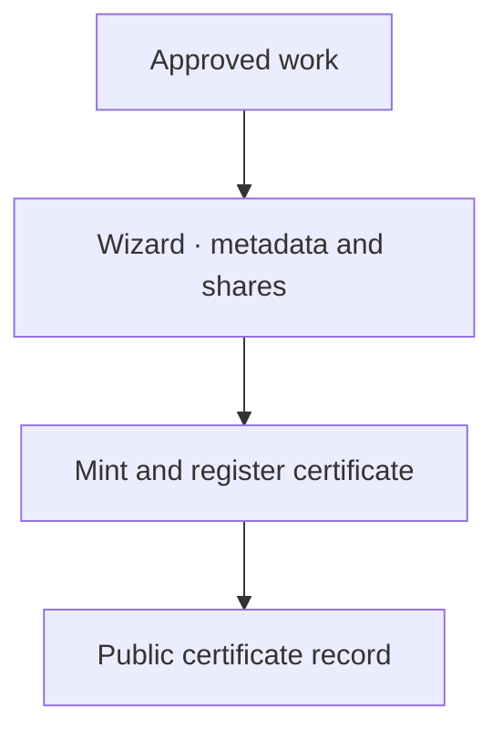

import {IntegrationProjection} from "@site/src/components/docs";

# Hypercerts

[Hypercerts](https://hypercerts.org) represent an impact claim with ownable fractions. The admin
wizard starts from approved work and records each contributor's share. Claiming and buying those
shares inside Green Goods remain unavailable; the [steward guide](/community/steward-guide/creating-impact-certificates)
explains the current limits. This wizard does not select or certify a commitment-pool cycle.

## How it flows

In the admin wizard a certificate starts from work that's already approved, so a claim minted
there traces back to real records. The contract does not enforce that rule: `registerHypercert`
checks operator authority, pause state, and that the claim is minted, and
`createAllowlistAndRegister` takes a metadata URI with no Work or Work Approval UID, so an operator
calling the module directly can register any minted claim. Treat approved work as the
application's constraint, not the contract's.

  <figure className="gg-figure">
    
    <figcaption>Anyone can read certificates and their supporting records on the Impact page.</figcaption>
  </figure>

## Where it lives in the code

| Layer | Source |
|---|---|
| Module | `packages/contracts/src/modules/Hypercerts.sol` |
| Data access | `packages/shared/src/modules/data/hypercerts*.ts` (fetch, metadata, repository, attestations) |
| Hooks | `packages/shared/src/hooks/hypercerts` |

The steward-facing flow lives in the community docs'
[minting guide](/community/steward-guide/creating-impact-certificates); these sources are the
machinery under it.

<IntegrationProjection id="hypercerts" />

## Working with it locally

The [fork mode](../getting-started#other-modes) (`bun run dev -- fork`) runs a local fork of
Arbitrum One with the minter and exchange contracts present, so mint flows run locally without
real funds.

## Canonical upstream docs

- [hypercerts.org](https://hypercerts.org) for the standard and its ecosystem.
- [The Hypercerts docs](https://hypercerts.org/docs) for minting, metadata, and fraction
  mechanics.
- [app.hypercerts.org](https://app.hypercerts.org) to browse minted hypercerts and their
  fractions.

## Next steps

- [Anatomy of a Work Submission](/builders/architecture/anatomy) shows the approved work a hypercert bundles.
- [Octant](/builders/integrations/octant) covers the vaults that fund gardens.
- [Karma GAP](/builders/integrations/karma) reports the same progress to grant programs.
