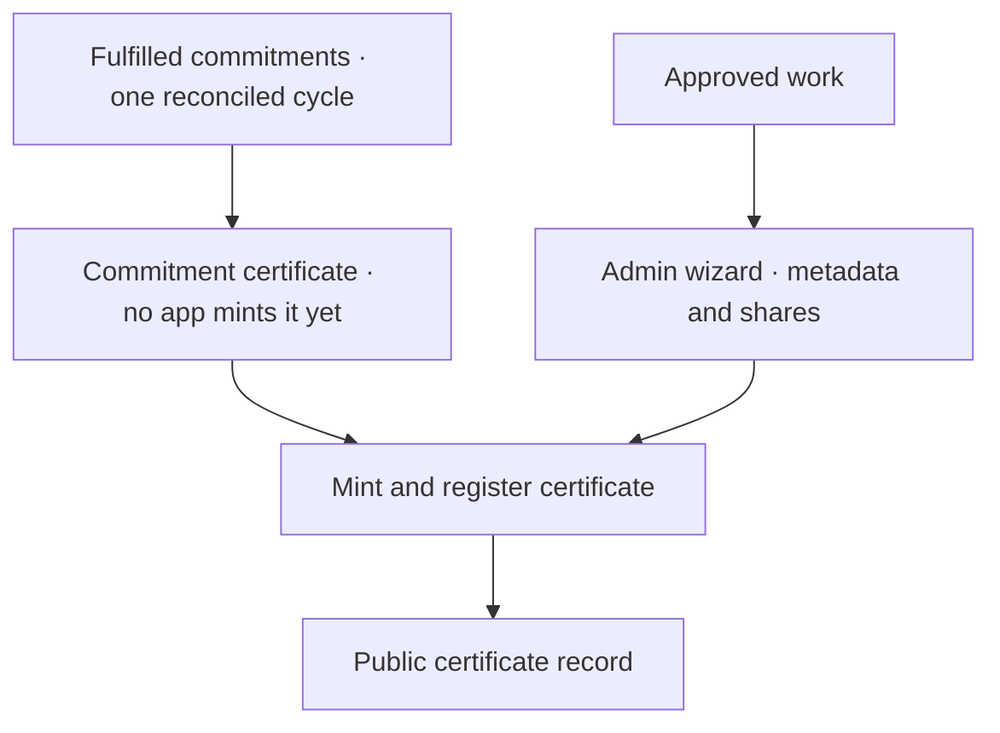

import {IntegrationProjection} from "@site/src/components/docs";

# Hypercerts

[Hypercerts](https://hypercerts.org) represent an impact claim with ownable fractions. Green Goods
reads two kinds, told apart by the `bundleKind` its metadata carries. A commitment certificate
(`COMMITMENT`) is built from the fulfilled commitments of one reconciled season or campaign, with
the approved work inside them kept as evidence; the indexer reads this kind, but no app path
mints it yet. The admin wizard mints the older kind (`WORK_LEGACY`), which bundles approved work
directly and records each contributor's share. Claiming and buying shares inside Green Goods
remain unavailable; the [steward guide](/community/steward-guide/creating-impact-certificates)
explains the current limits.

## How a commitment certificate shares recognition

A commitment certificate divides its units in a fixed order, so anyone can recompute the result
from the chain.

1. The cycle's six-role split, fixed when the season or campaign opened, sets each class's units:
   gardeners, treasury, steward, evaluator, community and funder.
2. The gardeners' units divide equally across the cycle's fulfilled commitments, not by how much
   work each one needed.
3. Within each commitment, the eligible contributors are the members of its frozen team with at
   least one counted work approval or evidence credit. They share that commitment's budget by the
   cycle's recognition policy: a part split equally for taking part and the rest by verified
   contribution. The protocol default is 20% and 80%, and stewards may choose another policy when
   the cycle opens. Recognition and payment are separate: these weights never move money.
4. Each share becomes whole units, with remainders assigned in a deterministic order, so the
   total always matches the budget.

The indexer expands a certificate only when every bundled commitment is fulfilled, has its team
frozen and belongs to the same cycle, so a commitment without a cycle cannot join one. The
designed composer also requires that cycle to be reconciled, which is why
[End a Season](/community/steward-guide/end-a-season) keeps a season **Reconciled** until a
garden decides about certification. Nothing gives a share to the lead by default: a commitment
cannot become ready for confirmation without at least one counted contribution. The indexer
records the result per certificate as `HypercertCommitmentContributorAllocation` rows, so a
second certificate that includes the same commitment gets its own units without changing the
first.

## How the work certificate flows

In the admin wizard a certificate starts from work that's already approved, so a claim minted
there traces back to real records. The contract does not enforce that rule: `registerHypercert`
checks operator authority, pause state, and that the claim is minted, and
`createAllowlistAndRegister` takes a metadata URI with no Work or Work Approval UID, so an operator
calling the module directly can register any minted claim. Treat approved work as the
application's constraint, not the contract's.

  <figure className="gg-figure">
    
    <figcaption>Anyone can read certificates and their supporting records on the Impact page.</figcaption>
  </figure>

## Where it lives in the code

| Layer | Source |
|---|---|
| Module | `packages/contracts/src/modules/Hypercerts.sol` |
| Data access | `packages/shared/src/modules/data/hypercerts*.ts` (fetch, metadata, repository, attestations) |
| Hooks | `packages/shared/src/hooks/hypercerts` |
| Commitment certificate read model | `packages/indexer/src/handlers/hypercert-allocations.ts` and the `Hypercert.bundleKind` field in `packages/indexer/schema.graphql` |

The steward-facing flow lives in the community docs'
[minting guide](/community/steward-guide/creating-impact-certificates); these sources are the
machinery under it.

<IntegrationProjection id="hypercerts" />

## Working with it locally

The [fork mode](../getting-started#other-modes) (`bun run dev -- fork`) runs a local fork of
Arbitrum One with the minter and exchange contracts present, so mint flows run locally without
real funds.

## Canonical upstream docs

- [hypercerts.org](https://hypercerts.org) for the standard and its ecosystem.
- [The Hypercerts docs](https://hypercerts.org/docs) for minting, metadata, and fraction
  mechanics.
- [app.hypercerts.org](https://app.hypercerts.org) to browse minted hypercerts and their
  fractions.

## Next steps

- [Anatomy of a Work Submission](/builders/architecture/anatomy) shows the approved work both certificate kinds draw on.
- [Architecture](/builders/architecture#commitment-pooling-settlement-and-pilots) separates recognition from settlement payouts.
- [Octant](/builders/integrations/octant) covers the vaults that fund gardens.
- [Karma GAP](/builders/integrations/karma) reports the same progress to grant programs.
