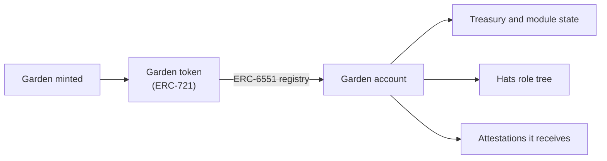

import {IntegrationProjection} from "@site/src/components/docs";

# Tokenbound Accounts

[ERC-6551](https://eips.ethereum.org/EIPS/eip-6551) token-bound accounts are why a Green Goods
garden is more than a database row: each garden is an ERC-721 token whose bound account is the
garden on-chain. That account holds the treasury, wears the [Hats](./hats) role tree, and receives
the garden's [attestations](./eas). Transferring the token hands over the account, assets and
history included, as long as transfers are open: the GardenToken contract can limit them to the
protocol's admin or lock them entirely (`transferRestriction`). It does not hand over the roles.
The owner hat is granted to the minter at mint and the transfer hook only enforces the
restriction, so after a transfer the previous owner still holds their hats, and the new holder is
not an owner to `isOwner` until the hats are rotated. Rotation is not symmetric. Granting the owner
hat also grants the steward and gardener hats beneath it, but a revoke removes only the hat it
names. Take the owner hat alone from the previous owner and they remain a steward, who can still
approve work and change roles, so revoke every hat they hold. The new holder can do this through
the account itself, which the Hats module accepts as a caller. Either way, no app of ours has to
exist for a garden to keep being real.

## How it flows

Minting a garden creates the token and its account together. From then on, the account is the
garden.

## Where it lives in the code

| Layer | Source |
|---|---|
| Garden token | `packages/contracts/src/tokens/Garden.sol` |
| Garden account and action routing | `packages/contracts/src/accounts/` |
| Account addresses per chain | The `accountProxy` and `gardenAccountImpl` fields, projected below and in the [deployment record](/builders/reference/deployments) |

One consequence for consumers: the indexer's `Garden.id` is the garden account address, which is
why it stays a bare address rather than a composite id (a documented exception in the
[indexer package](../packages/indexer)).

<IntegrationProjection id="tokenbound" />

## Working with it locally

The [fork mode](../getting-started#other-modes) (`bun run dev -- fork`) runs a local fork of
Arbitrum One, so every live garden account exists locally; creating a new garden on the fork
exercises the full token-plus-account flow without real gas.

## Canonical upstream docs

- [EIP-6551](https://eips.ethereum.org/EIPS/eip-6551), the standard itself; short and worth
  reading in full.
- [Tokenbound documentation](https://docs.tokenbound.org) for the reference implementation the
  ecosystem builds against.
- [The ERC-6551 reference implementation](https://github.com/erc6551/reference), the registry
  and account the garden account builds on.
- [tokenbound.org](https://tokenbound.org) for the SDK and the wider ecosystem.

## Next steps

- [Hats Protocol](/builders/integrations/hats) covers the role tree each garden account wears.
- [EAS](/builders/integrations/eas) shows the attestations a garden account receives.
- [Architecture](/builders/architecture#a-garden-is-an-account) explains why a garden is an account at all.
