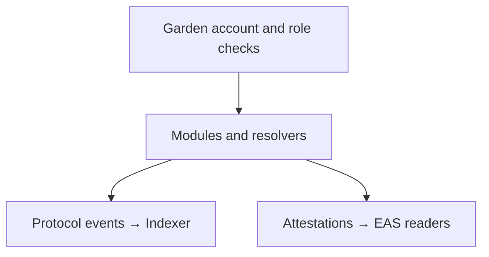

# Contracts

`packages/contracts` is the Solidity protocol, built with [Foundry](https://getfoundry.sh). It
owns everything the chain enforces: garden accounts, authorization, attestation schemas and their
resolvers, and the deployment artifacts that record what exists where. The
[Deployments & Addresses](/builders/reference/deployments) page is the generated view of those
artifacts.



## Inside the package

Solidity lives under `src/`, grouped by what it is to the protocol; the TypeScript around it
lives beside it. Deploys, upgrades, and verifications run through the CLI in `script/cli/`, tests
sit in `test/` by area, and `deployments/` records the outcome.

| Directory | What lives there |
|---|---|
| `src/accounts/` | Garden token-bound accounts, action routing, the Celo relay and coordinator, and the steward-role publisher and Safe receiver that keep a garden's Gnosis steward Safe in step with its stewards for the voucher pilot |
| `src/resolvers/` | The EAS resolvers for work, approval, assessment, and testimony, and beside them the yield resolver, which is not an EAS resolver: it is the Octant accountant that distributes vault yield |
| `src/modules/` | The modules the protocol wires per chain: Hats, which every mint requires, the other integrations (Karma, Octant, Gardens, Cookie Jar, Hypercerts, Unlock), the pooling and settlement control planes with the Celo settlement executor, and the voucher pilot's endpoints, entitlement, redemption and Gnosis adapter and escrow modules |
| `src/registries/` | Action, commitment, credit, deployment, ENS, power, GreenWill, and a same-chain CCIP router for testnet deployments. The credit registry backs Commitment Credit, which no app offers |
| `src/tokens/` | The Garden and Goods tokens |
| `src/lib/` | The pooling and settlement libraries the modules link against at deploy time (`CommitmentPooling/`, `Settlement/`), the garden mint hooks, and shared helpers for Hats, Karma, strings, and token-bound accounts |
| `src/libraries/` | Garden Safe execution and its action codec, the Celo garden account ledger, the settlement message codec, and the steward-role and voucher codecs |
| `src/interfaces/` | The interfaces every contract speaks |
| `src/markets/` and `src/strategies/` | Hypercert marketplace adapters and their strategies |
| `src/vendor/` and `src/mocks/` | Vendored partner contracts (Gardens, Octant) and the test doubles |
| `src/Schemas.sol` and `src/CommonErrors.sol` | EAS schema definitions and the shared error set |
| `script/` | The TypeScript operations: deploy, upgrade, verify, and the CLI that fronts them |
| `test/` | Foundry suites by area, plus the script tests Vitest runs |
| `config/`, `abis/`, `deployments/` | Schema and migration config, exported ABIs, and the per-chain artifacts that are the canonical record of what is deployed |

## Run and test

```bash
bun run --cwd packages/contracts build
bun run --cwd packages/contracts test
```

For one behavior, the match profile is the fast loop. Add a target build when the compiled surface
moves. These examples use real files; swap in your own:

```bash
bun run --cwd packages/contracts test --suite solidity --profile match test/E2EWorkflow.t.sol
bun run --cwd packages/contracts build --mode target src/resolvers/Work.sol
```

The full audit suite is `bun run --cwd packages/contracts test:audit full`. The
[contract operations](./contract-operations) page lists every deploy, upgrade, and verification
command.

## How it connects

Contracts sit at the top of the dependency arrow. Their events feed the
[indexer](./indexer)'s read models, their ABIs and addresses reach the apps through
[shared](./shared), and their EAS schemas give the [attestation layer](../integrations/eas) its
meaning. The [Architecture page](../architecture) shows the whole loop.

## Conventions that will bite you

- Deploys, upgrades, and migrations go through the contracts CLI, never raw `forge` commands.
  `bun run contracts -- help` lists every operation. Each run names its network and mode, and
  broadcasting needs release authorization. The [contract operations](./contract-operations) page
  has the full list.
- A deployment artifact records that something was deployed, not that it is live and healthy.
  Never present an address as an active feature without separate evidence. Two current
  examples: the voucher pilot's records in
  `deployments/100-pilot-downstream.json` and `deployments/42161-pilot-downstream.json` mark its
  endpoints paused with activation pending, and the credit registry has no app surface. The
  [Architecture page](../architecture#commitment-pooling-settlement-and-pilots) keeps their
  states apart.
- Storage-layout, contract-size, and fork checks are selected by the root validation pipeline for
  risky changes; when selected, they all have to pass.
- Shared Solidity helpers live in `src/lib/` (EAS, strings, token-bound accounts); reach for them
  before writing new ones.

## Go deeper

- [`packages/contracts/AGENTS.md`](https://github.com/greenpill-dev-guild/green-goods/blob/develop/packages/contracts/AGENTS.md)
  is the full package contract, deployment lanes included.
- [Deployments & Addresses](/builders/reference/deployments) for every recorded address per chain.
- [Data Model & Ontology](../architecture/data-model) for how contract records relate.
