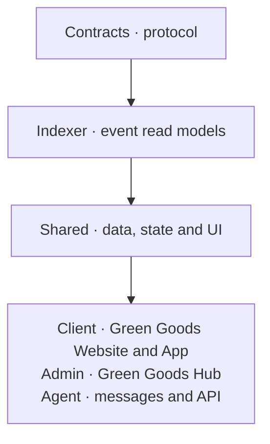

# Monorepo Map

Seven packages, one rule: find the owner before you change anything. Each package has its own page
with a map of its `src` folders, its commands, and the conventions that actually bite.

## The packages

| Package | What it owns | Runs as | Start here when you change |
|---|---|---|---|
| [`contracts`](/builders/packages/contracts) | The Solidity protocol: garden accounts, authorization, attestation schemas and resolvers, deployment artifacts | Arbitrum One and the other [recorded networks](/builders/reference/deployments) | Protocol behavior, authorization, attestation schemas, deployments |
| [`indexer`](/builders/packages/indexer) | Envio handlers that project contract events into GraphQL read models | Envio's hosted service | Event-derived read models or GraphQL shapes |
| [`shared`](/builders/packages/shared) | Cross-app hooks, providers, stores, protocol modules, domain types, translations, UI foundations | Inside every app bundle | A hook, provider, store, shared UI primitive, or translation |
| [`agent`](/builders/packages/agent) | Messaging bots and the public HTTP API | A hosted service | Bots, webhooks, or the public HTTP API |
| [`qa`](/builders/packages/qa) | The team's two-writer QA checklist app | [qa.greengoods.app](https://qa.greengoods.app) | The QA checklist app |
| [`admin`](/builders/packages/admin) | The Green Goods Hub, where stewards run their gardens | [admin.greengoods.app](https://admin.greengoods.app) | The Green Goods Hub |
| [`client`](/builders/packages/client) | The Green Goods Website and the installed, offline-first Green Goods App | [greengoods.app](https://greengoods.app) | The Website or the App |

Dependencies point one way: `contracts → indexer → shared → client / admin / agent`. Contracts
emit the events the indexer projects into read models, shared wraps both for the apps, and nothing
points back. The agent is the one exception on the read side: its reporting services
(`packages/agent/src/services/reporting/`) query the indexer directly rather than through shared,
which is why the Architecture diagram draws `indexer → agent`. That is the data flow; in package
terms the indexer imports nothing, and shared's indexer types are generated from the indexer's
schema. If your change crosses that arrow, validate
from the repo root rather than inside one package.

## Browser support {#browser-support}

The Green Goods App, Website and Hub support Chrome and Edge 111, Safari 16.4 on macOS and iOS, and
Firefox 128, and anything newer. In phone terms that is Android 7 or newer with Chrome updated, and
iPhone 8 or newer. Code in `client`, `admin` and `shared` may use any feature these browsers have.
A feature that arrived later needs a fallback, or it must only decorate.

Two files own the line:

- [`scripts/lib/browser-support.mjs`](https://github.com/greenpill-dev-guild/green-goods/blob/develop/scripts/lib/browser-support.mjs)
  names it as `SUPPORTED_BROWSER_TARGETS`. Both Vite configs build JavaScript and CSS for that
  list, and so does the client's service worker build.
- [`scripts/lib/browser-minimum-gate.js`](https://github.com/greenpill-dev-guild/green-goods/blob/develop/scripts/lib/browser-minimum-gate.js)
  checks the same line in the browser. It runs before the app's bundle, with one feature check per
  engine's minimum and no user-agent reading. Below the line, the App, the Hub and the reporting
  pages show an update screen in English, Spanish or Portuguese, and the app does not start; the
  Website stays open. The screen sends one `browser_update_screen_shown` event per browser to the
  surface's PostHog project, and counts the browser only once PostHog has taken it. The event
  carries no identifier of its own, no page path and no person profile; PostHog still sees the
  request's IP address, as it does for the apps' own analytics.

Moving the minimum means changing both files in the same pull request. The gate is plain ES5,
because it runs on the browsers it turns away; `packages/client/src/__tests__/browserMinimumGate.test.ts`
fails on newer syntax, and the `browser-minimum` Playwright specs check the screen in Chromium with
the minimum's features taken away.

## Generated references

- [API Index](/builders/packages/api-index): every declared package export, and every public route
  the agent registers with its methods, generated from the code.
- [Command inventory](/builders/packages/commands): every repository command, root first, generated
  from the package manifests.
- [Contract operations](/builders/packages/contract-operations): every deploy, upgrade, and
  verification command, grouped by task.

## Next steps

- [Architecture](/builders/architecture) shows how the packages work together on one submission.
- [Getting Started](/builders/getting-started) gets them running on your machine.
- [First Contribution](/builders/how-to-contribute) walks you from a task to a merged pull request.
