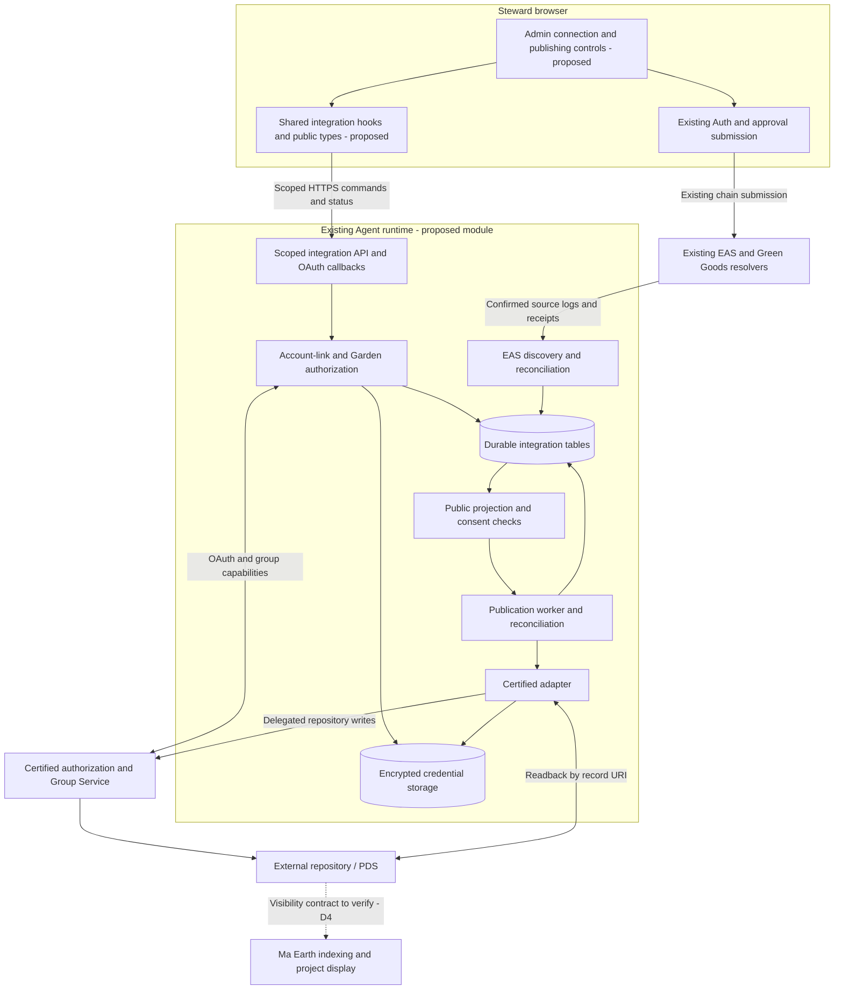
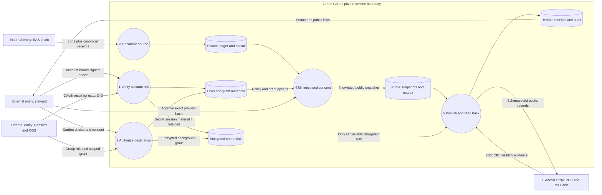
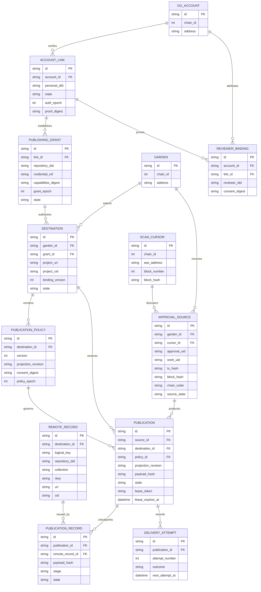
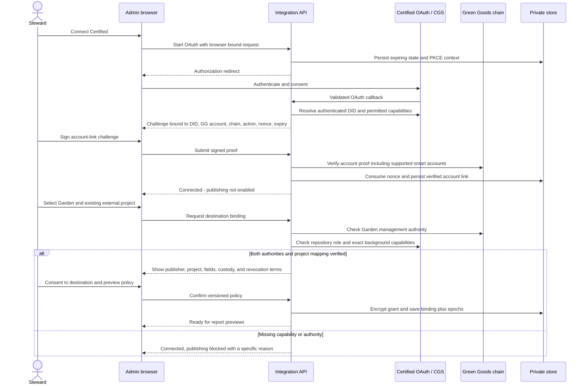
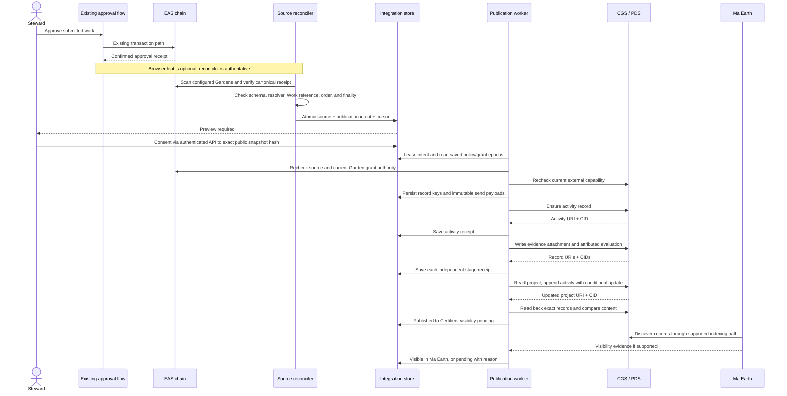
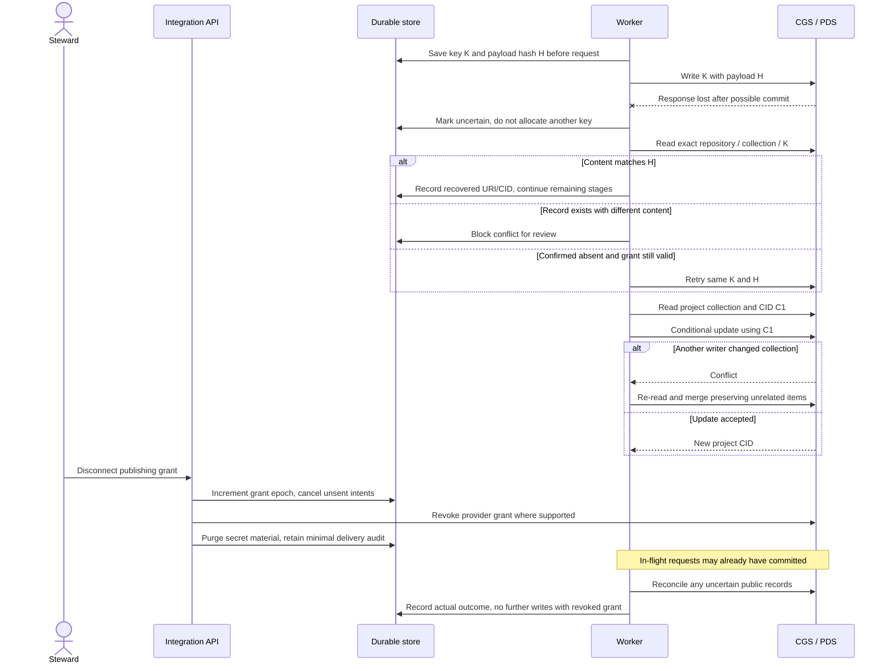
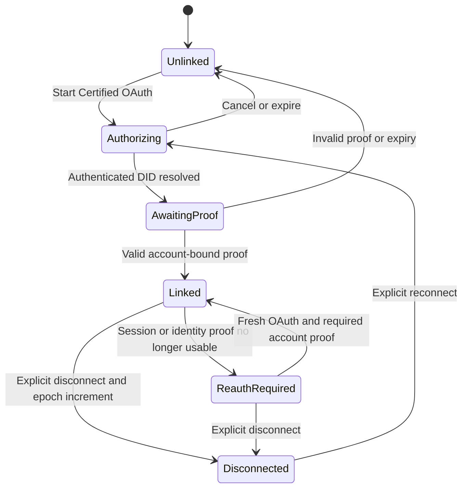
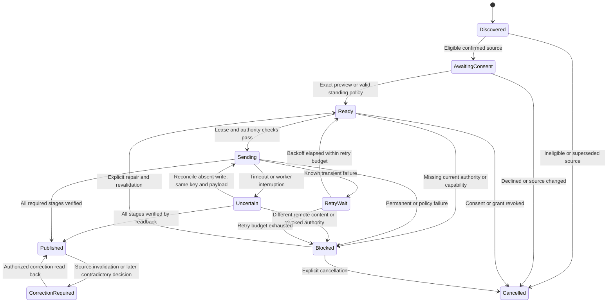
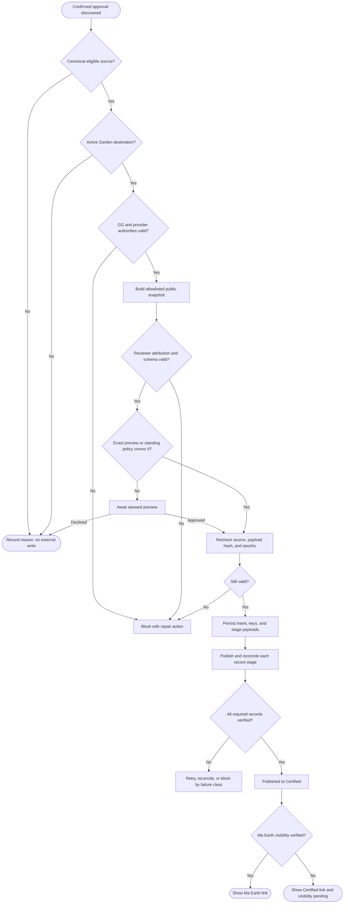
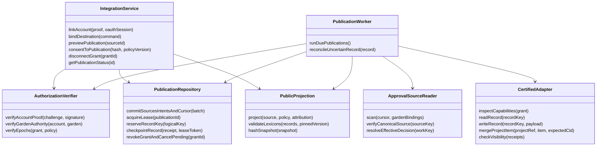

# Certified and Ma Earth approval publishing

**Proposed architecture, 2026-10-15. No integration is implemented by this document.**
The first delivery connects a steward's existing Certified identity, binds an existing external
project to a Green Goods Garden, and publishes confirmed work approvals with their approved public
evidence. Certified repository publication and Ma Earth visibility are separate outcomes.

This revision replaces the July browser-only proposal in [PR #640](https://github.com/greenpill-dev-guild/green-goods/pull/640).
The historical URL is retained. The [topology decision](./certified-atproto-topology-memo-2026-07.md)
compares the alternatives. The PR's backlog Plan Hub owns implementation sequencing; this page
owns the proposed architecture. Code owns existing behavior. All diagrams below are proposed
unless their nodes explicitly say **existing**. Dependencies D1–D9 remain unresolved.

The [ontology and user-action crosswalk](./impact-integration-action-map.md) extends this design
with GainForest/Bumicerts and all nine requested Garden lifecycle actions. It adds five diagrams,
the distinction between shared repository records and application visibility, and later gates
G1–G5/A1–A4. The first implementation remains account linking and approval publication.

## 1. Product boundary and vocabulary

The pilot experience is: **Connect Certified → choose a Garden's external project → approve
work → preview and publish the public report → see its publication result.**
An approval remains successful in Green Goods even when an external platform is unavailable.
The first pilot requires a preview for each report. Standing automatic publishing follows only
after the correction and consent policy has been proven.

| Concept | Meaning and authority |
|---|---|
| Green Goods account | Chain-scoped EVM identity used by existing wallet, passkey, or embedded auth |
| Steward | Product role; the approval resolver enforces operator authorization |
| Account link | Verified association between one Green Goods account and an external personal DID |
| Garden destination | A chain/Garden binding to a repository DID and an existing project collection URI |
| Publishing grant | Revocable authority to write to that repository; separate from account linking |
| Publication policy | Explicit consent to publish a bounded public projection, versioned independently of a grant |
| Approval source | Canonically confirmed EAS WorkApproval, its referenced Work, and source-chain coordinates |
| Activity | The external description of the work; approval is represented separately |
| Evaluation | An attributed Green Goods steward review, never a claim of independent certification |
| Publication | Durable delivery of a specific source decision to a specific destination |
| Visibility | Evidence that Ma Earth discovers and displays the records in the intended project |

Account linking does not mint a Hypercert, issue credits, create a new Green Goods login mode,
or transfer DID custody. A person, a Garden, and a Certified group are different identities.
The first version supports one active Certified destination per Garden; a person can participate
in several Gardens. Multiple reviewers retain their own decisions rather than being collapsed
into an invented universal approval score.

## 2. Existing behavior and the integration seam

Reviewed against Green Goods `b9176994beddb74c1f32240a1829a7e2c3805896`:

| Existing authority | Finding | Design consequence |
|---|---|---|
| `packages/shared/src/modules/work/submit-approval-command.ts` | Direct wallet, queued, and batch paths exist | A browser queue callback cannot be the only publication trigger |
| `packages/shared/src/modules/work/wallet-submission/submit-approval.ts` | A submission can return a transaction hash without confirmed success | Optimistic UI and transaction submission are not publishing evidence |
| `packages/shared/src/modules/job-queue/approval-executor.ts` | Queue retries reconcile uncertain onchain submission | Preserve this safety; do not add an external request to its transaction retry loop |
| `packages/shared/src/modules/job-queue/process-job.ts` | Completion deletes the queued job and emits an in-process completion event | That event is a hint, not a durable server publication source |
| `packages/contracts/src/resolvers/WorkApproval.sol` | Enforces Garden/operator and review constraints; revocation is rejected | Later decisions are new attestations; do not invent mutable source approvals |
| Same resolver | Optional commitment module supplies `decisionSequence`; positive approvals may call Karma GAP with failure isolation | Do not require sequence availability, duplicate Karma delivery, or change contracts for this feature |
| `packages/shared/src/modules/work/work-list.ts` | Current reads select the latest timestamp and treat conflicting latest decisions as unknown | Publication must preserve that uncertainty; scan ordering is not permission to change approval semantics |
| `packages/indexer/AGENTS.md` | Envio excludes EAS | Keep EAS discovery in an integration-specific scanner using chain receipts/logs and existing EAS access patterns |
| `packages/agent/src/services/reporting/outbox.ts` | Durable, consent-aware conversation delivery already exists | Reuse proven persistence/encryption patterns, but keep impact publications separate from conversation replies |
| `packages/agent/src/api/routes/garden-join-request-auth.ts` | Signed request verification handles scoped claims and smart-account inputs | Reuse verification primitives after review; define a distinct integration authorization message |
| `packages/agent/src/api/http/auth.ts` | Existing API bearer authentication serves runtime callers | Never expose a bot API token to the browser or treat it as steward identity |

The selected seam is a durable **impact publication module inside the existing Agent runtime**.
It owns source reconciliation, consent checks, delivery, and receipts. Shared owns browser-facing
types, pure projections, and hooks. Admin owns the steward's controls. External protocol details
stay in one Certified adapter. There is no new service deployment, generic event bus, or adapter
framework in the first slice.

## 3. Architecture / component diagram

**Placement is proposed:** an `impact-publication` module in Shared for public contracts
and pure mapping, an `impact-publication` hook directory in Shared, and an
`impact-publication` service directory plus integration API routes in Agent for orchestration;
existing Admin account and Garden settings for controls. Confirm final filenames against the
owning package guides during each implementation slice. Runtime code must never depend on a Plan Hub.

## 4. Data flow diagram

The diagram distinguishes authority-bearing credentials from public report data. DFD stores are
logical boundaries; they do not require separate databases.

Only a sanitized projection crosses the publication boundary. Exclude contact details, private
notes, precise sensitive locations, secrets, and media without permission. A public IPFS URL can
still expose excluded content: never attach raw source metadata merely because it is already
reachable. Publish an allowlisted evidence snapshot and include only source references approved
under the policy. Provider errors and telemetry must redact credentials and private payloads.
Credential encryption, retention, recovery, and deletion rules are rollout gates, not assumptions.

## 5. ERD and identity constraints

This is a proposed logical model. Reuse the existing Agent database/migration infrastructure;
do not reuse conversation-delivery rows for external reports. Secret bytes belong in encrypted
storage, referenced by an opaque ID.

Required constraints and transactions:

1. Unique Green Goods account and Garden keys are `(chainId, normalizedAddress)`. Link uniqueness
   is `(accountId, personalDID)`. No implicit replacement when either browser account changes.
2. Source uniqueness is `(chainId, EAS address, approvalUID)`. Store schema UID, resolver, decoded
   decision, reviewer, Work reference, and chain coordinates with the source snapshot. Never use
   transaction hash alone: a batch can contain multiple attestations.
3. Publication uniqueness is `(destinationId, sourceId, projectionRevision)`. A new mapping revision
   requires explicit migration/consent; it must not silently republish history.
4. `REMOTE_RECORD` is unique on `(destinationId, logicalKey)` and on `(repositoryDID, collection, rkey)`.
   Activity records are shared across decisions about the same Work snapshot; evaluations are
   keyed by source decision. Join rows prevent duplicate activity creation during concurrent reviews.
5. Atomically commit source rows, eligible publication intents, and the scan cursor. Persist record
   keys, exact payload hash, consent/grant epochs, and retry state before network I/O. The ERD omits
   routine timestamps, nonce/session tables, and detailed snapshot fields for readability.
6. Lease acquisition and receipt updates use compare-and-swap. Serialize updates to each project
   collection; remote conditional writes are still required because other applications can edit it.

## 6. Sequence: link identity, then authorize a destination

The recommended OAuth boundary is a backend-for-frontend. Use maintained AT Protocol libraries
only after dependency approval, with PKCE, state, DPoP and authenticated DID resolution. Use
bounded sessions, secure cookies, origin/CSRF checks, nonce expiry and one-time use. Treat DID/PDS
discovery as untrusted network input and enforce safe URL resolution. Never accept a DID supplied
by the browser as proof of OAuth control. Retain personal refresh credentials only if the selected
flow needs them; a group-scoped background grant can have a separate lifecycle.

The link proves two account controls to Green Goods. It does **not** claim to be an
`app.certified.link.evm` record. The documented native EVM link supports EOA EIP-712 proof;
ERC-1271/6492 support remains an upstream dependency. Passkey account linking needs the existing
Green Goods smart-account verifier to pass replay and counterfactual-account tests (D2).

## 7. Sequence: approval to external publication

The preview interaction is drawn against the store to keep this sequence compact; all browser
access goes through the authenticated API. There is no browser-to-database access.

Scan only configured Garden sources, with bounded RPC ranges and a persisted overlap window.
Verify configured EAS/schema/resolver, successful canonical receipt, Work/Garden consistency, and
chain-specific finality. Use `(blockNumber, transactionIndex, logIndex)` for deterministic ordering;
the optional commitment `decisionSequence` is extra evidence, not a universal requirement.
Select an activation block during onboarding. Historical backfill is an explicit previewed action.

Approval decisions remain attributable to their reviewers. Current Work reads select the latest
`createdAt` bucket and treat conflicting decisions in that bucket as unknown. The proposed scanner
uses chain coordinates for reproducible ingestion, not to override that business rule. Preserve
each reviewer's source attribution and resolve effective Work status through the accepted domain
policy (D6); do not invent per-reviewer voting or silently resolve an unknown state. Before
dispatch, re-read effective source state. If a newer decision makes a queued positive report stale,
cancel it and require a new projection. Treat finality violations as source invalidation and
compensation work, never as successful retries of stale data.

## 8. Certified schema crosswalk

These shapes were checked against the `hypercerts-lexicon` **v1.5.1** tag on 2026-10-15.
They are a candidate baseline, not an approved dependency installation. Some reference pages
still identify v1.4.1; deployed service compatibility must pass D1.

| Green Goods meaning | Proposed external shape | Rules |
|---|---|---|
| Existing Garden project | `org.hypercerts.collection`, `type: project` | Select an existing URI; preserve all unrelated fields/items; items use `itemIdentifier: {uri, cid}` |
| Work snapshot | `org.hypercerts.claim.activity` | Required title, shortDescription, createdAt; preserve work dates separately; include only consented contributors and location |
| Evidence snapshot | `org.hypercerts.context.attachment` | Required title/createdAt; set subjects to activity/evaluation strong references; content is an array of typed URI/blob values |
| Steward decision | `org.hypercerts.context.evaluation` | Required evaluators/summary/createdAt; always set subject to activity URI **and CID**; state Green Goods review method and relationship |
| EAS provenance | Approved evidence/report content | Include chain/EAS/schema/source UIDs and decision provenance in an allowlisted report; do not invent extra protocol fields |
| Reviewer attribution | Verified account-to-DID binding | Name only verified, consenting evaluators; publishing under a group does not prove the named person signed the external record |

Do not map confidence `0–3` to an ecological outcome score. Preserve confidence, verification
method, and decision as evidence with their Green Goods meaning. Do not invent measurements,
rights, funding receipts, or carbon credits. Group publication of a reviewer-attributed evaluation
requires D5; if Ma Earth requires a personal-repository evaluation or additional signature, that
is a separately approved topology change, not an invisible fallback.

Record keys differ: v1.5.1 activity permits `any`; collection, evaluation and attachment use `tid`.
Allocate a schema-valid key once and persist it before sending. Do not put a hex source hash into
a TID-only key. Keep `createdAt` and payload bytes stable across retries. `REMOTE_RECORD` maps the
logical source key to the allocated external key; it is the idempotency authority.

An activity update changes its CID. Preserve each evaluation's reference to the version reviewed;
do not silently retarget old evaluations. The project collection can reference the current activity
version after a conditional merge. Its v1.5.1 item limit is 1,000: capacity must block with an
actionable reason; automatic nested-project sharding is out of scope.

## 9. Sequence: uncertain delivery, concurrent edits, and disconnect

An absent read is sufficient for retry only after the provider's read-after-write/consistency
contract is verified (D3). A local lock cannot prevent other clients overwriting a project.
Without supported remote compare-and-swap, automatic collection mutation stays blocked.
Disconnect cannot promise removal from a public replicated network. A separate authorized
correction/withdrawal workflow is required for records already published.

## 10. State machines

Account-link state is independent of destination readiness. Reauthentication does not automatically
restore a revoked Garden grant or accept a changed publishing policy.

Publication has its own durable lifecycle. `Blocked` carries a reason such as consent, attribution,
grant, schema, source, conflict, or project capacity. `Published` means all required record stages
were read back; Ma Earth visibility remains an independent status.

Per-record checkpoints are `planned → sending → verified`, with `uncertain` and `blocked` branches.
Resume only incomplete stages. A lease expiring during `sending` enters reconciliation rather
than issuing a fresh create. After disconnect, a readback may still verify an in-flight publication;
record that fact without re-enabling the grant. Visibility states are `pending`, `visible`,
`not_supported`, and `failed`; they never rewrite the Green Goods approval state.

Later evaluations do not inherently supersede earlier evaluations in the protocol. Correction
behavior must be demonstrated with Ma Earth (D6): keep the new source decision, update the earlier
published summary with an explicit correction where authorized, and preserve its old CID in the
audit. Do not assume a new negative evaluation hides an old positive one. Until the display
semantics are proven, contradictory decisions require operator review and broad automatic
publishing remains disabled.

## 11. Activity diagram: publication eligibility

This uses Mermaid flowchart notation for the activity and decision nodes.

## 12. Class / interface diagram

These are proposed TypeScript contracts, not a mandate to introduce classes or an inheritance
framework. Implement with the repository's existing functional patterns. Only the Certified
adapter exists in the first delivery; add other adapters after their contracts are known.

Public commands return structured states and repair actions, not raw provider exceptions. The
adapter classifies errors into authentication/capability, schema/content, conflict, rate limit,
transient, and uncertain outcomes. The repository owns leases and uniqueness; the worker owns
ordering and recovery; the projection owns public fields and lexicon mapping. No provider token
appears in Shared's public types, a browser queue payload, or a service-worker message.

## 13. Dependencies and decision gates

Owners below are roles to assign when execution starts, not commitments from external teams.
No live third-party OAuth, background write, or Ma Earth display test has been completed here.

| ID | Unresolved dependency / owner | Required evidence | Blocks |
|---|---|---|---|
| D1 | Certified schema and deployed API conformance / integration engineer + Certified | Exact approved package/tag and schema hashes; fixtures validate against deployed service; activity `any` vs other `tid` keys verified | Provider implementation and all writes |
| D2 | Third-party OAuth and account proof / auth maintainer + Certified | Registered client/redirects, tested PKCE/DPoP/session lifecycle, wallet/passkey/embedded proof matrix, replay and account-switch rejection | Verified linking |
| D3 | CGS background capabilities / Certified + backend maintainer | Existing group access, role/grant revocation, caller-supplied key behavior, read-after-write, conditional `putRecord`, scopes and imported-group behavior proven | Automatic publishing and safe retries |
| D4 | Ma Earth project discovery and visibility / product lead + Ma Earth | Correct existing repository/project binding, accepted record types, indexing route, actual project display and attributable result URL | Claiming Ma Earth integration complete |
| D5 | Evaluation authorship / product lead + Certified/Ma Earth | Acceptance of group-published Green Goods steward review; reviewer DID consent/proof and any required signature; clear affiliation label | Evaluation publication |
| D6 | Corrections and multi-reviewer interpretation / domain maintainer + Ma Earth | Positive-to-negative, duplicate, reorg, and later-review fixtures with demonstrated downstream correction display | Automatic rollout beyond supervised pilot |
| D7 | Runtime custody and operations / Agent maintainer | Durable DB on actual deployment, encrypted grant storage/rotation, backup/restore, worker singleton/leases, retention and deletion policy | Holding production grants and background writes |
| D8 | Public evidence policy / product and Garden steward | Approved field/media allowlist, sensitive-location rules, reviewer consent, exact preview, disconnect language, reconsent rules | Any public report |
| D9 | Existing group custody and recovery / Garden owner + Certified | Identify registered vs imported group, actual PDS controller, recovery process, grant owner and handoff expectations | Production destination activation |

CGS documents different custody for registered and imported accounts. A newly registered group
may leave the main PDS credentials and recovery key with CGS; a CGS owner role is not equivalent
to PDS custody. Full account-control transfer is not currently promised by the integration guide.
The MVP therefore selects an existing configured group/project. New group provisioning, migration,
and recovery transfers require a separate scope decision.

Recommended internal decisions for phase 0: use the existing Agent runtime; start with per-report
preview; allow one active destination per Garden; use chain-specific finality and explicit backfill;
block unverified reviewer attribution; retain minimal audit receipts after disconnect. Confirm these
before runtime changes. Optional platform signatures and native EVM link records are outside the
first release unless D4/D5 make them necessary.

## 14. Delivery phases and acceptance

| Phase | Deliverable | Exit evidence |
|---|---|---|
| 0 — Conformance and decisions | Resolve provider contract, authorship, custody, privacy, and runtime choices | D1–D9 evidence matrix with explicit pass/block results; test identities and projects agreed |
| 1 — Link and configure | Verified account link, read-only project discovery, Garden destination, disconnect | Correct account/DID displayed; unauthorized Garden denied; no publication enabled by linking alone |
| 2 — Preview and publish | Durable source discovery, public preview, explicit consent, Certified publication receipts | Direct, queued and batch approvals each produce one intended report; crash/retry tests do not duplicate records |
| 3 — Supervised Ma Earth pilot | Real project visibility, attribution, correction and recovery exercises | Actual Ma Earth display verified; positive-to-negative correction, disconnect during send, and lost-response recovery demonstrated |
| 4 — Standing automatic policy | Opt-in automation, monitoring, bounded retries, restore drills, staged rollout | D6–D8 satisfied; no silent loss or stale positive report; pause/revoke controls demonstrated |
| 5 — Evidence and other platforms | Separately scope a GainForest monitoring pilot, then selected Bloom, Silvi and Regen mappings | G1–G5 for GainForest; A1–A4 for broader source actions/provider mappings; each native contract verified before implementation |

Phase 1 may ship linking while publication remains visibly unavailable. Phase 2 may prove Certified
publishing while Ma Earth discovery is still blocked, but that is not a completed Ma Earth pilot.
There are no calendar estimates until the external conformance gates have owners and evidence.

GainForest adds sampling events, organism observations, typed measurements and acoustic evidence.
Use the [action crosswalk](./impact-integration-action-map.md) for its pinned schemas and native
project/site mapping. Ma Earth and Bumicerts may consume the same repository records: track each
application's visibility separately and do not duplicate activities merely to reach another view.
Shared login/infrastructure does not establish shared grants, supported records or indexing.
GainForest's native evaluator correction fields also do not establish Hypercerts supersession.

Garden creation, initial/delta assessment, cycle creation, commitment creation/fulfillment and
certificate minting are separately gated source actions. Work submission supplies evidence in
the first slice; Work Approval is its public trigger. The broader mapping is research, not
authorization to build a generic event platform or enable every trigger at once.

Bloom reporting should project into its actual community/action/report structure. Silvi should
receive protocol-valid site/tree/monitoring evidence, not a generic approval relabeled as a tree
event. Regen anchoring, attestation and credit issuance are distinct operations: a Green Goods
approval is not automatically a Regen verification or credit. These are later investigations;
no production write API or shared identity delegation is assumed for any of them.

## 15. Verification and operational acceptance

Implementation must protect: nonce replay rejection; account-switch isolation; unauthorized Garden
and repository denial; smart-account proof; stale grants; redaction of indirect media references;
duplicate scanner ranges; batch source extraction; restart at each record stage; remote timeout
after commit; concurrent collection edits; retry budget; source reorg; conflicting later review;
disconnect during send; and public status surviving browser closure.

Run focused behavioral tests in the owning packages and the validation selector's critical
overrides if existing auth/work/queue surfaces are touched. Prefer leaving those mutation paths
unchanged. Capture authenticated browser proof for account linking and signing; other display
surfaces accept the repository's labeled browser proof classes. Provider fixtures alone do not
prove live conformance or Ma Earth visibility.

Operational signals: oldest eligible source lag, oldest ready publication age, blocked reasons,
uncertain deliveries, repeated provider failures, expired grants, correction backlog, and Ma Earth
visibility lag. Show source approval and publication state separately. Operators can pause a
destination, inspect sanitized failure details, reconnect, or re-preview; they cannot override
source validity or consent with a force-send button. Restore tests must prove retained keys and
receipts prevent duplicate records after a worker/database restart.

## Sources and evidence boundary

- [Certified account and identity](https://docs.hypercerts.org/architecture/account-and-identity)
  and [CGS service reference](https://docs.hypercerts.org/reference/services/certified-group-service).
- [CGS integration guide](https://github.com/hypercerts-org/certified-group-service/blob/main/docs/integration-guide.md),
  read 2026-10-15; inspected content blob `c3497060` prefix. This moving source requires recheck in phase 0.
- Pinned candidate lexicons: [activity](https://github.com/hypercerts-org/hypercerts-lexicon/blob/v1.5.1/lexicons/org/hypercerts/claim/activity.json),
  [collection](https://github.com/hypercerts-org/hypercerts-lexicon/blob/v1.5.1/lexicons/org/hypercerts/collection.json),
  [evaluation](https://github.com/hypercerts-org/hypercerts-lexicon/blob/v1.5.1/lexicons/org/hypercerts/context/evaluation.json),
  and [attachment](https://github.com/hypercerts-org/hypercerts-lexicon/blob/v1.5.1/lexicons/org/hypercerts/context/attachment.json).
- [Evaluation semantics](https://docs.hypercerts.org/lexicons/hypercerts-lexicons/evaluation)
  and [EVM-link reference](https://docs.hypercerts.org/lexicons/certified-lexicons/evm-link).
- [GainForest schema research pin](https://github.com/GainForest/lexicons/tree/6c27c30211d5815458120ae7e2dac69aca2469ad)
  and [documented Ma Earth relationship](https://github.com/GainForest/gainforest-docs/blob/2cb3c43adb447b6e776a01484c9d86a10bcf674f/content/docs/ma-earth.mdx).
- [Ma Earth](https://maearth.com/about), [Bloom vision](https://bloomnetwork.earth/vision),
  [Silvi user guide](https://docs.silvi.earth/silvi-app-user-guide/getting-started),
  and [Regen data module](https://docs.regen.network/modules/data/).

These sources establish concepts and candidate interfaces. They do not establish deployed
interoperability, partner approval, or a live Green Goods integration.
