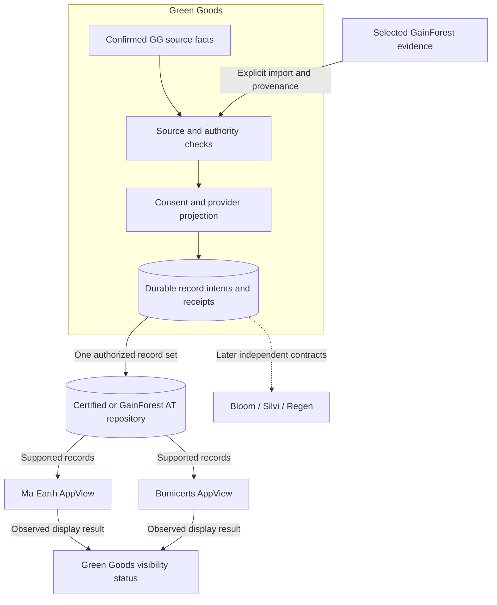
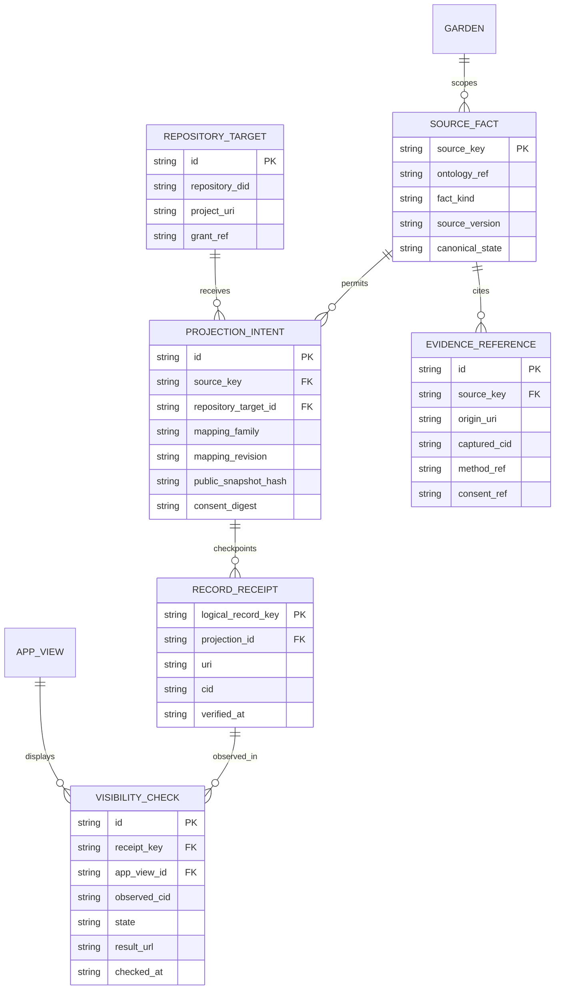
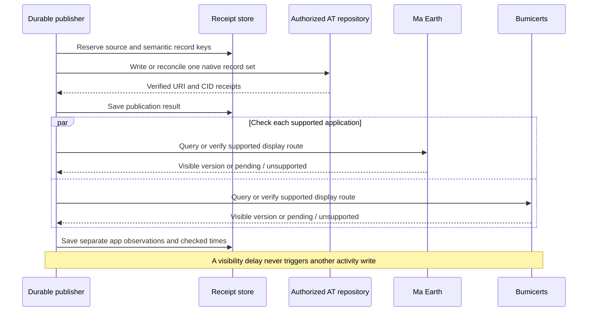
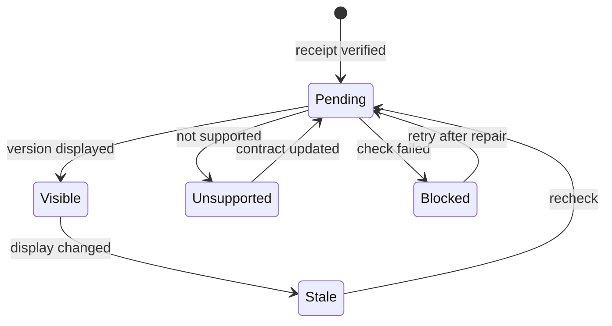
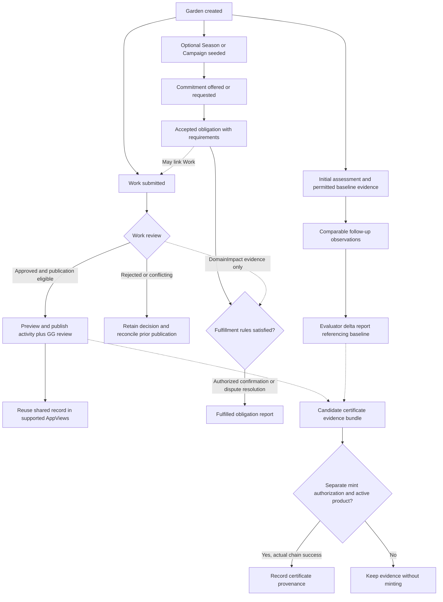

# Impact integrations across the Garden lifecycle

**Proposed mapping, 2026-10-15.** Green Goods owns coordination, source attestations and its
own review decisions. Certified supplies a candidate identity and publishing path; Ma Earth
and GainForest/Bumicerts may display shared records. GainForest adds biodiversity evidence;
Bloom offers community reporting; Silvi organizes methodology-specific asset claims; Regen
separates data anchoring, verifier attestations and credit issuance.

The first implementation remains **Certified account linking and explicit Work Approval
publication**. The [architecture](./certified-atproto-integration-spec-2026-07.md) owns that
delivery model and its ten diagrams. This crosswalk adds the wider action model, GainForest
research, five extension diagrams and gates G1–G5/A1–A4. It does not activate other triggers.
All external mappings below are proposals; public schemas establish possible shapes, not
production write access or application compatibility.

## 1. Domain language and current capability

Canonical ontology IDs appear in code formatting below. A user action is a command or a
lifecycle transition. The ontology entity `action` is a reusable template for regenerative
work; it is not the name for every UI action. A `commitment` is a promise, `work` is a performed
instance of an Action, and `work-approval` is a separate review of that Work.

The checked-in capability ledger reports Garden, Work, Work Approval and Assessment available.
It reports the commitment cycle/commitment product surfaces as deployed but unavailable and
the Hypercert product as in build. Commitment Pool availability is chain-specific: its ledger
records Arbitrum support and no Sepolia deployment. These are dated repository claims, not a
new live deployment check. Verify the selected chain and actual product route before enabling
any later trigger; contract code alone does not prove a usable product journey.

There is an unresolved ontology boundary: the `assessment` entity definition describes an
up-front baseline, while the Assessment v3 schema/resolver supports kinds 0, 1 and 2, including
the baseline-linked delta path for kind 1. Gate A1 must reconcile the baseline/delta terminology,
readers and validity policy before exporting assessments. This planning PR leaves canonical
ontology and generated documentation unchanged.

## 2. Nine actions, authoritative facts and publication eligibility

Publication follows a confirmed source fact and consent, never a button click, optimistic toast,
local queue completion, or unverified indexer row. Indexer reads can discover candidates for
indexed contracts; canonical receipts/state establish eligibility. EAS remains outside Envio.

| User action | Ontology and source of truth | Proposed trigger and guard | First delivery or later |
|---|---|---|---|
| Garden Creation | `garden`; Garden token/account and `GardenMinted` | Confirm chain/token/account, then offer an explicit binding to an existing external project. Garden creation does not prove external ownership or complete all Garden initialization. | Phase 1 can bind an existing Garden; automatic creation of external projects is deferred |
| Initial Assessment | `assessment` + `attestation`; EAS schema/version, recipient, author and config | After a valid baseline assessment, prepare a selected plan/report. Export actual baseline observations separately from targets and proposed Actions. Do not infer baseline kind from missing v2 fields. | Later; A1 |
| Commitment Season/Campaign Creation | `commitment-pool`, `commitment-cycle`, `season`, vocabulary `cycle-type`; `CycleSeeded` | Preserve pool ID, cycle ID, Season/Campaign type and timing. A seeded cycle is not open; opening has its own allocation snapshot. One open Season per pool; Campaigns may overlap. | Later; A2 |
| Commitment Creation | `commitment`; `CommitmentCreated` and current module state | Export a clearly labeled offer/request and requirements only after explicit consent. Preserve accountable lead, direction, scope, units and optional cycle. Creation is not acceptance, performance or fulfillment. | Later; A2 |
| Work Submission | `work`, `action`, `attestation`; confirmed Work UID | Build a private candidate for an activity and evidence. The first delivery waits for an eligible approval before public export. Any future unreviewed export must say unreviewed and use its own policy. | Source material in phase 2; independent submission publishing deferred |
| Work Approval | `work-approval`; confirmed WorkApproval UID plus its Work/action/Garden relationship | Reconcile effective decision, retain reviewer/method/confidence and exact source IDs, preview the public projection, then publish. A later rejection or conflict enters correction handling. | Phase 2 primary trigger |
| Commitment Fulfillment | `commitment`; module terminal state and confirmation/dispute provenance | Observe `CommitmentFulfilled` **and** `DisputeResolved` with final state Fulfilled. Verify source state and resolution path. Publish a fulfillment report referencing evidence; do not infer fulfillment from a single approved Work. | Later; A2 |
| Delta Assessment | `assessment`, v3 `baselineUID` and optional cycle association | Validate the baseline relationship and comparison method, preserve both assessment UIDs and observation versions, then publish evaluator report plus supported measurements. Difference in conditions is not by itself causal impact. | Later; A1/G3 |
| Certificate Minting | `hypercert`; actual minter state/receipt, Garden registration and metadata | Distinguish a newly created certificate from registration of an existing one. `HypercertMintedAndRegistered` is emitted on both paths. Retain chain/minter/type ID and validate included Work references independently. | Later; A3; observing a certificate does not authorize minting one |

Important source limits: the current Assessment resolver's `_validateBaseline` checks existence,
recognized schema and matching Garden; it does not by itself establish baseline kind, chronology,
non-revocation, non-expiry, cycle membership or scientific comparability. Those checks need an
accepted export policy. The Hypercert registration module checks minted state but does not
enforce the ontology's approved-Work bundle at that boundary. These are integration gates,
not proposed contract changes in this PR.

For Assessment v3, baseline authoring permits an evaluator or operator; the other kinds require
an evaluator. A Work reviewer, commitment confirmer, certificate operator and community data
authority are distinct roles. Linking their accounts must not collapse these authorizations.

For commitments, DomainImpact uses the Work/WorkApproval path; other archetypes may use
counterparty confirmation. Readiness, fulfillment, reconciliation and payout are separate facts.
The fulfillment reader must include dispute resolution so it neither misses legitimate terminal
states nor invents a payment when the pool/cycle is reconciled.

## 3. Proposed native representations

### Certified, Ma Earth and GainForest

The [Hypercerts inventory](https://docs.hypercerts.org/reference/lexicon-inventory) defines
projects as `org.hypercerts.collection` records with type `project`. Use the candidate v1.5.1
schemas from the main architecture, with deployed compatibility still gated by D1. "Report"
below means appropriately typed attachment/content, not a new invented provider collection.

| Action | Certified / Ma Earth candidate | GainForest / Bumicerts candidate and constraint |
|---|---|---|
| Garden Creation | Bind to an existing project collection; Garden and external project keep separate identities | Select the actual organization/project and site records used by the application. A `dwc.event.projectRef` names organization info, not automatically the Hypercerts collection URI |
| Initial Assessment | Baseline/strategy report attachment; feature for the observed subject and measurement records only for actual observations | Sampling `dwc.event`, organism `dwc.occurrence`, typed `dwc.measurement`; an assessment plan is not a field observation |
| Season/Campaign Creation | Optional nested collection or linked cycle report, with explicit parent project and cycle identity | Monitoring programme/event grouping only if the cycle actually represents a survey programme; a funding Campaign is not a sampling event |
| Commitment Creation | A labeled promise/requirements report linked to the project; no direct commitment contract equivalent is established | Optional project plan reference. Do not emit organism observations or performed activities for promises |
| Work Submission | Candidate `org.hypercerts.claim.activity` and `org.hypercerts.context.attachment`; publish after approval in the pilot | The activity can reference already authorized field observations, files or acoustic deployments. Work can have many observations; observation and Work identities remain separate |
| Work Approval | `org.hypercerts.context.evaluation` of the exact activity version, with explicit GG reviewer relationship | Reuse the shared review if supported by the AppView. A native `app.gainforest.evaluator.evaluation` needs its own evaluator/result contract; never translate GG confidence 0–3 mechanically into its 0–1000 confidence scale |
| Commitment Fulfillment | Fulfillment report linked to the commitment provenance and supporting activities/evaluations | Project progress report grounded in the fulfilled obligation, not automatic ecological verification, reward or funding receipt |
| Delta Assessment | Linked baseline/follow-up report, measurements and an attributed evaluation where appropriate | A new visit/event and new observation/measurement versions for the same subjects; preserve method, time, units, missing data and uncertainty |
| Certificate Minting | Reference to the verified EVM certificate and evidence bundle; an AT activity is not the EVM token | Optional certificate reference in project evidence; neither a species record nor a new token. No automatic GBIF publication or funding |

The specific GainForest organization/project bridge is a dependency. Its pinned organization
info and default-site records use the singleton key `self`; creating one per Garden in a shared
repository could overwrite organization identity. Its event/occurrence/measurement records use
TID keys. Do not copy the first provider's key or reference rules into another schema.

### Bloom, Silvi and Regen

These are semantic research candidates, not assertions of available write APIs. Bloom documents
community action, reporting and peer review; Silvi documents sites/assets, methodology-defined
claims and review/payout; Regen documents data anchoring separately from attestation and its
ecocredit module. Each provider needs an explicit account/authority mapping and conformance plan.
([Bloom](https://bloomnetwork.earth/vision), [Silvi](https://docs.silvi.earth/silvi-app-user-guide/getting-started),
[Regen](https://docs.regen.network/modules/data/))

| Action | Bloom candidate | Silvi candidate | Regen candidate |
|---|---|---|---|
| Garden Creation | Explicit community/project association; Garden is not automatically a Local Bloom | Existing approved project/site association; a Garden may contain several sites | Existing registry project reference only when methodology/governance fit; no automatic registry project creation |
| Initial Assessment | Context and intended outcomes in a community report | Site/asset baseline required by the selected methodology | Baseline evidence package and optional hash anchor; no truth claim from anchoring |
| Season/Campaign Creation | Bounded reporting initiative/window if supported | Methodology-defined monitoring window; not an assumed native GG cycle | Monitoring/reporting period metadata; not a credit batch |
| Commitment Creation | Offer of contribution or planned action if supported | Planned service obligation only if the project methodology represents it | Agreement/evidence reference; no credits for a promise |
| Work Submission | Draft/unreviewed contribution report | Candidate asset claim with required forms, dates and images | Evidence package; optional authorized anchor |
| Work Approval | GG peer-review provenance; Bloom retains its acceptance/reward decision | GG review as supporting evidence; Silvi retains claim acceptance and payment authority | Separate GG review evidence; Regen attestation requires its own signer and assertion |
| Commitment Fulfillment | Completed obligation/progress report; avoid recounting the same Work | Fulfillment summary referencing accepted claims; no inferred payout | Completion evidence; no automatic verification or issuance |
| Delta Assessment | Outcome report with method and uncertainty | Repeat asset monitoring under the selected methodology | Comparable monitoring evidence for the applicable registry process |
| Certificate Minting | Link to certificate provenance; no new reward claim | Optional evidence link; no equivalent Silvi mint operation established | Reference to a separate EVM certificate; Regen credit issuance remains a distinct governed process |

## 4. GainForest evidence contract

The earlier GainForest investigation identified a useful pilot: one community, one monitored
plot and recurring visits. Primary sources were rechecked here. The schema research pin is
[`GainForest/lexicons@6c27c302`](https://github.com/GainForest/lexicons/tree/6c27c30211d5815458120ae7e2dac69aca2469ad),
read 2026-10-15. This is a source revision, not a verified production deployment or approved dependency.

| Evidence | Required meaning and mapping constraint |
|---|---|
| Sampling visit | `dwc.event` requires event ID/date and creation time; protocol, effort, location and uncertainty should be required by the pilot method even when optional in the schema |
| Organism observation | `dwc.occurrence` requires basis of record, scientific name, event date and creation time. If identification is unknown, retain the raw evidence until an accepted uncertainty convention exists; never fabricate a species to satisfy validation |
| Measurement | `dwc.measurement` requires an occurrence AT-URI and typed result. Flora fields encode units, such as DBH in cm and height in m; generic entries need explicit unit/method policy. Preserve the source measurement and transformation |
| Acoustic evidence | `ac.deployment` records device/setup/time; `ac.audio` references deployment and optionally a species occurrence. Recording upload does not establish species identification |
| Spatial history | `organization.layerGroup` and its layers can organize repeated coverage of a monitored area; choose explicit site/feature identity and coordinate disclosure policy |
| Scientific or automated evaluation | GainForest evaluation supports typed results, method, confidence, `neg` and `supersedes`. Its subject CID is optional in the schema; this proposal requires a captured version for reproducible review. Automated identification stays separate from a steward's Work Approval |

Most biodiversity links (`eventRef`, `occurrenceRef`, `deploymentRef`, `projectRef`, `siteRef`)
are URI-only strings. The integration's provenance receipt should also save the resolved CID,
retrieval time and accepted source hash; do not send a Hypercerts strong-reference object where
the schema requires a string. Later source edits should mark dependent comparisons stale and
request review. GainForest's native correction fields do not prove equivalent correction display
in Ma Earth or automatic supersession of Hypercerts evaluations.

For example, two visits to the same 20 existing trees produce two observation rounds, not 40
new plantings. Tree identity, sampling effort, survival/missing status, units and method must
survive the mapping. A delta report may describe change only within that method's limits.

The [Bumicerts documentation](https://docs.gainforest.earth/gainforest.app-and-bumicerts/what-is-bumicerts)
supports projects with updates and linked evidence. The pinned documentation describes
[reviewed beta batch uploads](https://github.com/GainForest/gainforest-docs/blob/2cb3c43adb447b6e776a01484c9d86a10bcf674f/content/docs/evidence/batch-uploads.mdx),
and [AudioMoth capture without downstream acoustic analysis](https://github.com/GainForest/gainforest-docs/blob/2cb3c43adb447b6e776a01484c9d86a10bcf674f/content/docs/evidence/bioacoustic-sensors.mdx).
Use manual evidence links for the pilot when an automation contract is unproven. Do not design
an instant bulk-upload API or a scientific analysis service from those user workflows.

Publication policy must cover ecological coordinates, identifiable media, traditional knowledge,
license/reuse and community benefit terms. Technical OAuth authority is separate from community
permission; the [Data Council model](https://github.com/GainForest/gainforest-docs/blob/2cb3c43adb447b6e776a01484c9d86a10bcf674f/content/docs/organizations/data-council.mdx)
is a useful governance input. Optional Tainá or model-assisted processing needs its own consent
and provider decision; this plan does not authorize sending gardener evidence to a model.

## 5. Architecture extension: records and application visibility

GainForest documents [shared Ma Earth infrastructure and login](https://github.com/GainForest/gainforest-docs/blob/2cb3c43adb447b6e776a01484c9d86a10bcf674f/content/docs/ma-earth.mdx).
That makes record reuse plausible. It does not prove that a third-party grant, namespace or
record will work in both applications. Verify DID, repository, project identities and capabilities.
The native `app.gainforest.link.evm` and `app.certified.link.evm` namespaces are separate
contracts; shared login does not make their proofs interchangeable.

### Component and data-flow extension

Reuse a canonical activity/evaluation when both applications consume the same record in the same
repository. Do not create a second activity merely to mark another application visible. A distinct
GainForest observation is a different semantic projection and may need its own record/grant.
When repositories differ, record an explicitly consented copy with provenance and correction
responsibility; do not silently expand one destination into several repositories.

The current phase 1 design still allows one active repository/project destination per Garden.
Later program/cycle-specific routing requires explicit source-scope bindings and a default rule;
do not infer the destination from Garden names. Reconnecting or changing a binding must reuse
known remote records when identity and projection are unchanged, or request explicit migration.

### Extension ERD

This is a conceptual extension to the approval-specific ERD, not a new universal event store or
an addition to the canonical domain ontology. Implement only when an additional source type or
AppView is accepted.

Stable source keys are namespace-qualified: EAS uses chain/EAS address/UID; module entities use
chain/contract/entity ID plus the particular confirmed transition; certificates use chain/minter/type
ID plus mint or registration provenance. A transaction hash alone loses multiple records in a batch.
Remote record identity is scoped by repository DID, source object, semantic record role and target
scope where genuinely required. Mapping revision versions its payload; a revision or new AppView
does not automatically allocate a duplicate logical activity. Reuse the main architecture's
checkpoint/CAS/unknown-outcome rules.

Imported evidence keeps its external origin. Only an explicit Green Goods action creates a new
GG source fact. Reading back our own published records cannot create another Work, another
approval, or a publication loop. Independent grants and disclosure policy gate any later import.

### Sequence: shared record, independent visibility

Visibility is observed, not permanently guaranteed. A previously visible result can become stale,
hidden or unsupported after a record/app change. The existing publication state machine remains
independent; this additional state machine belongs to each AppView observation.

### Activity: baseline, Work, fulfillment and delta

This diagram shows evidence dependencies, not a mandatory linear workflow. Work can exist without
a commitment or cycle; commitments may exist without Work. Delta assessment is not inherently
gated on fulfillment, and a certificate does not follow automatically from any of these steps.

The existing class/interface diagram remains the first implementation contract. Add a GainForest
projection only after G1–G5; reuse transport only when capabilities match. Add source readers for
cycles, commitments, assessments or certificates only after their A gates. AppView status checking
must be separable from `CertifiedAdapter` record writes when a second display target is introduced.

## 6. Dependencies and delivery order

Owners are roles to assign, not commitments from partner teams. These gates supplement D1–D9;
they do not all block the initial Certified link/approval slice.

| Gate | Unresolved decision / proposed owner | Evidence needed and affected scope |
|---|---|---|
| G1 | GainForest identity, grant and deployed schema / integration maintainer + GainForest | Production schema pin, OAuth/group scopes, native link proof semantics, key rules, readback/CAS and per-namespace access; blocks GainForest automated writes |
| G2 | Project/site bridge and shared visibility / GainForest + Ma Earth | Exact organization info/site/project/collection identities and supported record types, demonstrated in both applications; blocks claims of cross-app display or shared publishing authority |
| G3 | Monitoring method and reviewer roles / ecological partner + community | Versioned sample dataset with stable subjects, units, effort, missing observations, baseline/delta relation and correction examples; blocks ecological inference and automated assessment mapping |
| G4 | Disclosure, licensing, reuse and models / Garden/community data authority | Field/media policy including sensitive coordinates, collective consent, attribution, benefit terms and any model access; blocks disclosure outside the accepted approval policy |
| G5 | Indexing, correction, bulk ingest and operations / GainForest + Agent maintainer | Actual limits, import/export provenance, loop prevention, lost-response recovery, correction display and pilot support ownership; blocks automatic GainForest rollout |
| A1 | Assessment semantics / ontology + assessment owners | Reconcile baseline-focused definition with v3 kinds, validate baseline/cycle/chronology/revocation policy, distinguish plan from observed data; blocks baseline/delta automation |
| A2 | Cycle and commitment source lifecycle / pooling + product owners | Selected-chain product readiness, seed/open and promise/performance distinctions, all fulfillment paths, explicit source-scope routing and cancellation corrections; blocks commitment/cycle automation |
| A3 | Certificate identity and eligibility / certificate + domain owners | Product activation, mint-vs-registration detection, approved evidence bundle provenance, issuance authority and no implied external credits; blocks certificate automation |
| A4 | Provider semantics and ontology adoption / domain + provider owners | Accepted field mappings, auth/role contracts and loss/correction cases for Bloom/Silvi/Regen; update canonical integration/projection sources only after acceptance, without advertising proposals as live |

**Delivery order:** retain phases 0–4 for linking, previewed approvals, the Ma Earth pilot and
bounded automatic approval publication. Phase 0 records the nine-action boundaries so initial
record identities and consent are not tied to one UI screen. It does not expand the runtime scope.

Phase 5 first scopes a GainForest evidence pilot alongside the other provider research: one
existing project, one baseline visit, one approved Work, one follow-up and one correction. Start
with explicit evidence references; automate only the proven schema/application contract. Broader
Garden creation, cycle, commitment, assessment and certificate triggers each need separate accepted
implementation scope and their A gates. GainForest need not wait for Bloom, Silvi or Regen.

Acceptance examples: replaying an approval creates no duplicate shared activity; one AppView
can be visible while another is pending; a new mapping revision cannot silently fork the activity;
a changed source observation marks the comparison stale; missing baseline provenance blocks a
delta claim; a dispute-fulfilled commitment is discovered; registering an existing Hypercert
is never reported as a new mint; and no fulfillment report fabricates a payment or credit.
