# Four provider architectures with shared delivery rules

**Design proposals, 2026-10-16.** Each provider below has its own component diagram, sequence,
native entity model, lifecycle, reconciliation rules and pilot. The shared
[sync architecture](./impact-sync-and-sharing-architecture.md) supplies the common class/interface,
data-flow, durable ERD, delivery state machine and activity diagrams. The
[action crosswalk](./impact-integration-action-map.md) maps all nine GG actions to these native
structures. The [Certified architecture](./certified-atproto-integration-spec-2026-07.md) remains
the first implementation slice and contains its own complete diagram set.

These designs are concrete enough to test without pretending that undocumented endpoints exist.
Solid lines show the proposed flow once that capability is proven; dashed lines mark conditional
or deferred paths. Native ERDs are conceptual mappings, not claims about provider database tables.
Only the source evidence is established; no live partner conformance or writes were performed.

## 1. Evidence and reuse boundaries

| Provider | Established evidence | Unresolved capability | Transport decision |
|---|---|---|---|
| Certified / Ma Earth | Hypercerts record schemas and Certified identity/group design | Deployed grants, readback/CAS, reviewer authorship and Ma Earth display | Existing first-slice AT design; D1–D9 |
| GainForest / Bumicerts | Published AT lexicons for organizations, field observations, measurements and evaluations | Production pin, project bridge, grants and each AppView's ingestion/display | Reuse AT transport after conformance, preserve native schemas; G1–G5 |
| Silvi | Registration and repeat asset claims; methodology-driven workflows; public source includes tree-data/RDF work | Deployed AT NSIDs, OAuth/scopes, MRV write/readback/update API and attribution | AT adapter if proven; otherwise a native API adapter or explicit export |
| Bloom Network | Member/community reporting and peer verification; official source points to GitLab | Third-party auth, report IDs/API, review attribution, edit semantics and reward linkage | Native API if proven; manual draft/export is an honest first delivery mode |
| Regen Network | Data anchoring, semantic graph attestations and resolver operations; ecocredits are separate | Target network/version, signer/custody, method and registry acceptance | Cosmos signing/query adapter plus content-addressed evidence storage |

**Silvi AT evidence is unresolved, not disproven.** The public
[Silvi source](https://github.com/SilviProtocol/silvi/tree/305a5e8b614e4ad5bc9ee6bb9d05cec2c88bfe97)
and documentation index were inspected; an organization-scoped `atproto` code search returned no
matches. This is a bounded public-source check, not evidence about private work or deployments.
A [Hypercerts ecosystem memo](https://gist.github.com/holkexyz/6fb79cdc7c3db8e9093e1ad93892db15)
names Silvi among contributors, which supports investigating the shared path but does not specify
a Silvi write contract. Do not confuse the ecological-benefits organization “The Lexicon” with
an AT Protocol schema. Ask Silvi for its current integration repository, NSIDs and an authorized
test project before selecting transport.

Shared AT Protocol establishes compatible repository mechanics, not common authorization,
semantic meaning or application visibility. Certified and GainForest can share a transport for
DID/PDS resolution, schema-valid keys, reads, conditional writes and URI/CID receipts. Their
projection, field policies, evaluator roles and application observers remain distinct. Silvi can
join this pattern only after proving the same capabilities. Bloom and Regen do not need to adopt
AT Protocol for the architecture to support them.

## 2. GainForest / Bumicerts

### Scope and binding

Bind an authorized GG Garden to an existing GainForest organization, explicitly selected
project/collection and monitored site. Keep sampling visits and stable organisms/plots distinct
from Work. A person can link a DID without acquiring permission to publish for an organization.
Use the existing [GainForest evidence contract](./impact-integration-action-map.md#4-gainforest-evidence-contract)
and its pinned [lexicons](https://github.com/GainForest/lexicons/tree/6c27c30211d5815458120ae7e2dac69aca2469ad).

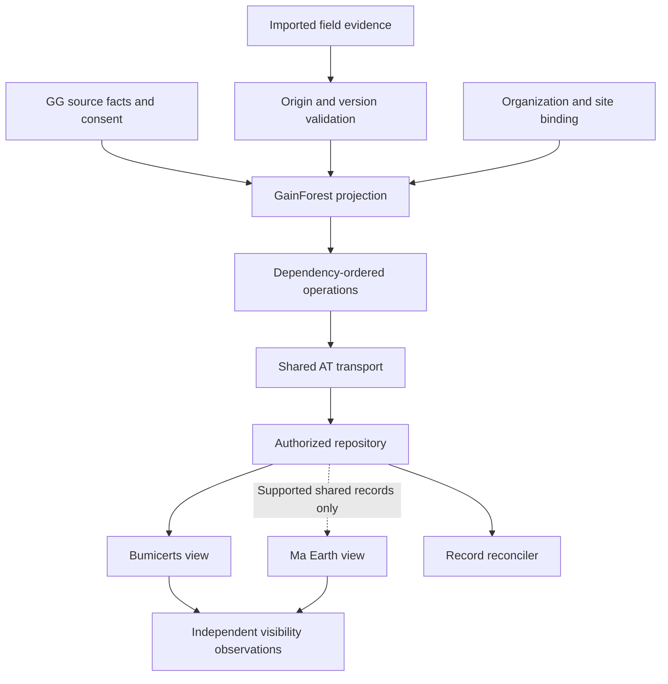

The project collection and organization info are different identities. `dwc.event.projectRef`
points to organization info in the inspected schema; `organization.defaultSite` is a singleton,
not a record to overwrite for every Garden. Resolve the explicit bridge before writing. A shared
Hypercerts activity already published for Ma Earth is reused by identity when compatible; it is
not recreated simply because Bumicerts has not displayed it.

### Native ERD

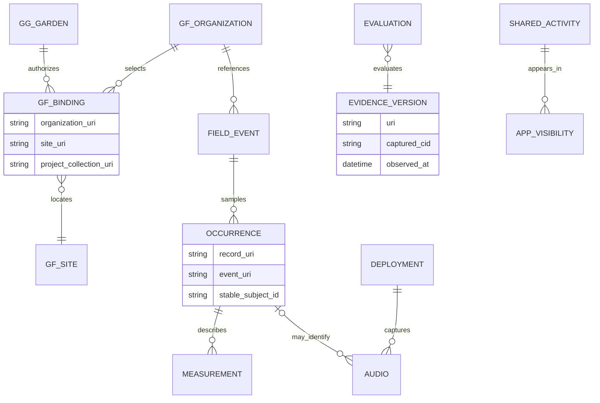

`stable_subject_id` is a proposed GG provenance mapping, not an invented GainForest lexicon field.
URI-only references are transmitted as URIs; capture resolved CID/time in our receipt store.
A typed GainForest measurement is not automatically a Hypercerts measurement. Reusing its value
requires a validated semantic transformation with source references, units and method preserved.

### Sequence and lifecycle

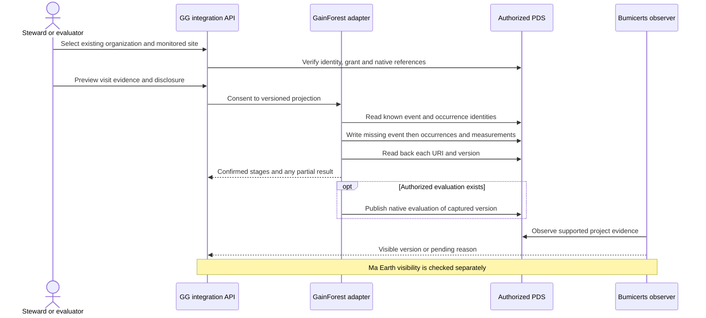

Field evidence progresses from captured → validated → consented → delivered; ecological review
and AppView visibility follow separate paths. The delivery state machine in the sync design applies
to each record. A failed third measurement leaves the event and first two measurements delivered.
A later visit adds observations for the same subjects, not another planting count. Changes to an
observation mark dependent comparisons/evaluations stale. GainForest's `supersedes`/`neg` evaluation
semantics must be proven in its AppView; they cannot be copied into a Hypercerts evaluation that
has no such fields. Do not overwrite an independent evaluator's record.

**Pilot:** one existing project/site, one baseline visit, one approved Work, one repeat visit and
one correction. Prove partial resume, exact versions, shared-record reuse, sensitive-location policy
and independent application visibility. Native bulk ingestion, model training and GBIF publication
remain separate capabilities. G1–G5 remain the activation gates.

## 3. Silvi

### Scope and binding

Bind Garden → existing Silvi project/site → registered asset(s), with the selected methodology
and claim type. Initial registration and later monitoring are different operations. Silvi's
[claim guide](https://docs.silvi.earth/silvi-app-user-guide/logging-claims) permits claims without
methodologies or payouts; paid project workflows have additional requirements. Do not force every
GG Work into a paid planting claim. Its [onboarding guide](https://docs.silvi.earth/silvi-app-user-guide/getting-started)
describes project setup and methods; external control and API access still require proof.

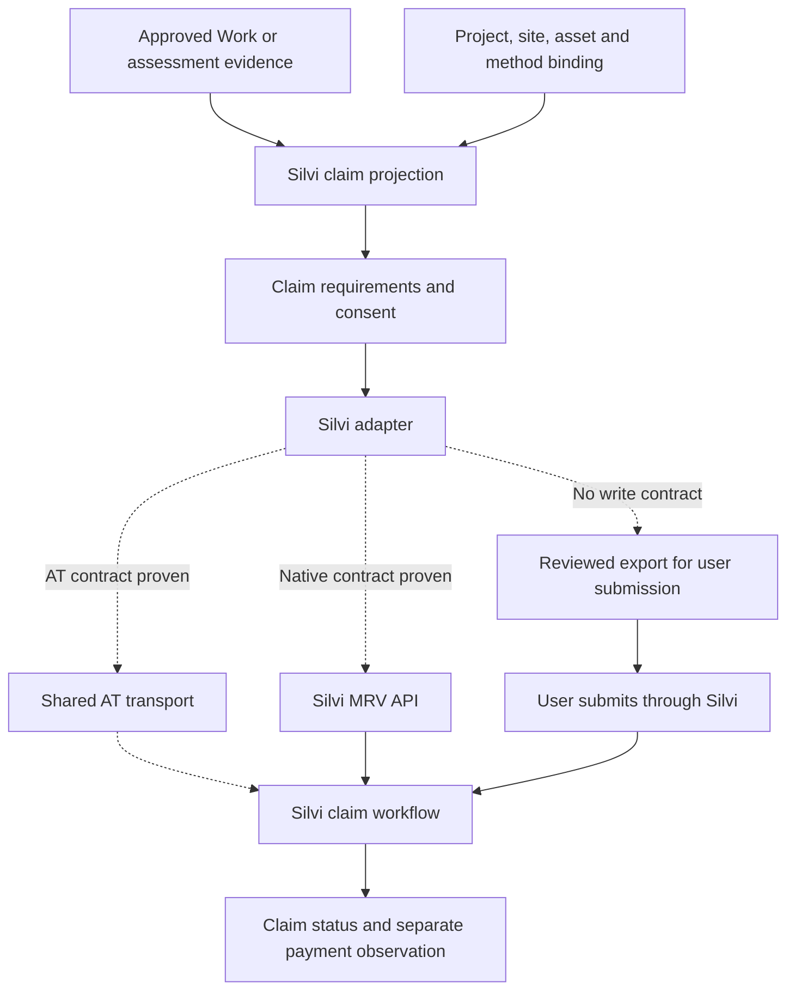

Account linking verifies the Silvi identity using its supported flow. A linked Celo/EVM payout
wallet is not proof of project management, asset authorship or a server publishing grant.
If AT-based, discover actual publisher DID, schemas and grants. Do not create a private
Green Goods lexicon and assume Silvi will ingest it. If only a native API is supported, keep the
same source/projection/receipt contract with provider IDs and version tokens.

### Native ERD

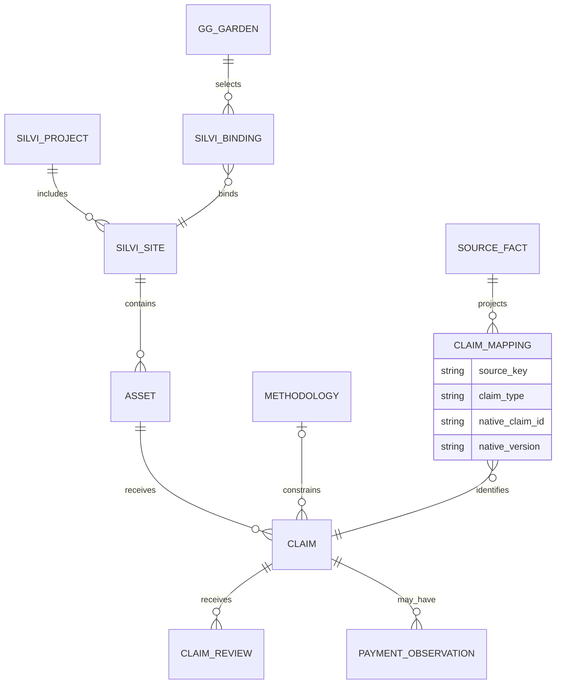

One Work may reference several assets; a revisit references the existing asset and a new claim
identity. The adapter's logical key includes source observation and claim role; retrying a claim
does not register another tree. Method versions, units, species/asset identifiers and media capture
time are required by the chosen method, not guessed from a photo or free-text title. A commitment
may be referenced as planned work where supported; it is not a claim of completed planting.

### Sequence and lifecycle

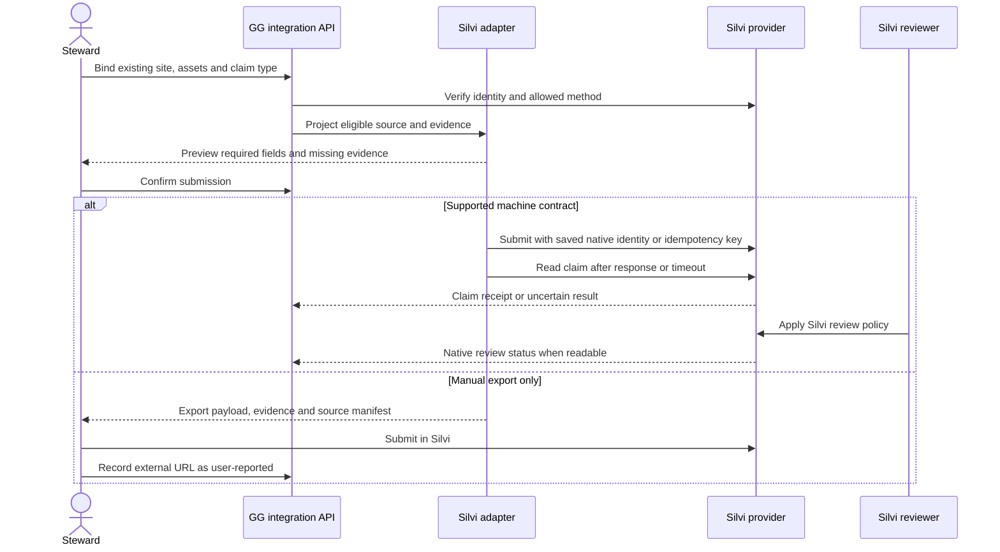

GG approval → claim eligibility → submitted claim → Silvi review are separate transitions.
Payment is an independently observed outcome, not the next automatic state of GG approval.
Provider labels above are conceptual; fetch the actual status vocabulary during conformance.
If a write times out without an idempotency contract or searchable source identity, retain
Uncertain and request a native receipt; do not resend automatically. A changed remote claim uses
three-way comparison. Unsupported updates produce an amendment/export for human review, not a
silent overwrite. Silvi's method may require in-person capture that old GG evidence cannot prove;
historical sync must expose that incompatibility rather than backdating a new claim.

**Pilot:** one existing site and registered tree, a historical Work match/adoption, one repeat
monitoring claim, a dropped response and a corrected observation. Distinguish method acceptance
from GG approval and any payment. Gates:

| Gate | Evidence required |
|---|---|
| SI1 | Current MRV integration contract; AT NSIDs/deployment/grants if applicable, otherwise native auth and API |
| SI2 | Project/site/asset identity, methods, registration vs repeat claims, capture requirements and attribution |
| SI3 | Safe create/readback/update or amendment, native review statuses, duplicate matching and payout observation |

## 4. Bloom Network

### Scope and binding

Bind a Garden to an explicitly selected community/Local Bloom or project relationship accepted
by Bloom. Garden membership alone does not enroll someone into a Local Bloom. Prepare a report
of performed work, evidence and clearly attributed GG review, preserving Bloom's own peer-review
and funding decisions. Bloom's [published workflow](https://bloomnetwork.earth/vision) describes
action, documentation, peer verification and rewards. Its [official source pointer](https://github.com/BloomNetwork/blooming)
leads to GitLab; public API discovery did not establish a supported third-party reporting contract.
The initial adapter may therefore be a structured export plus a manually supplied receipt.

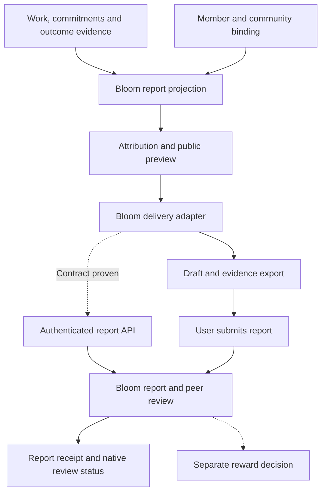

### Native ERD

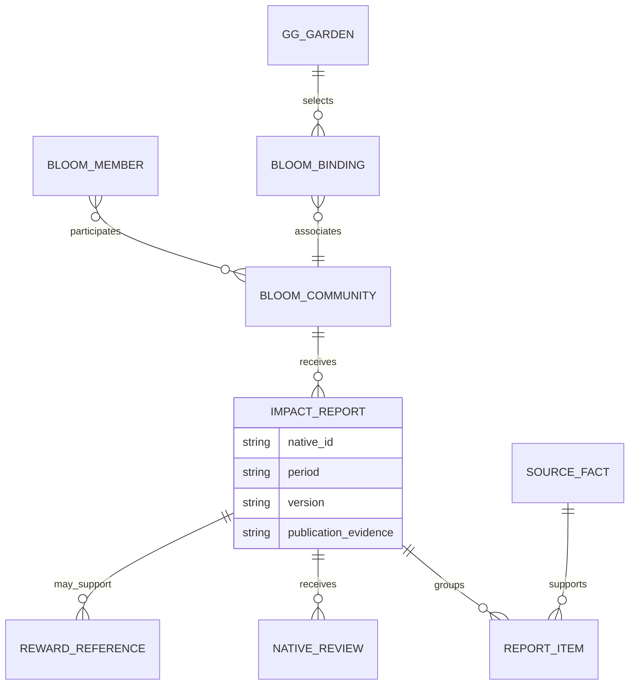

The IDs and cardinalities are proposed integration concepts to confirm with Bloom. A report can
aggregate multiple Work records; keep a manifest mapping each source once. A commitment is a
promise, and fulfillment references that same Work rather than generating another contribution.
Assessment targets remain targets; measured changes require method and period. A certificate is
a provenance link, not automatic eligibility for a second reward. Aggregation must not duplicate
reports across a Garden project and its parent community without an explicit reporting rule.

### Sequence and lifecycle

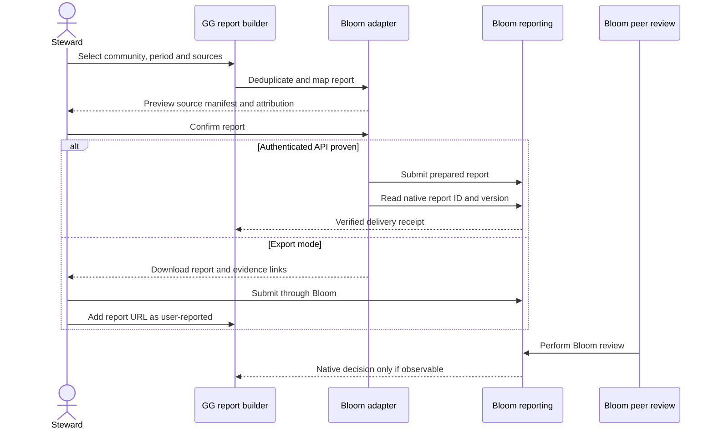

Report draft → exported/handed-off is not equivalent to submitted → peer-reviewed. Store
user-reported submission separately from API-verified submission. Never manufacture Bloom review
votes from GG approvals. For a supported API, adopt the shared three-way comparison with native
report version tokens. Without readback, Check sync reports “external status unverified” and offers
receipt matching. Corrections require Bloom's actual edit/amendment policy; a generated updated
PDF alone does not correct an already published report.

**Pilot:** one consenting member/community, a period report over approved Work, one linked
commitment and assessment, manual receipt verification, then a correction. Reward distribution is
outside this pilot. Gates:

| Gate | Evidence required |
|---|---|
| B1 | Member/community authority, accepted report taxonomy, attribution and period aggregation rules |
| B2 | Supported authenticated API or accepted export workflow; native ID/version, readback and edit/amendment rules |
| B3 | Independent Bloom review/reward semantics, duplicate contribution policy and imported-source provenance |

## 5. Regen Network

### Scope and binding

Begin with a versioned public evidence package and an optional **data anchor**. Keep an attestation
by a Regen signer and a registry/ecocredit workflow as separate, explicitly authorized operations.
An EVM address or Certified DID link does not authorize a Cosmos transaction. Link the intended
Regen account/network with the appropriate proof; the signer sees the operation, content hash and
fees. For a first pilot use an explicit signing interaction, not assumed server custody.

The [data module](https://docs.regen.network/modules/data/) separates anchoring, attestation and
resolver registration. Source contracts inspected at
[`regen-ledger@493da6de`](https://github.com/regen-network/regen-ledger/tree/493da6dee1be6dc66bd7b8885872cce1bc171544)
include [v1 messages](https://github.com/regen-network/regen-ledger/blob/493da6dee1be6dc66bd7b8885872cce1bc171544/proto/regen/data/v1/tx.proto)
and [queries](https://github.com/regen-network/regen-ledger/blob/493da6dee1be6dc66bd7b8885872cce1bc171544/proto/regen/data/v1/query.proto).
These establish candidate contracts, not the selected network's deployed version.

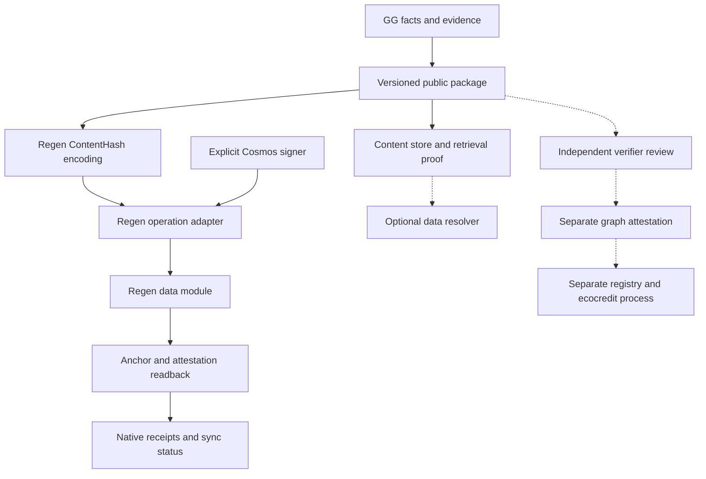

### Native ERD

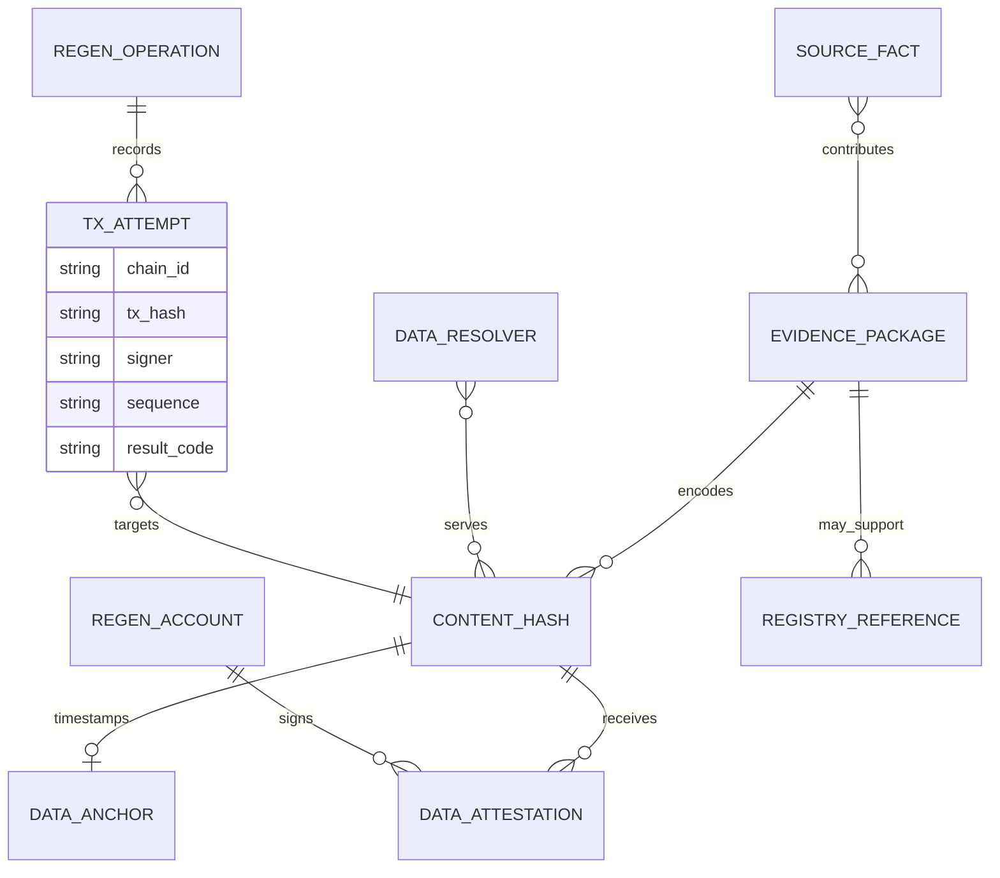

A `ContentHash` includes the native encoding information, not just an arbitrary IPFS string.
The inspected v1 `MsgAnchor` accepts raw or graph content hashes; `MsgAttest` accepts graph hashes.
A JSON/PDF byte anchor therefore does not automatically qualify for semantic attestation. Define
and test canonical RDF/JSON-LD context and normalization before a graph path; no ad hoc conversion
of GG assessments into a universal impact assertion. The same signer/hash is not a new
attestation on replay in this source contract, and `Attest` can implicitly anchor. Prove actual
network behavior and preserve the operation selected by the user.

### Sequence and lifecycle

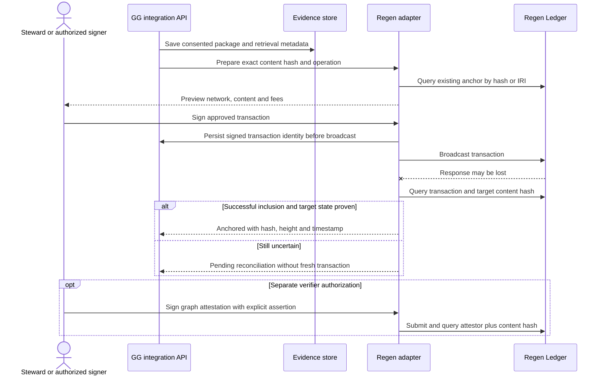

Evidence prepared → available → anchor confirmed is one lifecycle. Verifier attestation and
registry acceptance are distinct lifecycles; no state is called “impact verified” on the strength
of an anchor. Store signed transaction bytes/hash, chain, signer, sequence, message digest and fee
before broadcast. Serialize sequence use per signer. On a lost response, query transaction result
and target state; a broadcast acknowledgement is not successful inclusion. If absent, establish
mempool/timeout/sequence conditions before rebroadcasting the same bytes or asking for a newly
signed transaction. Never create fresh paid transactions merely because a UI timed out.

If the hash was already anchored by someone else, report that observed fact without attributing
it to this attempt. Attestation reconciliation additionally checks the intended attestor and
assertion. Resolver availability needs a separate retrieval test. A correction creates a new
content version/hash with explicit links to the older evidence; anchoring does not mutate or erase
the old timestamp. Do not represent a correction as revocation of an immutable record.

**Pilot:** one sanitized approved-Work evidence package, explicit test-network anchor, interrupted
broadcast/readback and corrected package. Graph attestation follows only after a method and signer
agree on the assertion. No credit-class/project/batch creation or issuance is part of this pilot.
Gates:

| Gate | Evidence required |
|---|---|
| R1 | Selected network/module version, account proof, signer custody, fees, sequence and transaction recovery |
| R2 | Canonical package/hash/IRI, content availability, raw vs graph mapping and resolver ownership |
| R3 | Attestor assertion/method, registry fit and independent issuance authority for any later phase |

## 6. Provider acceptance is separate from delivery

| Provider | Delivered evidence | Business decision | Visibility or downstream result |
|---|---|---|---|
| Certified/Ma Earth | Correct URI/CID and project membership | Attributable GG review, interpreted under accepted Ma Earth rules | Ma Earth indexed version |
| GainForest | Correct field/evaluation record versions | Method/ecological review by the named authority | Bumicerts and other AppViews independently |
| Silvi | Native claim ID/version or verified manual receipt | Silvi claim acceptance under its method | Claim history and separately observed payout |
| Bloom | Native report ID/version or verified manual receipt | Bloom peer review and contribution rules | Published report and separately observed reward |
| Regen | Successful transaction/target-state evidence | Named attestor's assertion or registry decision | Data availability, registry status or distinct issuance |

All providers inherit historical preview, current consent, source revalidation, stable identity,
partial resume, conflict handling, deletion policy and readback uncertainty from the sync design.
Each conformance suite must prove its own native operations. Local fakes cover deterministic
failure cases; they cannot establish deployed compatibility or a provider's acceptance policy.
A provider outage pauses only that destination; other destinations and GG source actions continue.
