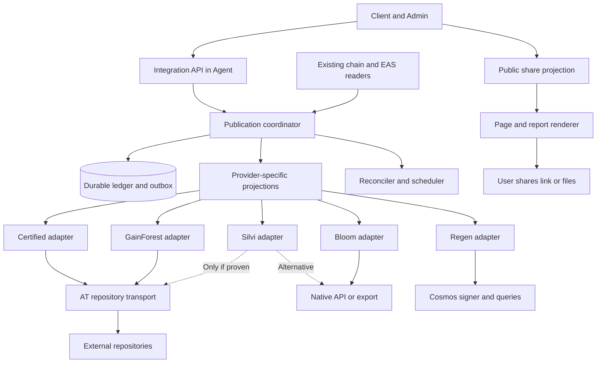
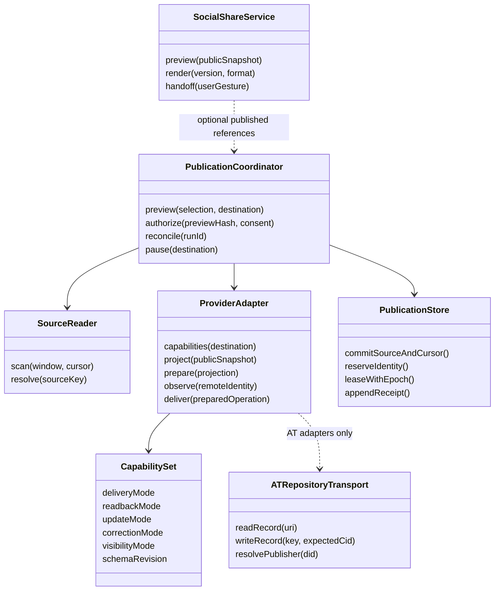
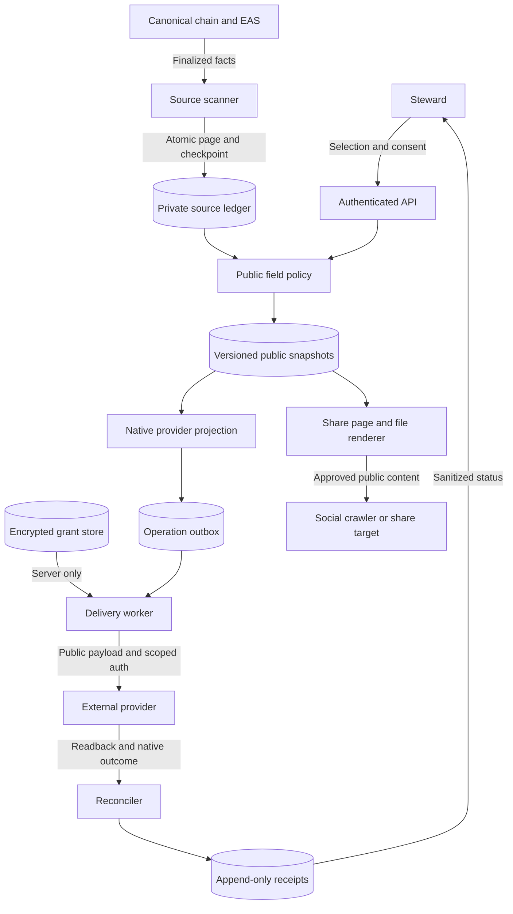
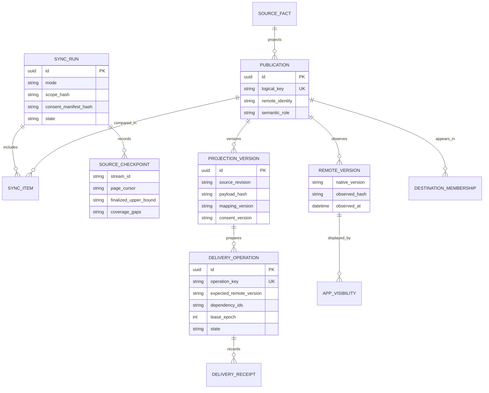
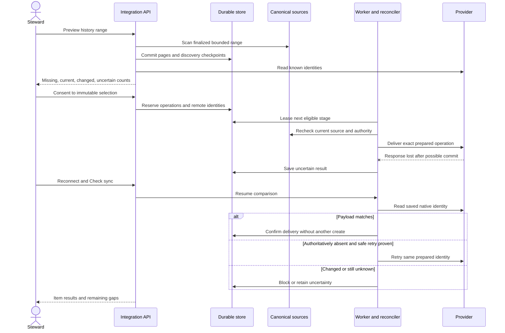
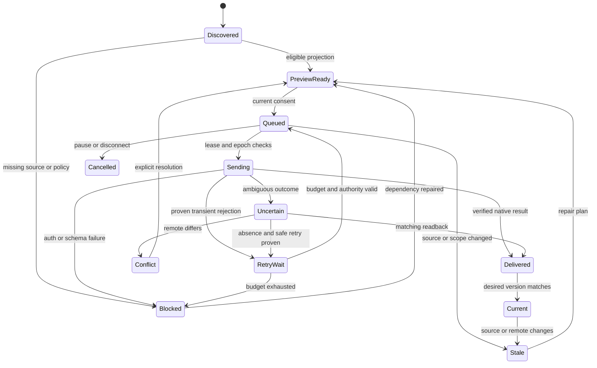
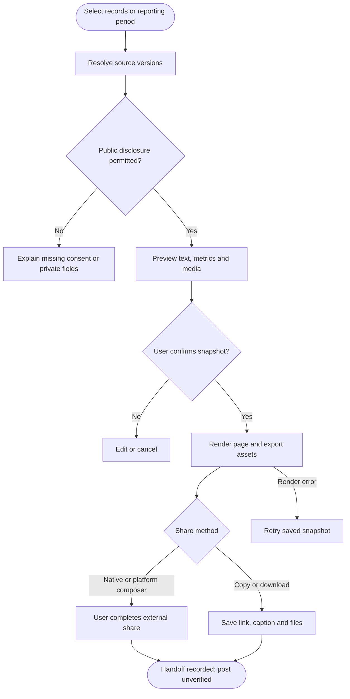

# Reliable sync and reusable impact publishing

**Proposed architecture, 2026-10-16.** Every integration needs an explicit answer to three
questions: what may be shared, what the destination considers that information to mean, and
how we prove which version arrived. This design extends the
[Certified first slice](./certified-atproto-integration-spec-2026-07.md) with historical sync,
ongoing reconciliation, replaceable provider modules and a simpler social-sharing route.
The [provider architectures](./impact-provider-architectures.md) instantiate these boundaries
for GainForest, Silvi, Bloom and Regen. All components below are proposed unless marked existing.

## 1. Module boundaries and ownership

Keep the existing Agent deployment and durable database. Add one cohesive impact-publication
module there; do not create a service for every provider or introduce a general event bus.
Shared owns public contracts, pure public-data projections and consuming hooks. Agent owns
credentials, source scanning, persistence, delivery and reconciliation. Client/Admin own the
user journey through declared Shared exports. Domain modules continue to own approval,
assessment and commitment meaning; integrations consume those decisions.

**Concrete reuse:** the existing Agent database/outbox and Garden-join proof verifier provide
persistence and verification patterns; they do not own report semantics. The existing
`packages/shared/src/utils/app/clipboard.ts#shareLink` and Client `shareGarden` already support
native link sharing with a copy fallback. They do not produce public per-record metadata,
report images or distinguish cancelled, copied and handed-off outcomes. Extend these capabilities
at their owners; do not build social sharing on top of the Work upload queue. The browser queue
continues to own unconfirmed/offline Work uploads, while Agent owns confirmed-source publication.

Two designs were considered: one universal provider object with many optional methods, or a small
publication coordinator composed with explicit capabilities. Recommend the latter. AT repositories,
HTTP claim APIs, Cosmos transactions and manual shares cannot honestly promise identical writes
or readback. The coordinator centralizes consent, identity, durable intent and evidence; provider
modules own mapping, corrections and remote outcomes. Removing it would spread recovery rules
across UI and adapters, so it earns its boundary. Removing an adapter must leave GG approval
behavior and other integrations intact.

### Capability contract and class/interface diagram

The diagram describes responsibilities, not a required object-oriented implementation. Start
with the Certified implementation and a meaningful fault-injection adapter. Extract the AT
transport when GainForest conformance proves shared behavior; no dependency installation or
registry implementation is authorized by this design.

These are conceptual method names. `prepare` must persist the exact record identity, payload,
dependencies, preconditions and idempotency material before side effects. `deliver` returns one
of confirmed, uncertain, retryable, blocked, conflict or unsupported with a safe reason code.
`observe` can return present/version, authoritatively absent, inaccessible, indeterminate or
unsupported. Unsupported readback cannot be interpreted as absent. Native receipts retain their
type: AT URI/CID, provider ID/version, or chain/transaction/content hash. A transport error must
not erase a provider's business decision.

Capabilities are versioned, conformance-backed facts per destination: e.g. conditional replacement,
append-only correction, manual export, caller-supplied identity, reliable readback, and AppView
observation. Unknown capabilities stay disabled. Settings/preview/status consume these capabilities
rather than accumulating provider switches in every screen. Tokens never enter Shared contracts.
A checked-in composition table is sufficient; dynamic plugins and a universal impact schema are
out of scope. Adding a provider should require an adapter/projection, fixtures, capability metadata
and composition wiring, not changes to Work or its approval mutation.

## 2. Data flow and trust boundaries

The public projection is an allowlist, including its linked media/documents; a public URL to a
private source bundle still leaks that bundle. Keep private source data, proof challenges, grants,
precise sensitive locations and internal errors outside report payloads and crawler metadata.
Imported observations retain external origin and version. They can support a later explicit GG
action, but an import never manufactures a new Work/Approval or loops an export back into itself.

## 3. Historical sync and reconciliation are product workflows

Offer **Sync history**, **Check sync**, **Retry eligible items**, **Resolve conflicts**, and
**Pause** within existing integration controls. Show destination, source range, last successful
check, freshness and counts by outcome. Counts cover the requested scope only, never all Garden
history when discovery was incomplete. A run with blocked/unknown items finishes with issues;
“all synced” requires every selected obligation to be verified or explicitly excluded.

| Mode | Trigger | Behavior |
|---|---|---|
| Historical backfill | Steward selects Garden, provider, actions and date/block range | Read-only discovery and preview first; deduplicate already mapped records, apply current eligibility, then consent to the exact public selection |
| Incremental capture | Finalized source changes after activation | Scan with overlap and durable checkpoints; update desired versions and queue only policy-covered intents |
| Recovery | Reconnect, worker restart, lease timeout or unknown write result | Revalidate identity/authority, inspect saved remote identities and receipts, repair only proven missing/stale operations |
| Scheduled audit | Bounded periodic sweep | Recheck existing mappings for remote edits/deletions and stale source decisions, including records older than the scan cursor |
| Manual comparison | Steward selects Check sync | Refresh state without writes; show a repair preview and native provider links |

A lost browser connection does not undo a confirmed source or a persisted publication intent.
If a disconnected browser's request outcome is unknown, query by the saved command ID after
reconnecting. Its offline Work upload is still handled by the existing JobQueue; historical sync
never resubmits old Work attestations. Reconnecting to the **same verified provider identity**
rotates grant epochs while retaining mappings. A different identity/repository requires an explicit
new binding and copy/migration decision; never replay the prior queue into it automatically.

### History algorithm and snapshot boundary

1. Capture a finalized upper source watermark and explicit lower bound for each chain/source
   stream. Translate date filters to conservative block ranges and filter canonical event dates.
   Save Garden/schema/action filters, source reader revision and policy/mapping versions in the run.
2. Scan bounded pages. Atomically store discovered identities, deduplicated source observations
   and the page checkpoint. Incomplete RPC/index results and missing metadata remain visible gaps;
   a checkpoint is discovery progress, not proof of successful remote delivery.
3. Resolve current effective source state, including later rejection, expiration and correction
   history. Historical approval does not authorize publishing a now-rejected Work as approved.
   Current authorization and current public-disclosure consent apply to old records too.
4. Compare desired projections against persisted operations and fresh remote readback. Existing
   records created outside GG require an explicit adoption preview: exact source provenance,
   author/repository and payload/version match, or manual review. A title/date resemblance is
   insufficient. No match lookup means unknown, not permission to create another report.
5. Present counts and item diffs; persist consent over the selected source revisions, payload hashes,
   destination and policy. For a large run, consent may cover the exact immutable manifest, with
   pagination and exclusions; no need to approve identical fields one row at a time.
6. Deliver dependency stages in bounded chunks with persisted identities, leases, rate limits and
   backoff/jitter. Recheck source, binding and grant epochs before every side effect. Changes after
   preview make affected items stale. Resume from checkpoints; cancellation stops unsent work and
   reconciles in-flight outcomes without claiming public deletion.
7. Incremental capture continues after the captured watermark using the same unique keys. Completion
   of a historical run does not mean there are no later events. Retain range coverage, unresolved
   gaps and the remote-check timestamp in the completion receipt.

Unique source keys include chain and source namespace: EAS address/schema/UID; contract/address/
transaction/log index for events; and entity ID plus observed state revision for entity projections.
A logical publication is `(source identity, semantic role, publisher repository/account, native
collection or operation)`; bindings associate it with project destinations. Binding changes and
mapping-version changes do not generate a new logical record accidentally. One AT activity can
serve multiple AppViews; project membership is a separate operation. Distinct providers receive
distinct projections when their meanings differ. Preserve source observation time, publication time
and remote check time separately; backfill must not present old work as newly performed work.

### Extended ERD

This extends the Certified ERD; it does not replace account links/grants or duplicate their secrets.
`PROJECTION_VERSION` and `REMOTE_VERSION` keep immutable history, while `PUBLICATION` identifies
one logical record. One source can produce an activity, measurements and multiple evaluations.

Use database unique constraints for logical/operation keys; process locks alone do not establish
idempotency. Serialize mutations to a logical record and shared project membership with a lease
and fencing epoch. External conditional writes remain required where available; a lease cannot
stop another app editing the same remote record. Distinct source, publication and destination IDs
remain separate even when a first provider makes a one-to-one mapping convenient.

### Comparison rules

Use a three-way comparison: **B** = last acknowledged remote version/payload we wrote or adopted;
**L** = current consented desired projection; **R** = fresh authoritative remote observation.
Compare provider-normalized owned fields and hashes without erasing unowned fields. For native
server-generated fields, the adapter defines the canonical comparison and version token.

| Observation | Classified outcome | Allowed next action |
|---|---|---|
| R equals L | Current | Save observation/receipt; no write, even if last response was lost |
| L changed, R still equals B | Local update pending | Preview if needed; conditional update or provider-native correction |
| R changed, L still equals B | Remote edit | Conflict/review; adopt only after provenance and consent checks |
| L and R both changed differently | Conflict | Show both versions; no last-write-wins overwrite |
| Authoritatively absent, no prior send/receipt | Missing | Create using the previously reserved identity, if current consent permits |
| Absent after a known prior publication | Remote deletion | Ask for an explicit restore/correction decision; never resurrect automatically |
| Timeout, unavailable read or unproven consistency | Uncertain | Recheck within budget; no blind resend or false “missing” |
| Source is invalid or no longer eligible | Source correction needed | Cancel stale unsent operations; plan native correction for published records |
| Native record present, AppView missing | Indexing pending | Recheck the application only; do not recreate the record |

“Uploaded” is not one boolean. Show preparation, remote delivery, current-version match,
provider review/acceptance, and application visibility independently. A terminal upload error
must preserve completed stages so a retry sends only the missing work. Reconciliation may
confirm a result without proving that our last attempt caused it; retain provenance honestly.

### Sequence: backfill, timeout and repair

### Delivery state machine

App visibility and provider acceptance have their own states; neither is a prerequisite for a
record to be Delivered. Pause prevents new leases, lets sent operations settle, and runs read-only
reconciliation. Cancellation may be requested during Sending, but its final result remains
Delivered or Uncertain until evidence establishes the outcome. After logout/disconnect, use
public readback only where available; required private reads wait for reauthorization. Retry
exhaustion blocks an item without throwing away its identity, payload or history.

## 4. Social sharing and social-friendly impact reports

This is a separate, lighter delivery mode. Begin with an explicit share gesture, public URL,
copy text/link and downloadable images/report. No social-account linking is required for this
slice. Account-linked automatic posting, analytics and post editing would require separate OAuth,
platform permissions and the durable adapter contract above.

| Share target | Initial experience | Evidence and limitation |
|---|---|---|
| X / Twitter | Open composer with approved text and public URL; offer downloadable card | [X Web Intents](https://docs.x.com/x-for-websites/web-intents/overview) support user-driven composition without app authorization; opening the composer does not prove a post exists |
| LinkedIn | Share public URL through its supported share mechanism; copy caption and download image/PDF | [LinkedIn Share Plugin](https://learn.microsoft.com/en-us/linkedin/consumer/integrations/self-serve/plugins/share-plugin) documents URL sharing; do not promise arbitrary prefilled captions or automatic file upload |
| Facebook | Native share sheet or copy URL/caption and download card; add dedicated share dialog after conformance | Official [web sharing reference](https://developers.facebook.com/docs/sharing/web/) returned HTTP 429 during research; dialog configuration/permissions remain H2, not a verified capability |
| System share / manual upload | Feature-detect URL/file sharing, then copy/download fallback | [Web Share](https://www.w3.org/TR/web-share/) needs a user gesture and platform support; installed targets vary and handoff is not a durable post receipt |

Give Work, commitment, assessment and certificate details the same **Share** entry point. The
snapshot preserves their differences: “submitted” versus “approved”, “committed” versus “fulfilled”,
“target” versus “observed”, and “certificate minted” versus “existing certificate registered”.
Include author/reviewer attribution only with consent. Certificates retain chain/minter/type ID
and public evidence links; no implication of carbon-credit issuance. Public share eligibility is
separately controlled: sharing a clearly labeled unreviewed Work is a product decision, not a
side effect of enabling approved-Work cross-posting.

The report builder selects Garden, period and source types, previews the exact public result,
and exports a canonical HTML report plus proposed 1200×630 landscape, 1080×1080 square and
1080×1350 portrait PNG cards, a short accessible PDF and a plain-text caption/alt-text file.
These sizes are our initial templates, not guaranteed platform requirements. Reuse approved
photos after stripping unnecessary metadata; retain asset licenses and exclude sensitive GPS.
No image-generation service is needed to produce deterministic branded cards.

A period report counts unique Work once even if it appears in several commitments or providers.
Count trees planted separately from revisits, survival observations and outstanding promises.
Do not sum different units or duplicate a Work because both its approval and fulfillment are in
the period. Show source coverage, report generation time, observation period, methodology,
uncertainty and unresolved evidence. Missing readings are unknown, not zero. Any percentage or
delta needs an explicit comparable denominator/baseline. Social copy must not promote a target,
community review or timestamped anchor into a verified ecological outcome.

### Activity diagram: preview to share

Public pages require crawlable server/static HTML, canonical HTTPS URLs, per-snapshot Open Graph
and X metadata, accessible text and stable public images. Existing client-only or fragment routes
are insufficient for per-record crawler previews. Add a bounded rendering route at an existing
server/build owner after deployment review; do not assume a Vite SPA renders metadata for bots.
Render from the same public snapshot as the preview, with escaping, safe remote asset retrieval,
size/time limits and no arbitrary HTML from evidence. Credentials/private routes never enter URLs.

`SHARE_SNAPSHOT` records selected source revisions, public-field policy, content hash and consent;
`EXPORT_ASSET` records format/template/version/checksum; `SHARE_ATTEMPT` records target plus
copied/downloaded/cancelled/handed-off/failed. The current `shareLink` returns `void`, including
on cancellation, so implementation must expose honest outcomes before displaying success text.
Neither a popup close nor a resolved Web Share promise marks a provider post Published.
A voluntarily supplied post URL may be stored as user-reported, separately from API-verified posts.

Source corrections mark cached reports stale and update the public landing page with a correction
notice; regenerated reports receive a new version. Versioned assets retain their as-of label and
provenance. Revocation stops serving controlled assets according to retention policy, but cannot
promise to erase third-party caches, downloaded files or already shared posts. Social distribution
must not become a loophole around the same consent and evidence rules used by partner adapters.

## 5. Gates and rollout

| Gate | Evidence needed | Blocks |
|---|---|---|
| S1 | Source bounds/finality, complete discovery, checkpoint atomicity, current source policy and history consent | Historical sends |
| S2 | Native identity, comparison normalization, authoritative readback, remote deletion/correction policy, retry limits and restore test | Automatic reconciliation writes |
| M1 | Two real adapter contracts, capability fixtures and isolated failure behavior | Extracted shared transport and future provider activation |
| H1 | Public field/media rights, public route/metadata, report counts, asset renderer and correction/retention policy | Public sharing and report generation |
| H2 | Actual X/LinkedIn/Facebook/native composer behavior, file fallback and honest status | Each dedicated social affordance |

Keep Certified linking first. Deliver history preview and safe recovery as part of its first
publishing slice, before standing automation. A small social-sharing release may proceed once
H1/H2 and its selected source types pass, independently of provider grant negotiations. Provider
pilots then exercise the common seams with their own contracts; this is designed extensibility,
not a promise that every provider is already interoperable. The owning plan's
[extension checkpoints](https://github.com/greenpill-dev-guild/green-goods/blob/research/certified-atproto-exploration/.plans/backlog/certified-approval-publishing/extensions.todo.md)
are a repository execution artifact, not runtime configuration.
