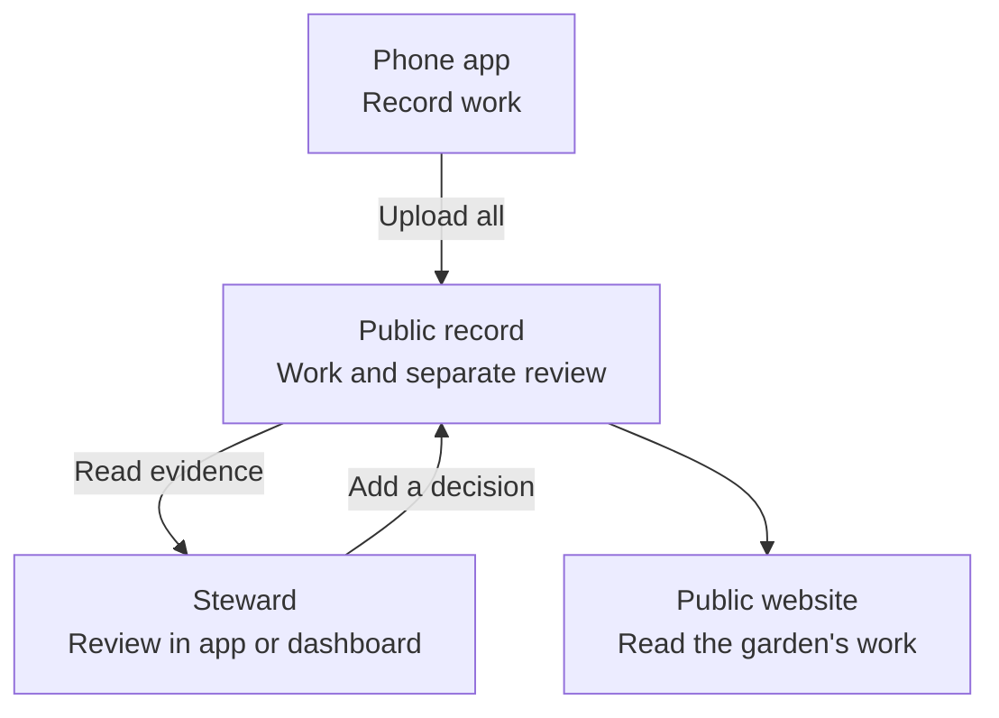

import {NextBestAction} from "@site/src/components/docs";

# How It Works

Good work often leaves no trace. Someone plants forty trees or clears a riverbank, and a month later there is nothing to show a funder except a memory. Green Goods fixes that one problem: it turns work into a record that the community itself has checked.

<figure className="gg-figure gg-overview-photo">
  
</figure>

## One piece of work, start to finish

An example, with made-up names.

1. **Record the work.** Ama plants twelve mango seedlings on a hillside with no signal. She chooses the tree-planting action, takes two photos, enters “12”, and taps **Upload Work**. The app says **Saved offline**.
2. **Send it.** Back in town, she opens **Your Work** and taps **Upload all**. The item changes to **In review**.
3. **Review the evidence.** Kofi, a steward, checks the photos and count. He knows the place from a recent visit. He chooses **Medium** confidence and taps **Approve**.
4. **See the result.** Ama sees **Approved** in **Your Work**. The public record shows her work and the steward's decision to anyone considering supporting the garden.

<figure className="gg-figure" style={{maxWidth: '560px'}}>
  
  <figcaption>Choose a confidence level to enable <strong className="gg-inline-label">Approve</strong>.</figcaption>
</figure>

## Where the tools meet

The app and dashboard work with the same public record. The website lets other people read it. A review adds a separate decision; it does not send a payment.

The arrows show records and decisions. A supporter chooses whether to fund a garden separately. The [Funder Guide](/community/funder-guide/) explains those choices; the [builder architecture](/builders/architecture) has the technical map.

## The loop, step by step

### 1. Plan

A **garden** is a community doing regenerative work together. Before the work starts, someone who knows the subject writes an **assessment**: where the garden is starting from, what it wants to change, and how it will measure that. It is the "before" picture.

The garden also has **actions**: the kinds of work it tracks, such as planting a tree, sorting a load of waste, or checking a solar panel. Each action says what photo to take and which details to give.

### 2. Document

A **gardener** does the work and records it in the app: choose the action, take photos, fill in a few details, send. That record is called **work**.

It takes a few minutes and works without a signal. The work is saved on the phone first and sent when the gardener is back in range.

### 3. Review

A **steward** from the same garden looks at the photos and details and decides. They **approve** the work, or **reject** it with a note on what to fix. Their decision is saved next to the work as its own record, with their reason and how confident they are.

### 4. Certify

When a garden has a body of approved work that tells one story, a steward can bundle it into an **impact certificate**: one claim that says "this garden did this, in this period." This step is still being switched on. Read [Mint Impact Certificate](/community/steward-guide/creating-impact-certificates) for the current limits.

### 5. Fund

Anyone can read a garden's approved work on its public page. A supporter who likes what they see can **donate** to the garden's shared fund, or **endow** it with a deposit whose earnings go to the garden. The garden uses that support to do more work, and the loop starts again.

## What an approval is, and is not {#impact-reporting-verification}

Approval is the idea everything else rests on, so it is worth being exact about it.

**What it is**

1. **A person's judgment.** A steward from the garden looked at the evidence and decided the work happened as described.
2. **A signed record.** The decision is saved with the steward's account, their reason, and their confidence level.
3. **Separate from the work.** The gardener's record and the steward's decision are two records. Neither can rewrite the other.
4. **Public and permanent.** Anyone can read both, and neither can be edited or deleted afterwards.

**What it is not**

- **Not a payment.** Nothing is paid when work is approved.
- **Not an outside audit.** The reviewer belongs to the same community. That closeness is the strength of the review, and also its limit.
- **Not a measurement of results.** It says the work was done. It does not say how much carbon a tree will store.

## What a good record contains

Each action asks for four kinds of information, in plain form:

| The question | An example |
|---|---|
| What did you do? | Planted trees in the east plot |
| What did it produce? | 12 mango seedlings, photographed |
| What changed? | More of the plot is covered |
| Why does it matter? | Shade, fruit, and soil that holds |

The first two come from the gardener, with every piece of work. The last two are what the garden's assessment and its certificates are for.

## Where the money fits

A garden can hold money in two ways.

- **A shared fund.** Donations land here. Gardeners in the garden can claim from it, up to limits the garden sets, and each claim records what it is for.
- **An endowment.** A supporter's deposit stays theirs and can be withdrawn. Its earnings go to the garden when a steward collects them.

Three things are worth saying plainly:

- **Approval and payment are separate.** How a garden rewards its people is the garden's decision.
- **An endowment is not guaranteed.** A supporter can get back less than they put in.
- **Green Goods does not promise a charitable receipt or tax deduction.** Check any separate arrangement with the garden.

The [Funder Guide](/community/funder-guide/) has the details.

## Where Commitment Pooling fits {#commitment-pooling}

A shared fund supports a garden as a whole. **Commitment Pooling** helps the community organize specific promises: an offer to do work or provide support, or a request for it. A pool holds the shared rules for those promises, including who can confirm that one was kept.

For example, a garden could agree on a promise to plant and care for seedlings. Work records can provide evidence toward it. Reviewing those records and confirming the promise are related decisions, but they are separate: linking work does not by itself mean the promise is fulfilled.

If the promise includes financial support, payment follows its agreed conditions and a separate payment process. **Work approval alone does not release money.** A donation to the shared fund and an endowment also remain separate ways to support a garden.

:::info Availability
Commitment Pooling is part of Green Goods 2.0. A garden can use it once its steward has set up the pool; what you can do depends on your role and the selected action. A promise can carry a G$ reward, which a steward sends from the garden's Safe on Celo after the promise is kept. Follow the [gardener guide](/community/gardener-guide/make-a-promise) or the [steward guide](/community/steward-guide/open-a-pool).
:::

## Built for the field

- **No app store.** You install Green Goods from the website onto your phone's home screen.
- **No password.** You sign in with your fingerprint, face, or screen lock. Your phone keeps a passkey for you.
- **No signal needed to record.** Work is saved on your phone. Nothing is added to your garden's record until you send it with **Upload all**.
- **Your language.** The app is available in English, Spanish, and Portuguese. These docs are in English only for now.

## Who does what

| Role | In one line | Guide |
|---|---|---|
| **Gardener** | Does the work and documents it | [Gardener Guide](/community/gardener-guide/) |
| **Steward** | Runs the garden and reviews its work | [Steward Guide](/community/steward-guide/) |
| **Evaluator** | Helps the garden set its starting point and goals | [Evaluator Guide](/community/evaluator-guide/) |
| **Funder** | Supports a garden with a donation or an endowment | [Funder Guide](/community/funder-guide/) |
| **Community member** | Lives alongside the work, and can read a garden's public record | [Gardens on the public website](https://greengoods.app/gardens) |

<NextBestAction
  title="Next: Why We Build"
  why="You have seen how the loop works. Here is why it exists and who it is for."
  actionLabel="Why We Build"
  actionHref="/community/why-we-build"
  alternatives={[
    { label: "Gardener Guide", href: "/community/gardener-guide/" },
    { label: "Steward Guide", href: "/community/steward-guide/" }
  ]}
/>
