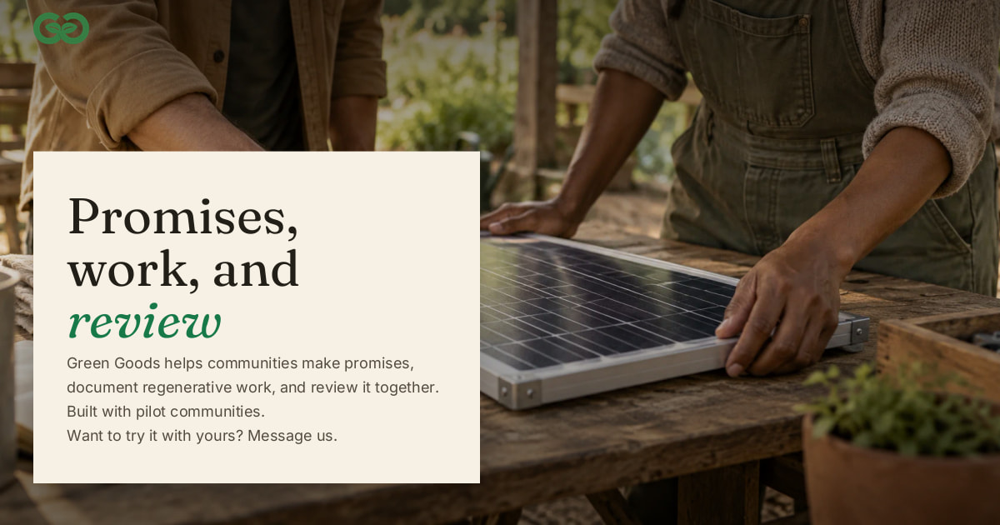
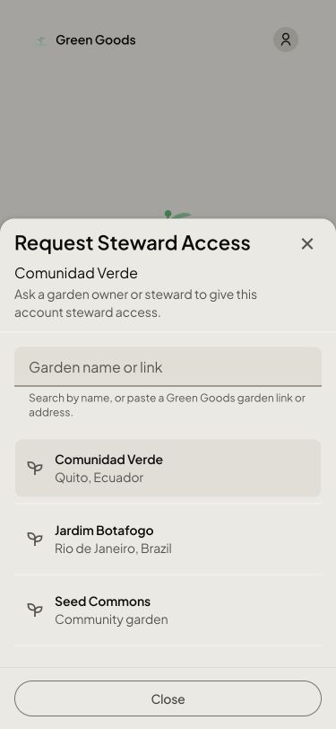
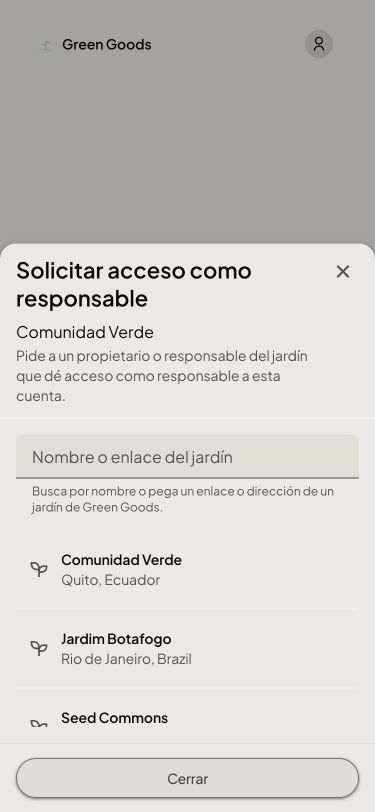
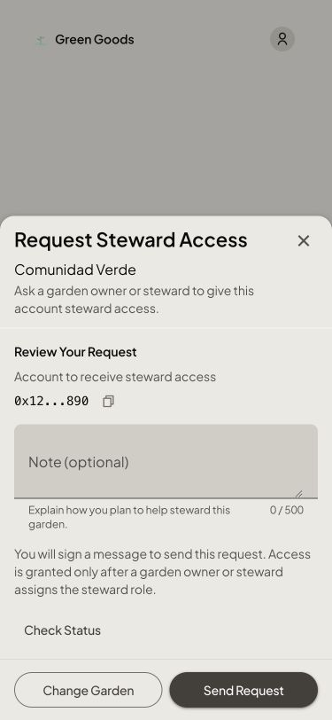
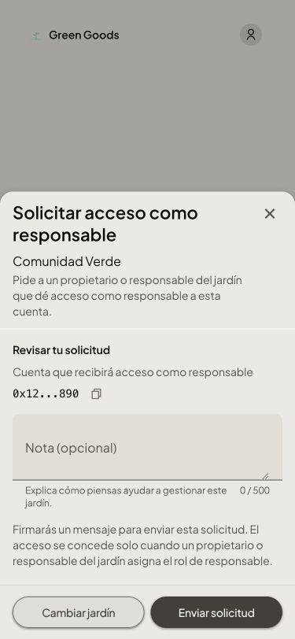
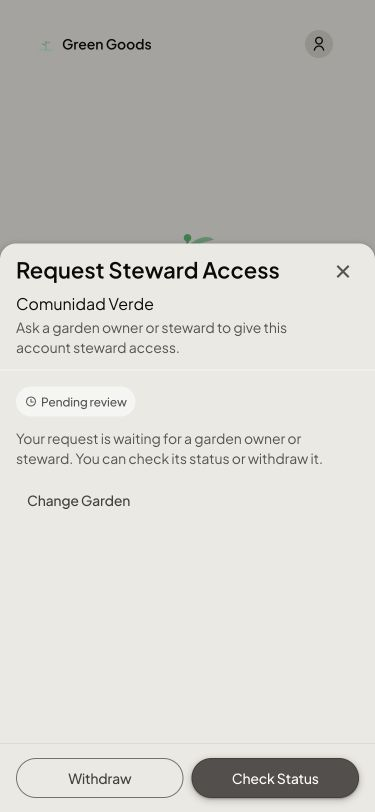
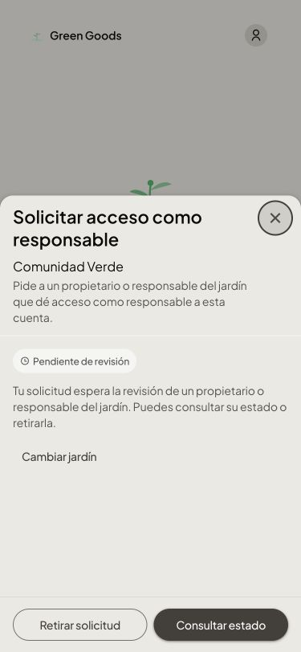

# 2.0.0 release media

## Pilot release card

A 1200 by 630 image for posts to prospective pilot communities: the separate announcement card that
[social-preview-readiness.md](../social-preview-readiness.md) recommends. It names no version and
makes no payment, payout, or reward claim, so later pilot outreach can use it too. It is marketing
artwork, not evidence of authenticated 2.0 behavior. It was drawn with the website's share-card
renderer and fonts (`renderSocialCardTextPaths` in `packages/client/vite/social-preview.ts`) over
`docs/static/img/community/editorial-solar-workshop.webp`.

## Steward access design references

Engine/session: **Brave · Storybook**, October 8, 2026. Synthetic fixture data.
These images show the implemented tall mobile sheet; they do not prove authenticated beta behavior.

| State | English | Español |
|---|---|---|
| Choose a Garden |  |  |
| Review |  |  |
| Pending |  |  |

All three states retain the same sheet height. Review content scrolls when needed; footer actions remain visible. Buttons stay on one line in the prepared English and Spanish examples.
